# Arcade games on the Atari STE

Classic arcade games running on a standard Atari STE: 8 MHz, 4 MB of memory, no accelerator card. Each port runs
the arcade machine's own program, converted ahead of time into code the STE understands, and draws the graphics with
the STE's own hardware. Every port is tested against an exact model of the arcade machine and against the MAME
emulator, so the game behaves like the original.

**This project is AI-assisted.** Much of the code, the tools and the documentation was written by AI coding agents
(Claude Code) under the author's direction. If you prefer to avoid AI-assisted work, this project is not for you.
Correctness comes from testing, not trust: every port's logic and picture are compared with the arcade original.

## The games

Screenshots from the Hatari emulator. Status as of 2026-11-20, best first; each game's page has the details.

| | | | |
|:-:|:-:|:-:|:-:|
| <a href="games/dkong/README.md">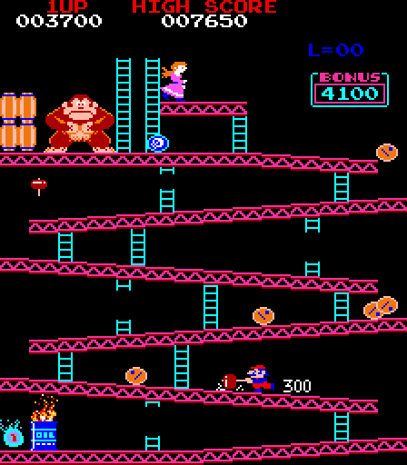</a><br><b><a href="games/dkong/README.md">Donkey Kong</a></b><br><br>Smooth, 83% speed with sound; a full playthrough still to be checked | <a href="games/dkongjr/README.md">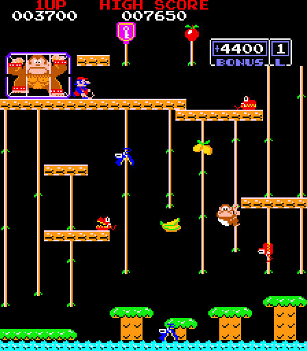</a><br><b><a href="games/dkongjr/README.md">Donkey Kong Junior</a></b><br><br>Smooth, 83% speed with sound; a full playthrough still to be checked | <a href="games/1942/README.md">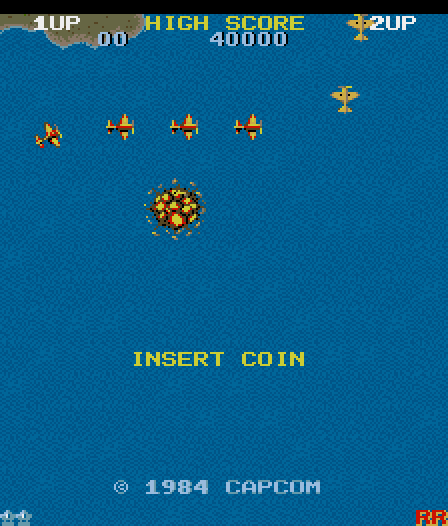</a><br><b><a href="games/1942/README.md">1942</a></b><br><br>Near full speed with sound; the ending reached with cheats, not yet by play | <a href="games/galaga/README.md">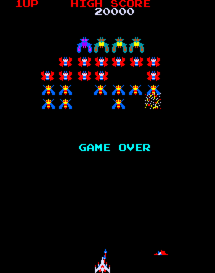</a><br><b><a href="games/galaga/README.md">Galaga</a></b><br><br>82% speed with sound; a full playthrough still to be checked |
| <a href="games/blktiger/README.md">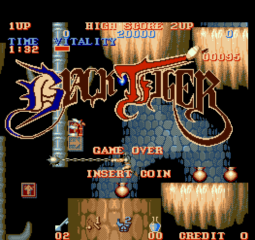</a><br><b><a href="games/blktiger/README.md">Black Tiger</a></b><br><br>Near full speed with sound; a recorded game reaches stage seven | <a href="games/commando/README.md">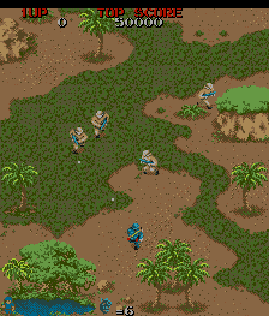</a><br><b><a href="games/commando/README.md">Commando</a></b><br><br>Full speed with sound; a full playthrough still to be checked | <a href="games/gunsmoke/README.md">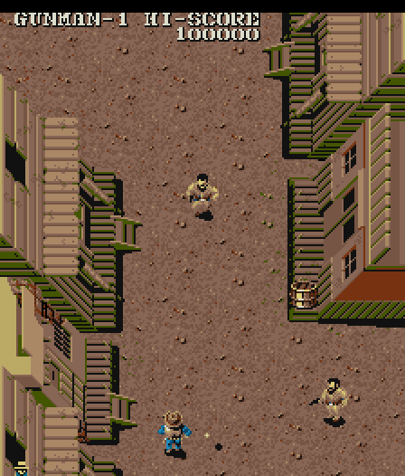</a><br><b><a href="games/gunsmoke/README.md">Gun.Smoke</a></b><br><br>92% speed with sound, faster on a Mega STE; a full playthrough still to be checked | <a href="games/gauntlet/README.md">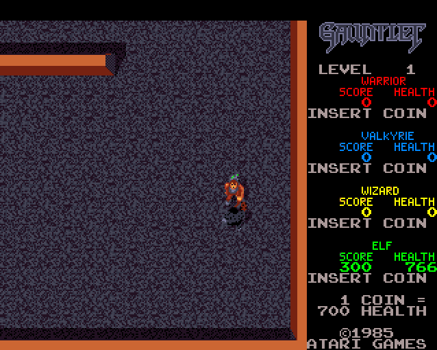</a><br><b><a href="games/gauntlet/README.md">Gauntlet</a></b><br><br>Full speed with music, effects and speech; a full playthrough still to be checked |
| <a href="games/pacman/README.md">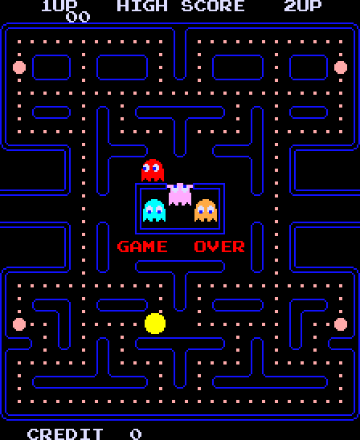</a><br><b><a href="games/pacman/README.md">Pac-Man</a></b><br><br>Full speed; controls and a full playthrough still to be checked | <a href="games/pooyan/README.md">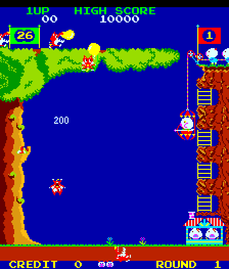</a><br><b><a href="games/pooyan/README.md">Pooyan</a></b><br><br>Full speed with sound; a full playthrough still to be checked | <a href="games/mrdo/README.md">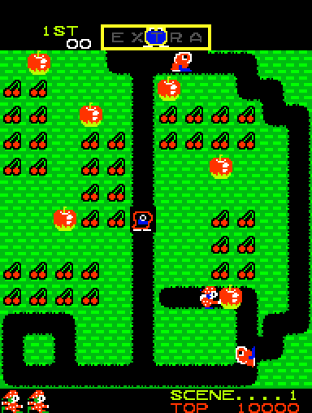</a><br><b><a href="games/mrdo/README.md">Mr. Do!</a></b><br><br>Full speed most of the time, with sound; a full playthrough still to be checked | <a href="games/mpatrol/README.md">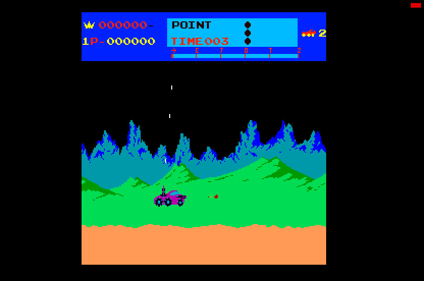</a><br><b><a href="games/mpatrol/README.md">Moon Patrol</a></b><br><br>95% speed with sound; a full playthrough still to be checked |
| <a href="games/timeplt/README.md">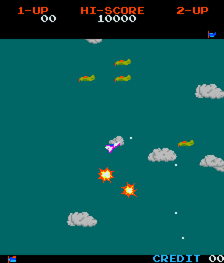</a><br><b><a href="games/timeplt/README.md">Time Pilot</a></b><br><br>Full speed, but no sound yet | <a href="games/mario/README.md">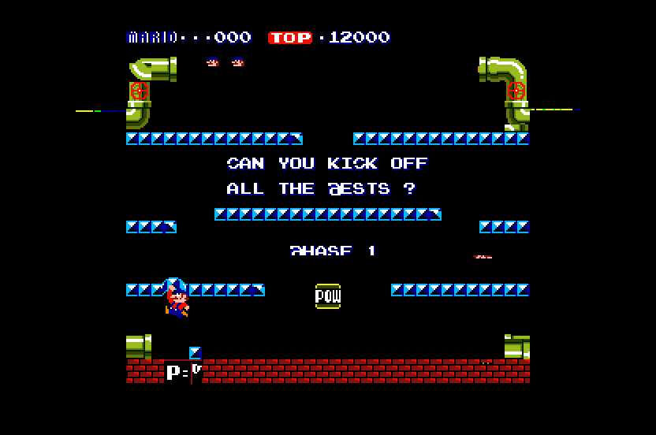</a><br><b><a href="games/mario/README.md">Mario Bros.</a></b><br><br>Full speed with sound (not yet listened to); later phases not reached | <a href="games/trackfld/README.md">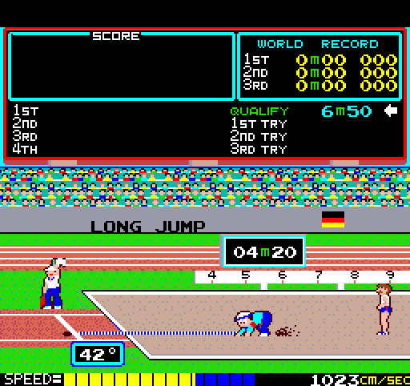</a><br><b><a href="games/trackfld/README.md">Track & Field</a></b><br><br>95% speed with sound; screen flip and a full playthrough missing | <a href="games/yiear/README.md">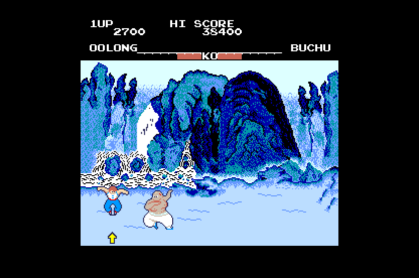</a><br><b><a href="games/yiear/README.md">Yie Ar Kung-Fu</a></b><br><br>98% speed with sound; later stages reached only with cheats |
| <a href="games/kungfum/README.md">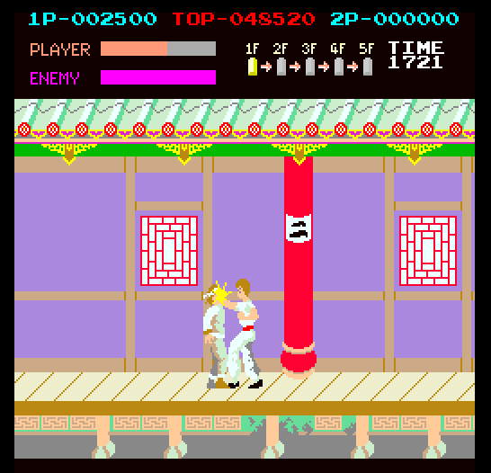</a><br><b><a href="games/kungfum/README.md">Kung-Fu Master</a></b><br><br>Close to full speed with sound; flipped screen and service mode missing | <a href="games/mikie/README.md">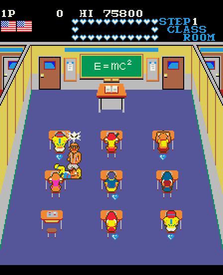</a><br><b><a href="games/mikie/README.md">Mikie</a></b><br><br>About 92% speed with sound; later rooms reached only with cheats | <a href="games/dkong3/README.md">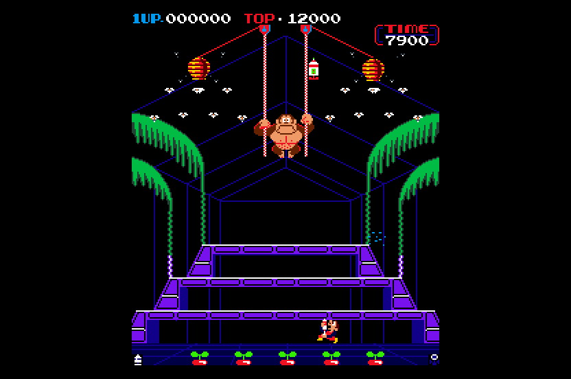</a><br><b><a href="games/dkong3/README.md">Donkey Kong 3</a></b><br><br>90% speed with sound (not yet listened to); not yet played by hand | <a href="games/digdug/README.md">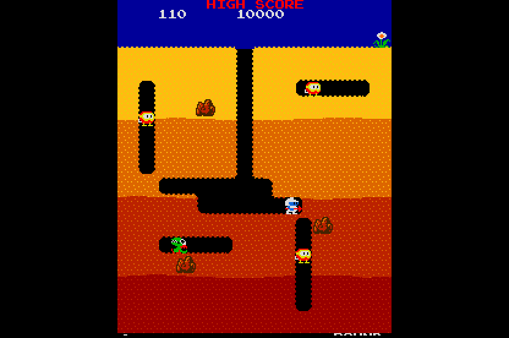</a><br><b><a href="games/digdug/README.md">Dig Dug</a></b><br><br>90% speed with sound; only rounds 1-2 played, bottom lines cut; not released |
| <a href="games/rocnrope/README.md">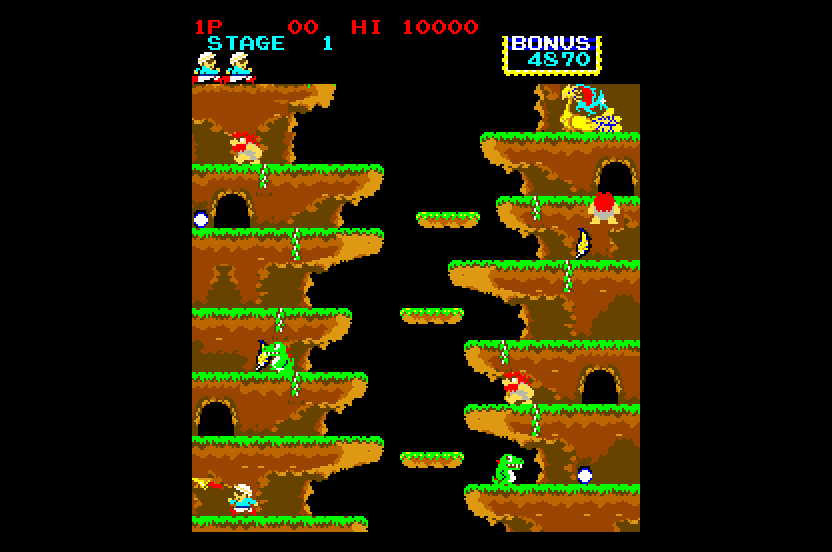</a><br><b><a href="games/rocnrope/README.md">Roc'n Rope</a></b><br><br>About 90% speed with sound; later stages reached only with cheats | <a href="games/trojan/README.md">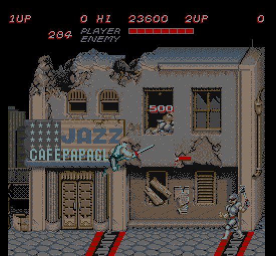</a><br><b><a href="games/trojan/README.md">Trojan</a></b><br><br>90% speed but jerky, no spoken shouts; the attract mode stops after two minutes | <a href="games/hyperspt/README.md">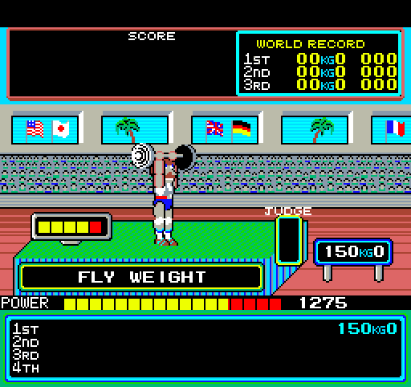</a><br><b><a href="games/hyperspt/README.md">Hyper Sports</a></b><br><br>85% speed with sound, slower in busy moments | <a href="games/sbasketb/README.md">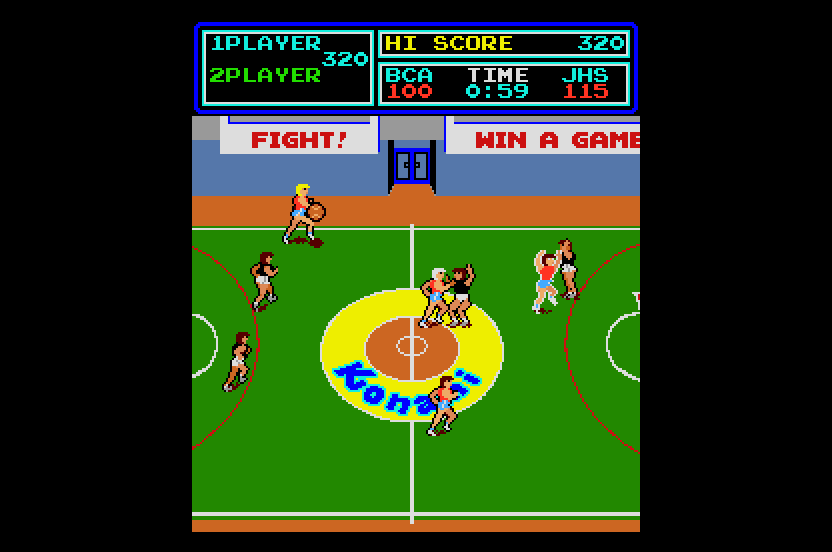</a><br><b><a href="games/sbasketb/README.md">Super Basketball</a></b><br><br>Near full speed with recorded sound; played only to the first game over |
| <a href="games/jailbrek/README.md">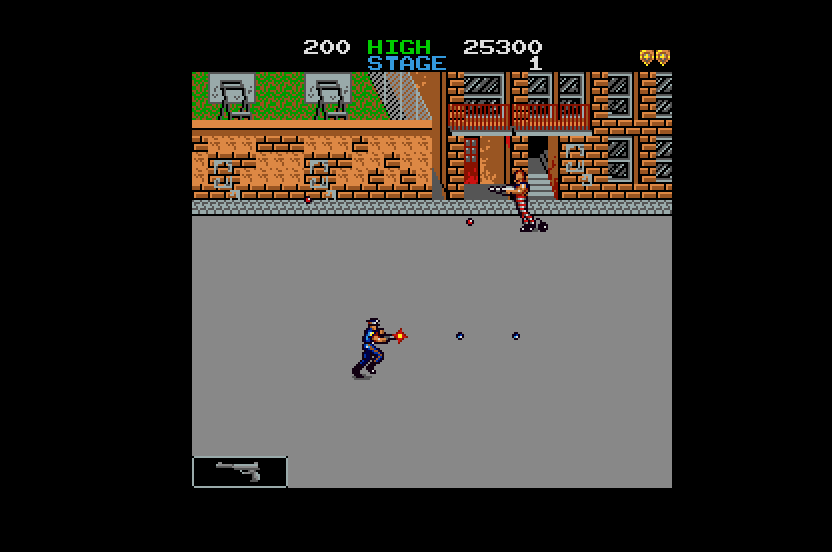</a><br><b><a href="games/jailbrek/README.md">Jail Break</a></b><br><br>About 83% speed with sound (not yet listened to); later stages not reached | <a href="games/1943/README.md">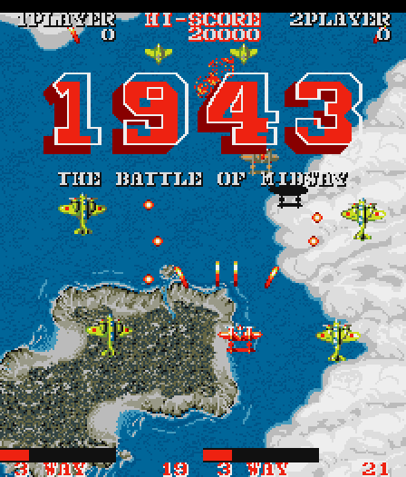</a><br><b><a href="games/1943/README.md">1943</a></b><br><br>85% speed but only about 8 pictures a second; edge cropping missing | <a href="games/rtype/README.md">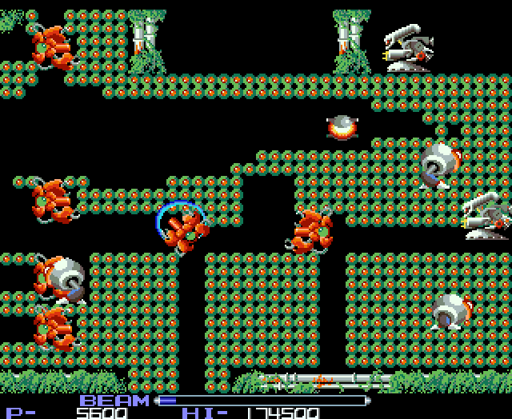</a><br><b><a href="games/rtype/README.md">R-Type</a></b><br><br>All eight stages at 43-80% speed; no sound yet; needs 14 MB, not released | <a href="games/gyruss/README.md">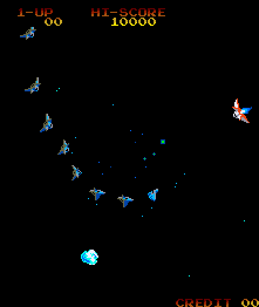</a><br><b><a href="games/gyruss/README.md">Gyruss</a></b><br><br>Slow (55% speed) with sound; screen flip and service mode missing |
| <a href="games/ddragon/README.md">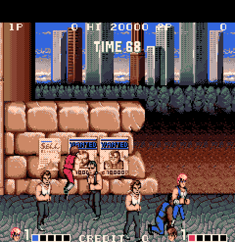</a><br><b><a href="games/ddragon/README.md">Double Dragon</a></b><br><br>About half the arcade's speed, 3 pictures a second in play | <a href="games/bublbobl/README.md">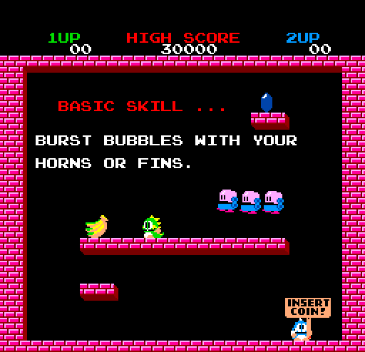</a><br><b><a href="games/bublbobl/README.md">Bubble Bobble</a></b><br><br>Picture and sound work, but under half the arcade's speed | <b><a href="games/rthunder/README.md">Rolling Thunder</a></b><br><br>About 70% speed in play, no sound; long games can stop; not released | <a href="games/defender/README.md">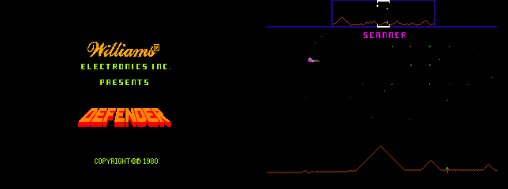</a><br><b><a href="games/defender/README.md">Defender</a></b><br><br>New (2026-11-19): about 70% speed in play, no sound yet |
| <a href="games/junofrst/README.md">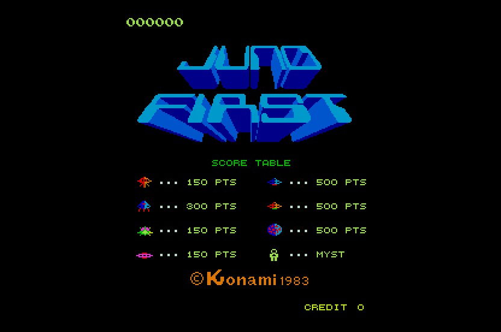</a><br><b><a href="games/junofrst/README.md">Juno First</a></b><br><br>Correct but slow: about 58% speed, 16 pictures a second | <a href="games/xevious/README.md">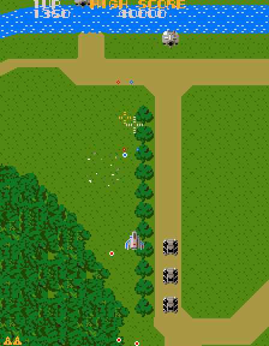</a><br><b><a href="games/xevious/README.md">Super Xevious</a></b><br><br>Correct but too slow (about 47% speed); most sound effects missing | <a href="games/splatter/README.md">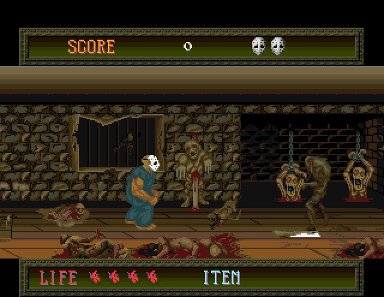</a><br><b><a href="games/splatter/README.md">Splatterhouse</a></b><br><br>A quarter of the arcade's speed, no sound | <a href="games/galaga88/README.md">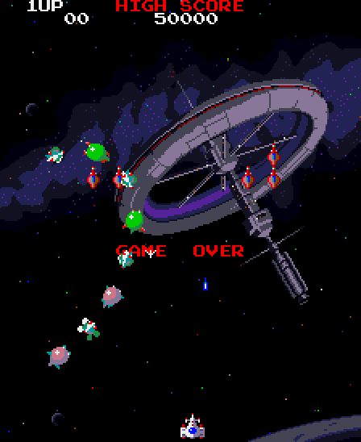</a><br><b><a href="games/galaga88/README.md">Galaga '88</a></b><br><br>A fifth of the arcade's speed, no sound |
| <a href="games/dspirit/README.md">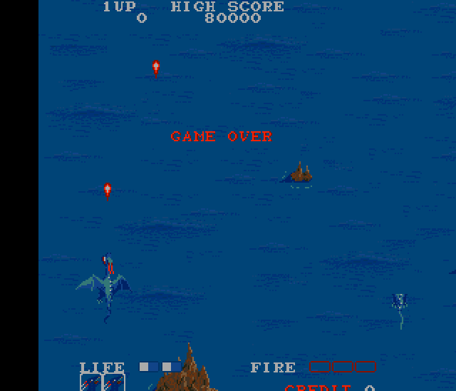</a><br><b><a href="games/dspirit/README.md">Dragon Spirit</a></b><br><br>A seventh of the arcade's speed, no sound; needs 14 MB | <a href="games/mrheli/README.md">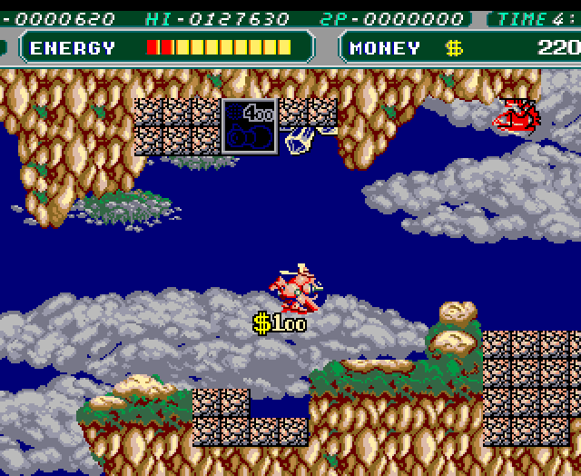</a><br><b><a href="games/mrheli/README.md">Mr. HELI no Daibouken</a></b><br><br>About 2 pictures a second, no sound; needs 14 MB | <b><a href="games/pacmania/README.md">Pac-Mania</a></b><br><br>Groundwork only: no STE program yet |  |

What the labels mean:

-  Graphics and sound done, and the whole game played through in Hatari. No
  game has this yet.
-  Graphics, sound and gameplay done; a full
  playthrough in Hatari is still to be checked.
-  Runs, but something is missing or it is noticeably too slow.
-  Crashes, faults or speed keep it from being played.
-  Early work, research, or on hold.

"Speed" means how fast the game itself runs compared with the arcade; "pictures a second" means how many frames the
STE actually draws. The figures come from the Hatari emulator, not yet from real hardware. A short demo or a run with
cheats does not count as a full playthrough: see the [status rules](docs/port-status.md).

## Download

[Release 0.8](https://github.com/AnimaInCorpore/STEArcade/releases/tag/v0.8) (2026-11-20): `STEArcade-0.8.zip` holds
one ready-to-run program per game (no ROM files needed), a bootable floppy disk image in `DISKS/` for each game that
fits on one disk, and a README.TXT with the controls. You need an Atari STE with 4 MB. Not included: R-Type (needs
more memory while it is developed), Dig Dug (on hold), Rolling Thunder (not playable yet) and the experimental games
other than Juno First and Super Xevious. The sources here may be newer than the release.

## Controls

Every game works with the keyboard (cursor keys, Space / Control / Alternate to fire, 1 / 2 to start, 5 / 6 to insert
a coin, Esc to quit), two joysticks (port 1 for player 1, the mouse port for player 2) and two Jaguar pads or
PowerPads in the STE's extra joystick ports (Option inserts a coin, Pause starts, * and # together quit). Each game's
own buttons are on its page.

## Building from the sources

The arcade ROMs are not part of this repository. Put the MAME ROM archives listed in
[`assets/roms/README.md`](assets/roms/README.md) into `assets/roms/`, then:

```sh
python3 -m venv venv && venv/bin/pip install numpy pillow machine68k scipy    # once
python port.py list                     # the games the common commands handle
python port.py build bublbobl           # makes run/bublbobl/BUBBLE.PRG
python port.py run bublbobl shot@20     # starts it in Hatari and takes a screenshot
python port.py test bublbobl            # checks the port against the arcade model
```

`port.py run` uses the project's own Hatari build, set up as a 4 MB STE. A few games in development (R-Type, Double
Dragon, Dragon Spirit, Mr. HELI) are run with 14 MB; anything released must still load on a 4 MB STE. The games that
`port.py list` does not show (Defender, Splatterhouse, Galaga '88, Mr. HELI, Dragon Spirit) build with
`python games/<game>/tools/build.py`; their pages list their other steps. Some games need coverage runs or recorded
plays made once before they build or test; the error message names the command.

## Making a release

`python port.py release <version>` builds every released game and packs it into `release/STEArcade-<version>.zip`,
with a README.TXT and a bootable floppy image for each game that fits on a disk (the `lz4` command is needed). It
refuses a program that would not load on a 4 MB STE. Then tag `v<version>` and attach the zip to a GitHub release.

## Documentation

For players, each game's page (linked in the table) starts with a short summary; the technical details follow below
it. For developers: [how a port works](docs/architecture.md), [the porting guide](docs/porting-guide.md) (the method
and the lessons), [speed](docs/speed.md), [sprite preparation](docs/sprite-preparation.md),
[colours](docs/colours.md), [status rules](docs/port-status.md), [automated play](docs/ppo.md) and
[Go-Explore](docs/go-explore.md), and the Mega STE's [border timing](docs/megaste-border-timing.md) and
[diagnostics](docs/megaste-diagnostic.md). The rules every port follows are in [`AGENTS.md`](AGENTS.md).

## Layout

    engine/            shared code: emulators, the program converters, arcade board models, the STE test
                       simulator, sprite and colour tools; rt/ is the shared STE runtime; *_test.py its tests
    games/<game>/      one folder per game, all alike:
      README.md        the game's page: summary, build, controls, state, how it works, speed, tests, lessons
      src/             the STE program's sources
      tools/           the arcade model, the converter, graphics, build and test scripts
      ref/             coverage runs and the comparison with MAME
      docs/            screenshot, ROM list, notes and dated reports
    tools/             Hatari control, release and floppy-image tools
    docs/              the shared documentation, the status badges, reference manuals
    assets/roms/       the ROM archives (not in git; see its README)
    build/ run/        generated files and the finished programs (not in git)
    release/           packed releases (not in git)
    legacy/            superseded material, kept for reference only
    port.py            the list of games and the common commands: list, prepare, cover, build, test, run, mame,
                       release, ppo

## Screenshots and trademarks

The screenshots show the original games' graphics, which remain the copyright of their owners: Donkey Kong © 1981,
Donkey Kong Junior © 1982, Mario Bros. © 1983 and Donkey Kong 3 © 1983 Nintendo; Galaga © 1981, Pac-Man © 1980,
Dig Dug © 1982, Super Xevious © 1984, Rolling Thunder © 1986, Galaga '88 © 1987, Dragon Spirit © 1987, Pac-Mania
© 1987 and Splatterhouse © 1988 Namco; 1942 © 1984, 1943 © 1987, Black Tiger © 1987, Commando © 1985, Gun.Smoke
© 1985 and Trojan © 1986 Capcom; Bubble Bobble © 1986 Taito; Gauntlet © 1985 Atari Games; Moon Patrol © 1982,
Kung-Fu Master © 1984, R-Type © 1987 and Mr. HELI no Daibouken © 1987 Irem; Pooyan © 1982, Time Pilot © 1982,
Gyruss © 1983, Track & Field © 1983, Juno First © 1983, Roc'n Rope © 1983, Hyper Sports © 1984, Mikie © 1984, Super
Basketball © 1984, Yie Ar Kung-Fu © 1985 and Jail Break © 1986 Konami; Mr. Do! © 1982 Universal; Double Dragon
© 1987 Technos Japan; Defender © 1980 Williams Electronics. The game titles and logos are trademarks of their
owners. The pictures document the ports; this project is not affiliated with or endorsed by any of them.

## License

The code in this repository is free software under the GNU General Public License, version 2 or (at your option) any
later version: see [LICENSE](LICENSE). The license does not cover the arcade games themselves: their ROMs, and the
code, graphics and sound converted from them and built into each program, belong to their rights holders.
