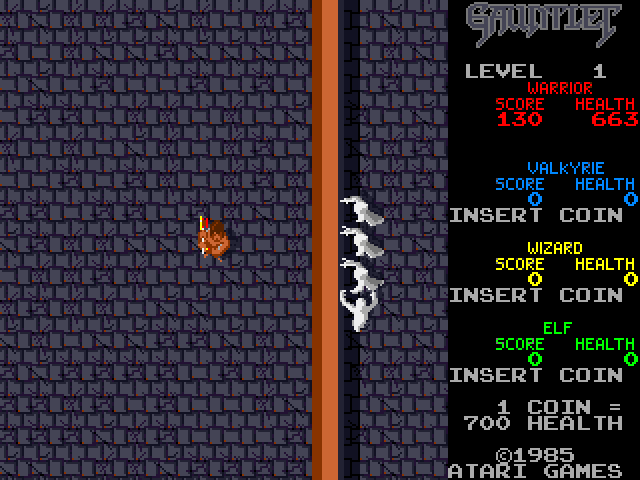
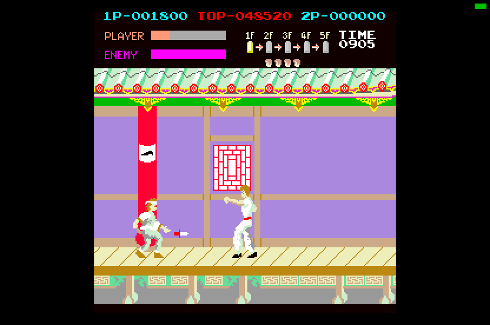
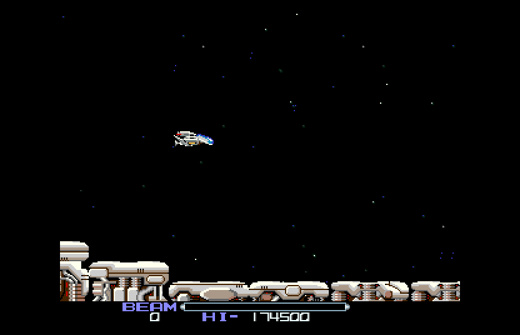

# Arcade games on the Atari STE

**Note: this project is AI-assisted.** Much of its code and documentation was written by AI coding agents
(Claude Code) under the author's direction; if you prefer to avoid AI-assisted work, this project is not for you.
Static translation of Z80, 6809-family and NEC V30 arcade programs to 68000 code, with a Blitter based renderer, running on an
8 MHz Atari STE with 4 MB of RAM and no accelerator.  Each port is a reference machine written from the MAME driver, a whole-program translation
checked against it in lock-step, and a runtime that delivers the arcade's interrupts at the vertical blank and draws the
arcade's tiles and sprites (sprites with short HOG Blitter passes and prepared opaque end masks).

This project is developed with AI coding agents (Claude Code): much of the translators, runtimes, tools and
documentation was written by them under the author's direction.  Correctness is checked by testing rather than by
trust: every translation runs in lock-step against its reference machine, and the pictures are compared with the
reference renderer and MAME.

| screenshot (Hatari) | game | CPUs | Port status |
|---|---|---|---|
|  | [Donkey Kong](games/dkong/README.md) | Z80 |  Assisted loop replay verified; full-game checks pending |
|  | [1942](games/1942/README.md) | Z80 (a cooperative kernel; the sound driver's output recorded) |  Assisted ending replay verified; full-game checks pending |
|  | [Galaga](games/galaga/README.md) | 3 x Z80 + 51XX MCU (its program translated) + 54XX (simulated) |  Real 51XX since 2026-10-21; full-game checks pending |
|  | [Black Tiger](games/blktiger/README.md) | Z80 + i8751 (firmware interpreter; sound CPU omitted) |  Full-game Hatari verification pending |
|  | [Commando](games/commando/README.md) | Z80 (encrypted opcodes; the sound driver's output recorded) |  Full-game Hatari verification pending |
|  | [Gun.Smoke](games/gunsmoke/README.md) | Z80 (four ROM banks with code; sound CPU omitted) |  Full-game Hatari verification pending |
|  | [Gauntlet](games/gauntlet/README.md) | MC68010 (the program itself, natively, patched in place) + 6502 sound (modelled; music and effects on the YM, speech on the DMA sound) |  Full-game Hatari verification pending |
|  | [Kung-Fu Master](games/kungfum/README.md) | Irem M62: Z80, M6803 sound (both translated) |  Cocktail and service modes unfinished |
|  | [Trojan](games/trojan/README.md) | Z80 (four ROM banks; the sound driver's output recorded, ADPCM omitted) |  ADPCM voices missing; speed limitations |
|  | [Gyruss](games/gyruss/README.md) | Z80 + KONAMI-1 (encrypted 6809, both translated) + Z80 sound (translated; YM) + i8039 (effects rendered offline; DMA sound) |  Cocktail and service modes unfinished |
|  | [1943](games/1943/README.md) | Z80 + i8751 (firmware translated; sound CPU omitted) |  Clipping and busy-scene speed limitations |
|  | [Bubble Bobble](games/bublbobl/README.md) | 3 x Z80 + MC6801 (its own firmware, translated) |  Significant gameplay slowdown |
|  | [R-Type](games/rtype/README.md) | Irem M72: NEC V30 (translated) + Z80 (sound: not yet) |  Sound not implemented |
|  | [Double Dragon](games/ddragon/README.md) | HD6309 (6809 code, translated) + HD63701Y0 sprite MCU (native) + MC6809 sound (recorded; ADPCM on the DMA sound) |  Significant gameplay slowdown |
|  | [Time Pilot](games/timeplt/README.md) | Z80 (translated) + Z80 sound (not yet) |  Sound not implemented; full speed, 24-33 pictures a second in play |
|  | [Splatterhouse](games/splatter/) | Namco System 1: 3 x MC6809 + HD63701 MCU (main and sub translated, the MCU native) |  Early implementation / reference work |
|  | [Galaga '88](games/galaga88/) | Namco System 1: 3 x MC6809 + HD63701 MCU |  Early implementation / reference work |
|  | [Mr. HELI no Daibouken](games/mrheli/) | Irem M72: NEC V30 + Z80 + i8751 |  Early implementation / reference work |
|  | [Pac-Mania](games/pacmania/) | Namco System 1: 3 x MC6809 + HD63701 MCU |  Early implementation / reference work |
|  | [Dragon Spirit](games/dspirit/) | Namco System 1: 3 x MC6809 + HD63701 MCU |  Early implementation / reference work |
|  | [Track & Field](games/trackfld/) | KONAMI-1 (encrypted 6809) + Z80 |  Early implementation / reference work |
|  | [Hyper Sports](games/hyperspt/) | KONAMI-1 (encrypted 6809) + Z80 |  Early implementation / reference work |

Port status (2026-10-22; based on the linked port reports):

-  — Graphics and sound implemented; complete playability verified in Hatari.
-  — Graphics, sound and gameplay implemented; Hatari testing still incomplete.
-  — Runs in Hatari, but has missing features or significant issues.
-  — Gameplay blocked by crashes, broken behavior or performance.
-  — Early implementation, reference work, or development on hold.

Short attract-mode or assisted runs do not establish complete playability. Green is reserved for ports
confirmed to meet all three criteria; none is currently certified complete by this table.
See the [full-game verification policy](docs/port-status.md) for every port, including
what an automated player can attempt and what evidence establishes completion.

`python port.py list` lists the ports supported by the common build, test, run and release commands. The table
also includes work in progress: Splatterhouse and Galaga '88 have standalone build and renderer tests; Mr. HELI
has a renderer harness; the remaining entries currently provide board/reference work. Use their local scripts;
their presence in the table does not put them in the release. Input and release instructions below refer to
registered ports. Current source capabilities and measurements may be newer than release 0.3.

Bubble Bobble also has reference captures from MAME (a 64-frame attract-mode collage with every on-screen colour, a
16-colour Oklab palette, the ROM manifests of the Japan and US sets) in [`games/bublbobl/docs/`](games/bublbobl/docs/README.md).

**Screenshots and trademarks.** The screenshots and captures show the original games' graphics, which remain the
copyright of their owners: Donkey Kong © 1981 Nintendo; Galaga © 1981 Namco; Bubble Bobble © 1986 Taito;
1942 © 1984 Capcom; 1943 © 1987 Capcom; Black Tiger © 1987 Capcom; Commando © 1985 Capcom; Gun.Smoke © 1985 Capcom;
R-Type © 1987 Irem; Kung-Fu Master © 1984 Irem; Trojan © 1986 Capcom; Double Dragon © 1987 Technos Japan; Gauntlet © 1985 Atari Games. The game titles and logos are trademarks of their owners. The pictures document the ports; this project is not affiliated with or endorsed by any of them.

## Download

[Release 0.3](https://github.com/AnimaInCorpore/STEArcade/releases/tag/v0.3): `STEArcade-0.3.zip` with one
self-contained TOS program per game (the arcade's code and graphics are built in: no separate ROM files are needed)
and a README.TXT with the controls.  Requirements: an Atari STE with 4 MB.

The ROM sets are not part of this repository.  To build from the sources, put the MAME archives listed in
[`assets/roms/README.md`](assets/roms/README.md) into `assets/roms/` and follow the Quick start.

Every port takes the keyboard (cursor keys, Space / Control / Alternate, 1 / 2 start, 5 / 6 coin, Esc quits), two
joysticks (port 1 player 1, the mouse port player 2) and two Jaguar pads / PowerPads in the STE's enhanced joystick
ports (pad A player 1, pad B player 2; Option coin, Pause start, * + # quit); the buttons of each game are in its README.

## Layout

    engine/            shared: Z80 / 6801 / 6809 (KONAMI-1 too) / HD63701 / MB88 emulators and disassemblers, translators (z80x,
                       translate, m6801x, m6809x), the Namco System 1 board (namcos1.py) with its MAME check
                       (namcos1_mame.py), MAME comparison helpers (mamegfx.py, mame_cmp.py, *.lua), STE simulator on
                       Musashi (sim.py), Blitter sprite code generator, ROM preparation (roms.py), paths and toolchain;
                       sound: capsnd.py (Capcom sound drivers recorded per command), opn.py / opl.py (YM2203 / YM3526
                       envelopes), lz.py (packed data); rt/: the shared 68000 runtime (rtlib.s, borders.s, jagpad.s,
                       ikbd.s, capsnd.s / capsnd_core.s: the sound players, lz.s, m6809rt.s, hdd.s: data streamed from the
                       hard disk); *_test.py: the engine's tests
    games/<game>/      one folder per port, all alike:
      README.md        state, controls, method, measurements (a screenshot at the top)
      src/             <game>.s (start, VBL schedule, input, hooks) and the parts it includes, named by topic without a
                       game prefix (render.s, sprites.s, hardware.s, mcu.s, sound.s, ...)
      tools/           machine.py (reference machine), gen.py (translation), assets.py, build.py, prepare.py (ROMs), the
                       tests *_test.py that port.py test runs, bench.sh / bench.ps1 (speed in Hatari) where a port has one
      ref/             cover*.py (port.py cover), mame_cmp_<game>.py + mame_dump.lua (port.py mame), analysis scripts;
                       ref/probes/: the numbered one-off experiments of the early ports, kept for the record
      docs/            screenshot.png, rom_manifest.json, notes and reference data (palettes, coverage, captures)
    tools/             hatari.sh (run, press keys, screenshot, dump memory in the F030Arcade Hatari), hddtest.sh (engine/rt/hdd.s
                       on Hatari's ACSI / IDE disks), release.py, windows/
                       (PowerShell helpers; run.ps1 finds the repository itself, F030ARCADE and MSYS2 override the tool locations)
    docs/              architecture.md, porting-guide.md, sprite-preparation.md, reference/ (68000 and Z80 manuals)
    assets/roms/       the ROM archives (assets/roms/README.md); extracted/<game>/ is unpacked by port.py prepare (not in git)
    build/ run/        generated code, assets, coverage data / the .PRG (ROMs embedded) (not in git)
    release/           port.py release: the packed programs (not in git)
    legacy/            superseded material, not built or tested (legacy/README.md): the Falcon030 plan, the old
                       Blitter-renderer branch, scratch scripts of the pre-restructure layout
    port.py            the list of the ports and the front end: list / prepare / cover / build / test / run / mame / release

## Quick start

    python3 -m venv venv && venv/bin/pip install numpy pillow machine68k scipy    # once (scipy: Donkey Kong's sound)
    python port.py list
    python port.py prepare bublbobl                                           # the ROMs (build does it when needed)
    python port.py build bublbobl && python port.py run bublbobl shot@20      # screenshot in /tmp/hrun
    python port.py test bublbobl                                              # reference vs translation vs renderer

Input: keyboard, the two IKBD joysticks and two Jaguar pads / PowerPads in every port (`docs/architecture.md`,
"Input").  A release: `python port.py release <version>` builds every port and packs the self-contained programs
with a README.TXT into `release/STEArcade-<version>.zip` (`tools/release.py`); then tag `v<version>` and attach the
zip to a GitHub release (`gh release create`).

Reading order: `docs/architecture.md` (how a port works), `docs/porting-guide.md` (method, MAME check, lessons),
then the game README.  Rules that hold for all ports: translate whole programs, no silent NOPs (unknown instructions
are a deliberate failure), check the reference against MAME before building graphics, and verify with the pinned
F030Arcade Hatari build.  MAME source: `F030Arcade/third_party/jsm68kdisassembler/third_party/mame`.

## PPO gameplay exploration

Use `venv/bin/python port.py ppo <game> train|record|verify|test` for the standard supplemental RAM-policy
workflow. It trains in MAME and verifies recordings through a private Hatari replay build, preserving canonical
fixtures and curated translator coverage. See [the shared PPO guide](docs/ppo.md) for setup, verification limits,
and storage policy. Galaga has no PPO profile yet; unregistered ports remain work in progress.
