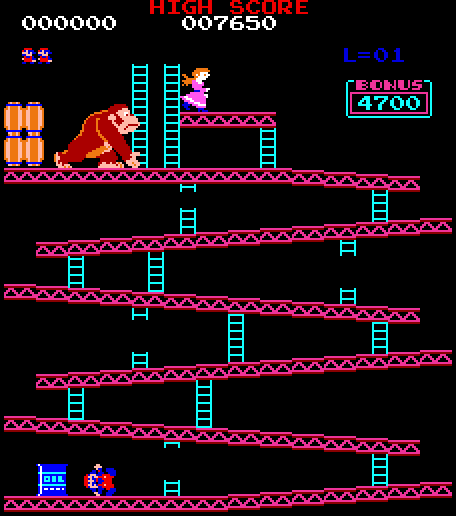
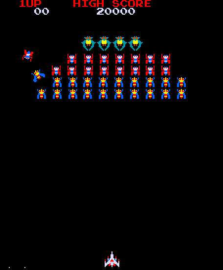
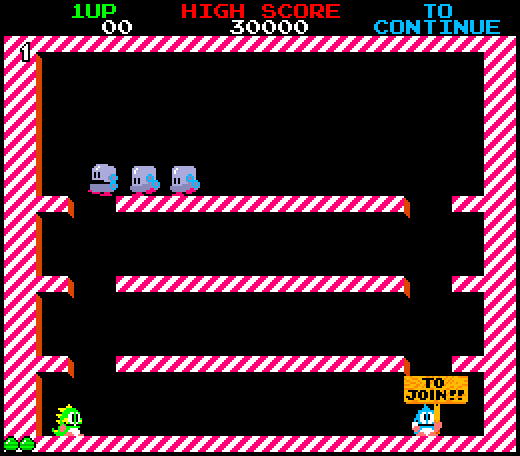
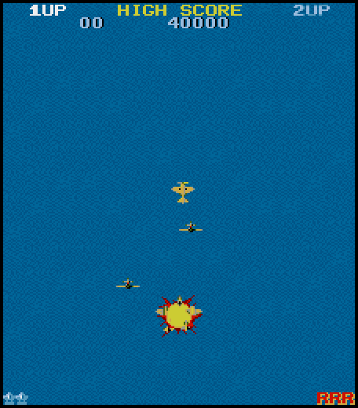
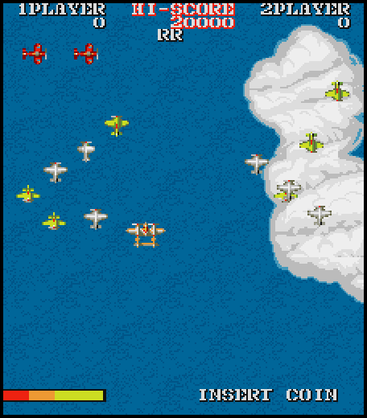
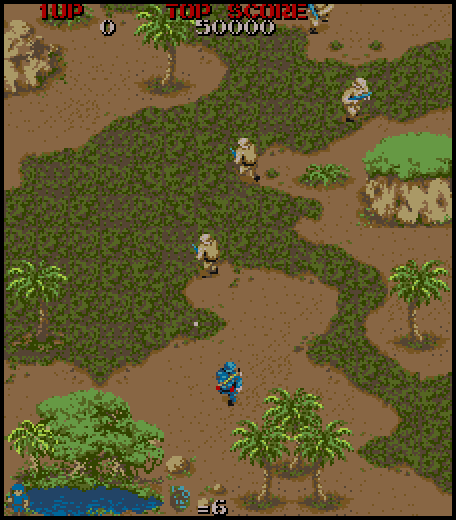

# Z80 arcade games on the Atari STE

Static translation of Z80 arcade programs to 68000 code, with a Blitter based renderer, running on an unexpanded
8 MHz Atari STE (4 MB).  Each port is a reference machine written from the MAME driver, a whole-program translation
checked against it in lock-step, and a runtime that delivers the arcade's interrupts at the vertical blank and draws the
arcade's tiles and sprites (sprites with the Blitter: one blit per sprite line, masks as end masks).

| screenshot (Hatari) | game | CPUs | state |
|---|---|---|---|
|  | [Donkey Kong](games/dkong/README.md) | Z80 | plays at 50 fps, pixel exact against MAME; sound (the 8035 board as DMA sound, walk / jump / stomp on the YM) |
|  | [Galaga](games/galaga/README.md) | 3 x Z80 (+ simulated 51xx/54xx) | attract mode and play, 25-43 fps in the light phases, 9-21 with the full formation |
|  | [Bubble Bobble](games/bublbobl/README.md) | 3 x Z80 + MC6801 (its own firmware, translated) | boots into the attract mode, exact logic and picture; too slow to play on a plain STE, no sound |
|  | [1942](games/1942/README.md) | Z80 (a cooperative kernel; sound CPU not translated) | attract mode and play with the hardware scrolled background, exact logic and picture; the arcade's speed (60 ticks a second) and 34-43 frames a second in Hatari, no sound |
|  | [1943](games/1943/README.md) | Z80 + i8751 (firmware translated; sound CPU omitted) | attract mode and play with the hardware scrolled background, lock-step logic and pictures exact; 93% of the arcade's speed and 11 frames a second in Hatari, no sound |
|  | [Black Tiger](games/blktiger/README.md) | Z80 + i8751 (firmware interpreter; sound CPU omitted) | STE runtime, banked translation, virtual-screen scrolling and firmware protection; about 65% of the arcade's speed and 12 frames a second in Hatari, no sound |
|  | [Commando](games/commando/README.md) | Z80 (encrypted opcodes; sound CPU omitted) | playable STE runtime, scrolling Blitter renderer, exact reference/translation checks; 16 colours, the sound effects on the YM (no music) |
|  | [Gun.Smoke](games/gunsmoke/README.md) | Z80 (four ROM banks with code; sound CPU omitted) | attract mode and play, exact logic and picture against the reference (checked in rounds 1-3, 6, 7, 9 and the ending); 54 ticks (91% of the arcade) and 29 frames a second in Hatari, 16 colours, no sound |

Bubble Bobble also has reference captures from MAME (a 64-frame attract-mode collage with every on-screen colour, a
16-colour Oklab palette, the ROM manifests of the Japan and US sets) in [`games/bublbobl/docs/`](games/bublbobl/docs/README.md).

## Download

[Release 0.1](https://github.com/AnimaInCorpore/STEArcade/releases/tag/v0.1): `STEArcade-0.1.zip` with one
self-contained TOS program per game (the arcade's code and graphics are built in: no separate ROM files are needed)
and a README.TXT with the controls.  Requirements: an Atari STE with 4 MB.

The ROM sets are not part of this repository.  To build from the sources, put the MAME archives listed in
[`assets/roms/README.md`](assets/roms/README.md) into `assets/roms/` and follow the Quick start.

Every port takes the keyboard (cursor keys, Space / Control / Alternate, 1 / 2 start, 5 / 6 coin, Esc quits), two
joysticks (port 1 player 1, the mouse port player 2) and two Jaguar pads / PowerPads in the STE's enhanced joystick
ports (pad A player 1, pad B player 2; Option coin, Pause start, * + # quit); the buttons of each game are in its README.

## Layout

    engine/            shared: Z80 / 6801 emulators and disassemblers, translators (z80x, translate, m6801x), STE simulator on
                       Musashi (sim.py), Blitter sprite code generator, ROM preparation (roms.py), paths and toolchain;
                       rt/: the shared 68000 runtime (rtlib.s, borders.s, jagpad.s, ikbd.s); *_test.py: the engine's tests
    games/<game>/      one folder per port, all alike:
      README.md        state, controls, method, measurements (a screenshot at the top)
      src/             <game>.s (start, VBL schedule, input, hooks) and the parts it includes, named by topic without a
                       game prefix (render.s, sprites.s, hardware.s, mcu.s, sound.s, ...)
      tools/           machine.py (reference machine), gen.py (translation), assets.py, build.py, prepare.py (ROMs), the
                       tests *_test.py that port.py test runs, bench.sh / bench.ps1 (speed in Hatari) where a port has one
      ref/             cover*.py (port.py cover), mame_cmp_<game>.py + mame_dump.lua (port.py mame), analysis scripts;
                       ref/probes/: the numbered one-off experiments of the early ports, kept for the record
      docs/            screenshot.png, rom_manifest.json, notes and reference data (palettes, coverage, captures)
    tools/             hatari.sh (run, press keys, screenshot, dump memory in the F030Arcade Hatari), release.py, windows/
                       (PowerShell helpers; run.ps1 finds the repository itself, F030ARCADE and MSYS2 override the tool locations)
    docs/              architecture.md, porting-guide.md, reference/ (68000 and Z80 manuals)
    assets/roms/       the ROM archives (assets/roms/README.md); extracted/<game>/ is unpacked by port.py prepare (not in git)
    build/ run/        generated code, assets, coverage data / the .PRG (ROMs embedded) (not in git)
    release/           port.py release: the packed programs (not in git)
    legacy/            superseded material, not built or tested (legacy/README.md): the Falcon030 plan, the old
                       Blitter-renderer branch, scratch scripts of the pre-restructure layout
    port.py            the list of the ports and the front end: list / prepare / cover / build / test / run / mame / release

## Quick start

    python3 -m venv venv && venv/bin/pip install numpy pillow machine68k scipy    # once (scipy: Donkey Kong's sound)
    python port.py list
    python port.py prepare bublbobl                                           # the ROMs (build does it when needed)
    python port.py build bublbobl && python port.py run bublbobl shot@20      # screenshot in /tmp/hrun
    python port.py test bublbobl                                              # reference vs translation vs renderer

Input: keyboard, the two IKBD joysticks and two Jaguar pads / PowerPads in every port (`docs/architecture.md`,
"Input").  A release: `python port.py release <version>` builds every port and packs the self-contained programs
with a README.TXT into `release/STEArcade-<version>.zip` (`tools/release.py`); then tag `v<version>` and attach the
zip to a GitHub release (`gh release create`).

Reading order: `docs/architecture.md` (how a port works), `docs/porting-guide.md` (method, MAME check, lessons),
then the game README.  Rules that hold for all ports: translate whole programs, no silent NOPs (unknown instructions
are a deliberate failure), check the reference against MAME before building graphics, and verify with the pinned
F030Arcade Hatari build.  MAME source: `F030Arcade/third_party/jsm68kdisassembler/third_party/mame`.
