# Arcade games on the Atari STE

**Note: this project is AI-assisted.** Much of its code and documentation was written by AI coding agents
(Claude Code) under the author's direction; if you prefer to avoid AI-assisted work, this project is not for you.
Static translation of Z80, 6809-family and NEC V30 arcade programs to 68000 code, with a Blitter based renderer, running on an
8 MHz Atari STE with 4 MB of RAM and no accelerator.  Each port is a reference machine written from the MAME driver, a whole-program translation
checked against it in lock-step, and a runtime that delivers the arcade's interrupts at the vertical blank and draws the
arcade's tiles and sprites (sprites with short HOG Blitter passes and prepared opaque end masks).

This project is developed with AI coding agents (Claude Code): much of the translators, runtimes, tools and
documentation was written by them under the author's direction.  Correctness is checked by testing rather than by
trust: every translation runs in lock-step against its reference machine, and the pictures are compared with the
reference renderer and MAME.

| game (screenshot in Hatari) | port status |
|---|---|
| <a href="games/dkong/README.md">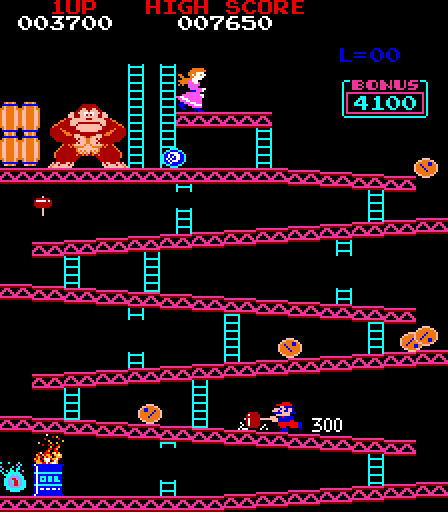</a> [Donkey Kong](games/dkong/README.md) |  Assisted loop replay verified; full-game checks pending |
| <a href="games/1942/README.md">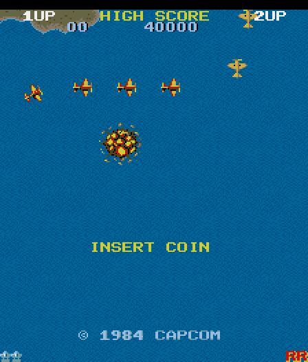</a> [1942](games/1942/README.md) |  Assisted ending replay verified; full-game checks pending |
| <a href="games/galaga/README.md">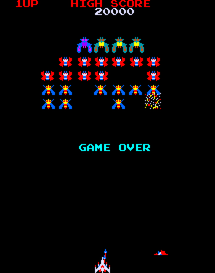</a> [Galaga](games/galaga/README.md) |  Real 51XX since 2026-10-21; full-game checks pending |
| <a href="games/blktiger/README.md">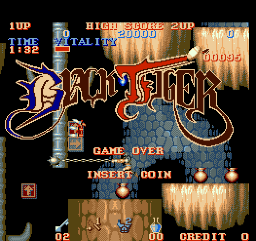</a> [Black Tiger](games/blktiger/README.md) |  Full-game Hatari verification pending |
| <a href="games/commando/README.md">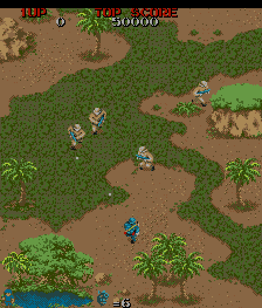</a> [Commando](games/commando/README.md) |  Full-game Hatari verification pending |
| <a href="games/gunsmoke/README.md">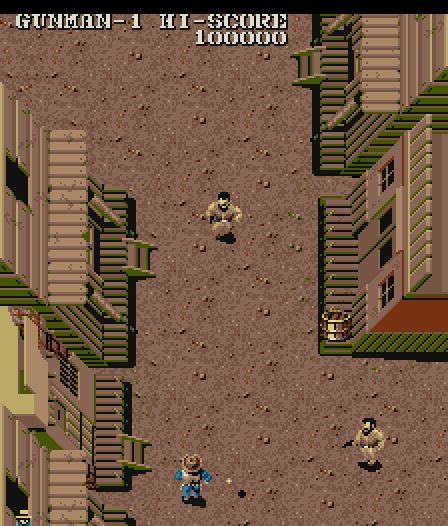</a> [Gun.Smoke](games/gunsmoke/README.md) |  Full-game Hatari verification pending |
| <a href="games/gauntlet/README.md">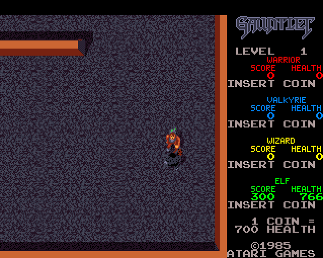</a> [Gauntlet](games/gauntlet/README.md) |  Full-game Hatari verification pending |
| <a href="games/dkongjr/README.md">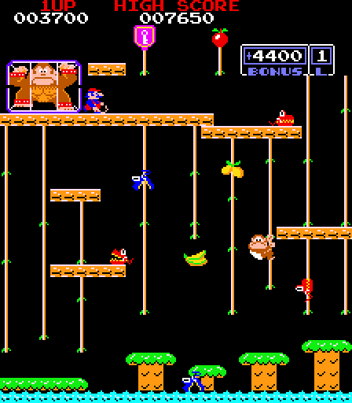</a> [Donkey Kong Junior](games/dkongjr/README.md) |  Picture equal to MAME; full-game checks pending |
| <a href="games/pacman/README.md">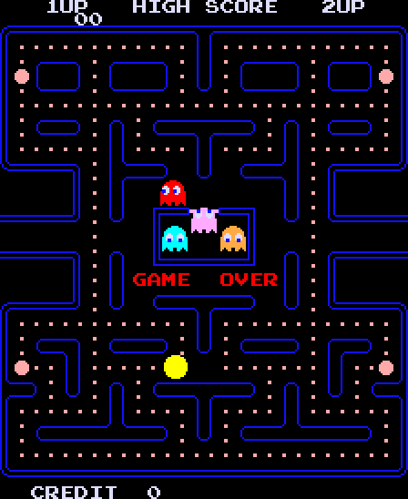</a> [Pac-Man](games/pacman/README.md) |  Logic and picture exact, full speed; full-game checks pending |
| <a href="games/pooyan/README.md">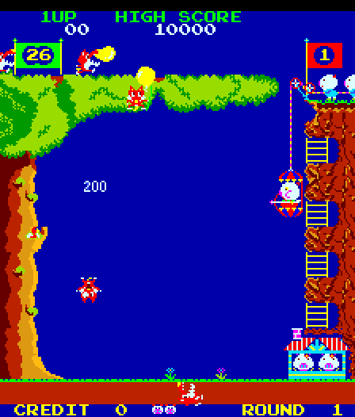</a> [Pooyan](games/pooyan/README.md) |  Logic and picture exact, full speed, 40-50 pictures a second in play; full-game checks pending |
| <a href="games/mrdo/README.md">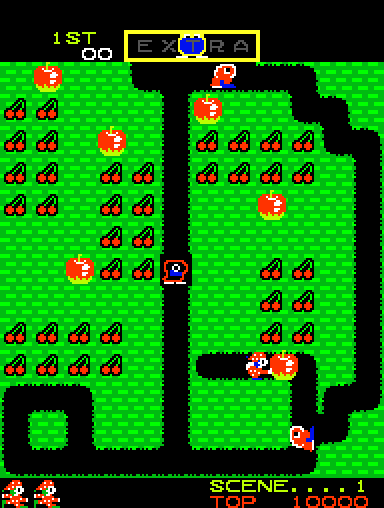</a> [Mr. Do!](games/mrdo/README.md) |  Logic and picture exact, full speed in most of play, 44-50 pictures a second; full-game checks pending |
| <a href="games/mpatrol/README.md">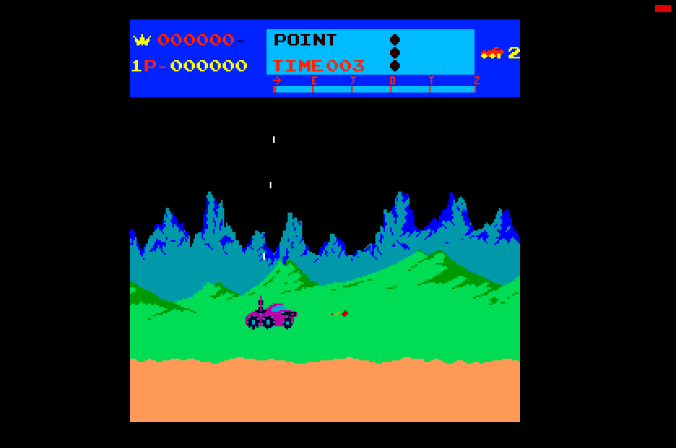</a> [Moon Patrol](games/mpatrol/README.md) |  Logic and picture exact (but frames with over 16 colours); ~95% speed, 14-30 pictures a second; full-game checks pending |
| <a href="games/kungfum/README.md">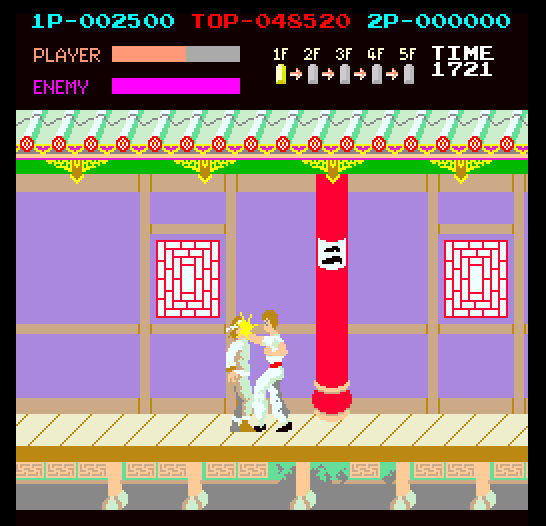</a> [Kung-Fu Master](games/kungfum/README.md) |  Cocktail and service modes unfinished |
| <a href="games/trojan/README.md">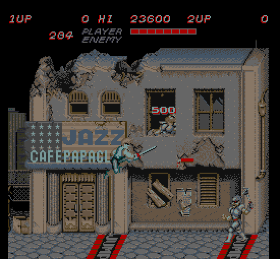</a> [Trojan](games/trojan/README.md) |  ADPCM voices missing; speed limitations |
|  [Gyruss](games/gyruss/README.md) |  Cocktail and service modes unfinished |
| <a href="games/1943/README.md">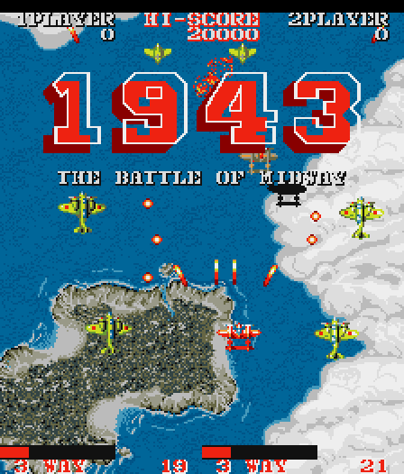</a> [1943](games/1943/README.md) |  Clipping and busy-scene speed limitations |
| <a href="games/bublbobl/README.md">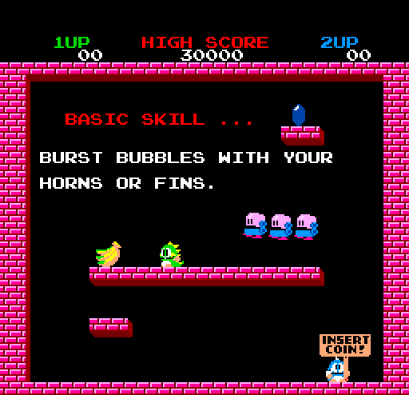</a> [Bubble Bobble](games/bublbobl/README.md) |  Significant gameplay slowdown |
| <a href="games/rtype/README.md">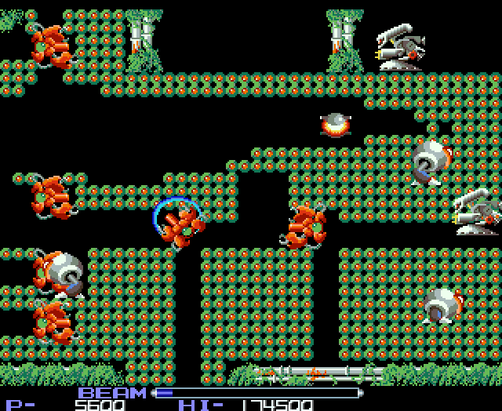</a> [R-Type](games/rtype/README.md) |  Sound not implemented |
| <a href="games/ddragon/README.md">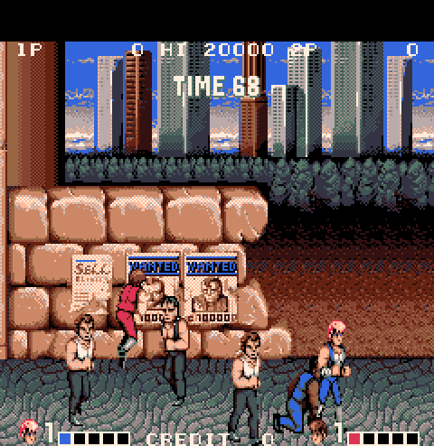</a> [Double Dragon](games/ddragon/README.md) |  Significant gameplay slowdown (about 50% speed in play, ~3 pictures a second; 56% and 7.1 pictures a second over the recorded play); developed with 14 MB in Hatari, the release still fits 4 MB |
| <a href="games/timeplt/README.md">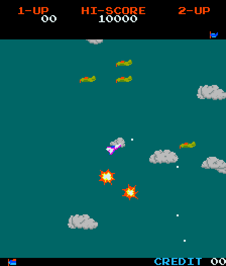</a> [Time Pilot](games/timeplt/README.md) |  Sound not implemented; full speed, 24-33 pictures a second in play |
| <a href="games/trackfld/README.md">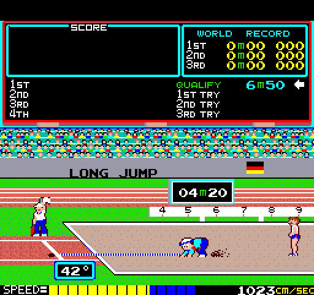</a> [Track & Field](games/trackfld/README.md) |  Full speed, 20-50 pictures a second; no full-game verification yet |
| <a href="games/hyperspt/README.md">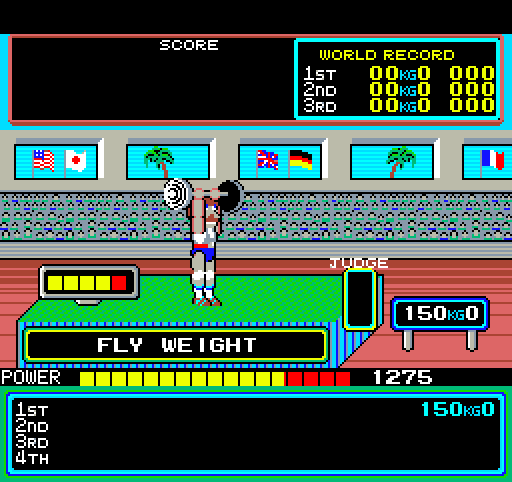</a> [Hyper Sports](games/hyperspt/README.md) |  85% speed with sound, 26.9 pictures a second on average; no full-game verification yet |
|  [Mikie](games/mikie/README.md) |  Logic (lock-step, 9 seeds x 20000 frames) and picture exact, runs in Hatari at 93% of the arcade rate (34 pictures a second in the attract and first room); no sound; later rooms not covered |
| [Splatterhouse](games/splatter/README.md) |  STE program: logic exact (lock-step), about 23% speed, 6.4 pictures a second in recorded play; no sound |
| [Galaga '88](games/galaga88/README.md) |  STE program: logic exact (lock-step), about 20% speed, 6.1 pictures a second (BENCH game); no sound |
| [Mr. HELI no Daibouken](games/mrheli/README.md) |  STE program on the shared M72 renderer: logic exact (lock-step to 40000 frames), about 2 pictures a second; R-Type's stage renderer and natives next |
| [Pac-Mania](games/pacmania/README.md) |  Early implementation / reference work |
| [Dragon Spirit](games/dspirit/README.md) |  STE program: logic exact (lock-step, 7700 frames), 320-pixel renderer, 13% speed, 3 pictures a second; no sound; developed with 14 MB in Hatari |

Port status (2026-11-07; based on the linked port reports; sorted by status):

-  — Graphics and sound implemented; complete playability verified in Hatari.
-  — Graphics, sound and gameplay implemented; Hatari testing still incomplete.
-  — Runs in Hatari, but has missing features or significant issues.
-  — Gameplay blocked by crashes, broken behavior or performance.
-  — Early implementation, reference work, or development on hold.

Short attract-mode or assisted runs do not establish complete playability. Green is reserved for ports
confirmed to meet all three criteria; none is currently certified complete by this table.
See the [full-game verification policy](docs/port-status.md) for every port, including
what an automated player can attempt and what evidence establishes completion.

`python port.py list` lists the ports supported by the common build, test, run and release commands. The table
also includes work in progress: Splatterhouse and Galaga '88 have standalone build and renderer tests; Mr. HELI
and Dragon Spirit have STE programs (their own build, lock-step and bench scripts) but are not registered yet; Pac-Mania
provides board/reference work only. Use their local scripts;
their presence in the table does not put them in the release. Input and release instructions below refer to
registered ports. Current source capabilities and measurements may be newer than release 0.7.

Bubble Bobble also has reference captures from MAME (a 64-frame attract-mode collage with every on-screen colour, a
16-colour Oklab palette, the ROM manifests of the Japan and US sets) in [`games/bublbobl/docs/`](games/bublbobl/docs/README.md).

**Screenshots and trademarks.** The screenshots and captures show the original games' graphics, which remain the
copyright of their owners: Donkey Kong © 1981 Nintendo; Donkey Kong Junior © 1982 Nintendo; Galaga © 1981 Namco; Bubble Bobble © 1986 Taito;
1942 © 1984 Capcom; 1943 © 1987 Capcom; Black Tiger © 1987 Capcom; Commando © 1985 Capcom; Gun.Smoke © 1985 Capcom;
R-Type © 1987 Irem; Kung-Fu Master © 1984 Irem; Trojan © 1986 Capcom; Double Dragon © 1987 Technos Japan; Gauntlet © 1985 Atari Games. The game titles and logos are trademarks of their owners. The pictures document the ports; this project is not affiliated with or endorsed by any of them.

## Download

[Release 0.7](https://github.com/AnimaInCorpore/STEArcade/releases/tag/v0.7): `STEArcade-0.7.zip` with one
self-contained TOS program per game (the arcade's code and graphics are built in: no separate ROM files are needed),
bootable floppy images (`DISKS/`) for the games that fit on one and a README.TXT with the controls.  R-Type is not in
it (it needs more than 4 MB while it is developed).  Requirements: an Atari STE with 4 MB.  For development, Hatari
runs R-Type, Double Dragon and Dragon Spirit with 14 MB (allowed by the author); a released program must still load
on a 4 MB STE.

The ROM sets are not part of this repository.  To build from the sources, put the MAME archives listed in
[`assets/roms/README.md`](assets/roms/README.md) into `assets/roms/` and follow the Quick start.

Every port takes the keyboard (cursor keys, Space / Control / Alternate, 1 / 2 start, 5 / 6 coin, Esc quits), two
joysticks (port 1 player 1, the mouse port player 2) and two Jaguar pads / PowerPads in the STE's enhanced joystick
ports (pad A player 1, pad B player 2; Option coin, Pause start, * + # quit); the buttons of each game are in its README.

## Layout

    engine/            shared: Z80 / 6801 / 6809 (KONAMI-1 too) / HD63701 / MB88 emulators and disassemblers, translators (z80x,
                       translate, m6801x, m6809x), the Namco System 1 board (namcos1.py) with its MAME check
                       (namcos1_mame.py), MAME comparison helpers (mamegfx.py, mame_cmp.py, *.lua), STE simulator on
                       Musashi (sim.py), Blitter sprite code generator, ROM preparation (roms.py), paths and toolchain;
                       sound: capsnd.py (Capcom sound drivers recorded per command), opn.py / opl.py (YM2203 / YM3526
                       envelopes), lz.py (packed data); rt/: the shared 68000 runtime (rtlib.s, borders.s, jagpad.s,
                       ikbd.s, capsnd.s / capsnd_core.s: the sound players, lz.s, m6809rt.s, hdd.s: data streamed from the
                       hard disk); *_test.py: the engine's tests
    games/<game>/      one folder per port, all alike:
      README.md        state, controls, method, measurements (a screenshot at the top)
      src/             <game>.s (start, VBL schedule, input, hooks) and the parts it includes, named by topic without a
                       game prefix (render.s, sprites.s, hardware.s, mcu.s, sound.s, ...)
      tools/           machine.py (reference machine), gen.py (translation), assets.py, build.py, prepare.py (ROMs), the
                       tests *_test.py that port.py test runs, bench.sh / bench.ps1 (speed in Hatari) where a port has one
      ref/             cover*.py (port.py cover), mame_cmp_<game>.py + mame_dump.lua (port.py mame), analysis scripts;
                       ref/probes/: the numbered one-off experiments of the early ports, kept for the record
      docs/            screenshot.png, rom_manifest.json, notes and reference data (palettes, coverage, captures)
    tools/             hatari.sh (run, press keys, screenshot, dump memory in the F030Arcade Hatari), hddtest.sh (engine/rt/hdd.s
                       on Hatari's ACSI / IDE disks), release.py, lz4prg.py + lz4stub.s (self-unpacking programs;
                       lz4prg_test.py runs the stub on Musashi), stdisk.py (bootable .ST images), windows/
                       (PowerShell helpers; run.ps1 finds the repository itself, F030ARCADE and MSYS2 override the tool locations)
    docs/              architecture.md (how a port works), porting-guide.md (method, correctness lessons), speed.md
                       (speed techniques, measuring, which port uses what), sprite-preparation.md, colours.md,
                       port-status.md, ppo.md, go-explore.md, megaste-*.md, dated reports, reference/ (68000 and Z80 manuals)
    assets/roms/       the ROM archives (assets/roms/README.md); extracted/<game>/ is unpacked by port.py prepare (not in git)
    build/ run/        generated code, assets, coverage data / the .PRG (ROMs embedded) (not in git)
    release/           port.py release: the packed programs (not in git)
    legacy/            superseded material, not built or tested (legacy/README.md): the Falcon030 plan, the old
                       Blitter-renderer branch, scratch scripts of the pre-restructure layout
    port.py            the list of the ports and the front end: list / prepare / cover / build / test / run / mame / release

## Quick start

    python3 -m venv venv && venv/bin/pip install numpy pillow machine68k scipy    # once (scipy: Donkey Kong's sound)
    python port.py list
    python port.py prepare bublbobl                                           # the ROMs (build does it when needed)
    python port.py build bublbobl && python port.py run bublbobl shot@20      # screenshot in /tmp/hrun
    python port.py test bublbobl                                              # reference vs translation vs renderer

Input: keyboard, the two IKBD joysticks and two Jaguar pads / PowerPads in every port (`docs/architecture.md`,
"Input").  A release: `python port.py release <version>` builds every port and packs the self-contained programs
with a README.TXT into `release/STEArcade-<version>.zip` (`tools/release.py`); then tag `v<version>` and attach the
zip to a GitHub release (`gh release create`).  The release also gets `DISKS/<GAME>.ST`: a bootable 720 or 800 KB
floppy image for every port that fits, its program packed with LZ4 (`lz4 -12`, the `lz4` command is needed) into a
self-unpacking program in the disk's AUTO folder; the stub unpacks in place behind a progress bar (4-13 s at
8 MHz), needs ~0.9 KB more memory than the program and is checked by `tools/lz4prg_test.py` for every port.

Reading order: `docs/architecture.md` (how a port works), `docs/porting-guide.md` (method, MAME check, lessons),
`docs/speed.md` (speed, and the techniques each port uses), then the game README.  Rules that hold for all ports: translate whole programs, no silent NOPs (unknown instructions
are a deliberate failure), check the reference against MAME before building graphics, and verify with the pinned
F030Arcade Hatari build.  MAME source: `F030Arcade/third_party/jsm68kdisassembler/third_party/mame`.

## PPO gameplay exploration

Use `venv/bin/python port.py ppo <game> train|record|verify|test` for the standard supplemental RAM-policy
workflow. It trains in MAME and verifies recordings through a private Hatari replay build, preserving canonical
fixtures and curated translator coverage. See [the shared PPO guide](docs/ppo.md) for setup, verification limits,
and storage policy. Galaga has no PPO profile yet; unregistered ports remain work in progress.

## License

The code in this repository is free software under the GNU General Public License, version 2 or (at your option) any
later version: see [LICENSE](LICENSE).  The license does not cover the arcade games themselves: their ROMs, and the
code, graphics and sound converted from them and built into each .PRG, belong to their rights holders.
