# Arcade games on the Atari STE

Arcade games ported to an 8 MHz Atari STE with 4 MB of RAM and no accelerator.  Each port has three parts: a reference
machine written from the MAME driver; a static translation of the arcade's whole program (Z80, 6809 family or NEC V30)
to 68000 code, checked against the reference in lock-step; and an STE runtime that delivers the arcade's interrupts at
the vertical blank and draws its tiles and sprites with the Blitter.

**This project is AI-assisted.**  Much of its translators, runtimes, tools and documentation was written by AI coding
agents (Claude Code) under the author's direction; if you prefer to avoid AI-assisted work, this project is not for
you.  Correctness is checked by testing, not by trust: every translation runs in lock-step against its reference
machine, and the pictures are compared with the reference renderer and with MAME.

## Ports

Screenshots from Hatari (2026-11-07).  Status as of 2026-11-08, sorted by status; each port's README has the details.

| | | | |
|:-:|:-:|:-:|:-:|
| <a href="games/dkong/README.md"></a><br><b><a href="games/dkong/README.md">Donkey Kong</a></b><br><br>Assisted loop replay verified; full-game checks pending | <a href="games/1942/README.md"></a><br><b><a href="games/1942/README.md">1942</a></b><br><br>Assisted ending replay verified; full-game checks pending | <a href="games/galaga/README.md"></a><br><b><a href="games/galaga/README.md">Galaga</a></b><br><br>The real 51XX MCU since 2026-10-21; full-game checks pending | <a href="games/blktiger/README.md"></a><br><b><a href="games/blktiger/README.md">Black Tiger</a></b><br><br>Full-game Hatari verification pending |
| <a href="games/commando/README.md"></a><br><b><a href="games/commando/README.md">Commando</a></b><br><br>Full-game Hatari verification pending | <a href="games/gunsmoke/README.md"></a><br><b><a href="games/gunsmoke/README.md">Gun.Smoke</a></b><br><br>Full-game Hatari verification pending | <a href="games/gauntlet/README.md"></a><br><b><a href="games/gauntlet/README.md">Gauntlet</a></b><br><br>Full-game Hatari verification pending | <a href="games/dkongjr/README.md"></a><br><b><a href="games/dkongjr/README.md">Donkey Kong Junior</a></b><br><br>Picture equal to MAME; full-game checks pending |
| <a href="games/pacman/README.md"></a><br><b><a href="games/pacman/README.md">Pac-Man</a></b><br><br>Logic and picture exact, full speed; full-game checks pending | <a href="games/pooyan/README.md"></a><br><b><a href="games/pooyan/README.md">Pooyan</a></b><br><br>Logic and picture exact, full speed, 40-50 pictures a second in play | <a href="games/mrdo/README.md"></a><br><b><a href="games/mrdo/README.md">Mr. Do!</a></b><br><br>Logic and picture exact, full speed in most of play, 44-50 pictures a second | <a href="games/mpatrol/README.md"></a><br><b><a href="games/mpatrol/README.md">Moon Patrol</a></b><br><br>Logic exact; ~95% speed, 14-30 pictures a second; frames with over 16 colours |
| <a href="games/kungfum/README.md"></a><br><b><a href="games/kungfum/README.md">Kung-Fu Master</a></b><br><br>Cocktail and service modes unfinished | <a href="games/trojan/README.md"></a><br><b><a href="games/trojan/README.md">Trojan</a></b><br><br>ADPCM voices missing; speed limitations | <a href="games/gyruss/README.md">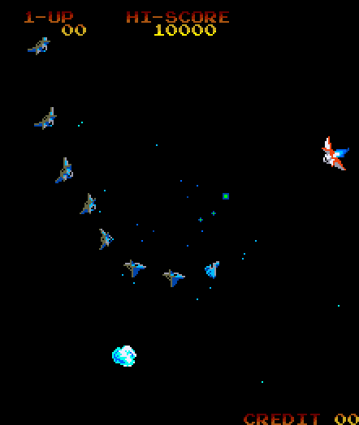</a><br><b><a href="games/gyruss/README.md">Gyruss</a></b><br><br>Cocktail and service modes unfinished | <a href="games/1943/README.md"></a><br><b><a href="games/1943/README.md">1943</a></b><br><br>Clipping and busy-scene speed limitations |
| <a href="games/bublbobl/README.md"></a><br><b><a href="games/bublbobl/README.md">Bubble Bobble</a></b><br><br>Significant gameplay slowdown | <a href="games/rtype/README.md"></a><br><b><a href="games/rtype/README.md">R-Type</a></b><br><br>Sound not implemented; developed with 14 MB in Hatari | <a href="games/ddragon/README.md"></a><br><b><a href="games/ddragon/README.md">Double Dragon</a></b><br><br>Significant slowdown: about 50% speed, ~3 pictures a second in play | <a href="games/timeplt/README.md"></a><br><b><a href="games/timeplt/README.md">Time Pilot</a></b><br><br>Sound not implemented; full speed, 24-33 pictures a second in play |
| <a href="games/trackfld/README.md"></a><br><b><a href="games/trackfld/README.md">Track & Field</a></b><br><br>Full speed, 20-50 pictures a second; no full-game verification yet | <a href="games/hyperspt/README.md"></a><br><b><a href="games/hyperspt/README.md">Hyper Sports</a></b><br><br>85% speed with sound, 26.9 pictures a second on average | <a href="games/mario/README.md">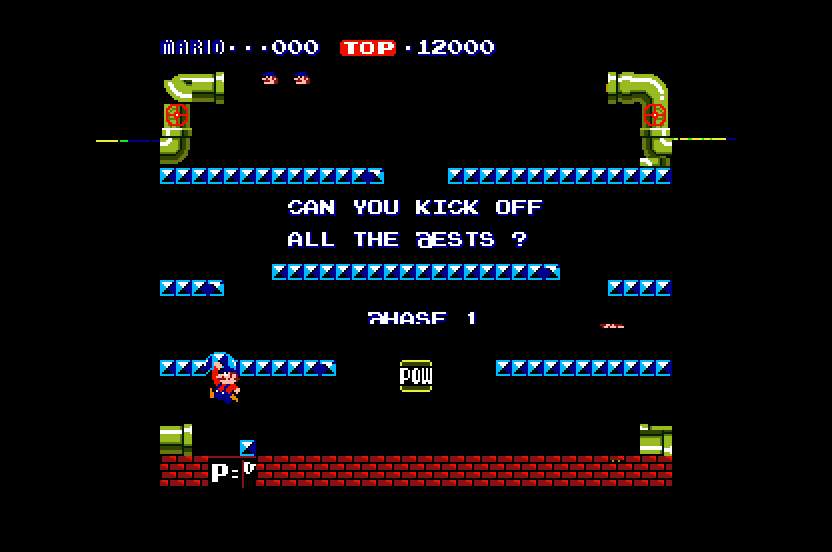</a><br><b><a href="games/mario/README.md">Mario Bros.</a></b><br><br>Logic (lock-step) and picture exact, 98% speed, 30 pictures a second (Hatari); sound by MAME recordings on the DMA (simulator-checked, not heard); later phases and full game not verified | <a href="games/mikie/README.md">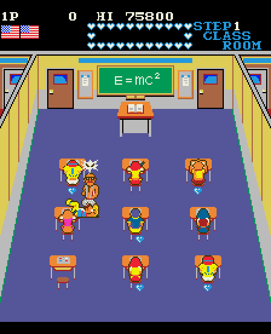</a><br><b><a href="games/mikie/README.md">Mikie</a></b><br><br>Logic (lock-step, 9 seeds x 30000 frames) and picture exact, 92% speed with sound, 35 pictures a second in the attract and first room; later rooms not covered |
| <a href="games/yiear/README.md">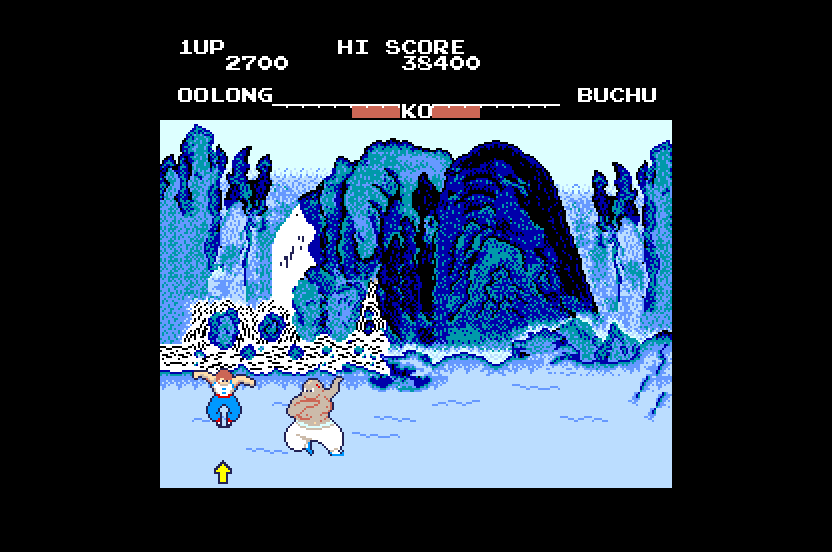</a><br><b><a href="games/yiear/README.md">Yie Ar Kung-Fu</a></b><br><br>Logic and picture exact, 96% speed, 37.7 pictures a second with sound (Hatari); no full-game verification yet, cocktail flip missing | <a href="games/sbasketb/README.md">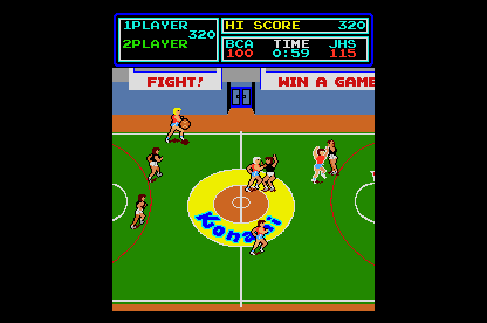</a><br><b><a href="games/sbasketb/README.md">Super Basketball</a></b><br><br>Sound by MAME recordings (simulator-checked only); 83-90% speed, 19-31 pictures a second; no full-game verification yet | <a href="games/jailbrek/README.md">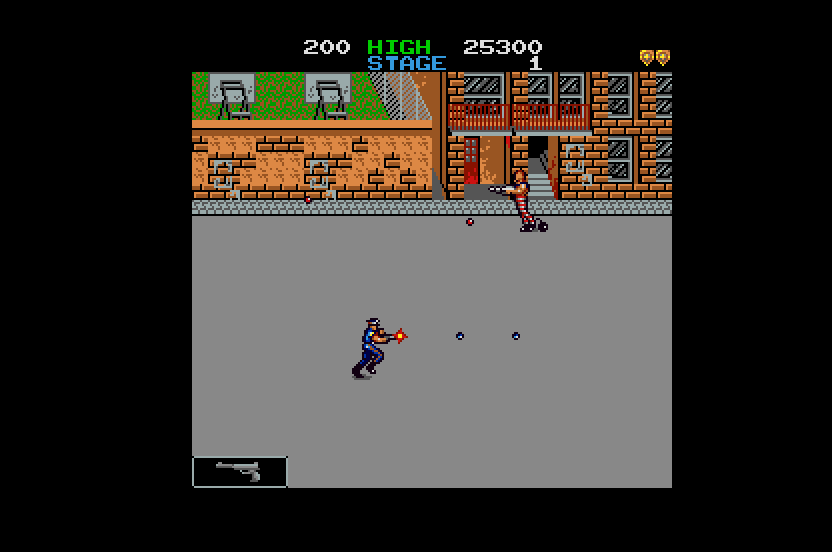</a><br><b><a href="games/jailbrek/README.md">Jail Break</a></b><br><br>Logic and picture exact; SN76489A on the YM, speech on the DMA (measured, not heard); ~40 arcade frames a second (68%), 15 pictures a second; no full-game verification yet | <a href="games/digdug/README.md">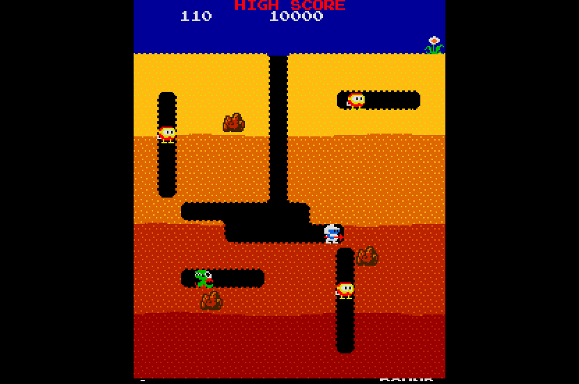</a><br><b><a href="games/digdug/README.md">Dig Dug</a></b><br><br>Three Z80s translated, real 51XX/53XX; picture exact, runs in Hatari with 4 MB, 33 pictures a second on average but ~18 in busy stretches; sound checked against MAME, not by ear; kept out of the release until decided |
| <a href="games/dkong3/README.md">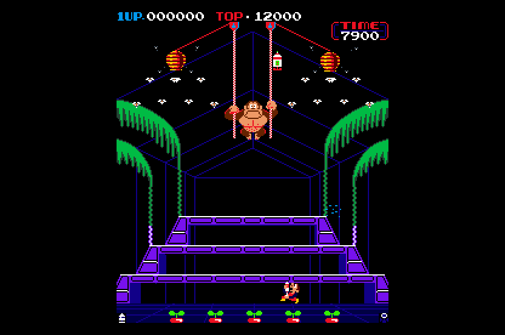</a><br><b><a href="games/dkong3/README.md">Donkey Kong 3</a></b><br><br>Logic, picture and sprites exact; about 84% speed, 27 pictures a second (Hatari); sound by MAME recordings on the DMA, not heard; full game not verified | <a href="games/rocnrope/README.md">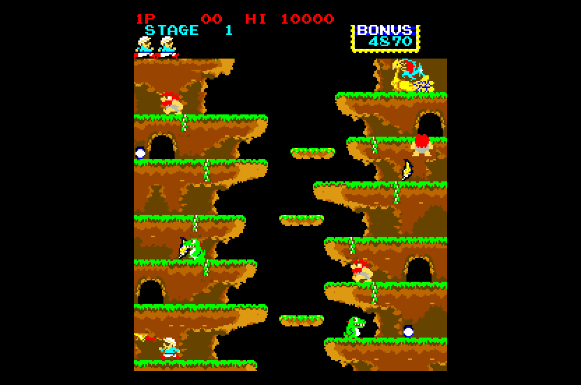</a><br><b><a href="games/rocnrope/README.md">Roc'n Rope</a></b><br><br>Logic and picture exact; sound (translated sound Z80, two AYs); no scroll in the hardware; later stages not reached | <a href="games/junofrst/README.md">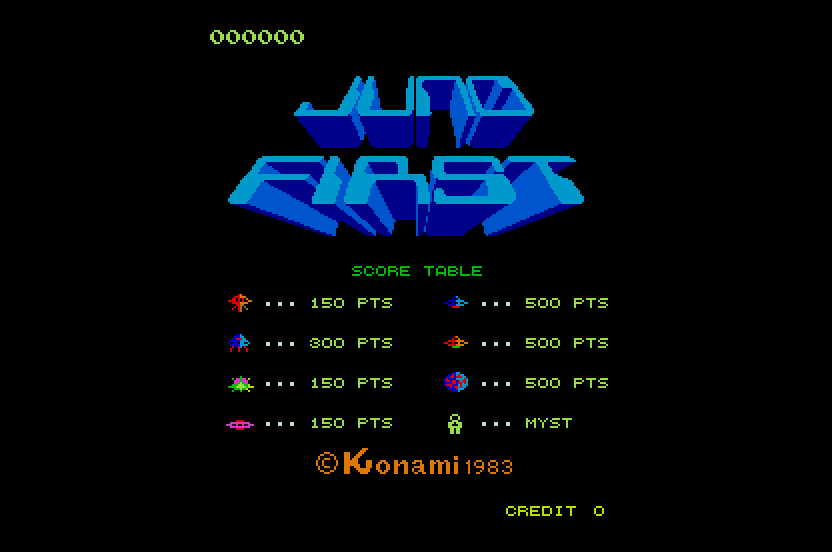</a><br><b><a href="games/junofrst/README.md">Juno First</a></b><br><br>About 61% speed, 8 pictures a second (Hatari); logic and picture exact; sound not compared with the arcade's audio | <a href="games/xevious/README.md">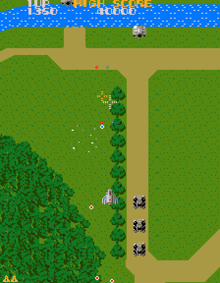</a><br><b><a href="games/xevious/README.md">Super Xevious</a></b><br><br>Slow: about 22 arcade frames a second, a few pictures a second (Hatari); logic (three Z80s) and picture exact; only the explosion noise as sound |
| <a href="games/splatter/README.md">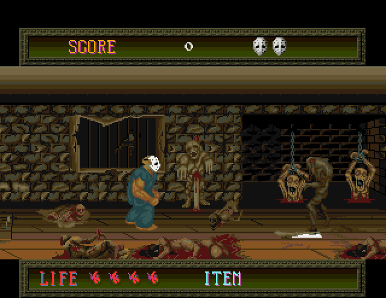</a><br><b><a href="games/splatter/README.md">Splatterhouse</a></b><br><br>STE program, logic exact; about 23% speed, 6.4 pictures a second; no sound | <a href="games/galaga88/README.md">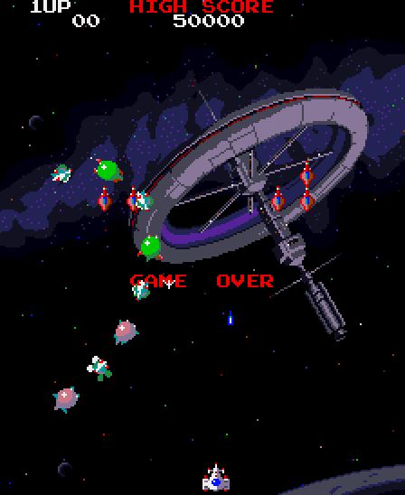</a><br><b><a href="games/galaga88/README.md">Galaga '88</a></b><br><br>STE program, logic exact; about 20% speed, 6.1 pictures a second; no sound | <a href="games/mrheli/README.md">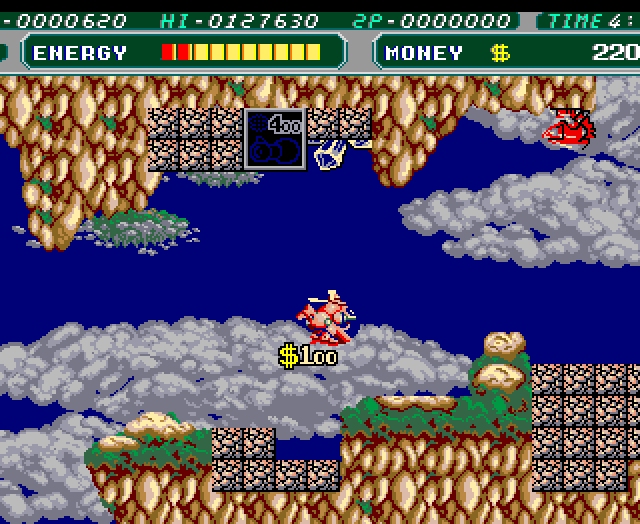</a><br><b><a href="games/mrheli/README.md">Mr. HELI no Daibouken</a></b><br><br>STE program on the shared M72 renderer, logic exact; about 2 pictures a second | <a href="games/dspirit/README.md">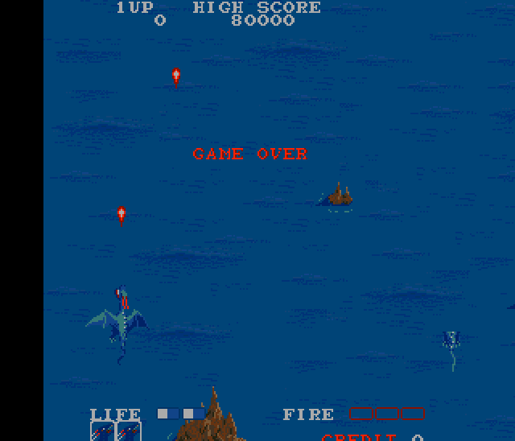</a><br><b><a href="games/dspirit/README.md">Dragon Spirit</a></b><br><br>STE program, logic exact; 13% speed, 3 pictures a second; no sound | <b><a href="games/pacmania/README.md">Pac-Mania</a></b><br><br>Board and reference work only | |

-  Graphics and sound implemented; complete playability verified in Hatari.
  No port has this status yet.
-  Graphics, sound and gameplay implemented; Hatari
  testing still incomplete.
-  Runs in Hatari, but has missing features or significant issues.
-  Gameplay blocked by crashes, broken behaviour or performance.
-  Early implementation, reference work, or
  development on hold.

Short attract-mode or assisted runs do not establish complete playability: see the
[full-game verification policy](docs/port-status.md).  `python port.py list` lists the registered ports, the ones the
common build, test, run and release commands handle.  Juno First and Super Xevious are experimental but registered (and in the release list).  Not registered and not released: Splatterhouse, Galaga '88, Mr. HELI and Dragon Spirit have STE programs with their own build, test and bench scripts; Pac-Mania has board and reference work only.

## Download

[Release 0.7](https://github.com/AnimaInCorpore/STEArcade/releases/tag/v0.7) (2026-11-02): `STEArcade-0.7.zip` holds
one self-contained TOS program per game (the arcade's code and graphics are built in: no ROM files are needed), a
bootable floppy image in `DISKS/` for each game that fits on one, and a README.TXT with the controls.  It needs an
Atari STE with 4 MB.  R-Type is not in it: it needs more than 4 MB while it is developed.  The sources may be newer
than the release.

## Controls

Every port takes the keyboard (cursor keys, Space / Control / Alternate, 1 / 2 start, 5 / 6 coin, Esc quits), two
joysticks (port 1 player 1, the mouse port player 2) and two Jaguar pads / PowerPads in the STE's enhanced joystick
ports (pad A player 1, pad B player 2; Option coin, Pause start, * + # quit).  Each game's buttons are in its README.

## Building from the sources

The ROM sets are not part of this repository: put the MAME archives listed in
[`assets/roms/README.md`](assets/roms/README.md) into `assets/roms/`.  Then:

```sh
python3 -m venv venv && venv/bin/pip install numpy pillow machine68k scipy    # once (scipy: Donkey Kong's sound)
python port.py list                                                       # the registered ports
python port.py prepare bublbobl                                           # unpack the ROMs (build does it when needed)
python port.py build bublbobl                                             # run/bublbobl/BUBBLE.PRG
python port.py run bublbobl shot@20                                       # in Hatari, a screenshot in /tmp/hrun
python port.py test bublbobl                                              # reference against translation and renderer
```

`port.py run` (`tools/hatari.sh`) uses the pinned F030Arcade build of Hatari, an STE with 4 MB.  R-Type, Double
Dragon and Dragon Spirit run with 14 MB, which the author allows for development; a released program must still load
on a 4 MB STE.  The experimental ports build with `python games/<game>/tools/build.py`; their READMEs list
their scripts.

## Making a release

`python port.py release <version>` builds every registered port and packs the programs with a README.TXT into
`release/STEArcade-<version>.zip` (`tools/release.py`; it refuses a program that needs more than 3,700,000 bytes).  It
also writes `DISKS/<GAME>.ST`, a bootable 720 or 800 KB floppy image for every port that fits: the program packed with
LZ4 (`lz4 -12`; the `lz4` command is needed) into a self-unpacking program in the disk's AUTO folder, which unpacks in
place behind a progress bar (4-13 s at 8 MHz, ~0.9 KB more memory; `tools/lz4prg_test.py` checks the stub for every
port).  Then tag `v<version>` and attach the zip to a GitHub release (`gh release create`).

## Documentation

Read [`docs/architecture.md`](docs/architecture.md) (how a port works), [`docs/porting-guide.md`](docs/porting-guide.md)
(the method, the MAME checks, the lessons), [`docs/speed.md`](docs/speed.md) (speed, and which port uses which
technique), then the game's README.  Also in `docs/`: [sprite preparation](docs/sprite-preparation.md),
[colours](docs/colours.md), [port status](docs/port-status.md), [PPO exploration](docs/ppo.md),
[Go-Explore](docs/go-explore.md), the Mega STE's [border timing](docs/megaste-border-timing.md) and
[diagnostic](docs/megaste-diagnostic.md).  Rules for all ports: translate whole programs; no silent NOPs (an unknown
instruction is a deliberate failure); check the reference against MAME before building graphics; verify in the pinned
Hatari.  The authoritative MAME source: `F030Arcade/third_party/jsm68kdisassembler/third_party/mame` (`AGENTS.md`).

PPO gameplay exploration: `venv/bin/python port.py ppo <game> train|record|verify|test` trains a RAM policy in MAME
and verifies its recordings in a private Hatari replay build ([the PPO guide](docs/ppo.md)); it supplements the
scripted coverage.

## Layout

    engine/            shared: the emulators and disassemblers (Z80, 6801, 6809 and KONAMI-1, HD63701, MB88, V30, i8039,
                       i8051), the translators (z80x and translate, m6801x, m6809x, v30x), the boards (namcos1.py,
                       m72board.py) and their MAME checks, the STE simulator on Musashi (sim.py), the sprite code
                       generators, the colour fitter, ROM preparation, paths and toolchain; sound: capsnd.py, opn.py /
                       opl.py / opm.py, lz.py; rt/: the shared 68000 runtime (rtlib.s, borders.s, jagpad.s, ikbd.s,
                       the sound players, lz.s, m6809rt.s, hdd.s); *_test.py: the engine's tests
    games/<game>/      one folder per port, all alike:
      README.md        the port: state, how it works, speed, tests, lessons (docs/porting-guide.md has the layout)
      src/             <game>.s (start, VBL schedule, input, hooks) and the parts it includes, named by topic
      tools/           machine.py (reference machine), gen.py (translation), assets.py, build.py, prepare.py (ROMs), the
                       tests *_test.py that port.py test runs, bench.sh (speed in Hatari) where a port has one
      ref/             cover*.py (port.py cover), mame_cmp_<game>.py (port.py mame), analysis scripts
      docs/            screenshot.png, rom_manifest.json, notes, dated reports and reference data
    tools/             hatari.sh (run, press keys, screenshot, dump memory), hddtest.sh, release.py, lz4prg.py +
                       lz4stub.s, stdisk.py (bootable .ST images), windows/ (PowerShell helpers)
    docs/              the shared documentation (above), status badges, reference/ (68000 and Z80 manuals)
    assets/roms/       the ROM archives (assets/roms/README.md); extracted/<game>/ is unpacked by port.py prepare
    build/ run/        generated code, assets and coverage data / the programs (ROMs embedded); not in git
    release/           port.py release: the packed programs; not in git
    legacy/            superseded material, not built or tested (legacy/README.md)
    port.py            the list of the registered ports and the front end: list, prepare, cover, build, test, run,
                       mame, release, ppo

## Screenshots and trademarks

The screenshots show the original games' graphics, which remain the copyright of their owners: Donkey Kong © 1981 and
Donkey Kong Junior © 1982 Nintendo; Galaga © 1981, Pac-Man © 1980, Galaga '88 © 1987, Dragon Spirit © 1987,
Pac-Mania © 1987 and Splatterhouse © 1988 Namco; 1942 © 1984, 1943 © 1987, Black Tiger © 1987, Commando © 1985,
Gun.Smoke © 1985 and Trojan © 1986 Capcom; Bubble Bobble © 1986 Taito; Gauntlet © 1985 Atari Games; Moon Patrol ©
1982, Kung-Fu Master © 1984, R-Type © 1987 and Mr. HELI no Daibouken © 1987 Irem; Pooyan © 1982, Time Pilot © 1982,
Gyruss © 1983, Track & Field © 1983 and Hyper Sports © 1984 Konami; Mr. Do! © 1982 Universal; Double Dragon © 1987 Technos Japan; Mario Bros. © 1983 and Donkey Kong 3 © 1983 Nintendo; Mikie © 1984, Yie Ar Kung-Fu © 1985, Super Basketball © 1984, Jail Break © 1986, Juno First © 1983 and Roc'n Rope © 1983 Konami; Dig Dug © 1982 and Super Xevious © 1984 Namco.  The game titles and logos are trademarks of their owners.  The pictures document the ports; this
project is not affiliated with or endorsed by any of them.

## License

The code in this repository is free software under the GNU General Public License, version 2 or (at your option) any
later version: see [LICENSE](LICENSE).  The license does not cover the arcade games themselves: their ROMs, and the
code, graphics and sound converted from them and built into each program, belong to their rights holders.
