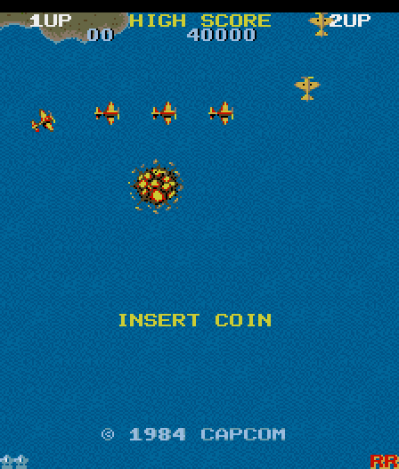

# 1942 (Capcom, 1984) on the Atari STE



The `1942` set (Revision B), MAME's `capcom/1942.cpp`.  The main Z80 is translated to 68000 code (15,469 instructions
since the task roots of 2026-10-20) and runs the arcade's cooperative task kernel; the scheduler's scan is a native
routine.  The sound Z80 is not run: the output of its driver (two AY-3-8910) is recorded per tune and effect and
played on the YM2149, three of its six channels.  The picture is the arcade's rotated raster in hardware scrolled
768-line rings (three draw rings and a clean one), sprites by generated Blitter code, one 16-colour palette per
palette bank.  Status: **Verification pending** (the assisted ending replay is verified; full-game checks are
pending).  Speed (Hatari, `bench.sh`: DEBUG + AUTOPLAY with MAME's cheats, 6000 VBLs, 4 MB, 2026-10-12): 58.1 arcade
frames a second (98% of the arcade's 59.6) and 35.7 pictures a second; the inline leaves of 2026-11-02 (logic -2.7% in
Musashi) have not been measured in Hatari.

## Build and run

```sh
python port.py prepare 1942            # verify assets/roms/1942.zip, unpack it to assets/roms/extracted/1942/
python port.py cover 1942              # 16 coverage runs of 60000 frames (about an hour), see "Coverage" below
python port.py build 1942              # -> run/1942/1942.PRG (the ROMs embedded; --sim: the Musashi build)
python port.py test 1942               # lock-step logic and pictures against the reference (see "Tests and tools")
python port.py run 1942 shot@30        # Hatari (tools/hatari.sh): screenshots, keys, dumps
python port.py mame 1942               # the reference renderer against MAME's picture
games/1942/tools/bench.sh [finish]     # Hatari speed (DEBUG + AUTOPLAY, 6000 VBLs), see "Speed"
```

The ROM archive is `assets/roms/1942.zip`, checked against `docs/rom_manifest.json`.  The commands need the venv of
the quick start.  Paths are relative to this folder; `engine/`, `tools/`, `port.py` and `docs/` at the top are the
repository's.

## Controls

**5/6** coins, **1/2** start, **arrows** move, **Space/Ctrl** fire, **Alt** loop, **Esc** quits.  Joystick port 1
plays player 1, port 0 player 2 (fire = fire).  Jaguar pad / PowerPad (STE enhanced ports,
[architecture.md "Input"](../../docs/architecture.md#input-all-ports)): pad A player 1, pad B player 2, the D-pad
moves, **A** fire, **B** loop, **Option** coin, **Pause** start, keypad **1/2** start, **5/6** coin, **\*** + **#**
quit.  Tap the coin key: the game ignores a coin held for 40 ticks (the reference machine credits 3-20).

## State

* Logic exact: `logic_test.py` 40000 frames of attract mode and random play (2026-10-08; RAM, video RAM, sprite RAM
  and latches compared every frame), `--cheat` 12000 frames with about ten stage changes, `--two` 12000 frames of a
  two-player game, 0 differences; `port.py test` runs 6000, 9000 `--cheat` and 6000 `--two`.
* Pictures exact through the palette map: `render_test.py seq 600 1 1200` 0 differ, 0 with margin pixels; `seq 200`
  and `ATTRACT=1 seq 300` likewise; both palette banks and wrapped windows seen.  The reference renderer equals MAME's
  picture (0 of 57344 pixels in 10 frames, palette banks 0 and 2, scrolling, sprites, characters).
* Sprites: `sprite_test.py` 56993 draws and restores (33912 at an edge, 15000 of them across 64 KB; SEED=3: 57159);
  `spritegen.py` checks all 8000 generated routine / stream pairs against a Blitter model.
* Sound: `sound_test.py 3000` 0 of 9000 ticks differ from the model; the model against the driver: see "Sound".
* Hatari: no late border events; the assisted Dreamer ending replay of 2026-10-20 (51,176 ticks, see "Verification").
* Missing: three of the two AYs' six channels; the flip screen (cocktail / DIP switch); the service mode (code in ROM
  bank 2, not translated); the arcade's wrap-around of sprites at the raw 256-pixel edges (parts wholly outside are
  not drawn); a palette per scanline band (the HUD's colours are quantized with the playfield's).
* Open: a natural full playthrough; real hardware (only Hatari was used); whether any window read goes through IY (the
  gen guards `(a6,dN.w)` forms only; Gun.Smoke's fix applies, see
  [speed.md](../../docs/speed.md#techniques-that-look-applicable-elsewhere-2026-11-07)); the shared default colour
  fitter has not been tried.

## How it works

`src/`: `1942.s` (start, schedule, input, timers), `render.s` (video, palette banks, baking), `bg.s`, `chr.s` +
`chr2.s`, `spr.s`, `frame.s` (one frame, data, variables), `sound.s` (the YM2149).  `tools/`: `machine.py` (the
reference machine), `gen.py` (translation), `assets.py` / `palettes.py` (graphics, palettes), `spritegen.py`,
`sound.py`, `build.py` and the tests.  `ref/`: coverage (`cover.py`), the MAME check (`mame_cmp_1942.py`,
`mame_dump.lua`), `palette_stats.py`.  `docs/`: `palette_stats.json` (how often each palette entry shows),
`palettes.json` (the four 16-colour palettes), `window-sites.json` (the window read sites), `rom_manifest.json`, the
screenshots and the Dreamer reports of 2026-10-20.  The shared pieces: [architecture.md](../../docs/architecture.md),
the method: [porting-guide.md](../../docs/porting-guide.md).

### The board and the reference

One main Z80 (the sound board in "Sound").  The program is a small cooperative kernel: tasks that sleep with
`rst $18`, a scheduler that scans a 16-entry task table (`$0084-$009A`), and two interrupts: RST 08 (line 109, a sound
command) and RST 10 (the vertical blank: sprite DMA `$EB00 -> $CC00`, scroll, timers).  `$8000-$BFFF` is a window onto
three 16 KB ROM banks (`$C806`); the program only reads them as data (the service mode is the one place that runs code
from them).  `tools/machine.py` is the reference machine; its RAM follows MAME's (the hook count of the old wolfmame
is 120 frames behind its emulated frame).

### Translation

`tools/gen.py`: "signed" memory model (the 64 KB block with the video RAM and RAM below `a6`), through
`translate.compile_code` (precise flag liveness over calls; the tasks started with `jp (hl)` and the hooks keep their
exact flags), the whole `z80x.FAST` register map (`alt_af="upper"`, `alt_regs="upper"`, `iy_reg="a2"`: A' in d0's
upper bits, F' in d6's upper word, BC' / DE' / HL' in the upper words of d1-d3, IY in a2, `ex af,af'` two swaps, a3
free for `ret`).  1942's own `ldir` stays (by longs; it clears only the low word of d1, `clr.w d1`, so BC' survives).
Translator options, all opt-in so that the other ports generate the same code (`engine/z80x.py`,
`engine/discover.py`): the P/V flag of `and/or/xor` as parity in `d6` bit 7 for `jp pe/po` (also through the
`ex af,af'` pair at `$261A` -> `$262D`), `bit` sets S as the CPU does, flags exact at `jp (hl)` and at the hook (the
task contexts the kernel saves on its stack are compared byte for byte), `add iy,bc`, jump tables behind `call $66F7`
(an index in A, the words follow the call).

* **Task roots** (`gen.py` `TASK_ROOTS`: `$6EDA`, `$6EEB`, `$70F2`): tasks installed indirectly through BC and
  `rst $38` (`$7056`, `$6CC2-$6CCD`) are explicit roots and join points, translated whatever the coverage saw;
  `tools/gen_test.py` removes them from the coverage and checks their labels and swapped dispatch entries.
* **Inline leaves** (2026-11-02): calls of leaf functions of up to 32 instructions in the fixed ROM are emitted in
  place (`gen.py` `INLINE`, z80x `inline_leaves` with `inline_rst` / `inline_jumps`, Commando's setting; 274 sites).
  `logic_test.py` leaves out the return address such a call writes below SP in the reference (a dead stack word, as
  for the merged push/pop).
* **ROM bank window**: reads go through `g_winbase` at the 97 instruction sites the coverage found (the mechanism of
  Bubble Bobble's main CPU), kept in `docs/window-sites.json` (read from there when no coverage file is present).
  `W_GUARD_ALL=1` guards every indirect access (the translated code 26.6k instead of 23.8k cycles a frame,
  `engine/xprof.py`); `logic_test.py --audit` traces a run for reads of the block's own window area, which only an
  unguarded site makes (none in 600 frames each of the attract, the cheats and two players).  Every store to `$C806`
  (`ld ($C806),a`, `ld (hl),n`, `ld ($C805),hl`) calls `g_bank_w`.
* **Dispatch table**: `gen.py` emits it (`dc.l` labels, `dcb.l` runs of `z80_badpc`, 65536 longs in byte-swapped
  order); `logic_test.py` checks at its start that every entry is its address's label, the token's `z80_irq_ret` or
  `z80_badpc`.

### Schedule

`src/1942.s` (header and `z80_hook`; `tools/machine.py run_frame_port` is the same in Python): the foreground runs the
tasks; when the scheduler finds nothing to run (the hook at `$009A`) the runtime draws the frame (if its tasks have
all slept again) and delivers a pending VBL: RST 08 and RST 10 run to completion with a token on the Z80 stack.  RST
10 may hand the CPU to another task (`jp $0084`): the 68000 stack was reset before, so nothing leaks.  The STE's VBL
adds one tick to `vbl_pending`, every 5th VBL a second one: the game ticks 60 times a second (the arcade: 59.6) while
the screen shows 50 frames.  Due ticks run before the next frame is drawn (`MAX_SKIP` 2: at most 3 ticks per frame;
`MAX_PENDING` 3 waiting): a game that is behind loses frames, not speed.  `-D NOTICK60` builds one tick per VBL.  The
scheduler's search for a ready task is native (`scan_native`, 10% of the logic saved; it writes d1-d3 as words and
clears F with `clr.w d6`, since a `moveq` would clear F').

### Picture

The screen is the arcade raster rotated 270 degrees: 224 x 256.  The background tilemap is 512 pixels long along the
screen's vertical axis and scrolls by one line every second frame; sprites (16 x 16, 16 colours) and characters (8 x
8, 2 bits) are fixed to the screen.

* **Hardware scroll.**  Three draw rings and `clean` (the background alone), each 768 lines of 256 bytes (the
  Shifter's line offset, `LINEWID`); line `L` is tilemap column `511 - L`, lines 512-767 repeat 0-255, so the 256-line
  window from `T = (256 - scroll) & 511` never wraps (lines below 256 are drawn twice only for the background; sprites
  and characters go where the frame's window has them).  No Timer B wrap trick is needed.
* **Three draw rings**: `render_frame` draws into a ring that is not shown, not waiting to be shown (`frame_ready` =
  its number + 1, one byte: the VBL sees a finished frame whole or not at all) and **not the ring that was shown until
  the last VBL**: Hatari scans that one out once more after the new video base is written, and a ring drawn into then
  tears.  The VBL shows the newest finished frame (video address = ring + `T` * 256 - `PIC_TOP` lines, palette
  `frame_pal`); a frame not shown when the next one is done is dropped.  Every ring keeps its own state (`ring_T`,
  sprite rectangles, characters drawn, tiles to copy).
* **A frame** (`src/frame.s`): window and palette bank from the Z80's registers; background and character RAM are
  compared with shadows (`bg_shadow`, `fg_shadow`) only when a store to them was seen (the translated code sets
  `bg_dirty` / `fg_dirty` at the 25 store sites the coverage found, plus a rescan every 32nd frame; `logic_test.py`
  checks that no change goes unflagged); new tiles are baked, put into `clean` and noted for the draw rings; the
  ring's old sprite rectangles go back (Blitter copy from `clean`); tiles; characters (when the window moved, every
  occupied 16 x 8 chunk, in the order that draws the neighbour after: the old lines of a chunk the new picture does
  not cover are put back as the chunk is drawn; else only the changed chunks); sprites, entry 31 first; the characters
  that sprites cover are drawn again.  Scrolling restores use the shared full-word copy path (2026-10-19,
  [the measurements](../../docs/virtual-scroll-performance.md#implementation-results)).
* **Sprites** (`src/spr.s`, `tools/spritegen.py`, the method of `stefastbobs2/FAST_BLITTER_SPRITES.md`, see
  [sprite-preparation.md](../../docs/sprite-preparation.md)): the baked source of a part has its rows in blit order
  (equal opaque masks adjacent, transparent rows left out, `assets.sprite_orders`); one Blitter call per row draws the
  four planes (Y count 4, the opaque mask cut into the two destination words as END1 / END3, holes included, NFSR for
  the second word, X / Y increment 2 so the Blitter walks the source itself).  A generated routine per row structure
  (772 for the 500 shapes, shifted or not, 93 KB) is only register writes (`add d4,(a4)`, `move (a0)+,(a2)`,
  `move d6,(a5)`, `move.b d7,(a6)`; the Blitter's registers in `a2-a6`, `d4-d7`); the masks and control word (skew,
  NFSR) of the 16 shifts are a stream per (code, shift) (`spr_code_tab`, 202 KB), nothing computed at run time.  The
  routines add to the low word of the destination address, so a part that reaches a 64 KB boundary of the ring (1 in
  16) goes through `generic_part` (a Blitter call per row with the full address, the same streams, rows from the
  shift-independent `spr_plan`).  `spritegen.py` runs every (code, shift) routine against a Blitter model (stale
  source buffer bits, skew, NFSR, end masks) over noise and refuses to write anything that fails.  1943 and Commando
  use the same generator.
* **Edges**: the game area's left and right edges (byte 24 and 136 of a line, black margins beside them, no horizontal
  scroll) are chunk boundaries.  `sprite_entry` tests the screen x with one unsigned compare (`cmp.w #208` /
  `bhi .edge`); the edge branch culls x < -15 or >= 224 and calls `draw_edge` (`spr.s`): one Blitter call per row with
  X count 1 and the full address (no 64 KB limit), masks from the existing streams, rows from `spr_plan`.  Right edge
  (x 209-223): the first word, skew s, END1.  Left edge (x -15..-1): the second word at chunk 0, FXSR with source Y
  increment 0 (two reads a line advance one word), END1 := the stream's END3; source Y increment 2 again afterwards.
  Only the inner chunk is recorded for the restore and the character overlay.  Top and bottom: whole parts into the
  guard rows.
* **Timers**: the shared `engine/rt/borders.s` and short HOG passes (`blit_go`), see
  [architecture.md "Border removal"](../../docs/architecture.md#border-removal).  Timer B also switches the palette on
  at the picture's first line and off after its last (the picture is centred in the 276 lines, black bars around it);
  `blit_copy` runs rows longer than 32 words a line a pass.

### Colours

16 per palette bank (`tools/palettes.py`: weighted k-means in Oklab over the colours of the bank's background, sprite
and character entries, weight = the pixel count over the sampled frames^0.6 + a floor; counts from
`ref/palette_stats.py`).  The pen masks of the graphics (`tools/assets.py`) are baked into STE planes on first use
(`tile_get`, `sprite_get`, `char_get`) and cached; a bank change flushes the caches and redraws the background.  The
shared default fitter of 2026-11-05 is not used here ([colours.md](../../docs/colours.md#what-each-port-uses)).

### Sound

The sound board (MAME `capcom/1942.cpp`): a Z80 at 3 MHz, two AY-3-8910 at 1.5 MHz, four IRQs a frame; the STE's
YM2149 is the same chip with three channels instead of six.  Translating the driver would cost about 1700 Z80
instructions a tick (as much as the game logic), so `tools/sound.py` records its output: every program (11 tunes, 14
effects) alone, in ticks of four IRQs, as YM register images (periods x 4/3 for the YM's 2 MHz, tones clamp at 4095,
noise at 31), until its slot ends or its RAM repeats (a loop).  `src/sound.s` plays them in the driver's scheme
(`sound.py` `Player` is the same in Python): music slots `$4480 > $4300 > $4580 > $4600` and effect slots
`$4100 > $4200 > $4180 > $4080`, only the highest active one of each steps (the lower ones pause), `$4180` / `$4080`
restart their effect every 32 / 8 IRQs, the stop commands.  Six channels to three: the in-game drums (command `$11`)
and the other first-chip tunes are the music, and every channel an effect (second chip) sounds on replaces the music's
channel of the same letter; the two-chip jingles play three fixed channels each (`PICKS`: octave doublings dropped,
the louder kept).  37 KB (2130 images of 12 bytes, 8.8 KB of program words).  The latch is read at every tick
(`.deliver`, the command of the tick before), the YM gets the registers that changed; no interrupt handler of the port
touches the YM.  `build.py --sound` records the programs again.

`sound.py check 3000` (the model against the driver run beside the game and with random commands): 273 of 3000 game
ticks differ, 230 of them by a volume step of 1-2 (an effect that resumes in the middle of a tick: the model steps
whole ticks); the random command runs 15 and 0.

### Memory

2,940,232 bytes (text + data + BSS, `build/1942/1942.map`, 2026-10-15), 1,094 KB left from the desktop
(`tools/memfree.sh`); 0.3 (3,933,862 bytes) did not start on a tester's Mega STE (the load budget:
[porting-guide.md "Memory and release"](../../docs/porting-guide.md#memory-and-release)).  The program allocates
nothing at run time (GEMDOS calls: `Super`, the `COUNTERS.BIN` / `DEBUG.BIN` / `CRASH.TXT` files, `Pterm`).  What made
it fit, none of it slower:

* the dispatch table as data (256 KB) instead of BSS filled at the start from an 86 KB (pc, label) list;
* the fixed ROM and the banks assembled where the translated code reads them (`g_block`: 32 KB zeros + the ROM;
  `g_win`: the banks + the empty `$FF` one), nothing copied at the start;
* the tiles as the arcade's three bit planes (`tile_planes.bin`, two flip-y variants: 96 KB instead of 256 KB of pen
  masks); `bake_tile` makes a row's eight masks as it bakes (`engine/rt/penmasks.s` `pm_expand`, ~250 cycles a row).
  Flip x is the row order of the baked tile (the ring's lines run down the tilemap's x axis): `bake_tile` writes an
  x-flipped tile's rows from its end (`-(a2)`, the same cycles);
* `tile_ptr` as word numbers of the baked tiles instead of pointers (128 KB less);
* the pools sized by their measured use: `tile_pool` / `spr_pool` / `chr_pool` 128 / 192 / 128 KB (were 384 / 256 /
  192): over `perf_test.py` runs of 11-19k ticks at most 20 / 70 / 33 KB were baked between two flushes, at most 15 /
  1.3 / 28 KB in one frame; the room kept for a frame (`*_POOL_ROOM`: all 512 background cells, 256 sprite parts, 48
  KB of characters) leaves 64 / 160 / 80 KB before a "full" flush, which no run reached.

## Speed

| date | setup | logic | pictures a second |
|---|---|---|---|
| 2026-10-12 | Hatari, `bench.sh` (DEBUG + AUTOPLAY, MAME's cheats, 6000 VBLs incl. ~300 of boot, 4 MB) | 58.1 arcade frames a second (98%) | 35.7 |
| 2026-10-10 | the same with a level skip every 600 frames (`bench.sh 600`) | 58.1 (98%) | 44.0 |
| 2026-11-02 | Musashi, the logic alone (`perf_test.py 3000 0 900 norender`, stage 1, ticks 900-3000) | 40,632 cycles a tick (median 40,074, p90 56,114) | |
| 2026-11-02 | Musashi, the logic with level skips (`perf_test.py 6000 600 900 norender`) | 32,356 cycles a tick | |
| 2026-10-19 | Musashi, CPU + Blitter a tick with its drawing (`perf_test.py 1600 0 1200`) | 139,250 cycles | |
| 2026-10-12 | Musashi, `render_frame` alone (`profile.py 300 1250`) | | 65,798 cycles a frame |

The first ~300 VBLs of the bench are the boot, so 57.2 of 59.6 is full speed.  Hatari takes about 1.35 times the
Musashi cycles.  A frame costs 65-90k cycles (heavy scenes: sprites 50%, characters 30%), so 8M cycles a second do not
allow 60 ticks and 50 frames in the busiest scenes: the frames give way.  Stage changes cost 1-2.4M cycles (the
palette bank changes and every cached picture is baked again).  The cross-port rates are in
[speed.md "Which port uses what"](../../docs/speed.md#which-port-uses-what-2026-11-07).

What made it fast, newest first:

* **Inline leaves** (2026-11-02): the logic 41,743 -> 40,632 cycles a tick (-2.7%), median 40,100 -> 40,074, p90
  58,094 -> 56,114; with level skips 33,196 -> 32,356 (-2.5%); `logic_test.py 6000` 37,581 -> 36,684 a frame,
  `9000 --cheat` 33,964 -> 33,169.  Not measured in Hatari (by the budget about +0.6 pictures a second).
* **Shared full-word restore path** (2026-10-19): a tick with its drawing 139,432 -> 139,250 (-0.13%).
* **Edge clipping** (2026-10-12) cost nothing: `perf_test.py 3000` 139,461 -> 139,455 a tick (CPU 126,281 -> 126,408,
  Blitter 13,180 -> 13,046), `3000 600` +0.01%, `render_frame` 65,915 -> 65,798 (`draw_edge` 547 CPU cycles, Blitter
  9,556 -> 9,294); Hatari 58.1 / 35.7 before and after.  The unsigned compare replaced the old cull's two, so inner
  parts got cheaper.
* **Translator** (2026-10-08, FAST 2026-10-09): `translate.compile_code` took the translated code from 28.1k to 24.3k
  cycles a tick (`engine/xprof.py 1942`, ticks 1100-1500, 1.16x); the full FAST map 24,254 against 24,306 with
  `alt_af="upper"` alone (the engine's `ldir`: 24,407).  What is left is spread thin: `ret`, `ldir`, `push`/`pop af`
  around calls, `bit n,(ix+d)` with the exact S.
* **`scan_native`**: the scheduler's scan in a register loop, 10% of the logic.
* **The schedule and the rings** (2026-10-08): the heavy scene of stage 1 went from about 40 ticks (67%) and 40 frames
  a second to 57.8 ticks and 35.3 frames; with stage skips every 600 frames 57.6 / 43.6.  What was lost before: a
  double buffer that blocked the renderer while the finished ring waited for the VBL (the CPU idled a tenth of its
  time), one tick per drawn frame (every slow frame slowed the game), and the characters redrawn at every ring visit
  (`draw8` and its bookkeeping were two thirds of a frame).

Measured, not kept:

* **Sprites as bit planes** (2026-10-15): would save 196 KB more, but their bakes made the 99th percentile tick
  266,472 cycles (+12% over 238,852); the sprites keep their masks.  The tile planes cost a tick 139,461 -> 139,528,
  the 99th percentile 238,852 -> 242,414 (Musashi's default 4 MB; with 16 MB the same build counts ~1.4% more).
* Left as they are (estimates, not built): Black Tiger's word dispatch table (128 KB less, but about 22 cycles more
  per `ret` / `jp (hl)`, 19 of them a tick); `chr_ptr` as word indexes (a few cycles per lookup); the unused 96 bytes
  of every ring line (the Shifter skips them: 294 KB in pieces, sprites reach into the first of them).

Open ideas (not measured): sprite entries kept in registers (`sprite_entry` / `draw_part` are 15% of busy frames);
fewer rectangles (one restore per sprite part); natives for the kernel's other hot routines (the timer loop `$0055`,
the task switch); the HUD rows' characters drawn only when they change; a faster bake at a stage change, or pre-baked
tiles for the common colour codes; a 4th draw ring (200 KB, fits since 2026-10-15).

Techniques other ports use that may apply:
[speed.md](../../docs/speed.md#techniques-that-look-applicable-elsewhere-2026-11-07) (among them writer marks for the
character RAM, contour restores, caches keyed by the colour mapping for the stage-change re-bakes).

## Tests and tools

Build with `--sim` without `--debug` for the sprite restore check: DEBUG paints counters into ring 0, which correctly
fails the check for untouched pixels.

```sh
python port.py test 1942                       # build --sim; logic_test 6000, 9000 --cheat, 6000 --two;
                                               #   sprite_test; sound_test 3000; render_test seq 200 1 1200
python games/1942/tools/logic_test.py 40000    # the whole program on Musashi against the Z80 reference, RAM every frame
python games/1942/tools/logic_test.py 12000 --two   # the same with a two-player game (--cheat: MAME's cheats)
python games/1942/tools/logic_test.py 600 --audit   # traces reads of the window area that an unguarded site makes
python games/1942/tools/gen_test.py            # the task roots and their dispatch entries without coverage
python games/1942/tools/sound_test.py 3000     # the YM player against tools/sound.py's model
python games/1942/tools/sound.py check 3000    # the model against the driver
python games/1942/tools/sprite_test.py         # every sprite code and shift, many positions (edges, 64 KB), restore
python games/1942/tools/spritegen.py           # sizes and the Blitter model check of all 8000 routine / stream pairs
python games/1942/tools/render_test.py seq 600 1 1200   # every picture against the reference renderer (margins black)
python games/1942/tools/profile.py 60 1250     # cycles of render_frame by routine ([n] [first] cheat|finish)
python games/1942/tools/perf_test.py 3000      # [ticks] [finish] [first] [norender|profile]: cost of a tick,
                                               #   the heaviest ticks, a profile by routine and by Z80 region
python games/1942/ref/mame_cmp_1942.py         # the reference renderer against MAME (ffmpeg, F030Arcade's wolfmame)
engine/xprof.py 1942                           # the translated code's cycles per Z80 instruction
games/1942/tools/record.sh                     # Hatari's picture (recanim), to look at frames one by one
```

`render_test.py` takes `ATTRACT=1` (no coin) and `SCROLLRND=1` (random scroll jumps: every sign and size of the
window's move between two visits of a ring).  `bench.sh [finish_period] [items]` builds the DEBUG + AUTOPLAY version
into `run/1942_bench` (with the ROM bank files; `run/1942` keeps the normal build): scripted coin, start, fire and
joystick, MAME's cheats for 1942b (lives E101, invincibility E0A5 and, every `finish_period` frames, "Finish Current
Level Now!" EBD0 / E099 / E102; the cheat that selects a starting level does nothing in this set), 6000 VBLs, then
reads `COUNTERS.BIN`: ticks a second, frames drawn a second, VBLs between two ticks, CPU idle.  It starts its own
Hatari and stops it by its PID (`tools/hatari.sh` stops every running Hatari, other benchmarks and interactive
sessions too); items (`shot@60`, `tap:5@20`, `dump:...`) work as in `tools/hatari.sh`.

Debug options (`build.py -D ...`): `DEBUG=1` counters (`COUNTERS.BIN`; `--frames N` quits after N VBLs) and assertions
(list entries, Blitter rectangles), `AUTOPLAY=1` scripted play, `FINISH=n` level skips with it, `RULER=1` a ring line
number as colours in the left margin (no line skipped or repeated can be read from a screenshot), `NOTICK60=1` one
tick per VBL, `STAGES=1` progress as colours.

Coverage (`ref/cover.py`, 16 seeds of 60000 frames): random play without cheats never got past the first stages, and
the program stopped at `z80_badpc` at the first stage change.  Seeds 5-8 play with MAME's cheats (lives,
invincibility, a level skip every 400 frames; 1800 more program addresses), 9-12 two-player games (two coins, start 2,
both joysticks, the turns change at every death), 13-16 long games with the lives cheat only (stages reached by
playing, with deaths on the way).  `logic_test.py --cheat` and `profile.py ... cheat|finish` use the same cheats on
both machines.

Hatari on Windows: `tools/windows/run.ps1` kills every running Hatari and its screenshots grab a wrong area at high
DPI scaling.  What worked: start Hatari with `--borders true --screenshot-dir <dir> --screenshot-format png`, send
RightAlt+G (with scan codes) to its window and read the PNG (Hatari's own screenshot, 2x the emulated 416 x 276); keys
with scan codes and a hold time of 700 ms (the game polls the inputs once per tick).  Never kill other Hatari
instances.

## Lessons

### 2026-10-20: tasks installed through BC

A Dreamer assisted run stopped at tick 41,649 with fatal code 99 (the translated-code failure path): D7 `$0003C9C0` is
the swapped dispatch index of `$70F2`, whose entry was `z80_badpc`.  Translated `$7056` loads BC with `$70F2` before
`rst $38`, which installs the task indirectly; recursive descent did not find it, the coverage had not run it, and the
generated `code_1942.s` had no `Z70F2`.  The ending exploration then found two more (`$6EEB`, `$6EDA`, high-score
entry tasks installed at `$6CC2-$6CCD`).  All three are explicit roots now, checked by `gen_test.py` without coverage.
Natural reachability of the failure without cheats is untested.

### 2026-10-12: edge clipping

Before this the tree drew parts whole into the visible margins (and an earlier HEAD cleared the margin chunk after
drawing, `spr_clip`); the old whole-drawing build fails `sprite_test.py` at once and showed margin pixels in 56 of 600
`render_test.py` frames.

### 2026-10-11: two players and long games

Seeds 9-16 reached 69 program addresses the first eight runs did not (the two-player turn change among them), but the
static discovery had translated all of them already: the generated code was the same, and no new window reads or video
stores turned up.

### 2026-10-09: FAST and the port's own ldir

`z80x.FAST` first measured 0.4% slower than `alt_af="upper"` alone: 1942's own `ldir` ended with `moveq #0,d1` and
wiped BC' in the upper word.  With `clr.w d1` FAST is faster (a234c67).  The DEBUG histogram in `z80_hook` must save
d0/d1/a0 for the same reason.

### 2026-10-08: a ring Hatari still scans, wrapped windows

With two draw rings the lower half of the picture showed the characters of the next frame, one or two lines off, while
the upper half was steady: Hatari scans the ring shown until the last VBL once more after the new video base is
written.  A third draw ring fixed it.  The first renderer test passed for 1000+ frames while the wrapped half of the
ring was wrong: test windows that wrap (`SCROLLRND=1`).

## Verification

The adjacent Dreamer project's `scripts/stearcade_play.py` tested a private instrumented build in patched Windows
Hatari (executable SHA256 `f113a3853fd993cac459cb672748f1c20c59ee4ac370501f49d5a6597cbf1796`), 2026-10-20:

* Natural play: 22,600 ticks (1,800 decisions, 434 learner updates), lives lost and restarts, `$E103` never beyond 0;
  a fresh replay matched all 188 sampled RAM checkpoints.
* Assisted (lives, invincibility and finish-level cheats): reached `$E103 = 32`, then the `$70F2` crash after tick
  41,649 (`CRASH.TXT`); a fresh full replay matched 347 RAM checkpoints and reproduced the byte-identical crash and
  registers.  The fixed build replayed all 347 checkpoints, completed the fatal input (tick 41,650) and ran 1,200
  ticks more ([the regression report](docs/1942-70f2-regression-2026-10-20.md)).
* Assisted ending: reached the final ending screen, found `$6EEB` and `$6EDA`
  ([the ending report](docs/1942-ending-regression-2026-10-20.md)).  The ROM ends with game-over / continue handling,
  not an automatic difficulty loop; the recorded continuation uses explicit coin / start inputs.  The final build
  completed 51,176 ticks, reached the ending and then stage byte 6 after starting again; a fresh-process replay
  matched all 426 RAM checkpoints and the complete input stream, with no crash or input mismatch.

Limits: controls bypass the host keyboard / pads, sound was disabled, and the replays establish reproducibility, not
logic / render equivalence; sampled guest framebuffers showed gameplay.  The evidence is in the Dreamer project
(`runs/stearcade-1942-assisted`, `runs/stearcade-1942-assisted-replay`, `docs/stearcade-results-2026-10-20.md`); the
crash reports `docs/1942-6eda-crash-2026-10-20.txt` and `docs/1942-6eeb-crash-2026-10-20.txt` are kept here.

PPO exploration: `venv/bin/python port.py ppo 1942 test --steps 256 --frames 2100` ([the PPO guide](../../docs/ppo.md)).
Full-game verification follows the [status policy](../../docs/port-status.md); nothing here claims a complete playthrough.
