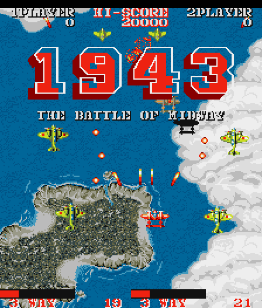

# 1943: The Battle of Midway (Capcom, 1987) on the Atari STE



The `1943` set (Euro), MAME's `capcom/1943.cpp`, registered as `1943`.  The main Z80 is translated to 68000 code
(14,314 instructions from the fixed ROM and banks 0, 1, 4, 6), the task kernel's scan for a ready task is a native
routine.  The i8751 protection MCU runs its dumped firmware, translated (`tools/mcux.py`), with its VBL interrupt
(INT1) as a native routine.  The sound Z80 is not run: the output of its driver is recorded per command (effects on
the SSG, the music from FM as square waves) and played on the YM2149.  The picture is a hardware scrolled Blitter
renderer with twin-line virtual screens and one 16-colour palette.  Status: **Incomplete** (busy scenes are slow; the
arcade's clipping of sprites at the raw 256-pixel edges is not done).  Speed (Hatari, `bench.sh`: DEBUG + AUTOPLAY,
6000 VBLs, 4 MB, 2026-10-12): 51.2 arcade frames a second (85%) and 7.9 pictures a second; the logic has since become
~20% cheaper in Musashi (the MCU's INT1 native, the kernel's scan native, inline leaves), not measured in Hatari.

## Build and run

```sh
python port.py prepare 1943                  # auto: the US archive if present, otherwise Euro
python port.py prepare 1943 --set 1943       # explicitly the available Euro set
python port.py prepare 1943 --set 1943u      # requires the US Rev C program ROMs
python port.py cover 1943                    # 40 runs (6-20: MAME's cheats, a stage each; 21-40: play that dies)
python port.py build 1943                    # assets + translation -> run/1943/1943.PRG (--sim: the Musashi build)
python port.py test 1943                     # ROMs, graphics, reference, lock-step logic and pictures, sound
python port.py run 1943                      # Hatari (tools/hatari.sh)
python port.py mame 1943                     # pixel checks against MAME at frames 100, 700 and 1500
games/1943/tools/bench.sh                    # Hatari speed (DEBUG + AUTOPLAY, 6000 VBLs), see "Speed"
```

Both sets have 38 ROMs; the manifests (`docs/rom_manifest.json`, `docs/rom_manifest_euro.json`) come from the local
MAME driver.  The supplied `1943.zip` plus `assets/roms/bm.7k` (the MCU) verifies completely as the Euro set.  MAME
marks Euro's `bme01.12d` as `BAD_DUMP`: a historically modified dump, used unchanged.  The US Rev C manifest remains,
but its three program ROMs are not supplied.  The set's identity is recorded in `build/1943/set.txt`; the generator
rejects coverage from another set.  The archive swaps `bm05.4k` and `bm04.5h`: preparation resolves files by size,
CRC32 and SHA1, verifies the complete set, then writes canonical names (archives unchanged) to
`assets/roms/extracted/1943` and nine MAME-layout regions to `build/1943`; loose ROMs and the parent archive can
supply shared contents.  Paths are relative to this folder; `engine/`, `tools/`, `port.py` and `docs/` at the top are
the repository's.

## Controls

**5/6** coins, **1/2** start, **arrows** move, **Space/Ctrl** fire, **Alt** the loop (button 2), **Escape** quits.
Joystick port 1 plays player 1, port 0 player 2.  Jaguar pad / PowerPad (STE enhanced ports,
[architecture.md "Input"](../../docs/architecture.md#input-all-ports)): pad A player 1, pad B player 2, the D-pad
moves, **A** fire, **B** button 2, **Option** coin, **Pause** start, keypad **1/2** start, **5/6** coin, **\*** +
**#** quit.

## State

* Logic exact (2026-10-09 and since): every stage 0-14 with MAME's cheats (4000 ticks each), the default schedule,
  random seeds 1-3; the recorded play (`logic_test.py 4000 --play`, 2026-11-02) all 4000 ticks.  Compared every tick:
  RAM, video latches, sprite buffer, latches, MCU reply and MCU RAM.
* Pictures exact through the palette map (margins black) but for the sprite order case below: `port.py test` runs
  `--render` over 3000 frames, 4000 of stage 13 (the front layer scrolls sideways) and 4000 of seed 1.
* The reference renderer equals MAME's picture at frames 100, 700 and 1500 (zero differing pixels): video equivalence
  at those states, not cycle-by-cycle CPU / MCU equivalence.
* Edges: `sprite_test.py` 376 cases (232 clipped), `front_test.py` 768 cases (496 across an edge), both edges, all 16
  shifts, plain and across 64 KB; the side bands black in every compared picture.  `--render` runs printed the clipped
  sprites: default 1600 frames (12), `--cheat 3` 2000 (62), `--seed 1` 1600 (15), `--cheat 9 --twins --every 2` 3000
  (975), all pictures equal.
* MCU: `reference_test.py` checks all 256 command values against the dumped firmware's tables; `mcu_native_test.py`
  the native INT1 against the translated firmware.
* Sound: `sound_test.py` 0 of 20,000 ticks differ from the model; Hatari plays sound in attract mode and play.
* Hatari: 0 late border events (4000 and 6000 VBLs).
* Not exact: where a sprite of colour 10/11 comes earlier in the list than an overlapping sprite of another colour,
  the arcade shows the first (or the front layer over it), the port the second (stage 3: 127 of 2000 pictures, a few
  pixels each); the test recognises such pictures by rendering the reference in the port's order.
* Missing: full speed in the busiest scenes; the arcade's clipping of sprites at the raw 256-pixel edges; the flip
  screen (cocktail).
* Open: a natural full playthrough; real hardware (only Hatari was used); a Hatari bench of the recorded play
  (`bench.sh PLAY=1` exists, no figure yet); whether any window read goes through IY and whether every block copy is
  guarded (see [speed.md](../../docs/speed.md#techniques-that-look-applicable-elsewhere-2026-11-07)); the shared
  default colour fitter has not been tried.

## How it works

Hardware facts from the MAME source: [docs/hardware-notes.md](docs/hardware-notes.md).  The shared pieces:
[architecture.md](../../docs/architecture.md), the method: [porting-guide.md](../../docs/porting-guide.md).

### The board and the reference

`tools/machine.py` emulates the main Z80, eight ROM banks, mapped inputs and latches, sprite buffering on `C806`, and
IRQs at scanlines 144 and 240; the SYSTEM VBL input follows the scanline.  `tools/mcu.py` executes the actual i8751
firmware at reset and each VBL INT1, including its table search and the P3 falling-edge reply strobe; unknown MCU
instructions fail explicitly.  MCU execution is synchronous, not cycle accurate; the sound CPU is not part of it.
`tools/video.py` is the reference renderer (raw arcade coordinates, from the verified graphics ROMs);
`tools/video_test.py` checks 4,000 decoded pixels against independent scalar ROM bit reads and exercises layer
enables, flips, maximum scroll, sprite ownership, priority and whole sprites at borders.  `ref/mame_cmp_1943.py`
builds a temporary canonical ROM directory (so MAME sees the right audio / character names and the loose MCU
firmware), reads MAME's RAM, video latches and actual buffered sprite RAM, renders the same state with the reference
and compares the portrait screenshot pixel by pixel.

### Translation

`tools/gen.py` (`translate.compile_code`, `z80x.FAST`, the banked window rules of Black Tiger).  Besides the coverage
roots, discovery adds the continuations of the object allocators (`06EC` and relatives: `pop hl; inc hl` x3; `jp (hl)`
returns to the call + 6 on success, and the compare `03C0` to + 3 / + 6: `discover.skip_returns`) and every entry of
the fixed ROM's jump tables (`JUMP_TABLES`: `59BC`, an object's type, and `5C18`).

* **Window guards**: only at the sites the coverage saw reading the banked window (and sites it never ran), block
  instructions on the same terms: 883 of 3,784 indirect accesses, kept in `docs/window-sites.json` so a build takes
  them from there when the coverage files have none.  `W_GUARD_ALL=1` guards every access (69.8k instead of 61.0k
  cycles a tick); `logic_test.py --audit` traces a run for accesses to the image of the window, which only an
  unguarded site makes (none in 3000 random and 4000 stage-13 frames).  A signed one-compare guard, a table bank
  switch.
* **Dispatch tables** (`gen.py dispatch_tables`): an entry is (the label - the table) / 2, unsigned, each table in the
  text section right before its region's code, so `g_dispatch` jumps relative to it
  (`move.w (a4,d7.l),d7; add.l d7,d7; jmp (a4,d7.l)`: 80 cycles for the fixed code).  A bank's table is a directory
  long per 64 window addresses and pages of words relative to the page, pages without an entry shared ($C000 and up
  rejected, a bank without code points to `g_wd_none`, every page bad).  Addresses without an entry go to the region's
  `g_bad_<region>` stub (`z80_badpc`).  vasm rejects an entry beyond 128 KB; `gen.py` checks that the regions are in
  address order and that the line before each table ends its flow.  `logic_test.py` first checks every table word and
  span as loaded against the map (`build/1943/dispatch.json`).
* **Natives** (`gen.py` `NATIVES`): `src/1943.s` `nat_scan` walks the kernel's scan (`$00B6`-`$00D4`: 16 records of 8
  bytes from `$EF80`, the first with a state of 4 or more) in a register loop.  The port delivers the interrupts at
  the hook only, so `$EF86` stays 0 during the scan; it leaves A, BC, DE, HL and the translation's F as the Z80 code
  does.
* **Inline leaves**: calls of leaf functions of up to 32 instructions in the fixed ROM are emitted in place (`gen.py`
  `INLINE`, z80x `inline_leaves` with `inline_rst` / `inline_jumps`, Commando's setting; 61 sites); `logic_test.py`
  leaves out the return address such a call writes below SP in the reference (dead, as for the merged push/pop).

### MCU

`tools/mcux.py` translates the i8751 firmware to 68000 code (`build/1943/mcu_code.s`, included by `src/mcu.s`), run at
reset and at each VBL INT1; a0 = the internal RAM and SFRs (256 bytes), a1 = the ROM.  The P3 bit 6 falling edge
latches the reply; PSW's parity is made exact where PSW is read.  The INT1 handler (`$0013` -> `$0200`-`$023B`) looks
the Z80's command up in 32 (key, value) pairs at ROM `$0800` and replies with the value of the last matching pair (R4
as it was when none matches); the firmware walks all 32 pairs, and each pass pays the 8051 flag bookkeeping of its
`subb`.  `src/mcu.s` `mcu_int1` searches the pairs from the end and sets what the walk leaves at once (R2 = R7 = the
command, R3 = 0, DPTR = `$0840`, ACC and PSW's CY / AC / OV of the last pair's `subb`, P0, the reply through P3 bit 6,
IE1, EA).  `-D MCU_XLATE` builds the translated INT1 instead.

### Schedule

The program is Capcom's task kernel (as Black Tiger): the scheduler at `00B6` runs the ready tasks of the table at
`EF80` and loops at `00D4` when none is ready.  `src/1943.s` hooks `00D4`: it draws the frame, then delivers a tick:
the line 144 IRQ (SYSTEM bit 3, the VBL, clear), the MCU's INT1, the line 240 IRQ (bit 3 set), each run to its return
to `00D4` with a token on the Z80 stack, then the tasks they woke.  `tools/machine.py run_frame_port` is the same
schedule.  Six ticks per five VBLs (59.6 Hz arcade), at most `MAX_SKIPS` 8 frames skipped in a row (the game first).
The latches `C804` (bank, flip, characters on), `C806` (the sprite list buffered: 128 entries of 4 bytes), `C807` (MCU
command) and `D806` (layer enables) are write hooks that keep every register and the CCR.

### Picture

`src/render.s`.  The screen is the raw 256 x 224 picture rotated: 224 x 256, screen x = raw y - 16, y = 255 - raw x.
The back layer (the sea, 32 x 32 tiles from the ROM map) scrolls vertically at half the speed of the front layer
(clouds, islands, ships), which also scrolls sideways (`D802`) in stages 3, 9 and 14.

* **Three display rings, virtual screens with twin lines** (Commando's scheme): ring lines l and l + 320 hold the same
  picture of the back layer, so the 256 window lines and 32 guard lines above and below are contiguous wherever the
  window is.  Back layer lines are drawn once, as they scroll into the band (each a line of 8 baked tiles into all its
  copies; `back_line`); a change of the layer's enable or a jump draws the band whole.
* **Everything else is drawn every frame and listed as damage**, copied back from the twin lines at the ring's next
  visit (scrolling damage restores use the shared full-word copy path since 2026-10-19,
  [the measurements](../../docs/virtual-scroll-performance.md#implementation-results)): the sprites of colours 10 and
  11 (behind the front layer), the front layer (whole 32 x 32 baked tiles, blank ones skipped; runs of lines with
  equal opaque masks: 4 lines and more one Blitter call per plane, shorter ones one call per line with the 4 planes as
  Y count, masks shifted to the horizontal scroll), the other sprites (two lists sorted once a frame; the generated
  routines and end-mask streams of `../1942/tools/spritegen.py`, 3000 routines, a packed table), the characters (each
  baked as a small `movep.l` routine; the list is rebuilt when the character RAM changes, compared only in the 32-cell
  blocks its 55 translated writers mark).  A fully opaque front tile's damage is left where the next frame's opaque
  tiles cover it.
* **Front-follow rings through cloud banks**: when the window's fully opaque front cells outnumber the blank ones (by
  16 of the 72, back again the other way; both layers on, no horizontal front scroll), a ring follows the front layer
  instead: its twin lines hold the front layer, drawn as its lines scroll in, and a sea pass draws the back layer
  where the front is transparent (blank cells two plain copies, the back tiles being in the same columns; mixed cells
  the tile's sea runs, inverted masks, one call per chunk and run).  Sprites of colours 10/11 get the front cells they
  overlap drawn over them again.  When such a ring's window wraps at the ring's end, the old band's lines are copied
  back from their twins (the sea is not damage).
* **Edges**: the window's edges lie on 16-pixel chunks (3 chunks of side band each side), so a sprite or front tile
  across one has its words inside drawn only.  Sprites: `sprite_part` sends sprites left of window x 0 or right of 208
  (one unsigned compare) to `sprite_edge`, which culls those wholly in the right band and draws the others with
  `clip_part`: one word a line, the right edge's first word with the skewed source under END1, the left edge's second
  word with FXSR and source Y increment 0 under the stream's END3 mask; only that word is listed as damage.  Front
  tiles (their rows start at window x -16 when `D802` is 0): an unshifted tile at chunk -1 or 13 draws one word (the
  general path's one-word mode: the right word at chunk 0, the left at chunk 13), a shifted one at chunks -2/-1/12/13
  its three words with the band words' end masks 0 (`ft_m12`, `ft_m3`, ANDed into the run's shifted masks), damage
  only for the chunks inside; the common path pays one unsigned compare.  The 48-pixel side bands stay black, nothing
  is cleared after drawing; top and bottom are whole objects in the guard lines.
* **Borders**: the shared `engine/rt/borders.s` and short HOG passes (`blit_go`; the 56-word copies of
  `restore_damage` and `ff_clean` run in two halves), see
  [architecture.md "Border removal"](../../docs/architecture.md#border-removal); Timer B also switches the palette on
  and off around the picture.

### Colours

One 16-colour palette: Oklab k-means over the colours of every stage weighted by how often they show (weight =
count^0.6 + a floor; `ref/palette_stats.py` -> `docs/palette_stats.json`, `docs/palette.json`).  The tiles of both layers
are baked at build time (`tools/assets.py`: 396 back, 583 front tiles); sprites and characters are baked on first use
into a 96 KB pool with hashed caches (4096 slots, 32 KB each).  The shared default fitter of 2026-11-05 is not used
here ([colours.md](../../docs/colours.md#what-each-port-uses)).

### Sound

The sound board (MAME `capcom/1943.cpp`): a Z80 at 3 MHz, two YM2203 at 1.5 MHz, four IRQs a frame (lines 32, 96, 160,
224).  The driver is Capcom's of Commando and Gun.Smoke (the same code at other addresses), recorded and played with
`engine/capsnd.py` / `engine/rt/capsnd.s` (the method: [Gun.Smoke's README](../gunsmoke/README.md) and
[porting-guide.md "Sound"](../../docs/porting-guide.md#sound)).  `tools/sound.py`: RAM C000, latch C800, the command
table at 009F, five effect slots a chip (C500-C580, C600-C680) that end the lower ones unless their byte 31 is $FF,
four music slots C100-C400; command 00 stops everything, 33-39 and 3B-3F the music.  31 effects (the SSG) and 19 tunes
(FM) are recorded: 122 KB in `build/1943/cs_data.s`.  Effect $0A (64 seconds of notes) would take 68 KB with its four
phases; its phases 1-3 differ from phase 0 only in which IRQ a volume step falls on (up to 3 IRQs, 12 ms), so it plays
phase 0 in every phase (`capsnd.EXC_LIMIT`: an effect whose phase exceptions exceed 8 KB), 50 KB less.  The player
costs ~7,900 cycles a tick.

`sound.py check 6000`: the music streams through the decoder 0 of 445,113 channel ticks differ; the effects with
random commands 70 of 48,000 chip IRQs differ audibly (the noise period an effect's first IRQs inherit), with the
game's commands (`logic_test.py`'s play) 0.

### Memory

3,668,442 bytes (text + data + BSS, `build/1943/1943.map`), 384 KB left from the desktop (`tools/memfree.sh`,
2026-10-15); the 4,051,070 bytes of 0.3 did not start on a tester's Mega STE (the load budget:
[porting-guide.md "Memory and release"](../../docs/porting-guide.md#memory-and-release)).  The program allocates
nothing at run time (no `Malloc`).  What made it fit (2026-10-10, merged 2026-10-15; nothing slower):

| what | before | after |
|---|---|---|
| natural-PC dispatch tables | 448 KB BSS (a long per Z80 address: fixed 128 KB, banks 0, 1, 4, 6 and an "invalid bank" 64 KB each) + 85 KB of entry lists to fill them at the start | word tables as data: the fixed code 64 KB (80 cycles a dispatch, was 92), the banks 50 KB as directories and shared pages (104 KB flat over their code's span) |
| fixed ROM | 32 KB data, copied into the 64 KB BSS Z80 image at the start | assembled in place in the image (`g_block` in the data section) |
| 68000 stack | 16 KB | 8 KB (under 200 bytes used in the simulator; the rest for the TOS calls at the exit and on a crash) |

A bank's pages cost ~50 cycles more for each of the ~3 window dispatches a tick: Musashi (`perf_test.py 1600 1200`)
logic 48,133 -> 48,062 cycles a tick, frames unchanged (236.8k).  The damage lists (700 rectangles a ring, at most 172
used a frame in 6000 ticks of the default schedule, random inputs and stages 3, 9, 13, 14) have no overflow check.

## Speed

| date | setup | logic | pictures |
|---|---|---|---|
| 2026-10-12 | Hatari, `bench.sh` (DEBUG + AUTOPLAY, 6000 VBLs, 4 MB, sound on) | 51.2 arcade frames a second (85%) | 7.9 a second |
| 2026-11-02 | Musashi, `logic_test.py 4000 --play` (the recorded play, `-D PLAYBACK=1`) | 65,534 cycles a tick | |
| 2026-10-19 | Musashi, `perf_test.py 1700 1300` (play) | ~49.2k cycles a tick | 213,988 cycles a picture |
| 2026-10-12 | Musashi, `perf_test.py` CPU + Blitter a frame: `--cheat 3`; `--cheat 9` (cloud banks, ticks 2600-2900) | | 341,561; 353,716 cycles |

A tick and a frame together cost ~285k Musashi cycles in play (2026-10-15), so 8 MHz would allow about 28 ticks a
second with a frame drawn after each (an estimate from the simulator's cycles, not a Hatari rate): the schedule gives
the game its ticks and the pictures what is left.  In cloud banks the logic took 82-86k cycles a tick before the MCU's
INT1 went native.  The sound costs about 2 arcade frames and 2 pictures a second in Hatari (2026-10-11, 4000 VBLs:
53.6 (90%) / 9.4 with it, 55.7 / 11.3 with `-D NOSOUND=1`).  The cross-port rates and costs:
[speed.md "Which port uses what"](../../docs/speed.md#which-port-uses-what-2026-11-07); its checklist names 1943's sea
and its full-band redraws when the scroll alternates every tick (15% of the picture cycles) as the largest picture
costs.

What made it fast, newest first:

* **The kernel's scan native, inline leaves** (2026-11-02): the scan was 24% of the translated code
  (`engine/xprof.py --pcs`, the flags of `inc c` through the stack).  Recorded play: 69,145 -> 65,534 cycles a tick
  (-5.2%; the scan alone 66,503, inline leaves alone 68,165).
* **Shared full-word restore path** (2026-10-19): a picture 215,736 -> 213,988 (-0.81%), the logic unchanged.
* **The MCU's INT1 native** (2026-10-12): the logic 57.1k -> 48.0k cycles a tick (`perf_test.py 1400 1300`; the MCU
  1.2k; the translated walk paid ~10k a tick for the `subb` flags).
* **Edge clipping** (2026-10-12): sprites +0.02-0.04% (play 237,010 -> 237,061, stage 3 346,033 -> 346,166, the
  compare); front tiles cheaper: play 237,061 -> 236,816 (-0.10%), `--cheat 3` 346,166 -> 341,561 (-1.33%),
  `--cheat 9` 354,525 -> 353,716 (-0.23%).  Hatari 51.2 / 7.9.
* **Short Blitter passes** (2026-10-11): no HOG pass longer than ~256 bus cycles, so the top border interrupt is never
  held back long; it cost ~1% (Musashi `perf_test.py 1600 1200` 227k -> 230k a frame; Hatari 8.4 -> 7.9 pictures a
  second, the ticks unchanged at 51.3).
* **2026-10-09**, from the first runtime: the i8751 firmware translated instead of interpreted (`tools/mcux.py`: the
  MCU 62k -> 8k cycles a tick), the window guard only at the coverage's sites, the signed one-compare guard, a table
  bank switch, front-follow rings (a cloud bank frame 506k -> 246k), the character RAM compared per marked block,
  fully opaque front tiles leaving their damage, faster front cells.  A tick's logic 110k -> 46k, a frame of open sea
  and a carrier 340k -> 222k, a cloud bank frame (`--cheat 9`, ticks 2600-2650) 562k -> 246k; Hatari (4000 VBLs) 31.9
  ticks (53%) and 6.4 frames a second -> 55.7 (93%) and 11.4, before the sound and the short passes.
* **`MAX_SKIPS` 8**: 4 gave 87% speed and 15.5 pictures a second (2026-10-09, before the sound): the game first.

Measured, not kept:

* **Smaller sprite / character caches** (2048 slots): the conflict misses use up the 96 KB pool faster, it rolls over
  once more in 6000-10000 ticks and the bakes rise 10-30% (`--cheat 9`: 1245 -> 1639 sprite bakes in 6000 ticks).
* **`front_map` as words** (the tile's number and a table of the tiles' addresses: 30 KB less): as fast in Musashi,
  1.5-3% fewer pictures in Hatari's cloud bank bench: dropped.
* **An exact native timer loop** (`$00A1`-`$00AD`, in the interrupt): not built; its F goes to F' (`ex af,af'`), so a
  native would have to rebuild it.

Techniques other ports use that may apply:
[speed.md](../../docs/speed.md#techniques-that-look-applicable-elsewhere-2026-11-07) (among them skipping the `C806`
sprite latch copy of skipped pictures, dropping the flags at the idle hook, opaque-row damage).

## Tests and tools

```sh
python port.py test 1943                     # prepare, video_test, reference_test 700, build --sim, sprite_test,
                                             #   front_test, mcu_native_test, logic_test 3000 (+ three --render runs),
                                             #   sound_test 20000
python games/1943/tools/logic_test.py 3000 --render --every 3   # pictures vs the reference (--twins: twin lines)
python games/1943/tools/logic_test.py 4000 --cheat 13           # stage n with MAME's cheats; --seed n random inputs
python games/1943/tools/logic_test.py 4000 --play               # the recorded play (a -D PLAYBACK=1 sim build)
python games/1943/tools/logic_test.py 3000 --audit              # accesses to the window's image (an unguarded site)
python games/1943/tools/sprite_test.py       # sprites at the window edges: clipped, all shifts, 64 KB
python games/1943/tools/front_test.py        # front tiles at the window edges: clipped, all shifts, 64 KB
python games/1943/tools/mcu_native_test.py   # the native INT1 against the translated firmware
python games/1943/tools/reference_test.py 700   # 256 MCU commands against the firmware tables, unpatched frames
                                                #   (-> build/1943/reference.png)
python games/1943/tools/sound.py check 6000  # the recorded streams against the driver
python games/1943/tools/perf_test.py 1600 1200  # Musashi cycles of a tick's logic and a frame (--cheat n, --profile)
python games/1943/tools/play_search.py       # the recorded play -> build/1943/play_inputs.bin (engine/playbot.py)
python engine/xprof.py 1943                  # the translated code by Z80 instruction (X1943_STAGE=n)
games/1943/tools/bench.sh [frames]           # Hatari; EXTRA="-D STAGE=n" a stage, PLAY=1 the recorded play
```

`logic_test.py` first checks the dispatch tables as loaded, then runs the translated program on Musashi against the
reference's port schedule and checks that every change of the character RAM came with its block's mark; `--render`
compares each picture the renderer finished with the reference renderer through the palette map (the margins must be
black), counts the pictures whose side bands are not black and prints the clipped sprites and front tiles
(`ft_uclips`, `ft_sclips`); `--twins` also checks the ring's twin lines (the back layer, or the front layer in
front-follow).  `sprite_test.py` (4 sprites with holes) and `front_test.py` (4 tiles with holes) draw every case
against the same object drawn whole in the middle, check that the bands stay untouched, that every change is inside
the listed damage and the damage inside the window; the old whole drawing fails both.  `bench.sh` builds a DEBUG build
of 6000 VBLs into `run/1943_bench`, starts its own Hatari (not `tools/hatari.sh`, which stops every running Hatari)
and reports ticks, frames drawn and late border events; `-D STAGE=n` makes the AUTOPLAY build play stage n with the
cheats.

## Lessons

### 2026-10-15: the program reached the tests' buffers

With the dispatch pages the program grew into the fixed buffers of `front_test.py` and `sprite_test.py`; they moved
above the program.

### 2026-10-12: front tiles in the side bands

The front layer's 32-pixel tiles spilled into the 16 pixels beside the window in nearly every picture (its rows start
at window x -16 when `D802` is 0): before the clipping `logic_test.py --render` found 941 of 1600 (default), 1341 of
2000 (stage 3) and 1170 of 1500 (stage 9) pictures with ~3,500 band pixels each.  Count the band pixels in the picture
test, not only the window.

### 2026-10-10: Hatari rates move with the screens' place in memory

Musashi showed the memory work neutral (play logic 47,991 -> 47,719, frame 206,404 -> 206,465; a cloud bank 82,141 ->
81,613 and 365,990 -> 365,888), but Hatari's frames moved by a few % with the rings' address alone, so each case was
run with the rings at more than one place (`-D PAD=n` before `screen_area` in a scratch copy).  Ticks / frames drawn,
28fe0cb -> after: 4000 VBLs 4460 / 924 and 4446 / 910 -> 4458 / 911; 8000 VBLs 8782 / 1899 and 8768 / 1940 -> 8787 /
1934; `-D STAGE=3`, 6000 VBLs, 6631 / 4017 and 6566 / 3873 -> 6637 / 4105 and 6626 / 3963.  The `-D STAGE=9` (cloud
bank) runs counted more frames than VBLs (8469-8473 / 8625-8726 at 6 places, 8481 / 8591-8742 at 3): the counter is
`cnt_renders` (renders finished, `src/1943.s`), not pictures shown, so those rows are not a picture rate (why the
renders exceed the VBLs there was not explained;
[the scrolling audit](../../docs/virtual-scroll-performance.md#ports-and-first-experiments) flags them).  Validate the
counters before using cloud bank results.

### 2026-10-10: jump tables reached late

Random play reached `5AE2` after 6 minutes (a tester's quit to the desktop: `z80_badpc`): 11 entries of the fixed
ROM's jump tables were untranslated, now all of them are (`JUMP_TABLES`).  An allocator continuation (bank 0 `A000`)
was likewise reached by random play and no coverage run; play that dies (seeds 21-40) runs what invincible play never
does.

## Verification

No playtest beyond the lock-step tests, the MAME pixel checks and Hatari runs of attract mode and AUTOPLAY play (sound
in attract mode and play; 2,500 VBLs of a 4 MB debug run without a crash file, 2026-10-11).

PPO exploration: `venv/bin/python port.py ppo 1943 test --steps 256 --frames 2100` ([the PPO guide](../../docs/ppo.md)).
Full-game verification follows the [status policy](../../docs/port-status.md); nothing here claims a complete playthrough.
