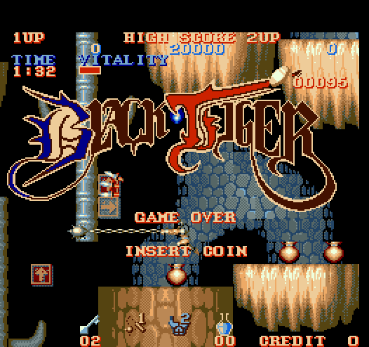

# Black Tiger (Capcom, 1987) on the Atari STE



STE port of MAME set `blktiger` (driver `capcom/blktiger.cpp`) for a 4 MB STE.  The unmodified main Z80 is translated
bank-aware (`tools/gen.py` on `translate.compile_code` with `z80x.FAST`), with window guards at the coverage's sites,
every block copy guarded and 87 extra roots from F030Arcade's replays; the i8751 protection MCU runs its dumped
firmware in an interpreter (`src/mcu.s`, synchronous transactions); the sound Z80 and its two YM2203s are not run: the
driver's effects and music are recorded and played on the YM2149.  The picture: the background in two display rings
and a clean screen used as virtual screens (hardware scroll on both axes), sprites clipped at the band words, the text
as OP 3 copy pieces, 16 colours from the shared default fitter with checker pairs.  Status **Verification pending**:
full-game Hatari verification is pending; a MARP replay leaves the recorded game in stage 7.  Speed (Hatari, 4 MB, the
MARP game's inputs, 2026-10-24): logic 98% of the arcade's 59.6 ticks a second (about 58.4 arcade frames a second),
25.5 pictures a second; the AUTOPLAY bench (2026-10-23) 57.9 ticks (97%) and 29.3 pictures a second.

## Build and run

```sh
python port.py prepare blktiger       # verify the 20 ROMs (size, CRC32, SHA1) and build the regions (tools/prepare.py)
python port.py build blktiger         # verify ROMs, build assets and run/blktiger/BLKTIGER.PRG (ROMs and graphics embedded)
python port.py run blktiger           # pinned F030Arcade Hatari, STE / 4 MB / TOS 2.06
python port.py test blktiger          # firmware, CPU lock-step, renderer, sprite and sound checks
python port.py mame blktiger 1500     # reference bitmap against MAME state (ref/mame_cmp_blktiger.py; MAME= overrides the executable)
python port.py cover blktiger 1       # optional additional bank-aware coverage (ref/cover.py, seeds 1-11)
```

Supply `assets/roms/blktiger.zip`.  Preparation checks all 20 ROMs against the size, CRC32 and SHA1 manifest
(`docs/rom_manifest.json`) before extracting or constructing regions.  The build uses the repository Python
environment, numpy, Pillow, vasm and vlink; MAME is only needed for `mame`.  Committed instruction roots and
window-guard sites (`docs/translation-roots.json`, `docs/window-sites.json`) make a fresh build independent of
coverage files.  Paths are relative to this folder; `engine/`, `tools/`, `port.py` and `docs/` at the top are the
repository's.

## Controls

**5/6** insert coins, **1/2** start, **arrow keys** move, **Space/Ctrl** attack, **Alt** jumps, **Escape** returns to
the desktop.  Joystick fire attacks; use Alt for jump (joystick port 1 player 1, port 0 player 2).  Jaguar pad /
PowerPad (STE enhanced ports, [architecture.md "Input"](../../docs/architecture.md#input-all-ports)): pad A player 1,
pad B player 2, the D-pad moves, **A** attack, **B** jump, **Option** coin, **Pause** start, keypad **1/2** start,
**5/6** coin, **\*** + **#** quit.  For scripted Hatari events, use ST scancodes for special keys: Right `77`, Space
`57`, Alt `56`, Escape `01`.

## State

* Firmware: `reference_test.py 700` exercises all 256 MCU commands and runs an unpatched reference boot.
* Reference renderer: matches MAME 0.289's own-state snapshots at frames 700, 1500 and 2500 with zero differing pixels
  (2500 uses the previous frame's sprite RAM, accounting for buffering).  The comparison reads MAME's memory and saved
  video state: it validates the reference's pixels, not the reference CPU's timing.
* Lock-step (`logic_test.py`): work RAM, saved task stacks, background banks, sprite buffers, scroll and control latches
  equal to the cooperative reference: `1600`, `4000 --walk`, `2400 --idle 2400` and `2600 --idle 2400` (the intro
  story), `3000 --walk --stage 2/4/6/7`; 6,000 frames with reproducible random controls.  `--audit` (1600, 4000
  --walk) reports only the eight block copies whose source is the bank's image.
* Renderer (`render_test.py`, `sprite_test.py`): both map layouts, normal/flipped video, all 16 fine-scroll positions,
  page-boundary crossings, sprites at the viewport edges (clipped at the band words, whole at the fine edges), every
  band pixel black, 4096 edge sprites in 512 pictures plus a 400-picture random walk, exact.  `sound_test.py 6000`:
  the 68000 player equals the model.
* Hatari: every HOG pass at most 256 bus cycles, none sharing the bus; 0 late border or palette events (two startup
  fallbacks).  Coin, start and play have music and effects.
* MARP: the recorded game fw666 (2,006,700 points, all eight stages) is followed through seven stages with the cycle
  budget test build; it leaves in stage 7, the cause not found (see Verification).
* Not emulated: the watchdog, coin counters and board timing in full; MCU transactions are synchronous rather than
  cycle accurate.  Instruction discovery combines committed coverage and static control flow, including allocator
  return-address adjustment; a missed dynamic target produces `CRASH.TXT` instead of silently continuing.
* Open: the 2026-11-02 logic change (-2.5% on Musashi) is not measured in Hatari.
* The load size with the 2026-11-05 checker-pair tables: text + data + BSS + 256 = 3,657,040 bytes (2026-11-07),
  within the release's 3,700,000.

## How it works

### The board and the reference

The memory map, the I/O ports, the protection firmware and the video (layers, priorities, palette ranges) are in the
[hardware notes](docs/hardware-notes.md), with the stedaimakaimura scrolling reference.  `tools/machine.py` is the
cooperative reference (the main Z80, the MCU through `tools/mcu.py`, an interpreter of the firmware's opcodes that
fails explicitly on an unknown one).  The audio Z80 runs only in `tools/sound.py` (its output recorded, see Sound).

### Translation

`gen.py` goes through `translate.compile_code` with `z80x.FAST`; the window code is the engine's `Emitter.window_wrap`
(a0 is free with `FAST`: no save around each access, and no base load where the window check sets it), `ldir` the
engine's, the jump table targets of `discover` are joins, merged pcs get `z80_badpc` in the entry tables, and the
return points in the window are left out of the direct returns (`direct_ok`: a stack word cannot tell the bank;
`ret_value` is the real address).

* **Window guards at the coverage's sites** (2026-10-11): the guards are emitted only at the indirect accesses the
  coverage saw reading the window or the background bank (8000-CFFF) or writing the bank (`ref/cover.py` records the
  sites: seeds 1-11 with every stage, `--walk`, `--auto`); the other 2,800 of the 5,242 indirect accesses are plain
  reads of the Z80 image.  The sites are kept in `docs/window-sites.json` (coverage files that record the sites write
  it again; `BT_GUARD_ALL=1` guards every access).  `logic_test.py --audit` traces a Musashi run and reports every
  translated instruction that touches the image of the window and the bank (`g_block` to +$4FFF), where an unguarded
  access would read the wrong memory: `bt_wsites_audit_*.pkl`, which gen adds to the sites.  `--audit` names the
  instruction that made the access and adds to its file instead of replacing it.  (Like stedaimakaimura, which runs the
  arcade's 68000 code as it is and handles the few special accesses by their faulting PC: the common path pays
  nothing, the exceptions are enumerated.)
* **Every block copy guarded** (2026-10-23, `gen.py`: each `ldir`/`lddr` is a window site): 2,426 -> 2,577 guarded
  sites.
* **87 roots** (`docs/translation-roots.json`, from F030Arcade's replays): 14 handlers named by bank 5's 8-byte object
  tables, object-script handlers (`00 lo hi` records in banks 0-4), and task starts (`ld bc,entry / call $00F6`:
  `$275D`, `$2778`, bank 6 `$A9E8`).  The translation: 24,628 instructions (19,273 before the roots), none
  unsupported.
* **Background banks in place**: the banks are addressed in place and a switch is a pointer (`g_bgbase`, 969e91b,
  2026-10-10; before, 4 KB were copied out and in, and the game reads its map for collisions).
* **Dispatch tables** (`gen.py`, `bt_dispatch`): a word per Z80 address, (the entry - the region's base) / 2, built as
  data: the fixed code in two regions (below and from $4000, 64 KB, a4) and each bank's code (32 KB, its base in the
  long before the table; `g_wdispatch` 0 for a bank without code).  A region's base is a label before its first line,
  its `z80_badpc` stub follows an unconditional jump inside it; vasm rejects an entry out of range.  About 24 cycles
  more a dispatch (16 a tick) than the long tables they replaced (640 KB in BSS, filled at start from 113 KB of entry
  lists).  The fixed ROM is assembled into the Z80 image (`g_block`, data) instead of copied there.
* **Writer marks**: every translated write to the background RAM goes through the window check (the RAM is not in the
  Z80 image) and notes its map entry (`bg_note`).  The palette writers set `pal_dirty` and the block copies to the
  palette note their ranges before they run (`pal_note`, `gen.PAL_WRITERS`); the text RAM's writers
  (`gen.TEXT_WRITERS`) mark their row in `text_rows_dirty`, a block copy sets `text_compare`.
* **No flags at the idle hook** (2026-11-02): `flags_at=set()`.  With `flags_at={IDLE}` the scheduler's last `inc c` of
  every slot visit computed the Z80 flags for the idle hook at 00D4 (52 cycles instead of 8); they are dead there: the
  IRQ handler swaps AF (`ex af,af'`) and 00D4's `jr $00B6` reaches `xor a`, which sets them again.
* **The cycle budget, a test build only** (2026-10-24): `tools/cycle_budget.py` and `tools/z80_cycles.py` (MAME 0.184's
  Z80 tables, from F030Arcade); `gen.py` uses them with `BT_CYCLES=1`, and `src/blktiger.s` has `cyc_poll` / `cyc_ei`
  under `ifd CYCLES` (the tick start is `tick_begin`, shared by the idle hook and `cyc_poll`).
  `build.py --sim --cycles` also guards every indirect access.  The normal build has no budget: it costs the STE
  logic time.

### Schedule

The cooperative task scheduler yields at the game's idle loop.  Native VBLs queue six game ticks per five 50 Hz
fields; drawing is skipped while ticks are pending, at most `MAX_SKIPS` (4, `src/blktiger.s`) frames in a row: the
game first, then the frames.  The MCU's transactions complete synchronously.

### Picture

`src/render.s`.  Two 768 by 544 planar buffers (the display rings) and a third, clean one hold the background as
virtual screens: the camera moves the Shifter address (coarse) and `$ffff8265` (fine, with the extra-fetch correction
in `$ffff820f`); the larger buffers avoid a scanout wrap interrupt sharing Timer B.  Per picture:

* **The clean screen** holds the 17 by 15 cells the view can touch.  Only the cells scrolled in are checked against
  their cache key; a full check of the window comes with a new 256-pixel page, a mode (flip, layout, background off),
  map or palette change.  Other physical instances are checked and filled when they enter the window, rather than
  drawing up to eight offscreen twins speculatively (2026-10-19; `-D BT_EAGER_TWINS=1` keeps the old path for
  comparisons).  The frame checks only the window's cells that show a noted entry (`check_noted`).  A tile the game
  changes (an animation) is drawn where it shows only; its twins are found stale when the page jumps there.
* **Each ring** keeps a damage list of cells (those the clean screen changed, margin cells that must lose their black)
  and a list of rectangles (what its sprites covered, and its text runs once the text is redone: a run's 8 lines, a
  sprite's 16).  Only those are copied from the clean screen, by the Blitter in short HOG pieces; a damage cell in a
  margin column gets its black bits with the copy (zeroes, or the clean screen AND a halftone mask).
* **Front pens** (the background's priority half) are in the clean tiles; they are drawn again only over the cells
  sprites touched (a mask per cell).
* **The text layer** is a list of runs (characters on one row, gaps of up to three blanks), composed when the text RAM
  or the flip changes and cut once into stefastbobs2's bob pieces (`text_run_pieces`, `character_pass`, 2026-10-24):
  per line the words with opaque pixels, two (or one) from the left; an entry holds each piece's two mask words and its
  destination step, then the pieces' planes in pass order.  A picture draws a piece as one OP 3 copy pass (HOP 2;
  destination X increment 8, Y count 4 = the planes, Y increment back to the next plane) whose end masks are the mask
  words shifted by the run's shift; with a shift the pass covers one destination word more and reads its words with
  NFSR (the skew in the pass), so the source runs on from piece to piece and nothing is shifted in advance.  A ring
  keeps its text while the scroll and the text are the same; else the runs' rectangles are restored and the text drawn
  whole.  Only the dirty text rows are rebuilt; one row a frame is compared in case a writer is missing.
* **The black side bands** (32 pixels each side of the 320-pixel window) are a mask per cell and ring, changed only
  where the window moved; the two word columns the fine scroll masks in part are copied whole by the Blitter (the clean
  screen AND the visible bits) before drawing when the window moved.  Background restoration prepares its margin cells
  before sprites are drawn; `strip_track` records those cells for the next camera move.  At a window step
  `strip_enter` blacks the cells entering band words 0, 1, 19, 20 that are not wholly black in that ring (`applied`,
  16 lines a pass), `strip_unmask` restores a listed cell whose row left the window while it keeps black bits, a
  rectangle's restore over words 0-2 or 18-20 is flagged (`.edge`, text runs at the sides, `rect_all` after a window
  step) and `ring_rects`, before the cell restores, blacks its band bits right after the copy (`rect_band`), and the
  front pass keeps front pens out of the band (`front_band_pass`, only after an edge sprite).
* **Sprites** use precomputed shifted masks and equal-mask row groups (the stream interpreter, ~107 cycles a row),
  including mirrored variants; a sprite and its mirror image share their row order.  The game's edges lie at window
  word 2 (18) + the fine scroll, so they are group-aligned only at fine scroll 0; the group boundaries next to them,
  words 1|2 and 18|19, separate the always-black band words (0, 1 and 19, 20) from the rest.  A sprite across one of
  them draws only its inner word (`clip_sprite`, one word a line, as 1943's `clip_part`: right, the first word under
  END1; left, the second word with FXSR and source Y increment 0, the stream's END1/END3 registers swapped so END1 gets
  the second word's mask); its damage is that word column only.  The band part of words 2 and 18 still shows whole
  sprites (no runtime edge mask, no mask after drawing).  No sprite can lie wholly in band words: the arcade's own
  range (x -15..255) already culls those.  The hot path adds the fine scroll to x and makes one unsigned compare
  (`.edge` does the culling and the clipping out of line).  Top and bottom: whole into the vertical guards.
* **Baking**: tiles, sprites and characters are baked into planes with a byte table a colour (two pixels a lookup,
  `movep` for the plane bytes in `bake_pixels`; 32 tables cached).  Background split priority and viewport-anchored
  text follow MAME.
* **Memory**: there is no Malloc, the screens are BSS.  The largest items: the three 768 by 544 screens (612 KB), the
  graphics (tiles, sprites 256 KB each, characters 64 KB), the ROM banks (256 KB), the shifted sprite masks (250 KB),
  the caches (tiles 96 KB, sprites 64 KB, byte tables 64 KB; `perf_test.py 4000 300 frames` bakes the same with half
  the tile or sprite entries, but later stages were not measured).  2026-10-15: text + data + BSS 3,546,696 bytes, 504
  KB left from the desktop ([porting-guide.md "Memory and release"](../../docs/porting-guide.md#memory-and-release));
  2026-10-23: the program file (text + data) 2,471,966 bytes.

### Colours

Since 2026-11-05 the ordinary build uses the shared default fitter with checker pairs baked in source coordinates
(`engine/palette_native.py` `ram`, trained on the sampled play's RGB counts in `docs/colour_training.json`; the text
and HUD flat through `rgb_map_flat.bin`), every possible palette word mapped at build time; black stays slot zero,
gameplay and graphics priorities are unchanged ([colours.md](../../docs/colours.md)).  A palette change remaps the pens
of the colours it touched (only the blocks of 128 entries noted by `pal_note` are compared and mapped again; 128 bytes
a frame are compared in case a writer is missing); their tiles and sprites are baked again unless one of the colour's
last eight mappings returns (flashes and cycles find their bakes in the caches).  Renderer comparisons use the same
mapping.  `ref/palette_fit.py` is the old fixed-palette fit (`docs/palette.json`), not used by the build.

### Sound

The sound board (MAME `capcom/blktiger.cpp`): a Z80 at 3.58 MHz, two YM2203 at 3.58 MHz (the default prescaler: FM at
3.58 MHz / 72, the SSG at / 4), interrupts from the first chip's timers: timer A (~250 Hz) runs the effects and the
music, timer B (~259 Hz) reads the latch.  A later Capcom driver than Commando's (`tools/sound.py` has the details):
commands through a table with a header byte each; effects one slot a chip with a priority (byte 31, cleared when the
effect ends), the SSG only; tunes six FM channels in a main slot (C100) and a backup (C300): a tune of the main one's
priority replaces it, a higher one moves it to the backup, a lower one goes to the backup unless that holds a higher
one; when the main tune ends the backup takes over, and a main tune with header bit 6 lets the backup step on
silently.  `tools/sound.py` models the board (the timers, the busy flag) and records with `engine/capsnd.py`'s forms:

* 40 effects, each alone in the four phases of C022 (12 values a driver step: the SSG registers and the priority).
  $14 repeats 564 steps for 144 s and $3C 68 steps 255 times: one period is kept with a loop and the total (`compact`,
  250 KB less).
* 25 tunes, each channel alone through `engine/opn.py` (a YM2149 period and volume a driver step), with its loop; a
  channel at 30 Hz or lower (FM without a frequency, the carriers' level left from the tune before) counts as silent.

`src/sound.s` plays them in the VBL, five driver steps a VBL (250 Hz), in the driver's scheme (`Player` in
`tools/sound.py` is that code in Python).  The tunes would take 158 KB: they are packed (`engine/lz.py`, a
byte-aligned LZ77, 57 KB) and unpacked when they start into one of two 17.7 KB buffers (the main and the backup slot);
the unpacking runs in the idle hook (`bt_snd_load`, up to 0.5 M cycles), not in the VBL: a tune starts when it is
unpacked.  Data 91 KB, the buffers 35 KB; the player ~9,500 cycles a VBL (Musashi, random commands).

Checks: `sound.py check 120` runs the real driver beside the model, a step at a time: the effects 0 of 59,958
chip-steps differ audibly (random commands and the game's own); the music 794 of 102,068 sounding channel-steps differ
in the game's commands, all by one volume step (an envelope carried over from the note before), 1-3% with random
commands (also tunes that start on another tune's chip state).  The attract mode's first command comes at game tick
1509, its demo play: the first ~40 s on the STE are silent, as the arcade's first 25.  `build.py --sound` records
again (~6 min).

## Speed

| | logic | pictures/s |
|---|---|---|
| 2026-10-24, Hatari, 4 MB, the MARP game's inputs (`PLAY=1 EXTRA="--frames 30000" WAIT=640 tools/bench.sh`, 30,000 VBLs) | 98% of 59.6 ticks a second | 25.5 (median 2-second stretch 23; 55 of 196 stretches under 15) |
| 2026-10-23, Hatari, 4 MB, AUTOPLAY (`tools/bench.sh`, DEBUG + AUTOPLAY, 6000 VBLs) | 57.9 ticks a second (97%) | 29.3 |
| 2026-11-02, Musashi CPU + Blitter, the MARP inputs (`PERF_PLAY=1 PERF_EVERY=3 perf_test.py 9000 1000`, 8000 ticks) | 52,982 cycles a tick | mean 184,114, median 140,124 cycles a picture |

A scrolling picture (the window moved, `PERF_SEL=moved`) 322k cycles (2026-10-24).  Musashi counts the 68000's own
cycles: Hatari takes about 1.35 times as many (bus alignment, interrupts, the Blitter's bus).  The sound costs about
1.3 ticks and 1.7 pictures a second (Hatari AUTOPLAY, 2026-10-11: 51.5 ticks and 21.2 frames a second, without it,
`EXTRA="-D NOSOUND=1"`, 52.8 and 22.9).

What made it fast, newest first (Hatari: `bench.sh` AUTOPLAY, 6000 VBLs, unless the MARP inputs are named):

* **2026-11-02: no flags at the idle hook**: Musashi, the MARP inputs, logic 54,325 -> 52,982 cycles a tick (-2.5%),
  pictures unchanged; Hatari not measured.
* **2026-10-24: text drawn like sprites** (OP 3 copy pieces instead of an AND and an OR pass per plane, eight passes
  over a run's 8 lines): Musashi, the MARP inputs, `character_pass` 83.7k -> 57.3k cycles a scrolling picture (the
  Blitter's part 45k -> 18.5k, the CPU's 38.7k -> 38.8k), a scrolling picture 347k -> 322k, every picture 195.4k ->
  185.7k (-5%).  Hatari, the MARP inputs: 24.6 -> 25.5 pictures a second (98% game speed both), the median 2-second
  stretch 22 -> 23, stretches under 15 pictures a second 60 -> 55 of 196.
* **2026-10-19: twins filled when they enter the window** (instead of up to eight offscreen twins drawn
  speculatively): Hatari 26.175 -> 29.465 pictures and 54.992 -> 57.922 ticks a second (`(6000,3141,6599)` ->
  `(6002,3537,6953)` VBLs, pictures, ticks; `BT_EAGER_TWINS=1` against the default;
  [virtual-scroll-performance.md](../../docs/virtual-scroll-performance.md#implementation-results)).
* **2026-10-12: sprites clipped at the band words**: Musashi (`perf_test.py`, CPU + Blitter a frame drawn) play
  1000-1600 164,658 -> 164,586 (-0.04%), with `PERF_EVERY=3` 269,392 -> 269,251, attract 400-1200 76,011 -> 76,054
  (+0.06%); Hatari 26.5 -> 26.8 frames and 55.4 -> 55.6 ticks a second.  The band fixes after it cost: play 1000-1600
  164,586 -> 168,637 (+2.5%), `PERF_EVERY=3` 269,251 -> 278,833 (+3.6%), attract 400-1200 76,054 -> 76,222 (+0.2%),
  1600-3000 169,779 -> 172,531 (+1.6%; the version committed before, with its after-drawing pass: 170,080, 279,924,
  78,809, 175,348); Hatari 26.8 -> 26.2 frames and 55.6 -> 55.0 ticks.  The cost is in scrolling frames: about 2.7 text
  rectangles a frame over word 2 or 18 (`rect_band`), the cells blacked at window steps (about 3 a frame) and their
  checks.
* **2026-10-11: window guards at the coverage's sites only**: the logic in play 80.7k -> 65.3k Musashi cycles a tick
  (-19%), the start screen's 26.8k -> 21.7k; Hatari 23.8 -> 26.3 frames and 54.0 -> 55.1 ticks (92%) a second.
* **2026-10-11: rectangles and Blitter copies**: where the per-frame counters (`perf_test.py frames`) showed the work
  (a scrolling play frame restored 118 cells: 52 under the text, 34 under sprites, 35 margin cells whose partial mask
  moved, 34 new tiles and their twins; it redrew 12.7 text runs and baked 2.5 sprites): sprites and text runs restored
  as rectangles, the part-masked margin columns as two Blitter passes, damage cells in margin columns with their mask,
  every copy by the Blitter; a changed tile not drawn to its twins; the palette compared in the blocks the game's block
  copies touched; `bake_pixels` with `movep`.  A scrolling play frame (`PERF_EVERY=3 perf_test.py 1600 1430`): 552k ->
  437k Musashi cycles (320k CPU + 118k Blitter bus); a frame of the start screen 251k -> 210k.  Hatari 21.0 -> 23.8
  frames, 54.0 ticks (90%) a second.
* **2026-10-09: the translator** (`z80x.FAST`, the engine's window wrapper and `ldir`, joins):
  `engine/xprof.py blktiger` (ticks 600-1000, attract) translated code 15.7k -> 12.9k cycles a tick (1.22x).

Measured, not kept:

* **Generated sprite code** (2026-10-25, `engine/sprite_programs.py` for the 761 shapes the MARP play shows, and a
  variant with indexed masks): exact, 184.8k -> 179.8k a picture (-2.7%), Hatari with 14 MB 25.4 -> 26.4 pictures a
  second (indexed: 180.4k, 26.0), but +2.5 MB (+2.60 MB indexed): over the load budget and a 4 MB STE.  The details:
  [sprite-preparation.md "Generated code per shape and pass-type pattern"](../../docs/sprite-preparation.md#generated-code-per-shape-and-pass-type-pattern-enginesprite_programspy-time-pilot-2026-10-25).
* **Text pieces, two intermediate versions** (2026-10-24): pieces cut in destination words with the masks and the
  shifted planes prepared per run and shift in a 64 KB pool (the preparation cost 16k a scrolling picture: the timer
  and the score change the text every second), and the same with only the masks prepared (the source address written
  per piece).
* **F030Arcade's Z80 cycle budget in the normal build** (2026-10-23): a recorded game needs it to stay in step with
  MAME, but it costs the STE logic time; it is a test build only.
* **`MAX_SKIPS=2`** (2026-10-10, an old build): 33.5 ticks and 14.0 frames a second.

Techniques other ports use that may apply:
[speed.md](../../docs/speed.md#techniques-that-look-applicable-elsewhere-2026-11-07).

## Tests and tools

```sh
games/blktiger/tools/perf_test.py     # Musashi: a tick's and a frame's cycles (profile, logic, frames)
games/blktiger/tools/bench.sh         # Hatari: DEBUG + AUTOPLAY build, ticks and frames a second (PLAY=1, MEM=14, EXTRA=, WAIT=)
games/blktiger/tools/sprite_test.py   # edge sprites: the whole hardware window, side bands included
python games/blktiger/tools/logic_test.py 4000 --walk    # lock-step (--idle N, --stage S, --audit)
python games/blktiger/tools/render_test.py --frames 3 --step 375 --scroll-sweep --flip-layout-sweep --sprite-edges
python games/blktiger/tools/render_test.py --consecutive --first 1100 --step 25 --frames 20 --walk   # every frame drawn
python games/blktiger/tools/reference_test.py 700        # firmware transactions and an unpatched reference boot
python games/blktiger/tools/sound_test.py 6000           # the 68000 sound player against the model
python games/blktiger/tools/sound.py check 120           # the real sound driver beside the recorded model
python games/blktiger/tools/play_search.py               # a recorded play for the bench (engine/playbot.py)
python games/blktiger/tools/marp_inputs.py fw666_blktiger_2006700_wolf184.zip   # a MARP recording as the recorded play
venv/bin/python games/blktiger/tools/marp_replay.py fw666_blktiger_2006700_wolf184.zip --shift 1   # the MARP game on Musashi
python games/blktiger/tools/marp_reference.py --mame184 --dsw1 0x2f   # the same on the reference board with 0.184's timing
python games/blktiger/ref/palette_fit.py   # the old fixed-palette fit (docs/palette.json); not used by the build since 2026-11-05
```

* `perf_test.py` takes `profile` (render_frame by routine; `PERF_CPU=1` without the Blitter's bus cycles),
  `logic [regions]` (the tick by routine or Z80 page), `frames` (a frame's cost and the renderer's DEBUG counters:
  bakes, cells restored, tiles drawn, sprites, text runs, margin cells, with `build.py --sim --debug`);
  `PERF_EVERY=n` a frame drawn every n-th tick, `PERF_PLAY=1` the recorded play's inputs, `PERF_SEL=moved` the
  pictures whose window moved, `PERF_HASH=file` each picture's hash (two builds compare picture by picture).
* `render_test.py --consecutive --walk` draws every frame (the incremental paths) and checks the black margins too;
  every run checks words 0, 1, 19, 20 black.  2026-10-12: `--consecutive --first 1100 --step 25 --frames 20 --walk`
  (20 matched), `--consecutive --first 1600 --step 50 --frames 28 --walk` (28), `--consecutive --first 700 --step 50
  --frames 12` (12), `--frames 3 --step 375 --scroll-sweep --flip-layout-sweep --sprite-edges` (253).
* `sprite_test.py` checks every band pixel, with the background and text on, two restoring frames without sprites
  after each, window steps every frame, rows jumping, and a 400-frame random walk (3000 also passed): 4096 edge sprites
  in 512 frames (1800 clipped, 172 across 64 KB, two sprites with holes, all fine scrolls and shifts, both
  orientations) plus the walk.  `sprite_test.py --whole` draws sprites whole (the old behaviour).
* `logic_test.py --idle N` keeps the player's inputs released until frame N (`--idle 2400` in `port.py test` runs the
  whole intro story).
* `marp_replay.py` decodes the recording (`marp_inputs.py`, with its DIP switches: fw666 has DSW1 `$2F`, continue off,
  where the port's default is `$6F`), builds `--sim --cycles -D PLAYBACK=1 -D MARP=1` (no lives kept) and plays it on
  Musashi, logic only, about 8,500 ticks a second; `--out x.npz --ram first-last` saves the port's state at each idle
  point.  Port tick n takes the recording's frame n + 1 (`--shift 1`; shifts 0, 2, 3, 4 lose the first stage).
* `marp_reference.py --mame184`: 100,000 cycles a frame, the interrupt from the end of frame 0; 78 frames a second.

## Lessons

### 2026-10-24: a MARP replay needs the cycle budget

Without F030Arcade's Z80 cycle budget the game's tasks finish in zero frames and the random generator runs ahead: the
port leaves the recording 30 frames after the start (F030Arcade's finding).  With it the port follows the expert's
game through seven of eight stages.  MAME 0.289 cannot play the recording (its blktiger screen is 384 x 262 lines,
59.63 Hz, and the playback stops as out of sync after frame 1).  The reference board with 0.184's timing equals the
port at every idle point to tick 16,409, then leaves: the port takes the interrupt at a block start, the reference at
the instruction, and the random generator's task then runs a different number of times.

### 2026-10-23: what replays find that coverage does not

F030Arcade's Falcon port runs this translation and replays a recorded MARP game against MAME; that replay and its PPO
plays found code and accesses the coverage here never reached.  A hand-played game crashed into bank 2 `$B8C0` (an
object-table handler, now a root).  Bank 0's `ldir` at `$AC71` was not a coverage site and copied zeros for the 32-byte
object template at `$AF06`, so the player's attack object had no type, timer or script (MARP game, frame 6,832): hence
every block copy guarded.  Hatari 58.0 -> 57.9 ticks and 29.5 -> 29.3 frames a second (noise); the program file
2,436,385 -> 2,471,966 bytes.

### 2026-10-15: a release built without the memory work

0.3 was built without the memory work of 2026-10-10 (merged only on 2026-10-15): text + data + BSS 3,972,764 bytes,
and TOS refused to start it on a tester's Mega STE.  Merged: 3,546,696.  Musashi: logic 37,414 -> 37,805 cycles a
tick, frames unchanged (168.6k -> 168.7k).

### 2026-10-12: the side bands, the intro story

* Clipping at the band words found four band faults, all in what the earlier removal of the after-drawing masking
  pass had left behind: a window step left background in band words 0, 1, 19, 20 (cells entering them were never
  blacked: `strip_enter`); rows that had left the window with their old mask or entered it unblacked (`strip_unmask`);
  `touch_cells` cleared a cell's `applied` when a sprite or a restore changed only some of its lines
  (`render_test.py --consecutive ... --walk` at frame 1450), so after the
  window's step `strip_unmask` skipped the cell and 2-5 black columns stayed in the picture (x 240-255, word 17;
  `applied` now stays what the cell may still hold); a rectangle's restore over words 0-2 or 18-20 copied the clean
  screen without the band (`rect_band`).  Before the clipping, a sprite's part in word 1 or 19 showed in the black band
  and its rectangle's restore copied the clean screen's background there.  The build before the fix fails 194 frames
  of `sprite_test.py` (94 of the 512, 100 of the walk).
* Since 0.2.1 the story after the start ("Long long ago, three dragons ...") showed rows of one character on black:
  every coverage and test schedule pressed a button right after the start, which skips the story, so its routines in
  bank 6 read the story text and palettes from the window unguarded (the image of another bank), and their stores were
  not in `gen.TEXT_WRITERS` / `PAL_WRITERS`.  Added: 9 window sites (`2BA0F`, `2BA8A`, `2BA95`, `2BAE6`, `2BAF1`,
  `2BAF4`, `2BAF6`, `2BAFE`, `2BAFF`), the text writers `BA18`/`BA1B`, `BAFF`/`BB02`, `BB1D`/`BB21` and the palette
  copies `BA8A`, `BA95`, `BAE6`, `BAF1` of bank 6, and the twelve palette copies at `7BB5`-`7C2B` (every block copy to
  the palette is now noted).  `BT_GUARD_ALL=1` showed the story right, which pointed at the sites.  `--audit` once
  named the next instruction's label (the PC is past the instruction when the access happens); it now names the
  instruction itself.

### 2026-10-10: memory and the fixed palette

* The build was 4,023,518 bytes, more than GEMDOS leaves on a 4 MB STE with a hard disk driver, accessories and TOS
  1.62 (TOS 2.06 without AUTO programs: 4,145,998).  The word dispatch tables built as data, the fixed ROM in place and
  shared sprite row orders (32 KB each for the last two) made it 3,484,734 (`build/blktiger/blktiger.map`: text
  297,744, data 2,089,628, BSS 1,097,362).
* The fixed palette before 2026-11-05: black and 15 colours fitted by a weighted k-means in Oklab (`ref/palette_fit.py`,
  Bubble Bobble's method) to the reference's pictures of the logic test's script and of each stage 0-7 (cover.py's
  cheats), each set's colour histogram normalised, the colours snapped to ones that occur (4 bits a channel, exact on
  the STE), every palette word mapped to the nearest of them in Oklab (`tools/assets.py`: a 4096-entry table at build
  time).  Compared:

  | palette | error per channel (0-255), mean of the 9 sets | exact pixels | worst set |
  |---|---|---|---|
  | median cut of the script's colours, RGB-weighted map | 17.2 | 27.7% | 38.8 (stage 5) |
  | the fixed fit (2026-10 to 2026-11-05) | 11.6 | 42.7% | 17.9 (stage 7) |
  | square-rooted weights (as Bubble Bobble) | 15.5 | 35.4% | 40.4 |
  | 13 colours + 2 lent to flashing entries | 12.4 | 40.3% | 21.1 |

  Only the script set (the old fit's own data) was a little worse with the fit (9.9 -> 10.8).  Lending colours does not
  pay here: the frequent changes are the fades and a four-entry ramp of the player's colours (every few hundred
  frames).  The palette's choice costs nothing at run time.

### 2026-10-09: the translator's window wrapper

The first build with the new translator did not boot: each gen's own window wrapper saved a0 in the middle of
`ld (hl),c`'s stack use (the banked windows:
[architecture.md](../../docs/architecture.md#what-makes-the-translated-code-cheap)); the engine's wrapper fixed it for
all ports.  After the translator the checks of every indirect access as a possible window read were a quarter of the
cycles (`ld a,(hl)` 58 cycles), which led to the guards at the coverage's sites.

## Verification

* **MARP** (2026-10-24, `marp_replay.py`, the cycle budget test build): fw666 (2,006,700 points, 240,662 frames,
  WolfMAME 0.184).  The port plays the expert's game through seven of the eight stages: stage 2 at tick 7,837, stage 3
  at 15,763 ... stage 7 at 129,364, about 1.2 million points.  The 68030 forms (`STE_XCPU=68030`, F030Arcade's) give
  the same game.  In stage 7 it leaves: from tick 162,519 the player loses a life every 7,664 ticks (the stage timer),
  the game ends in stage 8 at 1,766,650.  F030Arcade's port, the same translation, followed this game to the end
  against a WolfMAME 0.184 dump; the cause here is not found yet.  The ground truth for locating it is a WolfMAME 0.184
  RAM dump (F030Arcade's `scripts/mame_inp_dump.py`, Windows build) against
  `marp_replay.py --out x.npz --ram first-last`.
* The MARP inputs also drive the Hatari bench (`PLAY=1`, `marp_inputs.py`); the coverage seeds 4-11 reach every stage
  with cheats.  No natural playthrough on the STE.

PPO exploration: `venv/bin/python port.py ppo blktiger test --steps 256 --frames 2100` ([the PPO guide](../../docs/ppo.md)).
Full-game verification follows the [status policy](../../docs/port-status.md); nothing here claims a complete playthrough.
