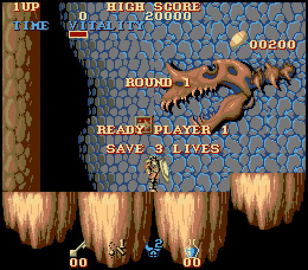

# Black Tiger (Capcom, 1987)



STE port of MAME set `blktiger`, with a bank-aware translation of the unmodified
main Z80 and an i8751 interpreter running the dumped protection firmware.
Requires a 4 MB STE (the program takes 3.48 MB: see "Memory"). Sound is not implemented.

```sh
python port.py build blktiger         # verify ROMs, build assets and BLKTIGER.PRG
python port.py run blktiger           # pinned F030Arcade Hatari, STE / 4 MB / TOS 2.06
python port.py test blktiger          # firmware, CPU lockstep and renderer checks
python port.py mame blktiger 1500     # reference bitmap against MAME state
python port.py cover blktiger 1       # optional additional bank-aware coverage
games/blktiger/tools/perf_test.py     # Musashi: a tick's and a frame's cycles (profile, logic, frames)
games/blktiger/tools/bench.sh         # Hatari: DEBUG + AUTOPLAY build, ticks and frames a second
python games/blktiger/ref/palette_fit.py   # refit the fixed palette (docs/palette.json), its error against the one before
```

Supply `assets/roms/blktiger.zip`. Preparation checks all 20 ROMs against the
size, CRC32 and SHA1 manifest before extracting or constructing regions. Build
uses the repository Python environment, numpy, Pillow, vasm and vlink. MAME is
only needed for `mame`; its executable can be overridden with `MAME`.
The executable is `run/blktiger/BLKTIGER.PRG`; its ROMs and graphics are embedded.
Committed instruction roots make a fresh build independent of coverage files.

Controls: **5/6** insert coins, **1/2** start, **arrow keys** move,
**Space/Ctrl** attack, **Alt** jumps, **Escape** returns to the desktop.
Joystick fire attacks; use Alt for jump (joystick port 1 player 1, port 0 player 2).
Jaguar pad / PowerPad (STE enhanced ports, `docs/architecture.md` "Input"): pad A player 1, pad B player 2, the D-pad moves, **A** attack, **B** jump, **Option** coin, **Pause** start, keypad **1/2** start, **5/6** coin, **\*** + **#** quit.
For scripted Hatari events, use ST
scancodes for special keys: Right `77`, Space `57`, Alt `56`, Escape `01`.

## Display and timing

Two 768 by 544 planar buffers (the display rings) and a third, clean one hold
the background as virtual screens: the camera moves the Shifter address
(coarse) and `$ffff8265` (fine, with the extra-fetch correction in
`$ffff820f`); the larger buffers avoid a scanout wrap interrupt sharing Timer B.
Everything is drawn whole into hidden margins, nothing is clipped. Per frame
(`render.s`):

* **The clean screen** holds the 17 by 15 cells the view can touch. Only the
  cells scrolled in are checked against their cache key; a full check of the
  window comes with a new 256-pixel page, a mode (flip, layout, background
  off), map or palette change. A new tile is also drawn to its twins 16 cells
  away outside the window, so the jump to the next page finds them ready.
* **Each ring** keeps a damage list: cells the clean screen changed, the
  cells sprites and text covered two frames ago, margin cells that must lose
  their black. Only those are copied from the clean screen.
* **Front pens** (the background's priority half) are in the clean tiles; they
  are drawn again only over the cells sprites touched (a mask per cell).
* **The text layer** is a list of runs (characters on one row, gaps of up to
  three blanks), composed into planar strips when the text RAM or the flip
  changes; a frame draws each run with the Blitter, shifted, two passes a plane.
* **The black side margins** (32 pixels each side of the 320-pixel window) are
  a mask per cell and ring, changed only where the window moved.
* **Change detection**: the translated writers of the background RAM and the
  palette set `bg_dirty` / `pal_dirty` (`gen.BG_WRITERS`, `gen.PAL_WRITERS`,
  from coverage); 256 / 128 bytes a frame are compared in case one is missing
  (a DEBUG build counts what that finds). The text RAM (about 80 writers) is
  compared each frame.

Whole sprites use precomputed shifted masks and equal-mask row groups, including
mirrored variants. Background split priority and viewport-anchored text follow
MAME. The palette changes go through the
writers' flags: `pal_dirty` makes the renderer compare the 2 KB palette, the
copies of the player's colours (`gen.PAL_PLAYER`, in about every other frame)
set `pal_player`, which compares only their 20 bytes.

**The palette** is fixed: black and 15 colours fitted by a weighted k-means in
Oklab (`ref/palette_fit.py`, Bubble Bobble's method) to the reference's
pictures of the logic test's script and of each stage 0-7 (cover.py's cheats),
each set's colour histogram normalised, the colours snapped to ones that occur
(4 bits a channel, exact on the STE). Every palette word maps to the nearest of
them in Oklab (`tools/assets.py`: a 4096-entry table at build time). A palette
change remaps the pens of the colours it touched; their tiles and sprites are
baked again unless one of the colour's last eight mappings returns (flashes and
cycles find their bakes in the caches). Renderer comparisons use that same
colour mapping.

| palette | error per channel (0-255), mean of the 9 sets | exact pixels | worst set |
|---|---|---|---|
| before: median cut of the script's colours, RGB-weighted map | 17.2 | 27.7% | 38.8 (stage 5) |
| now | 11.6 | 42.7% | 17.9 (stage 7) |
| square-rooted weights (as Bubble Bobble) | 15.5 | 35.4% | 40.4 |
| 13 colours + 2 lent to flashing entries | 12.4 | 40.3% | 21.1 |

Only the script set (the old fit's own data) is a little worse (9.9 -> 10.8).

Lending colours does not pay here: the frequent changes are the fades and a
four-entry ramp of the player's colours (every few hundred frames). The
palette's choice costs nothing at run time; its work is the change detection
and the remap (below).

The cooperative task scheduler yields at the game's idle loop. Native VBLs
queue six game ticks per five 50 Hz fields; drawing is skipped while ticks are
pending, at most `MAX_SKIPS` (4) frames in a row: the game first, then the frames.

## Memory (2026-10-10)

text + data + BSS = 3,484,734 bytes (`build/blktiger/blktiger.map`: text 297,744,
data 2,089,628, BSS 1,097,362); there is no Malloc, the screens are BSS.  It was
4,023,518, more than GEMDOS leaves on a 4 MB STE with a hard disk driver,
accessories and TOS 1.62 (TOS 2.06 without AUTO programs: 4,145,998).

* **Dispatch tables** (`gen.py`, `bt_dispatch`): a word per Z80 address,
  (the entry - the region's base) / 2, built as data: the fixed code in two
  regions (below and from $4000, 64 KB, a4) and each bank's code (32 KB, its
  base in the long before the table; `g_wdispatch` 0 for a bank without code).
  Before: 640 KB of long tables in BSS (an invalid bank's too), filled at start
  from 113 KB of entry lists.  A region's base is a label before its first
  line, its `z80_badpc` stub follows an unconditional jump inside it; vasm
  rejects an entry out of range.  About 24 cycles more a dispatch (16 a tick).
* **The fixed ROM** is assembled into the Z80 image (`g_block`, data) instead
  of copied there (32 KB).
* **Sprite row orders**: a sprite and its mirror image share theirs (32 KB).

The largest items now: the three 768 by 544 screens (612 KB), the graphics
(tiles, sprites 256 KB each, characters 64 KB), the ROM banks (256 KB), the
shifted sprite masks (250 KB), the caches (tiles 96 KB, sprites 64 KB, byte
tables 64 KB; `perf_test.py 4000 300 frames` bakes the same with half the
tile or sprite entries, but later stages were not measured).

## Speed (2026-10-10)

| | 2026-10-09 | before the memory work | now |
|---|---|---|---|
| a frame, Musashi cycles (`tools/perf_test.py 4000 300`) | | 152.9 k | 146.2 k |
| a frame (`tools/perf_test.py 1500 1000`, play) | 231 k | 158.5 k | 155.0 k |
| a game tick (logic, 1500 1000) | 47 k | 33.4 k | 33.8 k |
| Hatari (`tools/bench.sh`, 6000 VBLs of play), ticks/s | 38.9 | 52.8 | 52.9 |
| Hatari, frames drawn/s | 12.3 | 22.9 | 23.4 |

The frame's gain is the palette compare (`pal_player`); the tick's loss the
word dispatch.  `MAX_SKIPS=2` gave 33.5 ticks/s and 14.0 frames/s (2026-10-09).
`perf_test.py`
takes `profile` (render_frame by routine), `logic [regions]` (the tick by
routine or Z80 page), `frames` (a frame's cost, map / palette changes, tiles
baked). `render_test.py --consecutive --walk` draws every frame (the
incremental paths) and checks the black margins too.

## Validation and limitations

The firmware test exercises all 256 commands. CPU checks compare work RAM,
saved task stacks, background banks, sprite buffers, scroll and control latches
against the cooperative reference. Renderer checks cover both map layouts,
normal/flipped video, all 16 fine-scroll positions, page-boundary crossings,
and whole sprites at viewport edges. The independent MAME comparison validates
reference pixels using MAME's actual memory and saved video state; it does not
validate the reference CPU's timing.

The audio Z80 and YM2203s are omitted. MCU transactions are synchronous rather
than cycle accurate. The watchdog, coin counters and board timing are not
fully emulated. Instruction discovery combines committed coverage and static
control flow, including allocator return-address adjustment; a missed dynamic
target produces `CRASH.TXT` instead of silently continuing.

See [hardware notes](docs/hardware-notes.md) for the F030Arcade MAME sources and
stedaimakaimura scrolling references.

## Translator speed (2026-10-09)

`gen.py` goes through `translate.compile_code` with `z80x.FAST`; the window code is the engine's `Emitter.window_wrap`
(a0 is free with `FAST`: no save around each access, and no base load where the window check sets it), `ldir` the
engine's, the jump table targets of `discover` are joins, merged pcs get z80_badpc in the entry tables, and the
return points in the window are left out of the direct returns (`direct_ok`: a stack word cannot tell the bank;
`ret_value` is the real address).  `engine/xprof.py blktiger` (ticks 600-1000, attract): translated code 15.7k -> 12.9k
cycles a tick (1.22x).  What is left is mostly the policy of guarding every indirect access as a possible window
read: the checks are a quarter of the cycles (`ld a,(hl)` 58 cycles); the coverage's window-read sites, as Bubble
Bobble uses them, would make most of them plain moves.  Tests: `logic_test.py 1600`, `logic_test.py 4000 --walk`,
`render_test.py --frames 3 --step 375 --scroll-sweep --flip-layout-sweep --sprite-edges` all match.  The first build
with the new translator did not boot: each gen's own window wrapper saved a0 in the middle of `ld (hl),c`'s stack use
(see `docs/architecture.md`, "Banked windows"); the engine's wrapper fixed it for all ports.
