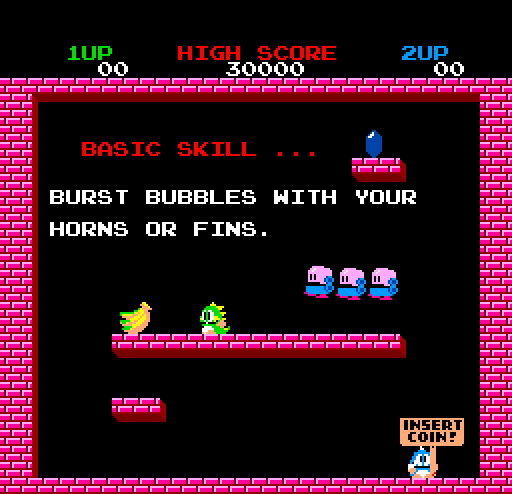

# Bubble Bobble (Taito, 1986) on the Atari STE



The MAME set `bublbobl` (Japan, with the protection MCU; driver `taito/bublbobl.cpp`): three Z80s and an MC6801 whose
own firmware (`a78-01.17`) is in the set.  The main and the sub Z80 are translated to 68000 code (`tools/gen.py`,
`engine/z80x.py`), with three native routines in place of hot Z80 code; the MCU's VBL interrupt is native 68000 code,
its firmware translated (`engine/m6801x.py`) for the boot and as a stand-in; the sound Z80 is not run: its driver's
output is recorded per command and played on the YM2149.  Frames in layers (the play, the demo, the title) are drawn
by the sprite renderer (Blitter sprites from cached unshifted images, a static picture of 8 x 8 cells, 16 x 4 block
copies), the others by the general tile renderer; a fixed fitted palette of 13 colours plus two lent to flashing
entries.
Logic and pictures are exact against the reference.  Status: **Incomplete** (root README): significant gameplay
slowdown.  Latest speed (Hatari, 4 MB, `ROUNDS=1 tools/bench.sh 3600`, scripted play, rounds 1200-2700, 2026-10-12):
26.6 arcade frames a second (45% of the arcade's 59.19), 12.2 pictures a second.

## Build and run

```sh
python port.py prepare bublbobl                   # checks assets/roms/bublbobl.zip, unpacks it (build does it too)
python port.py build bublbobl                     # run/bublbobl/BUBBLE.PRG (the patched CPU ROMs embedded)
python port.py build bublbobl --sim               # run/bublbobl_sim/BUBBLE.PRG, with the hooks the tests use
python port.py run bublbobl shot@20               # Hatari (F030Arcade), screenshots in /tmp/hrun
python port.py run bublbobl key:5@20 key:1@26 shot@60   # ... with keys (5 = coin, 1 = start)
python port.py run bublbobl dump:0xADDR:0xSIZE@50       # ... and memory dumps (savebin)
python port.py test bublbobl                      # the test sequence (Tests and tools)
python port.py cover bublbobl                     # coverage seeds 1-6, 20000 frames (ref/cover.py <seed> <frames>)
python port.py mame bublbobl                      # the reference picture against MAME's (ref/mame_cmp_bublbobl.py)
venv/bin/python games/bublbobl/tools/build.py --sound   # record the sound driver again (~10-15 min)
games/bublbobl/tools/bench.sh 1500                # Hatari speed: game rounds and pictures per 300 VBLs, border events
```

ROMs: `assets/roms/bublbobl.zip`, the 18 files of `docs/rom_manifest.json`; the CRCs of both sets (`bublbobl` and the
US `bublboblr`, which differs only in the two main-CPU ROMs and has not been run through the translator) are in
[docs/rom_manifest.md](docs/rom_manifest.md).  Build switches: `-D DYNPAL=1` (colours chosen per picture),
`-D NOCYCLE=1` (colour cycling ignored), `-D TICK60` (the arcade's rate), `-D NOSR=1` (the general renderer only),
`-D NOSOUND=1`, `-D MCU_XLATE` (the translated MCU always), `BYTEVMARKS=1` (a video RAM mark per store),
`BB_NO_NATIVES=1` / `BB_NO_INLINE=1` (environment: the translation alone), `W_GUARD_ALL=1` (every indirect access
guarded).  Layout: `src/` the runtime and renderers, `tools/` the reference machine, translation, build and tests,
`ref/` analysis scripts (one-off probes in `ref/probes/`), generated files in `build/bublbobl/`.  Commands run from
the repository root.  Paths are relative to this folder; `engine/`, `tools/`, `port.py` and `docs/` at the top are the
repository's.

## Controls

**5/6** coins, **1/2** start, **left/right** move, **Space/Ctrl** jump, **Alt** bubble, **Esc** quits.  Joystick port
1 plays player 1, port 0 player 2 (fire jumps, up blows a bubble).  Jaguar pad / PowerPad (STE enhanced ports,
[architecture](../../docs/architecture.md#input-all-ports)): pad A player 1, pad B player 2, the D-pad moves, **A**
jump, **B** (or up) bubble, **Option** coin, **Pause** start, keypad **1/2** start, **5/6** coin, **\*** + **#** quit.

## State

* Logic: `logic_test.py` (the whole game on Musashi against the reference, RAM every frame) 6,000 frames identical
  (2026-10-09), 4,000 after each speed step of 2026-10-12; `port.py test` runs 2,000 (into the play, where the natives
  run).  `mcu_test.py 2600`: the translated MCU against the 6801 reference at every IRQ, 0 mismatches;
  `native_test.py`: the natives and the native MCU against the translations they replace (3,000 random states, 20,000
  checked once).  `align_test.py 900`: no odd word access.
* Picture: `render_test.py seq 100 1500` (attract, coin, start, two rounds, a level transition) 1,500 of 1,500 frames
  exact, no stray pixel in the guards or side bands; passes with `NOSR=1` too (2026-10-17).  `sprite_test.py`: 128
  sprite cases and 768 general-renderer tile cases (all shifts, both side edges, flips, holes, vertical guards, cache
  collisions, a 64 KB crossing in each path).  The reference renderer against MAME: 0 pixels differ.
* Sound: `sound_test.py` 0 of 6,000 VBLs differ from `tools/sound.py`'s model; the model against the real driver: see
  "Sound".
* Hatari (pinned F030Arcade build, 4 MB): a debug build played 2,500 game rounds with coin and start, no crash file,
  zero late top / bottom border events (two startup fallbacks); `EXTRA='-D NOSR=1' tools/bench.sh 1200` (the general
  renderer's timer safety, 2026-10-17): 1,212 VBLs, zero late top, bottom or palette events; `BLIT_STATS=256` over 300
  frames: 28,117 HOG passes, the longest 256 bus cycles, none sharing the bus (the sequential render test: 250,730);
  music and effects in the attract mode and play.
* Missing: speed.  The play runs at 45% of the arcade's rate; 25 pictures a second at full pace needs ~3-4x cheaper
  logic ("Speed").
* Missing: a full natural playthrough (no recorded play; see "Verification").
* Missing: the screen flip (`$FB40` bits 6-7: the runtime keeps `video_flip`, no renderer reads it).
* Missing: the 16 sprites a line limit; test / service modes; the US set's DIP meanings.
* Missing: per-band palettes (22-26 colours on a screen, the STE shows 16: the rest map to the nearest).
* Sound: commands that change other commands' tracks are not modelled (effect `$1A` changes a parameter of two OPL
  channels' B tracks, which lasts); with random commands far more VBLs differ from the driver than with the game's.
* Open (2026-10-09): the coverage run of seed 4 stops at frame ~18000 with `handler of 01ED did not return` in the
  reference machine (`ref/cover.py 4 20000`).

## How it works

### The board and the reference

`tools/machine.py` is the reference: three Z80s and the 6801 running its ROM, 30 frames a second; `run_frame_port` is
the runtime's schedule with identical RAM.  The arcade draws a list of up to 192 objects (strips of 8 x 8 tiles, the
shape from a PROM, columns chained across objects); `machine.py render_raw` is the reference picture, checked against
MAME with `ref/mame_cmp_bublbobl.py` (0 pixels differ).  Hardware findings with evidence grades (the memory map, the
MCU's ports and bus protocol, PROM bit 2 = X continuation): [docs/hardware-notes.md](docs/hardware-notes.md).
Reference captures (64 MAME attract frames with all 68 on-screen colours) and the palettes: [docs/](docs/README.md).

The boot self-tests are patched out of the ROMs (`machine.skip_tests`, also in the reference): the RAM tests, the
delay loop, the sub CPU's ROM checksum.  The game checksums `$0001-$0EDC` of its ROM while it runs (one byte a frame,
`$484B`); a dead byte of the old RAM test (`$C5`) makes the sum the original's.  A second check (`$0AE3`, every 4th
byte of `$0004-$0C04`) crashes on a mismatch; none of the bytes it reads is patched.  `tools/build.py` embeds the
patched ROMs in the program.

### Translation

* **Main CPU** (6 MHz, 11.5k translated instructions, `z80x.FAST`: A' F' and BC' DE' HL' in the upper words of d0 / d6
  and d1-d3, IY in a2): the 32 KB fixed ROM plus a window (`$8000-$BFFF`) onto four 16 KB banks.  Window code is
  translated per bank (virtual pc `$10000 + $4000 * bank + offset`); a jump from fixed code into the window goes
  through a stub that picks the bank's label, `ret` and `jp (hl)` through the dispatch table of the current bank (`a4`
  follows the bank register `$FB40`).  Return points in the window are left out of the direct returns (`direct_ok`: a
  stack word cannot tell the bank).  Reads of the window as data use `g_winbase` (through a0, `Emitter.window_wrap`)
  at the sites the coverage runs and `tools/window_audit.py` found, kept in `docs/window-sites.json`.
* `gen.py` goes through the engine's pipeline (`translate.compile_code`) and uses the engine's `ldir`.
* **Sub CPU** (1.4k instructions, `z80x.FAST_LONG`): the same shared RAM (`g_ram`), "long" memory model.
* **Leaves in place**: calls of leaf functions of up to 48 instructions are emitted inline (`Config.inline_leaves`,
  16 until 2026-11-02); the video RAM marks skip the CCR save where the next instruction expects no flags in it
  (`ccr_kept`).
* **Writer marks**: the 104 instructions that write the video RAM (`gen.VRAM_WRITERS`, from `ref/vsites.py`) mark its
  128-byte pages; the two straight-line sprite tile writers mark their possible pages once a burst (generator
  assertions reject branches or entries inside a burst).
* **Natives** (`src/natives.s`, `gen.py` `MAIN_NATIVES` / `SUB_NATIVES`, the engine's `natives`):
  * `y_near`, the sub CPU's `$0849-$089B` (from the object loop `$03CF` through the jump table at `$0785`): for each
    of the `($E76B)` objects, is it near IX (same +29 excluded, |dx| < 13, dy 0..12): `+19` counts up.  Translated
    ~210 cycles an object (IY lives in memory, `add iy,de` keeps C for the `bit`s after it), native ~50: IY in an
    address register, IX+33's bits 4/5 tested once (the loop writes only +19 of objects 40 bytes apart), C of the last
    `add iy,de` is 0 (objects past `$FFFF` run the translation).
  * `z_state` / `y_state`, the objects' state dispatch of the main CPU (`$5C37-$5C75`) and the sub CPU
    (`$03CF-$03F9`): after the loop counter's `push af`, the first set bit of a list of bits of (IX+33) and (IX+0)
    picks the handler.  Translated, each `bit` merges Z into F and each `jp nz` loads the CCR from it (~58 cycles a
    test, 11 / 7 tests for an object with none set); native, two tests, and F, A and the CCR left as the translation
    leaves them.

### MCU

`src/mcu_native.s` is the MCU's VBL interrupt (`$F046`) as 68000 code (`mcu_irq` calls `mcu_native`).  The firmware
does its work in 20 routines that reach the Z80 side only through its two bus routines (`$F1BF` read, `$F1DB` write);
native, a bus read is a move from the shared RAM or the DIP switches / inputs and a write a move into it, and what the
ports keep afterwards is set once at the end (the handler always ends with the read of `$0F96`).  The routines: the
inputs and DIP switches to `$0C1F-$0C23`, the coins and credits (the coinage table at `$F187`), the coin lockout,
three counters the Z80 asks to change (and the firmware's checks of their copies), two position scans against 7
objects (`$F48F`, `$F585`), four sequences (the tables at `$F717`), a 16-bit countdown, three table lookups (`$F9B1`),
the main CPU's interrupt (IM 2: P1 bit 6 low-high-low, the vector byte in `$FC00`) and the reset request.  Bytes go to
and from the shared RAM at `$FC00-$FFFF`.  Not reproduced (nor by the translation): the stack push of a counter check
that fails (on the board the rts after it returns into nothing) and the delay loop of `$F089`.

The translated firmware (940 instructions) runs the boot and stands in when the ports' directions are not the init's
(P1 `$F0`, P2 and P4 `$FF`; `-D MCU_XLATE`: always); its self-test, which can never pass on the board, is skipped
(reset = `$F003`); its `jsr $F1BF` / `$F1DB` call the runtime's `mcu_bus_read` / `mcu_bus_write` directly, which
address the MCU's memory through a6 and take X's high byte from `$4A`.  DIP switches: DSW0 `$FE`, DSW1 `$FF`.

### Schedule

`src/bublbobl.s`, VBL-locked: at every VBL the MCU's IRQ1 handler, then the main CPU's interrupt handler and the sub
CPU's, each to completion (one round a VBL: 50 of the arcade's 59.19 a second), then the picture is drawn behind them
(the VBL nests into the renderer: the game keeps its pace, the display drops pictures; once a picture has been drawing
for 4 VBLs, every other VBL skips the game's interrupts, `render_age`, so the picture keeps coming).  The CPUs'
foreground threads only boot to their idle loops (the boot waits for the MCU's handshake at `$0158`: a hook gives the
MCU and the sub CPU a turn).  Three screens: the one shown, a complete one waiting for the next VBL (`ready_screen`),
the one being drawn; when a picture is done and the game ran meanwhile, the next one starts at once (`logic_rounds`
against `render_from`).  Each renderer keeps per screen what it lacks (`old_stale`, `sr_stale`) and copies it from the
screen drawn last (`last_screen_address`).  `-D TICK60`: a VBL adds one round due (every fifth two), at most
`MAX_PENDING` (2) due and two run in a VBL (see "Speed").

### Picture

The virtual screen is 512 pixels wide (256 bytes a row); the 320-pixel hardware window starts at x = 96, the
256-pixel game picture at x = 128 (32 pixels in), game rows 16-239, borders removed (277 lines).  `render_frame` gives
frames whose object list is in layers to the sprite renderer (`sr_frame`), the others to the general renderer
(switching draws everything once).

**Sprite renderer** (`src/srender.s`).  Layered frames have columns (32 rows of 2 tiles: the level's back), sprites
(shapes 0-3: 16 x 16, 2 x 2 tiles), columns again (the walls and platforms, in front of the sprites), sometimes
sprites after those.

* The static picture on the 8 x 8 grid: `sr_img` (both column layers, in the screen's layout), `sr_msk` (the front
  layer's opacity, a byte per 8 pixels and line), `sr_any` (per block: the front layer has an opaque pixel).  Two
  tiles per cell and layer are allowed (the title has 32 columns and no sprites).  A cell is drawn again when one of
  its tile entries changed (`rf_vdiff`'s `tile_dirty` through `sr_vinv`) or a pen of its tiles changed slot
  (`pen_chg`, `bb_penmask`; only cells whose banks include a changed one are looked at: `sr_cbm`, a bank mask per
  cell).  A cell's four tile keys look up the **composite cache** (`sr_ccache`, 1,024 entries of 64 bytes: the keys, a
  palette stamp, the four plane bytes and front opacity per line; it lives in the general renderer's composite
  buffers, which that renderer builds again when it takes over); a miss composes the cell (the first tile written as
  it is, the others merged).  The maps (`sr_maps`) are built again when a column, its x or its layer changed.
* Blocks of 16 pixels (one plane word group) x 4 lines.  Per object a record (`sr_recs`, 64 bytes) of what the last
  picture drawn here saw; `sr_scan` compares: a sprite whose entry, tile entries or colours changed (`sr_penhit`) puts
  its old and new blocks into the set; one that only moved keeps its tiles' keys.  The visible sprites are listed
  (`sr_vlist`); empty objects take a short loop, the last object is found with `dbne`.
* Closure: a sprite with a block in the set is drawn whole and its blocks join the set, until nothing changes.  The
  screen to draw gets: the blocks it lacks outside the set copied from the screen drawn last, the set restored from
  `sr_img`, the set's sprites in list order, the front columns again through `sr_msk` where a back sprite was drawn
  (blocks of `sr_s1` and `sr_any`), the sprites after the front columns.  Block copies find their runs with two byte
  tables (`sr_tz`, `sr_to`): one to three groups by the CPU, longer runs (up to 8 groups) in HOG passes of one line,
  at most 256 bus cycles.
* A sprite is drawn whole with the Blitter from an unshifted image (`sr_cache`, 512 entries of 212 bytes, keyed by
  four tile keys, validated by a palette stamp).  Its 16 rows are grouped by identical opacity masks (stefastbobs2's
  method: a group's first row carries the mask, the others 0; contiguous plane rows let the source address run on);
  the Blitter's skew gives every shift from one entry.  Comparison with the other ports:
  [sprite-preparation.md](../../docs/sprite-preparation.md).
* Edges: `sr_draw1` clips at the left and right picture edges (16-pixel groups): the word outside gets an end mask of
  0 (a second loop, only for such sprites, ANDs the row masks with `$0000ffff` or `$ffff0000`); the 32-pixel visible
  side bands stay clean.  Top and bottom: whole sprites into the guard rows; each screen remembers which guards it was
  drawn into (`sr_guard_pages`: bits left, right, top, bottom; the sprite renderer sets only top and bottom) and only
  those are restored before drawing.
* **Palette stamps** (the method: [speed.md](../../docs/speed.md#change-detection-caches-and-palettes)): the epoch
  `pal_epoch`, per pen and bank `pen_epoch`, `bank_epoch`; the baked tiles (`tcache`), sprite images and cell
  composites carry it, checked by `get_tile`'s `.stamp` and `sr_valid`.  The keys stay exact (tile, bank, flips); the
  epoch wrapping flushes everything (`pal_wrapped`).

**General renderer** (`src/render.s`), for the frames that are not in layers:

* Tiles are baked per (code, bank, flips) into planar rows + inverted mask (`tcache`); an aligned tile is one
  `movep.l` a row, a shifted one is merged into two cells.
* Dirty cells (8 x 8): an object that changed marks the cells of its old and its new tiles, a changed tile entry its
  cells; a shifted tile that touches a dirty cell makes all its cells dirty; the dirty cells are cleared and every
  object's tiles on them drawn in list order.  An object whose shape starts a new column does not count as changed
  when the x entering it changes.
* Layers and composites: the objects whose tiles changed within the last 8 renders make the *moving range*; the
  objects before it are composited below it, those after it above it, per cell: `comp_B` (below), `comp_S` (the static
  picture), `comp_K` (where above is opaque).  A dirty cell without moving tiles is one copy of `comp_S`; with them:
  `comp_B`, the moving range's tiles in list order, then `comp_S` through `comp_K`.  The composites are built lazily
  (`comp_bad`; the mask by drawing with each tile's opacity as its pixels, `rf_maskmode`); a colour change rebuilds
  `comp_B` / `comp_S` only.  A frame with more than 300 dirty cells is drawn whole.
* The video RAM diff compares only the pages the writers marked, plus one page a frame in turn; `logic_test.py`
  checks that every difference from the renderer's copy is marked.
* The cells the other screen lacks are copied from the screen shown (`rf_copy`: one `movep.l` a line, ~500 cycles a
  cell against ~7,000 to draw it).  At the side edges the fallback leaves out the outer 8-pixel cell, keeping its
  prepared opacity masks; vertically it draws whole into the guards.

### Colours

The fixed palette (`STATICPAL`, the default since 2026-10-10): colour 0 is the background (palette entry 255), colours
1-13 are fitted to the game's own colours by `ref/palette_fit.py` (weighted k-means in Oklab over the reference
pictures of the logic test's 3,000 frames and the 64 MAME attract frames, the square root of each scenario's colour
share, each colour snapped to one that occurs; `docs/palette_static.json`); every pen maps to the nearest in Oklab
(`stat_near`, 4,096 entries, `tools/assets.py`).  Colours 14 and 15 are lent to flashing entries: an entry that
changed `VOLMIN` (4) times takes a free one and from then on its changes only rewrite that STE colour; it gives it
back after `VIDLE` (48) palette changes without one of its own, and a new picture (16 entries or more at once) takes
both back.  A change of slot redraws only the tiles that use that pen.  Error against the arcade (per channel, 0-255):
gameplay 1.38 with 94.7% of the pixels exact; in `render_bench.py`'s windows 0.25-2.4.  The port does not use the
2026-11-05 default fitter; the other ports' choices: [colours.md](../../docs/colours.md#what-each-port-uses).

`-D DYNPAL=1`: the 15 most used colours of the banks in use plus the background, chosen again (`rf_palette`) when an
entry starts to flash, when a non-flashing colour changes together with the tile entries, or when a bank comes into
use; slots are stable (`.stabilize`: a colour stays in its slot), and a mapping change redraws only the banks whose 15
pens map differently (`bank_chg_b`, `rf_mark_banks`).

### Sound

The sound board (MAME `taito/bublbobl.cpp`): a Z80 at 3 MHz, a YM2203 (its timers interrupt the CPU) and a YM3526
(OPL), both at 3 MHz; the main CPU's latch (`$FA00`, reached through a write hook) raises the NMI.  The driver
(`tools/sound.py` models the board: the timers, the OPL's timer the boot waits for, the SSG registers read back)
queues commands (NMI, `0066`) and starts their items, one a track: 26 tracks, two for each of the 9 OPL channels, the
3 FM channels and the SSG (sets A and B); a track takes a new item unless it plays one with a lower priority number
(`0357`), and a channel plays its A track while that plays, else its B track (`0535`).  The stage tunes are OPL set B,
the jingles OPL set A, the effects FM (and three on the SSG).  The game sends `$EF` first (the sound on), then the
commands `$00-$34`.

The tempo is the YM2203's timer A, which a tune may change (`8FA3`): the recording is in real time, a value a 50 Hz
VBL.  Each command is recorded alone: per track a YM2149 period and volume (an OPL channel through `engine/opl.py`,
the YM3526's envelopes after ymfm; an FM channel through `engine/opn.py`) or the SSG's registers, until the track
ends, or with its loop (the chip writes of the driver's timer ticks repeat with a period; the tracks' blocks hold a
counter that never repeats; the loop rounded to whole VBLs).  `build/bublbobl/bb_sound.s`: 270 KB, 53 commands.

`src/sound.s` runs in every VBL (`bb_snd_vbl`, also those that only arm the border timers): the queued commands start
their items, every track steps a VBL (`bb_step`), each channel takes its A or B track's value, and the mixer of
`engine/rt/capsnd_core.s` (up to 12 music channels, `CS_MCH`, with a per-channel boost: the FM effects before the OPL
music) puts the loudest on the YM channels the SSG leaves.  `sound.py check` runs the real driver beside the model:
with the game's commands (2,400 frames) the SSG differs audibly in 0 VBLs; of 14,688 sounding OPL / FM channel-VBLs
2,972 differ by a VBL (the driver's ~60 Hz ticks fall elsewhere in the VBL) or a volume step, 1,719 more, mostly the
vibrato's phase (a few cents) and a note starting a VBL later.

### Memory

3,659,008 bytes (2026-10-15, from 3,942,912; 393 KB left from the desktop, the load budget: [porting
guide](../../docs/porting-guide.md#memory-and-release)).  What the start reads once lies under the tile cache: the CPU
ROMs (`load_roms` copies them, 132 KB) and the dispatch entries (`gen.py`'s `bb_entries_data`, 145 KB, read by
`init_table`) are the last thing in the data section, from `tcache` on, and the rest of the cache is the first thing
in the BSS (`tcache_tail`; the data's end is aligned to the BSS's 256 so that the two meet, which the start checks).
The tables are built right after `load_roms`, before `init_render`'s `tc_flush` marks every cache entry empty.  The
48- instruction leaves (2026-11-02) added 0.8 KB.

## Speed

| Date | Setup | Logic | Arcade frames a second | Pictures a second |
|---|---|---|---|---|
| 2026-10-12 | Hatari 4 MB, `ROUNDS=1 tools/bench.sh 3600`, scripted play, rounds 1200-2700 | 45% | 26.6 | 12.2 |
| 2026-10-12 | the same, translation alone (`BB_NO_NATIVES=1 BB_NO_INLINE=1`) | 38% | 22.8 | 7.2 |
| 2026-10-12 | the same, `-D TICK60` | 56% | 33.4 | 5.2 |

Musashi: a play round costs 85-160k cycles of logic (~1.35 times that in Hatari) of the 160k a VBL has; the translated
code 94.0k cycles a game frame (`engine/xprof.py bublbobl --frames 300 --skip 900`, 2026-11-02: main 79.8k, sub
14.1k), the natives ~16k, the native MCU 3.9k, the sound ~11.9k a VBL; a play picture ~285k renderer cycles (VBLs
900-1199, 2026-10-12).  25 pictures a second at full pace would leave ~125k a picture: the game's logic is the limit,
and it needs to be ~3-4x cheaper ([speed.md](../../docs/speed.md#the-budget)); full speed with a picture every VBL
would need a CPU several times faster (the estimate of 2026-10-08: a Falcon's 16 MHz 030, which has no Blitter).  The
scheduler puts the game's pace first (the user's choice, 2026-10-10).  The 48-instruction leaves of 2026-11-02 are not
measured in Hatari.

What made it fast, newest first (Musashi unless noted; game rounds a VBL / pictures a second in `tools/profile.py`
windows; figures before 2026-10-11 predate the corrected Blitter bus accounting):

* 2026-11-02, leaves of up to 48 instructions: translated code 96.7k -> 94.0k cycles a game frame, 300 game frames 360
  -> 355 VBLs.
* 2026-10-12, leaf inlining (16) and video RAM marks without the CCR save (`ccr_kept`): the main CPU's translated code
  92.5k -> 80.7k a game frame, 600 game frames 909 -> 775 VBLs.
* 2026-10-12, the native MCU: the MCU 27k -> 3.9k cycles a game frame (translated, each bus cycle was a dozen port
  writes the runtime emulates: ~340 cycles a call, ~56 calls a game frame); with the natives below 300 game frames
  take 398 VBLs instead of 601.
* 2026-10-12, natives: translated code 170.8k -> 115.8k a game frame (main 108.6k -> 92.1k, sub 54.5k -> 15.9k), the
  natives 16.0k (`y_near` 8.5k, `y_state` 3.8k, `z_state` 3.8k).  With `y_near` alone the time went to the pictures
  (VBLs 1500-1799 17.2 -> 19.8 a second), with all three the game runs 18-40% more rounds a VBL (0.50 -> 0.59-0.70).
* 2026-10-12, the performance plan ([docs/performance-plan.md](docs/performance-plan.md)): play 13.7 -> 15.8 pictures
  a second, a play picture ~330k -> ~285k renderer cycles; the fixed-state bench
  (`render_bench.py 900 40 1200 40 --step 2 --prof`) 735,903 / 391,036 -> 681,616 / 362,382 cycles, its means
  dominated by the map rebuilds (~3.6 M each).  Palette stamps instead of whole-bank generations and walks (a pen slot
  change ~225k -> ~50k cycles: the 4,096-slot tile cache walk and the 3,584-slot map walk gone); the cell composite
  cache and the first tile written without the clear and merge (`sr_key` decodes in half the instructions); block
  copies found by table (8% cheaper); the sprite draw loop 15% cheaper (the mask only at a group's first row, the
  Blitter registers through an address register); the guards per screen and edge; the video RAM diff with `dbne`,
  `tile_dirty` cleared only in the pages flagged before, the marks tested four at a time; the MCU's bus calls direct;
  sound: `bb_step` clears the tracks' flags at once and picks the channels inline, 13,863 -> 11,909 cycles a VBL.
* 2026-10-11, whole sprites from one unshifted image instead of sixteen shifted variants (98 KiB less sprite cache):
  pictures a second 3.2 -> 4.7 (VBLs 600-899), 11.2 -> 13.7 (900-1199), 14.0 -> 14.8 (1200-1499).
* 2026-10-10, the sprite renderer, the fixed palette and three screens: play VBLs 900-1200 6.7 -> 13.2, 1200-1500 3.5
  -> 16.2 pictures a second; a play picture ~620k -> ~180k cycles.  The MCU's bus routines address its memory
  through a6.
* 2026-10-09, video RAM writer marks and the layered composites: consecutive frames median 920k -> 640k cycles; play
  900-1200 3.3 -> 6.7 pictures a second.
* 2026-10-09, window guards only at the coverage's sites: the main CPU's translated code 62.4k instead of 67.7k
  (`W_GUARD_ALL=1`); the audit of seed 7, 3,000 frames, missed no site.
* 2026-10-08, the translator (`z80x.FAST` / `FAST_LONG`, the engine's `ldir` and window wrapper): translated code
  70.3k -> 54.2k a game frame (1.30x, `engine/xprof.py bublbobl`, frames 500-800).
* 2026-10-08, the general renderer's double-buffer copy, stable colour slots, per-bank mapping changes: play 1.8 ->
  3.3 pictures a second at most.

Measured, not kept:

* `-D TICK60` (the arcade's 59.19 rounds a second): 0.532 -> 0.668 rounds a VBL but 12.2 -> 5.2 pictures a second in
  Hatari: the extra rounds take the pictures' time.  An option until a round is much cheaper.
* `-D NOCYCLE=1` (palette changes of fewer than 16 entries ignored: the arcade flashes 1-3, at most 14 in the first
  1,500 frames; 2026-10-08, general renderer): attract 0.79 / 13.8 -> 0.86 / 17.8, play 0.57 / 1.8 -> 0.60 / 2.5 and
  0.63 / 3.3 -> 0.65 / 3.7; the colour error rises to ~5 of 255 (7% of the pixels).  Exactness traded for speed: off.
* The Blitter for 8 x 8 tiles (2026-10-08, `ref/blit_bench.py`, `tools/blit_project.py`; pixel-identical in every
  case): an aligned tile with transparent pixels 836-876 CPU cycles against 904 with the Blitter (opaque 516 against
  904), a shifted one 2,494 against 904 (one destination word) or 1,256 (two, `NFSR`), clears and copies 2-3.9x faster
  (clears of 1 / 8 groups 544 / 4,352 against 276 / 1,172, copies 1,056 / 8,448 against 404 / 2,196).  On real play
  frames 7.5% at best (113k of a 1.82 M frame on the shifted tiles), 4.8% at the coin and start, 1.7% in the attract
  mode: an 8 x 8 tile is too small to pay the set-up.  The Blitter paid off for sprite-like objects and block copies
  instead (the sprite renderer).
* `NEED_MAX` 96-160 (draw a frame with many cells lacking composites whole and leave the composites; 2026-10-09): 0.58
  / 2.0 at the start of a level, 0.68-0.69 / 4.5-5.0 later instead of 0.75 / 6.7: off (`NEED_MAX = 1000`).
* `-D DYNPAL=1` (colours chosen per picture): error 0.08-7.9 against the fixed palette's 0.25-2.4; its stable slots
  drift on the second round (7.2-7.9).  DawnBringer 16 would err 17.8 (68% exact), the first Oklab palette
  `docs/palette16.json` 8.0.
* Object RAM writer marks (2026-10-12): the game copies its 90 sprite entries (`$04B6`, 360 bytes from `$E1CD` to
  `$DD00`, odd source, even destination: bytes, ~5k cycles) every round, so a mark would flag every sprite every
  round, and a fused copy-and-compare costs more per byte than the misaligned byte copy.
* Per-cell recipes (a cell drawn again because its tile entry changed must decode it anyway; the memory is not there)
  and coherent scene-change generations (they move the cost of a transition, they do not remove it): not done.
* 2026-10-11 prototypes
  ([docs/performance-plan.md](docs/performance-plan.md#experiments-that-constrain-the-solution)): restoring each
  page's old damage and drawing every sprite (735,903 -> 737,038 / 391,036 -> 413,527 cycles: rejected); the
  first-tile initialisation alone (-2.6% / -2.3% mean, the VBL schedule 4.7 / 13.7 / 14.8 -> 3.3 / 14.3 / 14.7
  pictures a second: small savings change which scenes are captured; adopted later inside the composite cache).
* A cache keyed by a bank's whole mapping (interned) would hit on the start and round screens, which cycle bank 11's
  pens 0, 4, 7 through slots 1, 4, 8 and recompose the same ~175 cells each step, at the cost of the per-pen
  precision: not tried.

Remaining candidates: the `$04B6` object copy (`ldir`, ~5k a round); the sub CPU's object loop (`$03CF`, up to 11k
cycles a VBL in later rounds) keeps exact flags after every `bit` because a `push af` at its head makes them live (a
liveness proof across the `pop af` would remove five instructions a test); the main CPU's time is a flat tail of small
helpers (`$0D50-$0DBD`, `$147D`, `$26A4-$2772`, `$03FD`); `ret` / `call` (~15% of the translated code); the generated
row code of `engine/sprite_programs.py` (estimated 17k, ~10% of the median picture).  Techniques other ports use that
may apply: [speed.md](../../docs/speed.md#techniques-that-look-applicable-elsewhere-2026-11-07).

## Tests and tools

`python port.py test bublbobl` runs, in order:

```sh
venv/bin/python games/bublbobl/tools/mcu_test.py 2600       # translated MCU vs the 6801 reference, every IRQ
python port.py build bublbobl --sim
venv/bin/python games/bublbobl/tools/logic_test.py 2000     # whole game (Musashi) vs the reference, RAM every frame
venv/bin/python games/bublbobl/tools/native_test.py         # natives and the native MCU vs the translations
venv/bin/python games/bublbobl/tools/render_test.py seq 1500 20   # consecutive frames vs the reference bitmap
venv/bin/python games/bublbobl/tools/sprite_test.py         # sides, guards, shifts, holes, cache collisions, fallback
venv/bin/python games/bublbobl/tools/align_test.py 900      # odd word accesses (a 68000 faults, Musashi does not)
venv/bin/python games/bublbobl/tools/sound_test.py 6000     # the sound player against tools/sound.py's model
```

* `logic_test.py`'s reference keeps S Z C in `push af` / `pop af` (`afmask`, as the other ports' tests do) and does
  not compare the bytes of merged `push rr / pop rr'` until something else writes them.  The `--sim` build leaves the
  inputs to the test (the VBL composed them and overwrote the test's from 2026-10-10 until fixed).
* `render_test.py seq A N`: consecutive reference frames, including the screen swap of the VBL; every set pixel in a
  vertical guard must lie in a sprite drawn now, the side bands must stay black (also when a sprite covers them);
  mismatches and render timeouts fail `port.py test` (with the guard restore disabled the check finds 14 stray pixels
  at frame 514).  `--layers` prints the moving range and the cell counts.
* `render_bench.py A N [A N ...] [--prof|--detail|--count] [--step 2]`: per window `render_frame`'s cycles, wrong
  pixels (must be 0), the colour error against the arcade's RGB, mapping changes, cells drawn; `--prof` where the
  cycles go (by code label), `--count` how often `draw_tile` (aligned / shifted), `tc_bake`, `mark_tile` and
  `obj_slots` run; `--step 2` renders every second frame and leaves the first (a full redraw) out of its means.  It
  draws once per game frame, which the program never does: use it to compare renderers (example windows:
  `render_bench.py 110 60 400 60 620 120`).
* `profile.py N [--chunk 256] [--window A:B ...] [--hist R] [--bucket NAME]`: the whole program on Musashi with the 50
  Hz VBL and scripted coin / start / play, the PC sampled every 64 cycles: cycles per VBL by area (renderer, main Z80,
  sub Z80, MCU, runtime), the hottest routines, game rounds per VBL (1.00 = the port's full pace) and pictures a
  second; per window the renders started / completed / shown, cells composed, composite hits, palette-marked cells,
  pens invalidated, sprite lookups / bakes, visible / drawn sprites, blocks copied / restored, map builds, palette
  changes (the `--sim` build's `sim_*` counters, `sim_game_frames`, `sim_renders`) and the logic and logic + runtime
  cycles per round.
* `tools/bench.sh [frames]`: a DEBUG + AUTOPLAY build in the pinned Hatari (4 MB), `COUNTERS.BIN` every 300 VBLs (all
  VBLs, game rounds, pictures completed and shown) and `BORDERS.BIN` (late border events, passes in pieces);
  `ROUNDS=1` plays the script by game round (`-D ROUNDPLAY`), so builds of different speed play the same game;
  `EXTRA='-D ...'` adds build options.
* `native_test.py`: the MCU's random states have their request bytes biased to every path: the MCU's memory
  `$00-$EF`, the shared RAM, `p1_out` / `p2_out` / `p3_in`, the main CPU's interrupt, a reset.
* `engine/xprof.py bublbobl --frames N --skip M [--pcs]`: the translated code's cycles per game frame, per routine.
* `tools/trace_cmp.py <frame>`: the Z80 pcs of a frame against the translated labels the 68000 passes.
* `tools/window_audit.py <seed> <frames>`: reads of the banked window outside the guarded sites
  (`build/bublbobl/bb_wsites_audit_<seed>.pkl`, which `gen.py` adds to `docs/window-sites.json`).
* `ref/`: `cover.py` (coverage), `vsites.py` (video RAM writers), `disasm.py`, `find_write.py`,
  `mame_cmp_bublbobl.py`, the capture and palette scripts (`mame_attract_collage.py`, `quantize_collage.py` +
  `oklab_quantize.mjs`, `palette16.py`, `palette_fit.py`, `rom_manifest.py`), the Blitter experiment
  (`blit_bench.py`); one-off probes in `ref/probes/`.
* `render_test.py` / `render_bench.py` keep their scratch stack and slot buffer at the top of the 4 MB RAM: they used
  to write them into the tile ROM data (`$60000`, `$7F000`), where a build with another code size had its baked tiles
  damaged.

## Lessons

### 2026-10-12: count every VBL

`tools/bench.sh` counted VBLs with `frame_counter`, which a late VBL (`vbl_late`, counted in `cnt_late`) does not
advance; a play round costs more than a VBL in Hatari, so every Hatari rate of this port before b89956a was about
twice too high, and so was the release text of 0.3 ("67-80% of the arcade's speed and 15-27 frames a second").
`COUNTERS.BIN` counts every VBL now.  The general rule: [speed.md](../../docs/speed.md#measuring).

### 2026-10-12: a faster build plays a different game

The VBL windows of `profile.py` and `bench.sh` are VBLs, not game rounds: after a faster window the game is further on
(the natives' build was in a heavier scene from VBL 2400 on, 14.0 and 11.2 pictures a second against 23.0 and 27.3).
Compare within a column, or play by game round (`ROUNDS=1`).  The Musashi and Hatari states also differ (boot timing).
The `profile.py` of the plan's first days charged `sr_blocks_group` to the runtime; it is renderer time.

### 2026-10-09: flags kept by the reference, dead stack bytes

`logic_test.py` differed from frame 923 on (`$E0A8`, later `$E0A6`): a flags byte in a task context.  `$1929` does
`push af ... pop bc` with the alternate F (the reference's `$2C`, Y X P/V, the translation's `$00`), `exx` keeps it as
C', the task switch at `$0094` pushes it; no reader (the reference with and without the mask differs in these two
bytes only over 6,000 frames).  `$E0DE` / `$E0DF` from frame 1002 were the dead word of the merged `push hl / pop iy`
at `$1479`.

### 2026-10-08: palette work dominated scene changes

In the general renderer of 2026-10-08 the cost at every scene change was the colour mapping change: 62-64% of all
`render_frame` cycles of the attract and coin / start windows were in the frames that changed it (+22-24% in the frame
after), 3-9 M cycles each, 10-16 of the 16 banks changed.  Stable slots and per-bank redraws removed the changes that
were only a shifted slot order; a scene that really loads a new palette (13 banks) still cost ~6.5 M.  The fixed
palette and the palette stamps took the rest away.

### 2026-10-08: profile before choosing the tool

Profiled in the play (`render_bench.py 640 40 --prof --count`, the general renderer, a frame of ~2.0-2.2 M cycles over
~250 dirty cells): 572 `draw_tile` calls, 495 aligned and only 77 shifted (37% of the frame), `rf_redraw` 17%, the
palette 11%, `tc_bake` + `get_tile` 9%.  The shifted tiles were not the main cost the first estimate had made them, so
the Blitter was not the first thing to try (its experiment: "Speed", "Measured, not kept").

## Verification

Scripted coin / start / play in `profile.py` and `bench.sh` (into the later rounds, 3,600 VBLs), coverage seeds 1-6
of 20,000 frames, the 2,500-round Hatari run above; no recorded natural play, no full playthrough.  The status stays
**Incomplete** while the play runs at 45% of the arcade's rate.

PPO exploration: `venv/bin/python port.py ppo bublbobl test --steps 256 --frames 2100` ([the PPO guide](../../docs/ppo.md)).
Full-game verification follows the [status policy](../../docs/port-status.md); nothing here claims a complete playthrough.
