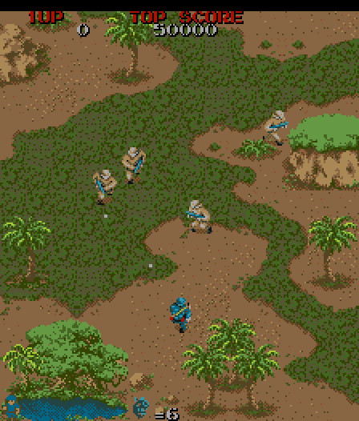

# Commando (Capcom, 1985) on the Atari STE



The `commando` set (World), MAME's `capcom/commando.cpp`.  The main Z80 (encrypted opcodes) is translated to 68000
code; the sound Z80 is not run: the output of its driver is recorded per command, the effects (the SSG) as register
tables and the music (FM on two YM2203) as square-wave streams, both played on the YM2149.  The picture uses three
virtual screens scrolled by the video address (twin lines, damage restored from them), sprites by generated Blitter
code with a per-slot cache, characters with `movep.l`, and one 16-colour palette from the shared default fitter with
checker pairs (2026-11-05).  Status: **Verification pending** (full-game Hatari verification pending).  Speed (Hatari,
`bench.sh PLAY=1`: the recorded play from VBL 900, 6000 VBLs, 4 MB, 2026-11-01): 100% of the arcade's rate (59.6
arcade frames a second) and 27.0 pictures a second, the slowest 100 VBLs 54 arcade frames and 19 pictures a second;
not re-measured since the colour change of 2026-11-05.

## Build and run

```sh
python port.py prepare commando        # verify the ROM archive, unpack it to assets/roms/extracted/commando/
python port.py cover commando          # seeded coverage runs into build/commando/ (seeds 1-3, 12000 frames)
python port.py build commando          # -> run/commando/COMMANDO.PRG (the main CPU ROM embedded)
python port.py build commando --assets # regenerate the palette, pen planes, bake routines and sprite streams
python port.py build commando --sim    # -> run/commando_sim/COMMANDO.PRG (Musashi); --debug diagnostic files,
                                       #   --frames N exits after N VBLs, -D AUTOPLAY=1 scripted coin/start/play
python port.py test commando           # the reference, lock-step logic, pictures, edges, bakes, sound
python port.py run commando            # Hatari (tools/hatari.sh)
python port.py mame commando           # the reference renderer against MAME's picture
games/commando/tools/bench.sh          # Hatari speed (PLAY=1: the recorded play), see "Speed"
```

All 22 ROM files are checked against `docs/rom_manifest.json` (MAME's CRC32 / SHA1).  `build.py --sound` records the
sound again.  Paths are relative to this folder; `engine/`, `tools/`, `port.py` and `docs/` at the top are the
repository's.

## Controls

**5** inserts a coin, **1** starts, **arrows** move, **Space/Ctrl** fire, **Alt** throws a grenade, **Esc** exits.
Joystick port 1 also controls player 1.  Wait for startup before inserting a coin.  Player 2 uses joystick port 0;
**6** inserts its coin and **2** starts a two-player game.  Jaguar pad / PowerPad (STE enhanced ports,
[architecture.md "Input"](../../docs/architecture.md#input-all-ports)): pad A player 1, pad B player 2, the D-pad
moves, **A** fire, **B** grenade, **Option** coin, **Pause** start, keypad **1/2** start, **5/6** coin, **\*** + **#**
quit.

## State

* The reference renderer and palette match MAME's screenshots exactly at frames 100, 700, 1500 and 2500.
* Logic exact: the translation matches all work / video RAM, sprite latches and scroll / control registers for 12,000
  reference frames with attract mode, coin / start and play; `port.py test` runs `logic_test.py 3000`.
* Pictures exact through the STE colour map: consecutive frames (incremental scrolling, damage restore, character
  list; 300 frames, 700-999) and scroll / wrap probes (full redraws).  Edges: whole sprites in the top and bottom
  guard lines, the left and right edges clipped to the inner word with the side bands unchanged
  (`render_test.py 4 edges`, `sprite_test.py`: 248 cases).  48,064 generated sprite / shift pairs pass the independent
  Blitter model; `bake_test.py` bakes all 143,360 object keys against the ROM pixels.  The shared Donkey Kong / Galaga
  sprite regressions pass after the FXSR model fix.
* Sound: the effect player and the music player match their models tick for tick (`sfx_test.py`, `music_test.py`); the
  converted main theme matches MAME's audio in pitch and time (see "Sound").
* Hatari (pinned build, 4 MB): coin / start, movement, fire, deaths and player restarts; no late border events.
* Missing: the music's FM timbre (square waves only); one chip's effects at a time (both chips' effects sound together
  in ~2% of the frames); the flip screen / cocktail mode is not exposed (the default DIP setting is upright).
* Open: 25 pictures a second are reached on average, not in every scene (about a third of the 100-VBL windows of the
  play stay at 19-24 pictures; the heavy scenes need ~15-20% more); the speed after the 2026-11-05 colour change; the
  SSG period scaling is derived, not measured against MAME's output; a natural full playthrough.

## How it works

The shared pieces: [architecture.md](../../docs/architecture.md), the method:
[porting-guide.md](../../docs/porting-guide.md).

### The board and the reference

The Python reference (`tools/machine.py`) has separate encrypted operand / data and decrypted opcode buses, including
ordinary CB / ED prefixes and the data-bus indexed-CB tail.  The MAME IRQ PROM supplies RST 08 and RST 10.  `C806`
latches all 96 sprites explicitly.  Foreground transparency is pen 3, sprite transparency pen 15.

### Translation

`gen.py` goes through `translate.compile_code` with `z80x.FAST` (A' F' BC' DE' HL' in the upper words of d0-d3 / d6,
IY in a2; the runtime saves all registers in its hooks).  The joins are the real entries (reset, the interrupts, the
idle hook, the targets of the `RST 30` word tables, which `discover` records); merged pcs get `z80_badpc` in the
dispatch table.  Recursive discovery also translates unobserved branches; unsupported speculative code entries remain
explicit traps, and any unsupported instruction the coverage actually saw stops the build (no unknown opcode becomes a
silent NOP).  `docs/coverage.json` keeps baseline instruction and sprite-latch coverage for reproducible clean builds;
`port.py cover commando` adds seeded runs in `build/commando/` without overwriting it.

* **Inline leaves** (`gen.INLINE` = 32; `COMMANDO_INLINE`, `COMMANDO_NO_INLINE=1`): the engine's `inline_leaves`,
  extended for this port (`z80x.Config` `inline_limit` 0xC000: the whole ROM is fixed; `inline_rst`; `inline_jumps`:
  jumps inside the body get local labels).  An inlined call does not write its return address below SP:
  `logic_test.py` ignores such dead stack bytes (the sites are marked `; (inline)`).
* **Writer marks**: the tile and character RAM are compared with their copies only after a translated writer ran.
  `gen.BG_WRITERS` / `FG_WRITERS` (10 and 31 instructions, from the coverage's write sites) emit `st bg_written` /
  `st fg_written`; of the latter the 29 `ld (hl)` / `ld (de)` / `ld (nn)` writers of the character RAM mark their row
  instead (`gen.fg_row_mark`: address >> 5 into `fg_marks`, 2 KB, rows at `fg_rowmark`; the CCR kept with `move sr` /
  `move ccr`, since the next instruction may branch on it), the boot's two `ldir` clears set `fg_written` (every row).
  128 bytes of each RAM are compared a frame in case a writer is missing; `logic_test.py` checks that every change
  comes with its flag or its row's mark.  `COMMANDO_FG_ROWS=0` builds the old flag everywhere.
* **Dispatch table** (`gen.dispatch_table`): 256 KB of longs in byte-swapped pc order, built as data (`dcb.l` runs of
  `z80_badpc`); `tools/dispatch_test.py` checks in the simulator that every entry and the interrupt token land on
  their labels and every other address on `z80_badpc`.

### Schedule

The runtime delivers both interrupts at `8001` when the foreground work queue at `ED82` is empty.  It preserves the
Z80 and native task stacks and drains queued work before drawing.  The STE schedules six arcade ticks per five VBLs,
skips up to three pictures in a row to catch up (`MAX_SKIP` 3) and caps pending ticks (`MAX_PENDING` 3).

### Picture

* **Virtual screens with twin lines** (after stedaimakaimura): three display buffers scrolled by the video address;
  buffer lines `l` and `l + 320` always hold the same background, so the 256 shown lines (plus 16 guard lines above
  and below for whole sprites) are contiguous wherever the window is, without a Timer B wrap (Timer A/B remove the
  borders).  The twin period is 320, not 288, because whole tiles at the band's edges overhang by up to 15 lines into
  unused slots.  Only the tile rows that scroll into the 288-line band and the tiles whose RAM changed (compared with
  a copy as longs after a writer flagged it) are drawn, into every buffer.  There is no clean map and no per-frame
  background copy.  A new horizontal scroll or a jump of more than 200 lines draws the band whole; a horizontal scroll
  that is not a multiple of 16 (never seen in play) clears the margin chunks (`clear_margins`, also used by the full
  redraws).
* **Tiles**: with a horizontal scroll that is a multiple of 16 (always in play) a tile copy is two HOG passes of 8
  rows x 4 planes (32 words, 256 bus cycles each: the source X increment steps through the planes), the Blitter set up
  once per `ring_update`; the shifted-tile pass is likewise two eight-line HOG passes with advancing addresses (it
  could reach 320 bus cycles before the 2026-11-05 audit, [colours.md](../../docs/colours.md#what-each-port-uses)).
* **Damage**: what sprites and characters covered in a buffer is a list of rectangles, copied back from the twin lines
  (short HOG Blitter passes, the Blitter's registers through address registers) the next time that buffer is drawn.
  `restore_damage` takes the lines a piece from `piece_lines` (`BLIT_PIECE` / the words a line, 1-16 words) and calls
  `blit_go_lines`; margin clears and the larger restores use the shared full-word dispatcher (2026-10-19,
  [the measurements](../../docs/virtual-scroll-performance.md#implementation-results)).  An 8-pixel character row adds
  one rectangle.  A sprite's damage is its opaque rows (split at the twin boundary by addresses).
* **Characters**: a list of the visible, non-blank cells, rebuilt only when the character RAM changes (only the marked
  rows are compared, `fg_scan`), drawn with `movep.l` (a keep mask and the four plane bytes per row).
* **Sprites**: 1942's `spritegen.py` (reordered source rows, shared mask groups, baked shift streams; see
  [sprite-preparation.md](../../docs/sprite-preparation.md)), with a full-address path (`generic_part`) for 64 KB
  crossings.  The loop keeps a slot per entry (28 bytes, walked beside the entry): the decoded shape, the y table
  pointer (`SL_YTAB`; `ytab`: (y + 16) * 256 or -1), the first opaque row and its count (`SL_FR`, `SL_LINES256`, from
  `spr_vrange`) and the damage's words and lines (`SL_DMG`: one chunk unshifted, two shifted), so the cache lookup
  (`get_object`'s hit path) is paid only when the slot's entry changes; the y pointer is one `move.l` instead of `lea`
  + `add.w`.  The loop rejects the hidden entries (x = 0) first, sets the Blitter registers no sprite routine changes
  once a frame, keeps the window base in the USP (the quit path puts the program's USP back), and skips a shape that
  is blank at its shift before the lookup; the sprite list copy uses `movem`.
* **Edges**: the window's left and right edges lie on chunk boundaries (`GAME_X` = 24 bytes, 224 = 14 chunks), so a
  sprite across one (x -15 .. -1 or 209 .. 223, always shifted) draws only its inner word, as 1943's `clip_part`:
  right edge the first word under END1, left edge the second word with FXSR, source Y increment 0 and the stream's
  END3 mask as END1; one word a line, the rows from `spr_plan`; its damage is that one chunk.  `draw_sprites`' x test
  is `beq` (hidden) / `sub.b #16` / `cmp.b #208` / `bhi.s` to `.edge` (hidden on the right, or across an edge);
  `.edge` repeats the loop's set-up off the hot path.  Top and bottom: whole sprites in the guard lines.
* **Borders**: the shared `engine/rt/borders.s` schedules each event early and syncs it to the video, long restores
  run in short HOG pieces (`blit_go`), see
  [architecture.md "Border removal"](../../docs/architecture.md#border-removal); the palette switches are line-exact.
  The DEBUG build counts events that started too late.

### Colours

One 16-colour palette from the shared default fitter with checker pairs (`engine/palette_native.py`,
`engine/palette_quantize.py`; the ordinary build since 2026-11-05): the bounded fit, checker pairs baked in source
coordinates (two row-conversion routines generated per colour), text and HUD glyphs flat, black in slot zero; gameplay
and graphics priorities unchanged.  Its training data are ten seed-1 frames (100-2500).  See
[colours.md](../../docs/colours.md) for the training, the native checks and the limits.

### Sound

The sound board (`tools/sound.py`, from MAME `capcom/commando.cpp`): a Z80 at 3 MHz, latch at 6000 (the main CPU's
C800), two YM2203, four IRQs a frame from the scanline PROM.  The driver keeps the two kinds of sound apart: the music
(commands $20-$2C, 13 tunes) uses only the six FM channels, the effects (commands $02-$1B) only the SSG (square waves
and noise, 3 channels of one chip each).  Translating the driver would cost ~3,800 Z80 instructions a frame (its IRQ
handler; the effects alone ~2,700); the music as samples (the Donkey Kong way) did not fit.  The four IRQs of an
arcade tick run at the tick's start (`.deliver`), with the latch as the tick before left it; the YM gets the state
after the fourth (a 60 Hz update of the arcade's 240: sweeps move in steps of four).  No interrupt handler of the port
touches the YM.

**Effects** (`tools/sound_sfx.py`, `src/sfx.s`), in the driver's own scheme (audio ROM): per chip four slots, only the
highest active one is stepped (0537 / 0564) and output (0955 / 0A27); a command (re)starts its effect in its slot
(092E), command 0 / $1C-$1F clear all (00E6).  An effect's output after n steps depends only on n and on the IRQ
counter's phase (05F8: part of the work every 4th IRQ), so each effect is recorded alone in the four phases.  The STE
form: every distinct output once (`sfx_dict`, 2,515 x 12 bytes) and per effect and phase a word per step (84 KB in
all); a step is two lookups, active slots are bit masks per chip.  The SSG periods are scaled by 8/3: the driver sets
the prescaler to 3 at boot (0064: registers $2D then $2E; MAME ymfm `ym2203::write`), an SSG clock of 750 kHz; the
STE's YM2149 runs at 2 MHz.  Noise periods above 11 clamp at 31 (5 bits): the lowest noises come out higher.  The STE
plays one chip: the one whose shown effect started last.

**Music** (`tools/sound_music.py`, `src/music.s`; its `Player`, `Channel`, `Mixer` and `combine` are the 68000 code in
Python, step for step; the method in general:
[porting-guide.md "FM music as square waves"](../../docs/porting-guide.md#fm-music-as-square-waves-commando-2026-10-11-the-other-capcom-boards-have-the-same-ym2203s)).
A tune command clears its slot's six channels and loads them (01F7 / 0200 / 0209, then 0224); $2D / $2E stop the music
(0101).  Four slots of six channels, $4100-$4400 (32 bytes a channel); the IRQ (02B3) steps only the highest slot
whose first channel is active, so a jingle ($20 the start, $2B a death, $22 ...) pauses the main theme ($21, the
lowest slot), which resumes when it ends.  Slot channel n is FM channel n % 3 of chip n // 3.  Each tune is recorded
alone from the boot, the driver's four IRQs of a tick run back to back, as the STE runs them; the register writes go
through `engine/opn.py` (the YM2203's envelope generator after ymfm, carriers only; 64 units = 6 dB): per tick and
channel the pitch of the carriers (the lowest within 12 dB of the loudest: their multipliers differ) as a period of
the 2 MHz YM2149, and their mean loudness over the four quarters of the tick as a volume (3 dB a step; a carrier at
full level is 14: ymfm peaks an FM carrier like an SSG square at 15, a sine sounds 3 dB below the square).  The FM
clock is 1.5 MHz / 36 (the prescaler 3, 0064), so Hz = fnum * 2^(block-1) * 41667 / 2^20.  Each channel loops on its
own (its 32 bytes and its output repeat, and keep repeating for a period more, at least 600 ticks): $21 1,728 ticks,
$23 384, $24 864 from 25, $28 2,304 (two channels 9,217), $2C 864 from 193; the others end, and their notes' release
is recorded as a tail (up to 180 ticks), played while no other tune plays.  The loop seams differ from the following
ticks in 0-2% of the ticks (the envelopes' state at the seam).  The STE form (34 KB): per channel a byte stream, a
tick a step (hold n + 1 ticks, a volume, a volume - 1 with a hold, a period without a tick, the end: the loop or
silence).  After the effects' IRQs of the tick the latch starts or stops slots, the highest slot that plays steps its
six channels (else the highest tail), and `mus_mix` builds the YM's registers: the effect keeps the YM channels it
sounds on (a volume, the tone or the noise on); the loudest music channels take the others (key volume * 2, +1 for a
channel that played the tick before, the lowest channel of a tie), each on the YM channel it had if it is free.  About
3.5k cycles a tick (Musashi: the tick 1.4k, the mix 2.2k; ~2.4% of the CPU).

Checks: `sound_sfx.py check 3000` (the encoded data through the decoder against the driver, IRQ by IRQ over 3000
frames of the game): 509 of 23812 chip outputs differ, all after an effect resumed from a pause (the quiet tail of
$06, at volume 1); `sfx_test.py 3000`: the 68000 player against that decoder, 0 of 23809 differ.
`sound_music.py check`: the encoded streams against the recording, 0 of 183,733 channel ticks differ;
`music_test.py 20000`: the 68000 player (`mus_tick`, `mus_mix`) against the model with random tunes, stops and effects
(pauses, resumes, tails, loops, effect channels), 0 of 20,000 ticks differ.  Against MAME 0.289's own audio (the latch
poked to $21 at frame 300, `-wavwrite`): the semitone spectra of the first 50 s correlate 0.94 at the same pitch and
time (0.2 a semitone off, 0.4 an octave off), with no tempo drift.  Hatari (`--sound 44100 --avirecord true`, coin and
start): its audio against the model's rendering of the start jingle 0.955.  `sound_music.py wav XX` renders a tune
through the player (`build/commando/music_XX.wav`).

### Memory

2,994,006 bytes (text + data + BSS, `build/commando/commando.map`, 2026-10-15), 1,040 KB left from the desktop
(`tools/memfree.sh`); TOS refused to start 0.3 (3,990,068 bytes, 4,047,656 with the music) on a tester's Mega STE (the
load budget: [porting-guide.md "Memory and release"](../../docs/porting-guide.md#memory-and-release)).  The program
does not Malloc (GEMDOS: Super, Fcreate / Fwrite / Fclose for the dumps, Pterm0); the screens are BSS.  What made it
fit (2026-10-10, merged 2026-10-15):

* **Dispatch table** as data instead of BSS filled at the start from 68 KB of (pc, label) entries; the dispatch code
  is unchanged.
* **Main ROM in place**: assembled into `g_block` (both copies of $8000-$BFFF) instead of copied from a third copy (48
  KB).
* **Pen planes instead of one-hot masks** (704 -> 224 KB): an object is its pen planes (`tile_planes`, `spr_planes`,
  `chr_planes`), and a row goes through a routine per kind and colour generated from the colour map
  (`assets.bake_rows`: a pen's pixels are the product of its pair of the two low planes and its pair of the two high
  ones, OR-ed into the STE planes it has); a mirrored row reverses its 2-4 plane words once.  The same bytes in about
  a quarter of the time (the old bake OR-ed a mask word per pen and row through `orp_tab`).  The characters' opaque
  pixels (`chr_opaque`, 128 KB) are the complement of the pen-3 product the row routine leaves; the bake keeps them
  for `char_convert`.
* **Sprite row orders** (`spr_order` 48 -> 12 KB): a sprite and its flipped and mirrored images share one order of
  base rows (a flip keeps equal rows equal and blank rows blank); a vertically flipped image's routine takes row 15 -
  order[j].  An image and its mirror share their Blitter routines (3934 -> 2416, 509 -> 303 KB; the streams 676 -> 682
  KB), and equal generic-path plans are stored once (122 -> 51 KB).

The largest items then: the three screens (504 KB), the sprite streams (682 KB), routines (303 KB) and their (routine,
stream) table (384 KB), the dispatch table (256 KB), the object pool and cache (128 + 96 KB; not shrunk: they would
cost bakes).  Since then the sound effect tables (84 KB) and the inline leaves (+19 KB of code) were added.

## Speed

| date | setup | logic | pictures |
|---|---|---|---|
| 2026-11-01 | Hatari, `bench.sh PLAY=1` (the recorded play from VBL 900, 6000 VBLs, 4 MB) | 100% (slowest 100 VBLs: 54 arcade frames a second) | 27.0 a second (slowest 100 VBLs: 19) |
| 2026-11-01 | Musashi, `PLAY=1 perf_test.py 2400 1200` (`-D SCREEN_PAD` for the same 64 KB offset) | 49.7k cycles a tick | 152.3k cycles a picture |

The recorded play is `play_search.py 9000` (`build/commando/play_inputs.bin`).  Hatari takes ~1.14 times the Musashi
cycles in play.  Where a picture's time goes (`PLAY=1 perf_test.py 2400 1200 profile`, 153.7k before the row marks):
the sprite loop's own CPU 29k, the character layer 24k (its RAM compare ~6k, the drawing ~17k, the rows' restore
set-up ~3k; ~610 cycles a cell in 2026-10-09's count, 8 rows of `movep.l` read-modify-write, only 10 of 248 rows a
frame blank and 17 opaque).  The logic is spread over ~2,900 Z80 instructions a tick (the top routine 12%; the
translated straight code ~14 cycles a Z80 instruction).  At 60 ticks against 25 pictures a second, 1k cycles saved a
tick is ~2.4k a picture.

What made it fast, newest first:

* **Character row marks and the slot's y table pointer** (2026-11-01, R-Type's ideas): a picture 153.7k -> 152.6k
  (marks) -> 152.3k (both), the logic 49.3k -> 49.7k a tick (the marks; the writers run ~12 times a tick in play).
  Hatari (single runs): 26.5 -> 27.0 (marks) -> 27.1 (both, padded) / 27.0 (as built) pictures a second, the slowest
  100 VBLs 18 -> 19; the heavy scenes are not lifted.
* **Full speed in play** (2026-10-23; goal: 100% with 25+ pictures a second): Hatari on the recorded play 95% (whole
  run) and ~21 pictures a second in play -> 100% and 26.5, the slowest 100 VBLs 49 / 18 -> 54 / 19; Musashi a tick
  55.8k -> ~51k, a picture 167.8k -> ~158k, the heaviest stretch (ticks 4900-4999, scrolling) 59.6k / 205.3k -> 57.3k
  / 191.4k.  The parts: inline leaves (-2.7k cycles a tick, +19 KB of code); the effects as tables (-1.7k typical to
  -4.2k busy a tick); the sprite slots (~680 -> ~560 cycles a drawn sprite); the damage restore's Blitter registers
  through address registers (~-2k a picture); the tile copies as two 32-word HOG passes (-13k a picture while
  scrolling); `MAX_SKIP` 2 -> 3 (Hatari 99% / 26.6 -> 100% / 26.5: the game keeps its speed in heavy scenes at the
  same picture rate); the sprite list copy with `movem` (-0.3k).
* **Shared full-word dispatcher** (2026-10-19): `perf_test.py 1600 900` 175,092 -> 174,645 a picture (-0.26%), the
  logic 47,971 in both.
* **Memory work** (2026-10-10, merged 2026-10-15): the bake 15,707 -> 1,925 cycles a picture, a frame 183,154 ->
  168,224, the 99th percentile picture 618,048 -> 323,834 (`PLAY=1 perf_test.py 2000 400 profile`); the logic
  unchanged.
* **Edge clipping** (2026-10-12) cost +0.04% (`perf_test.py` ticks 900-2499 183,204 -> 183,270; `clip_part` 339 and
  `sprite_edge` 28 a frame against fewer generated-routine and restore cycles; with no sprite at an edge +29, the
  entry `bra.s`).
* **Foreground damage batching** (2026-10-11): an 8-pixel character row one rectangle instead of four 2-line ones:
  render CPU + Blitter 233,717 -> 218,556 cycles (-6.5%, `perf_test.py 1000 900`); Hatari (AUTOPLAY, whole run) 24.1
  -> 26.0 pictures a second.
* **Restores without `divu`** (2026-10-09): `blit_go`'s `divu` cost 9.5k cycles a frame over ~68 restores;
  `perf_test.py 2500 900` a frame 185.8k -> 182.0k.
* **Translator** (2026-10-09): the real entries as the only joins: the translated code 8.4k -> 7.0k cycles a tick
  (`engine/xprof.py commando`, ticks 600-1000, attract; 1.20x).
* **Writer flags** (2026-10-09): a frame 246k -> 213k; **the sprite pass** (the entry pointer in a register, hidden
  entries first, Blitter registers set once a frame, the lookup, destination and damage inline): 189k -> 161k.
* **The renderer** (2026-10-08): a frame 962k -> 255k cycles (it had scanned the background, 329k, and the characters,
  208k, and cleared the screen, 151k, every frame); Hatari 23.6 ticks and 7.9 frames a second -> 52.2 and 21.5.

Measured, not kept:

* **Text as OP 3 copy passes** (2026-10-24,
  [sprite-preparation.md](../../docs/sprite-preparation.md#what-the-ports-found)): `draw_foreground` 25.0k -> 26.4k
  cycles a picture, the mean picture 155.1k -> 160.7k, pictures over 300k 7 -> 21; unshifted, the CPU's `movep` line
  costs no more than a pass.
* **A native for $A498** (the four sprite entries of an object): the same cycles as its translation.  Natives would
  have to replace most of the logic.
* **A cache of the music mix**: no hits in play (the effect registers change every tick).
* **`MAX_SKIP=4 MAX_PENDING=4`**: 100% / 26.5, the slowest 100 VBLs 17 pictures instead of 19.
* **R-Type's lean sprite loop** (state in registers): does not carry over; the generated routines leave only d0-d3
  free, and the walk over all 96 entries (~3.7k a picture) has no cheaper form.
* **Edge tests**: one more compare per drawn sprite cost +0.46% a frame (~50 sprites a frame); sending the hidden
  sprites through the edge test +0.6%.
* **A damage-bitmap union** (2026-10-11, with the character row batching): cost more cycles; discarded.
* Left out without building (estimates): the dispatch table as words or a split sprite table (cycles in every dispatch
  or sprite); a smaller object pool and cache (more bakes).

Techniques other ports use that may apply:
[speed.md](../../docs/speed.md#techniques-that-look-applicable-elsewhere-2026-11-07) (among them dropping the flags at
the idle hook `8001`).

## Tests and tools

```sh
python port.py test commando                     # reference_test, build --sim, dispatch_test, bake_test,
                                                 #   logic_test 3000, render_test 20 scroll and 4 edges,
                                                 #   sprite_test, sfx_test, music_test 20000
python games/commando/tools/logic_test.py 3000   # lock-step (writer flags, row marks, dead stack bytes)
python games/commando/tools/render_test.py 300 seq   # consecutive pictures against the reference; 20 scroll, 4 edges
python games/commando/tools/sprite_test.py       # 4 sprites with holes, 16 shifts, both edges, plain and across 64 KB
python games/commando/tools/bake_test.py         # all 143,360 object keys baked in the simulator against the ROM pixels
python games/commando/tools/dispatch_test.py     # every dispatch entry and the interrupt token on their labels
python games/commando/tools/sfx_test.py 3000     # the effect player against the decoder
python games/commando/tools/music_test.py 20000  # the music player against the model
python games/commando/tools/sound_sfx.py check 3000   # the effect data against the driver; sound_music.py check, wav XX
python games/commando/tools/perf_test.py 2400 1200    # [ticks] [first] [profile]: Musashi cycles
python games/commando/tools/play_search.py 9000  # the recorded play -> build/commando/play_inputs.bin
python engine/xprof.py commando                  # the translated code by Z80 instruction (PLAY=1; writes <csv>_pcs.csv)
games/commando/tools/bench.sh [items]            # Hatari: DEBUG + AUTOPLAY (PLAY=1: the recorded play), 6000 VBLs
```

`perf_test.py` takes `PLAY=1` (the recorded play) and `PERF_SPANS=1` (the means of every 100 ticks); its default mode
steps 2000-cycle chunks (up to one chunk's overshoot a frame), `profile` one instruction a step.  `sprite_test.py`
checks each case against the same sprite drawn whole in the middle, the bands unchanged and the damage inside the
window, also across the twin boundary; it fails on whole-drawing code.  `render_test.py 4 edges` expects clipped left
/ right sprites and whole top / bottom ones.  `bench.sh` starts its own Hatari (not `tools/hatari.sh`, which stops
every running Hatari), takes `EXTRA="-D ..."`, `WAIT` and screenshot items, and reports ticks, frames drawn and late
border events; `tools/bench.ps1` is its Windows counterpart.  A/B builds must keep the screens' 64 KB offset
(`-D SCREEN_PAD=n`, before `screen_area`).

## Lessons

### 2026-11-01: the screens' place in memory

Moving the screens by 2.8 KB moved `generic_part` (sprites across a 64 KB boundary) from 1.3k to 5.5k cycles a picture
in the profile window: A/B builds must keep the screens' 64 KB offset (`-D SCREEN_PAD`).  Already on 2026-10-10 the
memory work's frame was 175.9k at the new place and 174.0k at the old alignment.

### 2026-10-23: only Hatari raises address errors

A byte variable in the BSS moved later longs to odd addresses and only Hatari crashed: the simulator does not raise
address errors.  Keep BSS flags as words (or `even` after them).  Likewise a sprite slot's damage across the twin
boundary wrote over program code in Hatari only; `sprite_test.py` checks that case now.

### 2026-10-11: music timing and loops

Recorded with the arcade's timing, $28 did not repeat in 40,000 ticks and $21 only after 6,920: the arcade loses an
IRQ when a handler runs long (a tune's load, for one), which shifts the IRQ counter's parity that a channel with the
double-speed flag (ix+31, 02F6) depends on.  Recorded with the STE's back-to-back IRQs the tunes loop, and their tempo
still matches MAME's.  A short repeat of a channel's bytes alone can part again (the bytes are not all of the state).

### 2026-10-11: masked destination reads

Masked destination reads are counted by the simulator since the damage batching (its figures include them): Musashi
picture figures before 2026-10-11 leave them out.

### 2026-10-10: YM writes and the border interrupts

Masking interrupts around the YM writes made border events late; no interrupt handler of the port touches the YM, so
its writes need no masking.

### 2026-10-09: scripted Hatari runs and the damage trade

The scripted game unfolds differently with any timing change, so AUTOPLAY rates of two builds differ by more than the
change (`bench.ps1`: 26.5 -> 30.1 pictures and 55.4 -> 56.9 ticks a second for the sprite pass): compare runs of one
build, use `perf_test.py`, or the recorded play.  Damage cut to each shape's opaque rows saved as much Blitter time as
its lookup cost the CPU then; it paid on 2026-10-23, when the per-slot cache paid the lookup only when a slot's entry
changes.  Making every pc the coverage saw a join switched the CCR analysis, the precise returns and the merges off.

## Verification

Hatari runs (the pinned build, 4 MB) through coin / start, movement, fire, deaths and player restarts; the recorded
play of `play_search.py` replayed by the bench; the music against MAME's audio and Hatari's recorded audio (see
"Sound").  No full-game playtest.

PPO exploration: `venv/bin/python port.py ppo commando test --steps 256 --frames 2100` ([the PPO guide](../../docs/ppo.md)).
Full-game verification follows the [status policy](../../docs/port-status.md); nothing here claims a complete playthrough.
