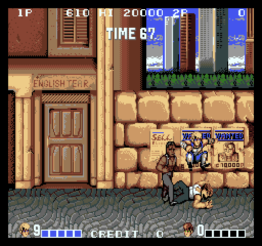

# Double Dragon (Technos, 1987) for the Atari STE



STE port of MAME set `ddragonj` (Double Dragon, Japan set 1; driver `technos/ddragon.cpp`): the main CPU's 6809
program translated whole (bank-aware), the sprite MCU's job as a native routine, the background, the sprites and the
text on the STE's 16 colours, the YM2151's music and effects on the YM2149, the ADPCM voices and hits on the DMA
sound.  4 MB STE, the borders open: all 240 lines.  Playable, but slow: about 30% of the arcade's speed in play.

```sh
python games/ddragon/tools/prepare.py       # verify assets/roms/ddragon.zip, unpack to assets/roms/extracted/ddragon/
python games/ddragon/tools/build.py         # run/ddragon/DDRAGON.PRG (--sim: run/ddragon_sim/ for the tests; --sound: record the tunes again)
python games/ddragon/tools/logic_test.py 6000 --seed -1      # lock-step against the reference (seeds: ref/cover.py)
python games/ddragon/tools/render_test.py 4000 --seed -1 --first 1000 --every 10   # the pictures against the reference
python games/ddragon/tools/sprite_test.py   # sprites at every edge, 16 shifts, holes, a 64 KB crossing
python games/ddragon/tools/mcu_test.py      # the native MCU job against the HD63701Y0 interpreter
python games/ddragon/tools/sound_test.py    # the ADPCM and YM players against their models
games/ddragon/tools/bench.sh 8000           # Hatari (pinned F030Arcade build, its own instance): AUTOPLAY, logic and picture rates
PLAY=1 games/ddragon/tools/bench.sh 8000    # the same with the recorded play (build/ddragon/play_inputs.bin)
python games/ddragon/tools/profile.py 3000 3200 --seed -1 [--callers main_bank_w]   # where the logic's cycles go (Musashi)
python games/ddragon/tools/play_search.py 90000 2      # a recorded play (engine/playbot.py) -> build/ddragon/play_inputs_2.bin
python games/ddragon/ref/mame_cmp_ddragon.py [frame ...] [--keep DIR]    # the reference board against MAME 0.289
python games/ddragon/ref/trace_cmp.py main|sub|sound F0 F1    # one CPU against MAME's trace, instruction for instruction
```

Supply `assets/roms/ddragon.zip`: the 23 files of MAME's `ddragonj` under MAME's names (`docs/rom_manifest.json`
has their sizes, CRCs and SHA-1s; they match MAME 0.289's `ddragonj` entry).  MAME runs it as `ddragonj` straight
from `assets/roms` (it looks for a clone's files in the parent's `ddragon.zip`).  Nothing ROM-derived is in git: the
graphics, the program image, the sound data, the recorded plays and the coverage pickles are made in
`build/ddragon/`.  `python port.py test ddragon` runs the main tests.  The coverage (`port.py cover ddragon`) needs
the recorded plays first: `tools/play_search.py 40000 1`, `90000 2`, `40000 3`.

Controls: **5/6** coin, **1/2** start, **arrows** move, **Space/Z** punch, **Alt/X** kick, **Ctrl/C** jump, **9**
service, **Esc** quits.  Joystick port 1 player 1 (fire punches), port 0 player 2.  Jaguar pad / PowerPad: pad A
player 1, pad B player 2, **A** punch, **B** kick, **C** jump, **Option** coin, **Pause** start, **\*** + **#** quit.

## The board

Three CPUs (MAME technos/ddragon.cpp, `ddragon` machine):

* **Main**: HD6309E at 3 MHz.  The program stays in 6809 emulation mode and uses no 6309 instruction (all 140
  mnemonics in a 60-second MAME trace of boot, attract and the demo are 6809 ones), and MAME's `hd6309.lst` gives
  every 6809 instruction the 6809's cycles in emulation mode, so `engine/m6809.py` runs it.  32 KB fixed ROM at
  $8000, a 16 KB bank at $4000 (six pages of 21j-2-3 / 21j-3 / 21j-4-1), 4 KB RAM, palette, two tilemaps, sprite
  RAM, the shared RAM.  NMI at the vertical blank's start (line 240), FIRQ every 16 lines, IRQ from the MCU.
* **Sprite MCU**: HD63701Y0 (6 MHz, 1.5 MHz E clock), 16 KB internal ROM `21jm-0.ic55`:
  `engine/hd63701.py` `HD63701Y0` (the Y0's memory map and port 6 on the shared 6301 core).  It only touches its
  RAM, port 6 and the 512-byte shared RAM: on the main CPU's NMI ($380F) it sorts the object list there and writes
  the sprite entries back, then raises the main CPU's IRQ (port 6 bit 1) and drops its own NMI (bit 0).  The main
  CPU halts it (bank register bit 4) or holds it in reset (bit 3) to reach the shared RAM, which reads $FF while
  the MCU runs; EXTRA bit 4 tells it when the bus is free.  On the first NMI it also sums its ROM into $8000.
* **Sound**: MC6809 at 1.5 MHz with a YM2151 and two MSM5205 (ADPCM samples in 21j-6 / 21j-7, idle bits at
  $1800).  The main CPU only writes the latch ($380E); the sound CPU still runs in the reference because its
  slices, its latch reads and the YM2151's and MSM5205's timers cut the other CPUs' slices in MAME.

`tools/machine.py` runs all three with MAME's scheduler (as `engine/namcos1.py`): 1/60000 s quanta in device order,
a suspended CPU (the MCU in reset or halted) moved to the end and eating its cycles, every timer (the scanline timer
each line, the screen's, the YM2151's, both MSM5205's VCK and capture timers, the 50 Hz stream update) and every
synchronised line change ending a slice.

Video (ddragon_v.cpp): bg 512 x 512 of 16x16 tiles (9-bit scroll x/y), sprites (16x16 to 32x32, pen 0
transparent, drawn first to last), fg 8x8 chars; screen line y shows tilemap line y + 8.  256 x 240 visible, 384 x
272 total at 6 MHz (57.44 Hz).

## Reference (`tools/machine.py`, `ref/mame_cmp_ddragon.py`)

* **All three CPUs exact**: `ref/trace_cmp.py` against MAME's debugger trace, every instruction's address,
  registers and cycle count equal: the main CPU frames 0-300 and 8000-8011 (4.6 million instructions), the MCU frames 0-1200
  (560,715, through its resets and halts), the sound CPU frames 0-3 and 600-1800 (6.9 million).
* **Memory**: `ref/mame_cmp_ddragon.py` from power-on: main CPU RAM, palette, tilemaps, sprite RAM, shared RAM, MCU
  RAM, sound RAM, scroll and every sound command equal at all checked frames through 9000 (boot, attract, the demo
  through its stages).  A dead stack byte can differ where MAME stops inside an instruction at a frame's end (frame
  8010: $0FEC-$0FED below S, the trace identical).
* **Picture**: the reference renderer draws MAME's memory with 0 differing pixels and all 384 layer pens equal; the
  board's own picture (each line with the video state at its scanline, as MAME's partial updates) is exact too,
  but for 26 pixels of frame 8000: while the program clears the background during the frame, MAME shows 16 old
  pixels at x 48 in line 0, x 144 in line 1, x 240 in line 2 (96 pixels further each line, a sub-line effect of its
  drawing that a line model does not give).
* Not checked yet: play (coins, start, the stages played) against MAME.  Not modelled: the flip screen
  (cocktail), the sound output itself (the YM2151 register writes and ADPCM starts are logged).

MAME's slices split instructions, the board's 6809 core runs whole ones.  Where that shows (a read on an
instruction's last bus cycle past a slice's end) the board reads by MAME's time: the vertical blank bit by the time
alone, the YM2151 status and the ADPCM idle bits after firing the YM2151 / MSM5205 timers that expire before the
read cycle (`DDragon.fire_early`); the YM2151's busy flag by the read cycle's time.

## The translation (`tools/gen.py`, `ref/cover.py`, `src/core.s`)

`engine/m6809x.py` translates every 6809 instruction the coverage saw (19,627) into 68000 code, driven by the
port's schedule (`tools/machine.py` `DDragonPort`), which runs the program as the STE does, one arcade frame at a
time: the NMI at the idle point, the FIRQ once if F is unmasked, then the foreground up to a hook where the program
waits ($83E9, $8541, $864C: the MCU's answer; $B7AD, $EEB0: the vertical blank).  Coins stay pending until the FIRQ
takes them.  `tools/logic_test.py` runs the translation in lock-step with that schedule on the reference board:
RAM, video RAM, palette, MCU RAM, the registers and every sound command equal after every frame.

* **Coverage** (`port.py cover ddragon`, 12 seeds of 20000 frames: attract, random play, infinite lives, two players;
  three recorded plays, `tools/play_search.py` on `engine/playbot.py`: seeds -1 and -3 to mission 2 in 40000 frames,
  -2 through missions 3 and 4 in 90000).  Per site: the DP ($0B), the shared RAM's mirror use, I/O reads and
  writes, an index that wraps past $FFFF.
* **Banks**: 16 KB at $4000 as two virtual pages (8 + 2 b, 9 + 2 b); a context per bank (`ctx_banks`: the slots'
  page bases, the dispatch tables, the page numbers), so a write to $3808 only switches a6.  The four bank selector
  routines ($BB40, $FC82, $FC8F, $FF80) are natives.
* **Dispatch**: a word table per code page (the label's offset from the page's base stub), for returns and jumps
  the coverage could not pin down.
* **The MCU** (HD63701Y0): its job on the main CPU's NMI (sort the object list, write the sprite entries back) is a
  native routine (`src/mcu.s`, from `tools/mcu.py`'s model), equal to the interpreter (`tools/mcu_test.py`).

Lock-step: the three plays (40000, 90000 and 40000 frames, missions 1-4) and seeds 0-4, 10-14, 20-21 (20000) identical.

## The picture (`src/render.s`, `tools/assets.py`)

Trojan's renderer, adapted: two rings of 416-byte lines with the STE's fine scroll; the background in 16x16 cells
with keys (a cell is drawn again only when its tile, colour or flips change, or a sprite or a text character damaged
it), the sprites first to last (1, 2 or 4 parts of 16x16, 4 orientations), the text on top.  One fixed palette of 16
STE colours for the whole game (`ref/palette_fit.py`: weighted k-means in Oklab over the attract mode and the
plays through mission 4, docs/palette.json; mean error 8-10 of 255 a channel), each of the 24 arcade colour sets
mapped onto it (a set whose colours change gets a new epoch: its baked images are made again).

* **Sprites**: the rows of each image sorted by their opaque mask at build time (`docs/sprite-preparation.md`: 2.4%
  fewer cycles than the rows' own order, the program 32 KB smaller), baked on first use per (code, flips, colour,
  epoch) into a 768-entry cache, the masks for the 16 shifts prepared; a HOG pass a row run.  Clipped at the black
  side words (the inner word only), culled beyond, whole into the guard rows at the top and bottom.
* **Text**: solid characters (every pixel one pen: the frame of the picture, rows 1 and 30 and columns 0 and 31) are
  Blitter fills, a run of them one fill and a column of them one tall fill; the others are baked (256 entries) and
  drawn a row a pass.
* Every Blitter pass HOG and at most 256 cycles (`BLIT_STATS=256`: none longer).
* `tools/render_test.py`: the picture equals the reference picture through the palette, pixel for pixel (the
  attract mode, the plays through missions 1-4); `tools/sprite_test.py`: both rings x 16 fine scrolls, sprites at
  every position near both edges, 32x32 objects across them, the guard rows, flips, transparent holes, a 64 KB
  crossing.

## Sound (`tools/sound.py`, `src/sound.s`)

* **YM2151 → YM2149**: each tune and effect the program sends (tunes $01 $03 $07 $09 $0A $0C $0E, effects $02 $04
  $0F-$12) recorded on the reference board's sound part (main CPU and MCU held), its carriers modelled
  (`engine/opm.py`), reduced to three voices a frame (the loudest of distinct pitch, each kept on its YM voice),
  encoded as `engine/capsnd.py`'s streams; the loop found from the driver's channel pointers.  An effect takes YM
  voice C while it plays.  $FF / $FE / $FD stop the music / the effect / both.
* **ADPCM** (two MSM5205: the punches, hits and voices, commands $80-$9A): each command's sample decoded at build time
  as MAME decodes it (`tools/sound.py` `Voice`) and resampled to 6258 Hz, a signed byte a sample; the two chips'
  voices mixed into a looping DMA buffer once a frame (~13k cycles with one voice, ~19k with two; decoding on the STE
  cost 98k / 163k).
* `tools/sound_test.py`: both players against their models, every byte / register equal.

## Speed (Hatari, pinned F030Arcade build, 8 MHz STE, 8000 VBLs)

| | arcade frames a second | pictures a second |
|---|---|---|
| attract mode | 57 (100%) | 47-50 |
| AUTOPLAY (coin, start, walk and punch) | 6-42, mostly 13-20 (20.7 overall) | 1-9, mostly 3 (7.2 overall) |
| the recorded play (`PLAY=1`, missions 1-2) | 10-49, mostly 15-20 (22.4 overall) | 2-9, mostly 3-4 (7.4 overall) |

The logic comes first (a picture after at most 4 frames not drawn).  Musashi, mission 1 in play (`profile.py 3000
3200 --seed -1`): the logic 251k cycles a frame (the MCU job 24k, the bank switches 15k, the sprite copy and the bank
natives 15k, the dispatcher 11k, the rest the translated code; 279k on average over the play through mission 4), the sound ~10-20k, a picture 674k with the Blitter
(cells 92k, the text 283k, the sprites 142k).  Taken here: the ADPCM decoded at build time (sound 98k / 163k -> 13k /
19k a frame with one / two voices), a context per bank (bank switches 27k -> 15k), solid text fills (the text's CPU
cycles 391k -> 237k a picture).

The program asks TOS for 3,654,036 bytes (text, data and BSS; the release limit is 3,700,000): the tile cache is 512
entries, the character cache 256, the sprites' row orders two a byte.

## What is missing

* Speed: about 30% of the arcade in play; the logic would have to get 2-3 times cheaper (the translated code's own
  cost, not one routine).
* The flip screen (cocktail) is not modelled; play against MAME itself (not the reference board) not compared.
* The music is the YM2151 reduced to three square-wave voices.
