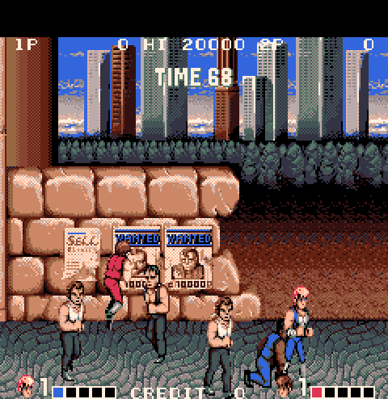

# Double Dragon (Technos, 1987) on the Atari STE



STE port of MAME set `ddragonj` (Double Dragon, Japan set 1; driver `technos/ddragon.cpp`).  The main CPU, an HD6309E
running 6809 code, is translated whole and bank-aware (`engine/m6809x.py`) with natives for the collision; the sprite
MCU (HD63701Y0) is not run: its job is a native routine; the sound MC6809 is not run either: the YM2151's music and
effects are recorded and played on the YM2149, the ADPCM voices and hits decoded at build time and played on the DMA
sound.  The picture: the background, the sprites and the text on the STE's 16 colours (the default fitter with
checker pairs), all 240 lines in the open borders.  Status **Incomplete**: significant gameplay slowdown, the logic
would have to get about 2 times cheaper.  Speed (Hatari, the recorded play, 4 MB, 2026-11-07): 32.3 arcade frames a
second (56% of the arcade's 57.44), 7.1 pictures a second over the recording; in play 25-31 arcade frames a second
(about 50%) and ~3 pictures a second.  Developed with 14 MB in Hatari (the user, 2026-11-07); the release still has to
fit the 4 MB load budget.

## Build and run

```sh
python port.py prepare ddragon              # verify assets/roms/ddragon.zip, unpack to assets/roms/extracted/ddragon/ (tools/prepare.py)
python port.py cover ddragon                # coverage: 12 seeds of 20000 frames (ref/cover.py); needs the recorded plays first
python port.py build ddragon                # run/ddragon/DDRAGON.PRG (tools/build.py; --sim: run/ddragon_sim/ for the tests; --sound: record the tunes again)
python port.py test ddragon                 # the simulator build, palette_test, logic_test, render_test, sprite_test, mcu_test, sound_test
python port.py run ddragon                  # Hatari (tools/hatari.sh; 14 MB for this port, MEMSIZE=4 for a 4 MB STE)
python port.py mame ddragon [frame ...] [--keep DIR]   # the reference board against MAME 0.289 (ref/mame_cmp_ddragon.py)
python games/ddragon/tools/play_search.py 90000 2      # a recorded play (engine/playbot.py) -> build/ddragon/play_inputs_2.bin
```

Supply `assets/roms/ddragon.zip`: the 23 files of MAME's `ddragonj` under MAME's names (`docs/rom_manifest.json` has
their sizes, CRCs and SHA-1s; they match MAME 0.289's `ddragonj` entry).  MAME runs it as `ddragonj` straight from
`assets/roms` (it looks for a clone's files in the parent's `ddragon.zip`).  Nothing ROM-derived is in git: the
graphics, the program image, the sound data, the recorded plays and the coverage pickles are made in `build/ddragon/`.
The coverage needs the recorded plays first: `tools/play_search.py 40000 1`, `90000 2`, `40000 3`.  Paths are relative
to this folder; `engine/`, `tools/`, `port.py` and `docs/` at the top are the repository's.

## Controls

**5/6** coin, **1/2** start, **arrows** move, **Space/Z** punch, **Alt/X** kick, **Ctrl/C** jump, **9** service,
**Esc** quits.  Joystick port 1 player 1 (fire punches), port 0 player 2.  Jaguar pad / PowerPad
([architecture.md "Input"](../../docs/architecture.md#input-all-ports)): pad A player 1, pad B player 2, **A** punch,
**B** kick, **C** jump, **Option** coin, **Pause** start, **\*** + **#** quit.

## State

* Reference board, all three CPUs exact: `ref/trace_cmp.py` against MAME's debugger trace, every instruction's
  address, registers and cycle count equal: the main CPU frames 0-300 and 8000-8011 (4.6 million instructions), the
  MCU frames 0-1200 (560,715, through its resets and halts), the sound CPU frames 0-3 and 600-1800 (6.9 million).
* Reference memory: `ref/mame_cmp_ddragon.py` from power-on: main CPU RAM, palette, tilemaps, sprite RAM, shared RAM,
  MCU RAM, sound RAM, scroll and every sound command equal at all checked frames through 9000 (boot, attract, the demo
  through its stages).  A dead stack byte can differ where MAME stops inside an instruction at a frame's end (frame
  8010: $0FEC-$0FED below S, the trace identical).
* Reference picture: the reference renderer draws MAME's memory with 0 differing pixels and all 384 layer pens equal;
  the board's own picture (each line with the video state at its scanline, as MAME's partial updates) is exact too,
  but for 26 pixels of frame 8000: while the program clears the background during the frame, MAME shows 16 old pixels
  at x 48 in line 0, x 144 in line 1, x 240 in line 2 (96 pixels further each line, a sub-line effect of its drawing
  that a line model does not give).
* Lock-step (`tools/logic_test.py`): the three recorded plays (40000, 90000 and 40000 frames, missions 1-4) and seeds
  0-4, 10-14, 20-21 (20000 frames) identical.
* `render_test.py`: the picture equals the reference picture through the palette, pixel for pixel (the attract mode,
  the plays through missions 1-4).  `sprite_test.py`: both rings x 16 fine scrolls, sprites at every position near both
  edges, 32x32 objects across them, the guard rows, flips, transparent holes, a 64 KB crossing (32 multi-object edge
  pictures).  `palette_test.py`: 1,024 flat solid-text fill cases.  `mcu_test.py`, `sound_test.py`: equal.
* Every Blitter pass HOG and at most 256 bus cycles (`BLIT_STATS=256`: none longer, also for the 2026-11-05 palette).
* Missing: speed (about 50% of the arcade's rate in play, ~3 pictures a second; see Speed).
* Missing: the flip screen (cocktail) is not modelled; play (coins, start, the stages played) not compared against
  MAME itself, only against the reference board.
* The music is the YM2151 reduced to three square-wave voices.
* The load size with the 2026-11-05 checker-pair tables: text + data + BSS + 256 = 3,671,698 bytes (2026-11-07),
  within the release's 3,700,000 (28 KB left;
  [porting-guide.md "Memory and release"](../../docs/porting-guide.md#memory-and-release)).

## How it works

### The board and the reference

Three CPUs (MAME `technos/ddragon.cpp`, `ddragon` machine):

* **Main**: HD6309E at 3 MHz.  The program stays in 6809 emulation mode and uses no 6309 instruction (all 140
  mnemonics in a 60-second MAME trace of boot, attract and the demo are 6809 ones), and MAME's `hd6309.lst` gives every
  6809 instruction the 6809's cycles in emulation mode, so `engine/m6809.py` runs it.  32 KB fixed ROM at $8000, a 16
  KB bank at $4000 (six pages of 21j-2-3 / 21j-3 / 21j-4-1), 4 KB RAM, palette, two tilemaps, sprite RAM, the shared
  RAM.  NMI at the vertical blank's start (line 240), FIRQ every 16 lines, IRQ from the MCU.
* **Sprite MCU**: HD63701Y0 (6 MHz, 1.5 MHz E clock), 16 KB internal ROM `21jm-0.ic55`: `engine/hd63701.py`
  `HD63701Y0` (the Y0's memory map and port 6 on the shared 6301 core).  It only touches its RAM, port 6 and the
  512-byte shared RAM: on the main CPU's NMI ($380F) it sorts the object list there and writes the sprite entries
  back, then raises the main CPU's IRQ (port 6 bit 1) and drops its own NMI (bit 0).  The main CPU halts it (bank
  register bit 4) or holds it in reset (bit 3) to reach the shared RAM, which reads $FF while the MCU runs; EXTRA bit
  4 tells it when the bus is free.  On the first NMI it also sums its ROM into $8000.
* **Sound**: MC6809 at 1.5 MHz with a YM2151 and two MSM5205 (ADPCM samples in 21j-6 / 21j-7, idle bits at $1800).
  The main CPU only writes the latch ($380E); the sound CPU still runs in the reference because its slices, its latch
  reads and the YM2151's and MSM5205's timers cut the other CPUs' slices in MAME.
* **Video** (`ddragon_v.cpp`): bg 512 x 512 of 16x16 tiles (9-bit scroll x/y), sprites (16x16 to 32x32, pen 0
  transparent, drawn first to last), fg 8x8 chars; screen line y shows tilemap line y + 8.  256 x 240 visible, 384 x
  272 total at 6 MHz (57.44 Hz).

`tools/machine.py` runs all three with MAME's scheduler (as `engine/namcos1.py`): 1/60000 s quanta in device order, a
suspended CPU (the MCU in reset or halted) moved to the end and eating its cycles, every timer (the scanline timer each
line, the screen's, the YM2151's, both MSM5205's VCK and capture timers, the 50 Hz stream update) and every
synchronised line change ending a slice.  MAME's slices split instructions, the board's 6809 core runs whole ones.
Where that shows (a read on an instruction's last bus cycle past a slice's end) the board reads by MAME's time: the
vertical blank bit by the time alone, the YM2151 status and the ADPCM idle bits after firing the YM2151 / MSM5205
timers that expire before the read cycle (`DDragon.fire_early`); the YM2151's busy flag by the read cycle's time.
Not modelled: the flip screen, the sound output itself (the YM2151 register writes and ADPCM starts are logged).

### Translation

`engine/m6809x.py` translates every 6809 instruction the coverage saw (19,627) into 68000 code (`tools/gen.py`,
`src/core.s`).  `tools/logic_test.py` runs the translation in lock-step with the port schedule (`DDragonPort`) on the
reference board: RAM, video RAM, palette, MCU RAM, the registers and every sound command equal after every frame.

* **Coverage** (`port.py cover ddragon`, 12 seeds of 20000 frames: attract, random play, infinite lives, two players;
  three recorded plays, `tools/play_search.py` on `engine/playbot.py`: seeds -1 and -3 to mission 2 in 40000 frames,
  -2 through missions 3 and 4 in 90000).  Per site: the DP ($0B), the shared RAM's mirror use, I/O reads and writes,
  an index that wraps past $FFFF.
* **Banks**: 16 KB at $4000 as two virtual pages (8 + 2 b, 9 + 2 b); a context per bank (`ctx_banks`: the slots' page
  bases, the dispatch tables, the page numbers), so a write to $3808 only switches a6 (`main_bank_w`: a table of the
  contexts, about 100 cycles).  The 16 bank selector routines (`PSHS A; LDA <$3A; ... STA $3808; PULS A,PC`,
  `tools/gen.py` SELECTORS) run inline at their 205 direct calls (`engine/m6809x.py` `inline_calls`: a 68000 `jsr` to
  a generated routine, no 6809 return address, no dispatch; a flagless variant where nothing reads the flags after
  it).
* **Dispatch**: a word table per code page (the label's offset from the page's base stub), for returns and jumps the
  coverage could not pin down.
* **Fast forms** (2026-10-26): the translator's `fast_forms`: flags kept through d7, return compares ordered by
  `docs/ret_weights.json` (`tools/ret_profile.py`), page checks against the context, none for a return into the same
  page.
* **Writer marks**: every store into the palette, the fg, the sprite RAM or the bg sets `pal_written`, `fg_written`,
  `spr_written` or `bg_written` (`tools/gen.py` writer_marks; a store site the coverage never saw sets all four); the
  renderer compares the palette, the text and the bg with its copies only when their flag is set (`spr_written` is
  set but not read).

### Natives

* **Collision** (`src/natives.s`; `ref/routines.py` finds such routines: a shadow call stack on the reference,
  inclusive and exclusive 6809 cycles per routine): the background and object collision of bank 4 (a quarter of the
  main CPU's time in play): the map boxes' scan ($40B3 / $40BC, with $40E6 $4154 $41A7 $41E0 inlined), an object's own
  box ($454A, with $4565), the 16 objects' scan ($450E).  Each runs its loop natively and continues the translation
  where the 6809 does something rare: a hit at the translated `JSR $4251` with the registers as the 6809 has them
  there, the scan's end or abort at the translated RTS.  The continuation roots are explicit (2026-10-19).
* **The MCU** (HD63701Y0): its job on the main CPU's NMI (sort the object list, write the sprite entries back) is a
  native routine (`src/mcu.s`, from `tools/mcu.py`'s model, equal to the interpreter: `tools/mcu_test.py`): the ROM's
  bubble sort as an insertion sort (the same stable order), the parts of a record in registers, the MCU's RAM left as
  the MCU leaves it.

### Schedule

`DDragonPort` (`tools/machine.py`) runs the program as the STE does, one arcade frame at a time: the NMI at the idle
point, the FIRQ once if F is unmasked, then the foreground up to a hook where the program waits ($83E9, $8541, $864C:
the MCU's answer; $B7AD, $EEB0: the vertical blank).  Coins stay pending until the FIRQ takes them.  The game first:
a picture after at most `MAX_SKIPS` 8 arcade frames not drawn (`src/ddragon.s`; 4 until 2026-11-07).

### Picture

`src/render.s`, `tools/assets.py`: Trojan's renderer, adapted.  Two rings of 416-byte lines with the STE's fine
scroll; the background in 16x16 cells with keys (a cell is drawn again only when its tile, colour or flips change, or
a sprite or a text character damaged it), the sprites first to last (1, 2 or 4 parts of 16x16, 4 orientations), the
text on top.  The margin clears use the shared full-word path (2026-10-19).

* **Sprites**: the rows of each image sorted by their opaque mask at build time
  ([sprite-preparation.md](../../docs/sprite-preparation.md#what-the-ports-found): 2.4% fewer cycles than the rows'
  own order, the program 32 KB smaller), baked on first use per (code, flips, colour, epoch) into a 768-entry cache,
  the masks for the 16 shifts prepared; a HOG pass a row run.  Clipped at the black side words (the inner word only),
  culled beyond, whole into the guard rows at the top and bottom.  The tile cache is 512 entries, the character cache
  256, the sprites' row orders two a byte.
* **Text**: solid characters (every pixel one pen: the frame of the picture, rows 1 and 30 and columns 0 and 31) are
  Blitter fills, a run of them one fill and a column of them one tall fill (the heights worked out when the text
  changes); two neighbouring others of one colour are one 16-pixel image (128 pairs), single ones baked (256 entries);
  a row a pass.  When the text and the scroll are as in the ring's last picture, only the text entries over cells
  redrawn or drawn over by sprites in this picture are drawn again (a mark a cell and a slot row).
* **HOG passes**: every Blitter pass HOG and at most 256 bus cycles.

### Colours

Since 2026-11-05 the ordinary build uses the default fitter with checker pairs baked in source coordinates
(`engine/palette_native.py` over the sampled play's RGB counts in `docs/colour_training.json`, frames 1100-2199 every
30; [colours.md](../../docs/colours.md)): each 12-bit arcade colour maps to a pair of STE colours drawn as a checker
(`rgb_map`), the text and HUD to one (`rgb_map_flat`); a colour set's tables are kept for both source-row parities
(+64 KB conversion tables, a 4 KB flat text lookup).  Black stays slot zero; gameplay and graphics priorities are
unchanged.  Each of the 24 arcade colour sets is mapped through them (a set whose colours change gets a new epoch: its
baked images are made again).  It replaced the one fixed k-means palette of `ref/palette_fit.py` (mean error 8-10 of
255 a channel).

### Sound

`tools/sound.py`, `src/sound.s`.

* **YM2151 -> YM2149**: each tune and effect the program sends (tunes $01 $03 $07 $09 $0A $0C $0E, effects $02 $04
  $0F-$12) recorded on the reference board's sound part (main CPU and MCU held), its carriers modelled
  (`engine/opm.py`), reduced to three voices a frame (the loudest of distinct pitch, each kept on its YM voice),
  encoded as `engine/capsnd.py`'s streams; the loop found from the driver's channel pointers.  An effect takes YM voice
  C while it plays.  $FF / $FE / $FD stop the music / the effect / both.
* **ADPCM** (two MSM5205: the punches, hits and voices, commands $80-$9A): each command's sample decoded at build time
  as MAME decodes it (`tools/sound.py` `Voice`) and resampled to 6258 Hz, a signed byte a sample; the two chips' voices
  mixed into a looping DMA buffer once a frame (~13k cycles with one voice, ~19k with two).

## Speed

| 2026-11-07, Hatari (pinned F030Arcade build, 8 MHz STE, `MAX_SKIPS` 8) | arcade frames a second | pictures a second |
|---|---|---|
| the recorded play (`PLAY=1 bench.sh 8000`, from the first arcade frame), 4 MB (the release's) | 32.3 (56%) | 7.1 (in play ~3) |
| the same, 14 MB | 34.0 | 7.3 |
| 2026-10-16 (`MAX_SKIPS` 4): the attract mode | 57 (100%) | 47-50 |

Musashi, 2026-11-07, mission 1 in play: the logic 174k cycles an arcade frame (`profile.py 3000 3200 --seed -1`), the
sound ~10-20k; a picture 471k mean / 400k median (`render_test.py 3400 --seed -1 --first 3000 --every 2 --profile`,
the cold first picture left out: `--warm`), 608k / 604k with a picture every 10th frame (`4000 --first 1000 --every
10`).

Where the time goes (`docs/speed.md`, "Where a picture's time goes"): the logic is flat - the calls and returns of the
translated code ~30k (`--mnemonics`), but 57% of the 344 calls a frame go to leaves and most of those are the bank
selectors already inline or collision code already native (the rest ~3%); the MCU job 15k; the bank writes 10k at ~50
cycles each; after the collision no routine of the game takes more than 2.5% of the main CPU's time
(`ref/routines.py`), and the calls cost ~40 cycles each way already.  A picture with a picture every 10th frame: the
cells that scroll in (~130k), the whole text drawn again after a scroll (~150k) and the sprites (~130k).  A picture
costs as much as 3 frames of logic.

What made it fast, newest first:

* **2026-11-07: the game first** (`MAX_SKIPS` 4 -> 8, the user's choice, R-Type's schedule lesson): the recorded play,
  4 MB, 28.1 -> 32.3 arcade frames a second (49% -> 56%), 8.6 -> 7.1 pictures a second (in play ~4.5 -> ~3).
* **2026-11-02: the text drawn again only over the cells redrawn or drawn over** (text and scroll unchanged;
  `render_test.py --seed -1`, 68000 + Blitter cycles a picture, median / mean; p90 unchanged: those pictures follow a
  text change or a scroll):

  | run | before | after |
  |---|---|---|
  | `3400 --first 3000 --every 2` (mission 1) | 500k / 576k | 400k / 490k |
  | `6500 --first 5000 --every 5` (scrolling) | 616k / 607k | 585k / 559k |
  | `4000 --first 1000 --every 10` | 650k / 655k | 606k / 620k |

* **2026-10-19: margin clears and solid text fills cheaper**: `render_test.py 1800 --first 1400 --seed 1` mean
  364,323 -> 364,122 (0.06%;
  [virtual-scroll-performance.md](../../docs/virtual-scroll-performance.md#implementation-results)).
* **The logic** (cycles a frame, mission 1 / over missions 1-4):

  | | cycles a frame |
  |---|---|
  | the start | 251k / 279k |
  | the collision natives | 234k |
  | the bank selectors inline | 203k |
  | `main_bank_w` from a table of contexts | 198k |
  | the MCU's parts in registers, its sort an insertion sort (67k -> 48k, 15k -> 6k at a mission's start) | 193k / 217k |
  | `fast_forms`, 2026-10-26: 191.3k -> 180.9k measured on the then current build | 181k |
  | 2026-11-07, measured | 174k |

* **The picture** (2026-10-16): 674k -> 619k with pairs of text characters (two neighbours of one colour baked into
  one 16-pixel image, 128 entries), 587k with the solid runs' column heights made once when the text changes (not per
  picture) and a tighter row compare, 578k with the cell copy unrolled.
* **Before that** (2026-10-16): the ADPCM decoded at build time (sound 98k / 163k -> 13k / 19k a frame with one / two
  voices), a context per bank (bank switches 27k -> 15k), solid text fills (the text's CPU cycles 391k -> 237k a
  picture), the sprite rows sorted by mask (-2.4%).

Measured, not kept (2026-11-07):

* **Sprite damage restored from clean twins of the rings** (R-Type's contour lesson; the 14 MB build): a clean copy of
  each ring with the bg cells only (cell_draw, the band masks written to both); a sprite records the rectangle it drew
  (its opaque lines and columns from a per-sprite table, the picture's lines only, the inner word when clipped) instead
  of invalidating its cells, the next picture into that ring copies the rectangles back with HOG passes (4 lines of
  two columns, 8 of one: 32 words) and marks the text over them.  Exact (render_test 700 pictures in three runs,
  sprite_test).  Mission 1 every 2nd frame 471k -> 442k mean, 400k -> 341k median, but with pictures 5 and 10 frames
  apart 549k -> 563k and 608k -> 613k (the cells written twice cost what the restores save: they are few when
  pictures are far apart); Hatari with `MAX_SKIPS` 8 (a picture every ~9 frames in play): 34.0 -> 34.1 arcade frames,
  7.3 pictures a second.  Not kept (+260 KB, no gain at the port's picture rate).
* **`MAX_SKIPS` 12**: 35.2 arcade frames, 6.4 pictures a second (in play ~2 pictures a second).
* **Larger caches** (2048 tiles, 4096 sprites): the bakes are first uses, ~2 a picture.
* **Skipping the MCU's sprite expansion for frames not drawn** (Commando's and Gun.Smoke's lesson): not exact here -
  the sprite RAM copy takes all 76 entries, and the entries beyond the count hold earlier frames' entries in the
  arcade too.
* **Leaf calls in the 6809 translator**: ~3% at most (the leaves are mostly inline selectors and natives already).

Techniques other ports use that may apply:
[speed.md](../../docs/speed.md#techniques-that-look-applicable-elsewhere-2026-11-07).

## Tests and tools

```sh
python games/ddragon/tools/logic_test.py 6000 --seed -1      # lock-step against the reference (seeds: ref/cover.py)
python games/ddragon/tools/render_test.py 4000 --seed -1 --first 1000 --every 10   # the pictures against the reference (--profile, --warm)
python games/ddragon/tools/sprite_test.py   # sprites at every edge, 16 shifts, holes, a 64 KB crossing
python games/ddragon/tools/palette_test.py  # native flat text fills: fine scroll, chunks and 64 KB crossings
python games/ddragon/tools/mcu_test.py      # the native MCU job against the HD63701Y0 interpreter
python games/ddragon/tools/sound_test.py    # the ADPCM and YM players against their models
games/ddragon/tools/bench.sh 8000           # Hatari (pinned F030Arcade build, its own instance, 14 MB; MEMSIZE=4): AUTOPLAY, logic and picture rates
PLAY=1 games/ddragon/tools/bench.sh 8000    # the same with the recorded play (build/ddragon/play_inputs.bin, -D PLAYBACK=1)
games/ddragon/tools/shots.sh shot@20 tap:5@25 ...   # its own Hatari: scripted keys and screenshots (PRG=, OUT=)
python games/ddragon/tools/profile.py 3000 3200 --seed -1 [--callers main_bank_w] [--mnemonics]   # the logic's 68000 cycles
python games/ddragon/tools/ret_profile.py   # the return points' weights -> docs/ret_weights.json (the order of the RTS compares only)
python games/ddragon/ref/routines.py 3000 3200 --seed -1 [--tree 6]     # the main CPU's time per routine (6809 cycles)
python games/ddragon/ref/trace_cmp.py main|sub|sound F0 F1    # one CPU against MAME's trace, instruction for instruction
```

`python port.py test ddragon` runs the simulator build, `palette_test.py`, `logic_test.py` 3000 and 6000 `--seed -1`,
`render_test.py 4000 --seed -1 --first 1000 --every 10`, `sprite_test.py`, `mcu_test.py` and `sound_test.py`.
`shots.sh` kills only its own Hatari (`tools/hatari.sh` stops every running one).

## Lessons

### 2026-10-16: check what the bench ran

The first `PLAY=1` bench had no PLAYBACK code in the program: it measured the attract demo, not the recorded play.
`bench.sh` now builds with `-D PLAYBACK=1` when `PLAY` is set; a play figure is only valid with that build.

## Verification

Three recorded plays (`tools/play_search.py` on `engine/playbot.py`: missions 1-2 in 40000 frames twice, missions 3-4
in 90000) run in lock-step and drive the Hatari bench; random play, infinite lives and two players in the coverage
seeds.  No natural playthrough; play not compared against MAME itself.

PPO exploration: `venv/bin/python port.py ppo ddragon test --steps 256 --frames 2100` ([the PPO guide](../../docs/ppo.md)).
Full-game verification follows the [status policy](../../docs/port-status.md); nothing here claims a complete playthrough.
