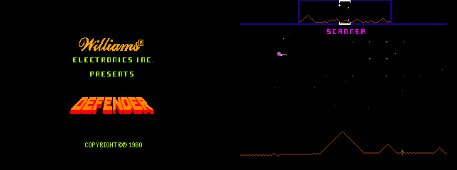

# Defender (Williams, 1980) on the Atari STE

MAME set `defender` (Defender, Red label; `midway/williams.cpp`, `williams_m.cpp`, `williams_v.cpp`).  The main CPU is
an MC6809E at 1 MHz that draws every pixel of a 304 x 256 bitmap of 4 bpp itself (no blitter on this board), 16
pens from a palette of 256 colours; the sound board is an M6808 with a DAC.  The main program is statically translated
to 68000 code (`engine/m6809x.py`); its video RAM is turned into the STE's planar screen as it is written.  Status:
**started** (2026-11-19): it runs in Hatari (STE, 4 MB) with picture and input, exact against the reference in the
simulator (logic and screen); no sound; not in `port.py list`.  Speed (2026-11-19, Hatari, the first 3,400 VBLs:
title and attract demo): 27.7 arcade frames a second (46% of the arcade's 60.10), every frame shown.



## Build and run

```sh
python games/defender/tools/prepare.py        # verify assets/roms/defender.zip, unpack to assets/roms/extracted/defender/
python games/defender/tools/machine.py out.png          # the reference board: 600 frames from power-on, a picture
python games/defender/ref/mame_cmp_defender.py [frame ...] [--factory] [--keep DIR]  # against MAME (MAME=...\wolfmame-0248\mame.exe)
python games/defender/ref/cover.py <seed> [frames]      # coverage: seeds 1-18, 30,000 frames each -> build/defender/cover<seed>.pkl
python games/defender/tools/build.py --sim              # the translation (tools/gen.py) -> run/defender_sim/DEFENDER.PRG
python games/defender/tools/logic_test.py [frames] [--seed N] [--trace F | --wtrace F] [--profile]   # lock-step on Musashi
python games/defender/tools/build.py                    # the STE program -> run/defender/DEFENDER.PRG
powershell -ExecutionPolicy Bypass -File games/defender/tools/hatari.ps1 -Frames 3400   # hidden Hatari: a still and the speed
```

Coverage of all seeds (about 2.5 minutes each, run them in parallel):

```sh
for s in $(seq 1 18); do python games/defender/ref/cover.py $s 30000 & done; wait
```

Supply `assets/roms/defender.zip`: MAME's merged Defender set (the parent's 14 files at the archive's root, the
clones in their folders); `docs/rom_manifest.json` has the parent's sizes, CRCs and SHA-1s, equal to MAME 0.286's
`ROM_START( defender )`.  Nothing ROM-derived is in git.

## Controls

Keyboard: **Up / Down** arrows move, **Space / Z / Control** fire, **X** or **Right** arrow thrust, **C** or **Left**
arrow reverse, **B** smart bomb, **H** hyperspace, **5 / 6** coin, **1 / 2** start, **Esc** quits.  Joystick (either
port): up / down, fire, right thrust, left reverse.  Jaguar pad A: up / down, A fire, B thrust, C smart bomb, right
thrust, left reverse, Option coin, Pause start; pad B's C is hyperspace.  The settings are the factory ones (3 ships,
a bonus ship every 10,000, 1 coin 1 credit).

## State

* **ROMs**: `tools/prepare.py` checks the 14 files (main program `defend.1`, `.4`, `.2`, `.3`; banked `defend.9`,
  `.12`, `.8`, `.11`, `.7`, `.10`, `.6`; sound `video_sound_rom_1.ic12`; the address decoders `decoder.2`, `decoder.3`).
* **The reference against MAME** (`ref/mame_cmp_defender.py`, WolfMAME 0.248, 2026-11-19, no input):
  * blank CMOS (MAME's first boot), frames 60, 300, 600, 900, 1500, 3000: the RAM $0000-$BFFF equals MAME's (but the
    64 bytes below S), 0 of 256 pens differ;
  * `--factory` (both boards boot with the CMOS a first boot writes), frames 1000-14000 every 1000: the RAM equals
    MAME's at 19 of 20 frames; at frame 5000 one byte ($9F2D) differs because MAME's frame ended inside `STD ,--U`
    at $FEE3 (its 6809 core can stop between the bus cycles of an instruction; the reference runs whole instructions);
  * the picture: the reference renderer draws the frame's RAM.  MAME draws line by line as the beam passes
    (`VIDEO_UPDATE_SCANLINE`) while the CPU writes, so its snapshot differs from its own RAM by 0-490 pixels a frame
    (objects being erased and redrawn), and from the reference's by exactly as many.
* **Coverage** (`ref/cover.py`, 2026-11-19, seeds 1-18 x 30,000 frames on the reference board in MAME's schedule):
  7,142 instructions: 4,640 in the fixed ROM ($D000-$FFFF), 1,000 / 193 / 819 / 489 in banks 1 / 2 / 3 / 7 (banks
  4-6 are empty), plus `JMP $DF17` at $A08F in RAM (the IRQ vector points there; every seed jumped to $DF17 only).
  398 sites touch the I/O, the window or the video RAM.  The windowed reads at $F780, $F4DD and $F4DF see several
  banks (1, 2, 3, 7), all other window sites one.  No code changed the view while running inside the window.  The
  seeds: 1-4 and 13-16 random play to the game over (fire, thrust, reverse, up / down, smart bombs, hyperspace),
  5-6 lives held, 7 two players, 8-11 lives held and waves 5 / 12 / 25 / 60 started, 12 the blank CMOS's bookkeeping
  menu (every item, values changed), 17-18 the score set to 20,000 / 300,000 (18 entered initials into the table).
  The play seeds add nothing over each other; seed 12 adds 668 instructions, seed 7 31.  A static walk from the
  vectors finds 154 fixed-ROM instructions coverage never ran (rare branches; the program runs most code through
  its process tables, which a static walk does not follow: it finds 2,189 of the 4,640).
* **Translation** (`tools/gen.py`, 2026-11-19): 7,628 instructions (the coverage's and what discovery adds); 5
  unsupported ones (undocumented opcodes the static walk finds in data; never run).  `tools/logic_test.py` runs the
  simulator build (`src/defender.s` with `-D SIM`) on Musashi frame by frame against the reference's port schedule
  (`machine.DefenderPort`) with ref/cover.py's inputs and cheats: the RAM $0000-$BFFF (video RAM included; the 64
  bytes below S left out), the palette, the CMOS, the view and the sound commands are equal after the boot and every
  arcade frame, 8,000 frames in each of the seeds 1, 2, 3, 5, 7, 8, 10, 11, 13, 16 and 18 (attract, coin, start,
  play, deaths, game overs, two players, lives held, waves 5 / 12 / 25 / 60, high-score entry).  The logic costs
  112,000-138,000 68000 cycles an arcade frame on Musashi (the means of those seeds; the STE has 160,000 a 50 Hz VBL
  and the arcade's 60.1 frames a second need about 133,000 each), drawing into the 6809's video RAM included but
  without any picture on the STE yet.
* **The screen** (`tools/logic_test.py`, 2026-11-19): the STE's planar screen equals the reference's picture
  (machine.render_pixels at x + 14, the side bands 0) after every arcade frame, 6,000 frames in each of the seeds 1,
  2, 5, 7, 10, 13 and 18, with the RAM, palette, CMOS, view and sound commands.
* **Hatari** (F030Arcade's build, STE, 4 MB, TOS 2.06, `tools/hatari.ps1`, looked at by eye): the Williams title
  screen with its colours and the attract demo (scanner, terrain, the ship, landers) at VBLs 900-3,400; no crash.
  Play from the keyboard has not been tried there.
* **Not done**: sound (the M6808 board), speed work, `port.py` registration, play in Hatari.

## How it works

### The board (`tools/machine.py`)

* **Timing**: 64 CPU cycles a line, 260 lines, 16,640 cycles a frame (60.10 Hz).  The picture is x 12-303, y 7-246.
  MAME's screen starts at its vertical blank (line 247) at power-on, so `frame_done` comes every 16,640 cycles from
  cycle 0 and the first line 0 at cycle 832 (`START_LINE`).
* **Interrupts**: PIA 1's CB1 is VA11 (scanline bit 5, set at lines 0, 32, ... 224, not 256: an edge every 32 lines)
  and CA1 is COUNT240 (1 from line 240, 0 at line 0); both PIA 1 IRQ outputs drive the 6809's IRQ.
  `machine.PIA` is MAME's 6821 for what Defender uses: DDRs, C1 edges, the IRQ1 flags, cleared by a data read.
* **The video counter** ($C800-$CBFF, vpos & $FC): read only by `LDA $C800` at $DF26 and $DF3C, where the program
  waits for the beam; the beam's line is taken 5 cycles after the instruction's start, as MAME's core reads it.
* **Banking**: a write to $D000-$DFFF selects what $C000-$CFFF shows: the I/O (0), the 4 KB banks of the banked
  ROM (1-7), nothing (8-15).
* **CMOS**: 256 nibbles at $C400 (writes store data | $F0).  MAME starts with all 0; the game then fills in the factory
  settings (3 ships, a bonus ship every 10,000, 1 coin 1 credit) and the high score table during its first boot
  (between frames 600 and 1200) and opens the bookkeeping menu ("PRESS ADVANCE TO STEP THRU TEST") instead of the
  attract mode.  `factory_cmos()` is the CMOS after that boot; with it the game goes to the attract mode.  In the
  menu Advance steps down while Auto Up (IN2 bit 0) is 0, up while it is 1; Advance with Auto Up on item 28 leaves.
* **Sound**: the main CPU only writes PIA 1's port B (the command | $C0 to the sound board's PIA 2); the reference
  logs it.

### The port's schedule (`machine.DefenderPort`, `src/defender.s`)

* **The IRQ in two passes**: the IRQ handler ($DF17) reads the video counter: at line 0 (beam < $80) it raises the
  frame count $A05D, copies the palette (while the beam is <= 8, with `PSHU` to $C010), and draws; at line 128
  (beam >= $80) it draws the other half, its boundary $A2 = beam - 8 (at most $A8) from a second read at $DF3C.  The
  IRQs at lines 64 and 192 do nothing.  The foreground waits at $E7C3 (`LDA <$5D; BEQ $E7C3`).
* **On the STE**: at that idle point with $A05D = 0 (`df_idle`, a native) the runtime delivers the line-128 pass (the
  counter answers $80, then $98: in play the arcade reads line 151-152 at $DF3C in most frames), then the line-0 pass
  (it answers 0), each with $E7C3 as the return address; then the foreground runs the frame.  In the arcade the
  foreground finished before the next frame in 98% of the frames of play (seed 5, $5D = 1 at $E7C7); here it always
  does.  No IRQ is delivered while CC's I is set.  The PIAs' registers are kept; their interrupt lines are not used.
* **The boot**: the power-on tests (12.2 million cycles) are skipped: the program starts at $D738 (`ORCC #$FF; LDS
  #$BFFF; DP = $A0`, the PIAs, the RAM $9C00-$BFFF cleared), where the tests go when they pass, with the factory CMOS.

### The picture (`src/defender.s`)

* The arcade's bitmap (byte = (x / 2) * 256 + y, the left pixel in the high nibble) shows x 12-303, y 7-246; on the
  STE at x + 2 (14 pixels of black on each side of 320) on screen lines 18-257 with both borders open
  (`engine/rt/borders.s`, PIC_TOP 18, 240 lines; the palette on for the picture's lines only).
* The bytes stay in df_mem (the program reads them).  The stores the coverage saw into the video RAM go through the
  runtime: sites that only ever stored there call `df_vstore` (the byte, and when it changed its two pixels: in play
  930 stores a frame, 500 change), the others `main_io_w`; PSHU into the video RAM (`video_push`) calls
  `main_vlist`.  `vput` writes a byte's two pixels: `vtab` (per video RAM address its screen byte and the pixel pair's
  position, built at the start) and `movep.l` of the four plane bytes, masked.
* One screen, drawn while shown (the arcade draws while the beam runs too); the 16 pens through `ste_pal_tab`
  (MAME's colours to the STE's 4 bits a gun; `tools/assets.py`) every VBL.

### The translation (`tools/gen.py`)

* **Pages**: 6 the fixed ROM $D000-$DFFF, 7 $E000-$FFFF, 8 + view the window's code of view 1-7 (banks 1, 2, 3 and 7
  have code).  Slot 6 ($C000-$DFFF) holds the window below $D000 and the fixed ROM above, which `engine/m6809x.py`'s
  one page a slot does not model: gen.py patches `branch_targets`, `Emitter.page_cmp` and `Emitter.jump_to` for this
  program (a target in $D000-$DFFF is page 6, always there; one in the window is the jumping code's own bank, or the
  banks the coverage saw, checked), and the dispatcher sends $D000-$DFFF to page 6's table.
* **Memory**: one 64 KB block df_mem (RAM, video RAM, the palette at $C000-$C00F, the fixed ROM) and, per view, an
  8 KB page for slot 6 (its bank, then $D000-$DFFF again): indexed and U-stack accesses into the window (bank 1's
  lists read with `PULU`) use the context's slot 6 base.  The accesses the coverage saw in $C000-$CFFF and the stores
  to $D000-$DFFF go through `main_io_r` / `main_io_w` (the I/O, the banks' bytes, the view select; `JSR [A,Y]` reads
  its pointer from the window there: `indirect_io`).
* **DP is data** (`engine/m6809x.py` `dp_data`, new 2026-11-19, off for the other ports): the sprite and block copiers
  move 8 bytes at a time with `PULS CC,D,DP,X,Y` / `PSHU`, and the fills set DP with `TFR A,DP`; direct addressing
  only happens with DP = $A0.  TFR into / out of DP, pushes and pulls of DP and the RTI's DP use the byte `main_dpv`.
* **The dispatcher** takes a long a 6809 address (192 KB of tables for the 6 pages; one `move.l`, no base).

## Speed

**2026-11-19 (Hatari, 3,400 VBLs from the start: title and attract demo): 27.7 arcade frames a second, 46% of
60.10**, every arcade frame shown (no picture is skipped: the video RAM is drawn as the game writes it).  On Musashi
(`logic_test.py`, 6,000 frames of play) 368,000-477,000 68000 cycles an arcade frame; the profile of seed 1: `vput`
45%, the RAM reads through `main_io_r` 16% (before its fast path), `df_vstore` 10%.  The logic alone was 112,000-
138,000 before the screen writes.  Next: inline video stores in the translation (no call, no register saves), and
the dirty bytes converted once a picture instead of at every store.

## Lessons

* **2026-11-19, the screen's phase at power-on**: with the beam at line 0 at cycle 0 and `frame_done` at line 247,
  the reference's RAM was 832 cycles (13 lines) behind MAME's at frame 60 and its video RAM differed now and then
  from frame 11,500 on (the interrupts and the beam reads were 13 lines off).  MAME's screen starts at the vertical
  blank: line 247 at cycle 0.
* **2026-11-19, the power-on tests take about 20 s** (frames 0-1200) and ignore the coin: scripted coins come after
  frame 1300.
* **2026-11-19, the IRQ vector is in RAM** ($FFF8 -> $A08F, where the boot writes `JMP $DF17`): the translation's
  IRQ root is $DF17.
* **2026-11-19, DP as a data register**: the power-on tests keep their state in DP (no RAM while it is tested), and
  the game's copiers push and pull it as data (DP takes 18 values in play); a translator that keeps DP constant runs
  the tests into another path and copies $A0 instead of image bytes.  Skip the tests, and treat DP as data.
* **2026-11-19, the stack pointer as an image pointer**: the sprite copiers ($D149-$D2D6) point S at an image and read
  it with `PULS D,X,Y`; in play only view 2's $CC00-$CFFF (1.2 million reads in seeds 1, 5, 7).  The translation's S
  is a flat pointer into df_mem, so df_mem's $CC00-$CFFF holds bank 2's bytes (in view 0 those addresses are the
  PIAs, reached through main_io_r).
* **2026-11-19, the palette is written with PSHU** ($DF6E: U = $C010): pushes are memory stores in the translation,
  so the palette lives in df_mem at $C000.
* **2026-11-19, a signed index**: `main_vlist` read the pushed bytes with `(a0,d0.w)`, and the screen clear at
  $8000-$97FF read 32 KB too low (stale pixels in the picture's right part); video RAM addresses need a long index.
* **2026-11-19, a translator bug** (`engine/m6809x.py`, fixed): `CLR B,X` at an I/O site kept its zero in d6, which
  the accumulator offset's address calculation also uses: the store wrote B.  The zero is in d5 now (the I/O
  routines keep d5).  It changes the code of every 6809 port's I/O CLRs; only Defender's tests ran after it.
* **2026-11-19, test harness pitfalls**: the harness's stops must be self-loops (`bra.s sim_wait`), not `rts`; its
  "bad pc" range must not cover the routine after main_badpc (`m6809_daa`); a trace of 68000 label addresses misses
  6809 instructions that translate to nothing (NOPs share one address): `--wtrace` compares the frame's RAM writes
  in order instead.
* **2026-11-19, a fresh CMOS stops in the bookkeeping menu**, in MAME too: compare the attract mode with
  `--factory` (the run folder's `nvram/defender/nvram`), and give the STE port that CMOS.
