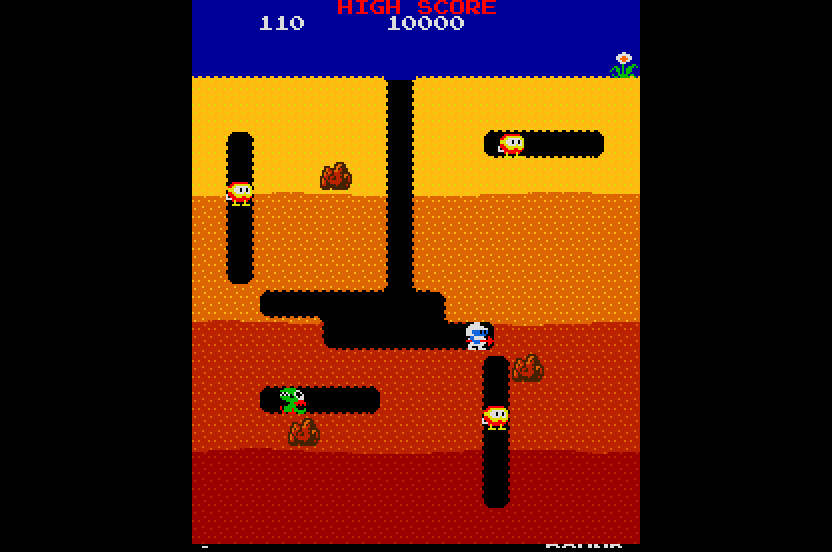

# Dig Dug (Namco, 1982) on the Atari STE

The MAME set `digdug` (Dig Dug rev 2; driver `namco/galaga.cpp` with `namco/digdug.cpp` for the video): the Galaga
board family: three Z80s at 3.072 MHz on one memory map, the Namco 06XX bus with the **51XX** (inputs, coins, credits)
and the **53XX** (the DIP switches), the ER2055 EAROM (the high scores) and the three-voice WSG.  Both MCUs run their own
programs (`namco51.zip`, `namco53.zip`; never blank stand-ins): the 51XX as in Galaga, the 53XX translated like it by
`engine/mb88x.py`.  All three Z80s are translated to 68000 code (`tools/gen.py`, `engine/z80x.py`).  The picture is
Galaga's renderer with Dig Dug's layers: the playfield's 2-bit background tiles and the 1-bit characters of the tile RAM
(the tunnels and the text) composed into one background screen, the sprites by Blitter with generated code per shape.

Status: **Incomplete** (root README): plays in Hatari (STE, 4 MB, TOS 2.06) with the arcade's logic at 83-103% (about 90% on
average) and 20-34 pictures a second (25 on average) in a 13,600-VBL run of the chasing bot (2026-11-08, below); no crash in
two such runs (24,600 and 13,600 VBLs, several games); the bot reaches round 1-2 only, so the later rounds are not run
natively (the reference machine's bot reached round 2 in 14,000 frames); the STE shows 277 of the 288 lines, so the lives and
the round line at the bottom are cut; the program loads 3.66 MB.



## Build and run

```sh
python port.py prepare digdug                    # checks assets/roms/digdug.zip, namco51.zip, namco53.zip, unpacks them
python port.py cover digdug                      # coverage: seeds 1-16 (build/digdug/digdug_cover_<seed>.pkl; ~25 minutes)
python port.py build digdug                      # run/digdug/DIGDUG.PRG (CPU ROMs embedded, patched self-tests)
python port.py build digdug --sim                # run/digdug_sim/DIGDUG.PRG, the simulator build the tests use
python port.py test digdug                       # prepare, build --sim, schedule_test, render_test
python port.py mame digdug                       # the reference picture against MAME's (ref/mame_cmp_digdug.py, MAME=<exe>)
```

Hatari runs it with 4 MB (`--memsize 4`, what `tools/windows/run.ps1` passes); to record, start Hatari directly (the AVI route of the other ports: `--run-vbls N --avirecord true --avi-vcodec bmp --avi-file ...`, with
`C:\msys64\ucrt64\bin` first on `PATH` for the DLLs).

## Controls

Cursor keys (or a joystick / pad): move (four directions); Space, Control, Alternate, joystick fire, pad A/B/C: pump;
1 / 2: start (player 2 plays on the same controls: the cabinet is upright); 5 / 6: coin 1 / 2 (the same coinage);
Esc quits.  Every input the arcade has reaches the game except the second player's own stick and button (a cocktail
cabinet's: `dswb` bit 2 is set for an upright one) and the service switch.  The DIP switches are the factory settings (`dswa` / `dswb` in `src/digdug.s`: three
lives, bonus at 20K and 60K, one coin a credit, easy, upright); the cocktail cabinet's screen flip is not drawn.

## State

Verified (what each check ran, see Tests and tools):

* **ROMs**: `tools/prepare.py` checks 21 files (the 19 of `digdug.zip` for the parent set, the 51XX and 53XX programs)
  against `docs/rom_manifest.json`.
* **The reference machine against MAME 0.248** (`ref/mame_cmp_digdug.py`, attract mode, frames 400-2400): all 544 pens
  equal, 0 differing pixels in five pictures (the renderer on MAME's own RAM, and the machine from power-on with the real
  51XX / 53XX); the RAM differs by 6-25 bytes of stack residue (the CPUs' phase).  The authoritative source is 0.286: its
  palette text (0x21 / 0x47 / 0x97 weights, blue 0x47 / 0x97) gives the same pens as the 0.248 binary, unlike Galaga's blue.
* **The translation**: 7027 + 3016 + 706 instructions, none unsupported; the STE's tile RAM and sprite RAM equal the
  reference's schedule (`tools/schedule_test.py`) at the sampled frames of a scripted game (boot, attract mode, a coin,
  a start, play) once the STE has caught up with the reference (it is slower in the boot test screen: a lag of up to 450
  frames, gone by frame ~1000).  This is **not** a RAM lock-step: the main thread runs freely between the VBLs, as in
  Galaga, so the two machines are not cycle-locked.
* **The picture**: `tools/render_test.py` freezes the game at a VBL and compares the screen the STE shows with the
  reference renderer through the colour map: 0 differing pixels at several moments of play (see below), the sprites'
  wrap-around copies (MAME draws a sprite 256 pixels to the right too) left out of both.  `tools/sprite_test.py`: 2664
  cases at both side edges, all 16 shifts, flips, double sizes, transparent holes and a 64 KB crossing, exact.
* **Hatari**: boots, attract mode, coin, start and a scripted game (`-D AUTOPLAY=1400`: moves and pumps) for 3600
  VBLs without a crash, tunnels dug, score counting, enemies and rocks drawn.  Looked at in AVI captures only (no sound, no
  keyboard session, no timing); the attract screens look as MAME's (the all-yellow dirt of the title screen is MAME's too).
* **The EAROM** (`g_earom_ctl`) is a model of the chip's states; its content is not kept between runs.  Coverage reaches
  the load at boot and the save at a game over.
* **The service / test mode** (service switch): the test mode runs inside the main CPU's IRQ handler and does not return in
  the reference; no key reaches it on the STE.  The cocktail cabinet (flip screen, DIP) is not drawn.
* **Sound**: the WSG's three voices become the YM2149's square waves through Galaga's mapping (`tools/sound.py`, the
  waveform PROM 136007.110); `tools/sound_test.py`: the 68000's YM registers equal the Python model's in all 2600 frames of
  the scripted game (1643 with a voice sounding).  Pitches against MAME's audio (`tools/sound_mame.py`, WolfMAME 0.248,
  `-wavwrite`; the sound CPU's command cells poked in MAME and in the reference machine, the model's YM registers
  rendered as square waves; 2 s pieces, semitone-spectrum cosine): of the 19 sound ids 11 sound at all in a run; ids 11, 12,
  14, 18 equal to 0.96-1.0, ids 9, 10, 13, 15, 19 0.71-0.94 (chords: the loudest peak differs, the set of peaks is the same;
  fundamentals within 1-30 cents where one dominates); ids 2-8, 16, 17 are silent in both (they need a running game); id 1
  and id 14 / 18 sound in some MAME runs and not in others (MAME's random power-on RAM changes the attract state).  The
  waveforms are squares, not the PROM's shapes: the timbre is not checked and was not listened to.  **On the STE**
  (`tools/sound_hatari.py`: `-D SNDTEST=1300` pokes the same cells, Hatari plays the YM, `--sound 44100`, its audio taken
  from the AVI): ids 10, 11, 12, 13, 15 alike (cosine 0.79-0.99, ids 11 / 12 within 10 cents), id 19 not (the tunes run at
  50/60.6 of the arcade's tempo, the 2 s windows catch other notes; not analysed further).  Nobody has listened to a
  whole game.  The sound CPU's commands are the arcade's (translated); only the chip is mapped.
* **The sprite rules of `AGENTS.md`**: the sprites use Galaga's pipeline (a Blitter pass per line with the shape's end
  masks, HOP 2 / OP 3, no AND + OR pairs, edge clipping at the 16-pixel groups); the reordered-source method of
  `docs/sprite-preparation.md` was not tried here.  The background and characters are drawn by the CPU (movep).


## How it works

### The board and the reference

* **The board** (`tools/machine.py`): the three CPUs share one map (ROM per CPU, RAM `$8000-$9FFF`: tile RAM, work RAM,
  and the three sprite RAMs at `+$380`), the latch `$6820-$6827` (IRQ enables, the sound NMI, reset of the other CPUs and
  the MCUs, MOD0-MOD2 of the 53XX), the video latch `$A000-$A007` (the background picture, its colour bank, colours off,
  flip), the 06XX at `$7000/$7100`, the EAROM at `$B800-$B840`.  The 51XX and 53XX are the real programs on the MB88
  core behind the 06XX's clock edges (`run_frame`, MAME's phase) or from wait point to wait point by their events (the
  STE's model: `run_frame_port`, `wait51`, `wait53`: the 53XX idles in its mode-7 input loop at `$22C` and waits for the
  chip select in a transfer at `$359` / `$35C`).
* **Boot**: the self-tests are patched out (`patch_tests`: the main CPU's five RAM tests, the sub CPUs' ROM checksums); the
  main CPU's own ROM checksum stays, kept right by a dead byte of the patched routine.  The handshake (flags `$8A00` /
  `$8A01`) is run by turns at the main CPU's spin loops `$3973` / `$3980` (`z80_hook`); the sound CPU's boot is native.

### Schedule

* **The schedule** (`src/digdug.s`, as Galaga's): the main CPU's program is the foreground thread; at every VBL its IRQ
  handler, the sub CPU's IRQ handler, the sub CPU's EAROM command (`$1DDC`, its main loop's only work, when the main CPU
  left one in `$9B3D`), the sound CPU's two NMIs (its RAM page and flags copied in and out) and the frame are run.  The
  06XX transfers run at the control write (`g_ctrl06`).  The EAROM keeps its address from the translated stores
  (`gen.py` Emitter, `earom_addr`).

### Picture

* **The picture** (`src/render.s`, `src/sprites.s`, `tools/assets.py`): the arcade raster rotated by 90 degrees, 224 x 288;
  a background screen of tile + character cells (the tile RAM compared with a copy every frame; a change of the video
  latch redraws everything), two draw screens, sprites as in Galaga with the Dig Dug sprite RAM converted per frame
  (a code with bit 7 is 32 x 32; the flame's colour 9 uses shapes 248-251 with pen 2 transparent), the bands MAME clips the
  sprites from (arcade x < 16, >= 272) given the background back.  The colours: 23 PROM colours, at most 15 on a frame, fitted
  to 16 with `engine/palette_quantize.py`.

### Sound

The WSG's three voices become the YM2149's square waves through Galaga's mapping (`tools/sound.py`, the waveform PROM
136007.110); the sound CPU's commands are the arcade's (translated), only the chip is mapped.  The checks (model against the
68000, pitches against MAME and Hatari) and their limits are in State ("Sound").

## Speed

Current figures first (see the top for the headline); then the audit of 2026-11-08 (partial) and the older measurements.

* **Speed, 2026-11-08** (Hatari 2.6.1 pinned build, STE, 4 MB, TOS 2.06, fast forward, `tools/bench.ps1`: `-D RATE=500`
  counters every 500 VBLs): **the chasing bot** (`-D AUTOPLAY=1400 -D BOTCHASE=1`: a coin and a start every 3000 VBLs, then
  `bot_chase` walks to the nearest Pooka / Fygar and pumps; 24,600 VBLs, 8 games of 2 lives each round, score ~900, rounds 1-2,
  no crash): the arcade's frames a second as % of 60.6 per 500 VBLs 83-103, average 90 (83 = one game frame a VBL: the
  sixth frame of five VBLs is dropped when the VBL is late); pictures a second 20-34, **average 24.9, busy stretches 20-22**
  (the same 13 windows repeat: the bot's game is deterministic).  The scripted game (`-D AUTOPLAY=1400`, 6000 VBLs): logic
  83-103%, pictures 19.8-34, average 27.7.  Before today: logic 82% (one frame a VBL), pictures 28.9 / 32.6 on average (12-17.9 busy).
  What changed (simulator cycles in the game's interrupts a frame, scripted play): leaves in place 102.4k -> 96.8k, the sub
  CPU's sprite copy native 6.3k -> 2.0k, the sound sequencer native (`nat_x04d5`, $04D5: 15% of the interrupts) 100.8k -> 89.8k,
  the sound CPU's RAM copies with movem 6.0k -> 3.6k; **six game frames in five VBLs** (`round5`: every fifth VBL runs a second
  round of the interrupts, the sound CPU, the 51XX's frame; the YM is written after the later one): the logic from 82% to 90%.
  The sound pitches did not change; the tune tempo is the arcade's now.  A frame of 160,000 cycles: interrupts 90-100k a round
  (sound CPU 19-22k + copies and YM 8k, main CPU 25k, 51XX/53XX + 06XX glue 19k, sub CPU 10k), a picture ~44k (sprites 28k).
  `NOSIXFIVE=1` builds the one-round schedule (the reference machine's: `schedule_test` needs it).  Still open: the 53XX's
  fixed answer could be cached (5-6k), the sprites' reordered-source passes (not tried), 25 pictures a second in the busy stretches.
* **Memory**: the program loads 3.66 MB (text + data + BSS + 256 bytes; `tools/release.py` MAX_LOAD is 3.7 MB) and runs in
  Hatari with `--memsize 4` (the newer statement than the 14 MB above), the bench's figures identical.  It was 4.27 MB: the three CPUs' 256 KB dispatch tables
  (byte-swapped pc index, sparse) now share one in columns (the sub CPU at +$41, the sound CPU at +$82) and the sub / sound
  CPU's compact tables hold their ROM only.  Sprite data 1.1 MB and masks 0.5 MB are untouched.  Dig Dug stays in
  `NOT_RELEASED` until the user decides (no natural playthrough, speed below 25 pictures a second in busy windows).

### Speed audit (2026-11-08, partial)

Simulator cycles in the game's interrupts, scripted play (`tools/profile.py`; Hatari figures above).

| Technique | Result | Before -> after |
|---|---|---|
| Leaves, rst and jumps in place (`inline_leaves=32`, `inline_rst`, `inline_jumps`) | applied, all three CPUs; sizes 16 / 64 / 128 give the same | 102.4k -> 96.8k a frame (-5.5%; the sound CPU 24.1k -> 19.8k) |
| Native at a profile hot spot (`nat_y0e4c`, the sub CPU's sprite position copy, checked by `native_test.py` against the Z80) | applied | 6.3k -> 2.0k |
| Shared RAM copies of the sound CPU with `movem.l`, only what it uses (also fixed: `$8401`, `$8646` were not copied in) | applied | 6.0k -> 3.6k |
| One dispatch table for three CPUs | applied (memory, not speed) | 4.27 -> 3.66 MB |
| Register maps / flags_at at the idle hook / window guards at coverage sites | not tried (Galaga's maps `FAST` / `FAST_LONG` as is; the main loop `$0238` is a spin that costs nothing in the budget) | - |
| 06XX/MCU glue (19k + 5k a frame, 16 chip-select events per frame) | not optimized; the 53XX's answer for fixed DIP switches could be cached (open) | - |
| Sprites: `sprite_programs` reordered-source passes, per-slot cache, damage of drawn rows | not tried (the sprites are 28k of the ~40k a picture) | - |
| Colour cycling, parallax, HUD, hardware scroll | not applicable / none in the game | - |

## Tests and tools

| script | what |
|---|---|
| `tools/prepare.py`, `docs/rom_manifest.json` | the ROM check and unpacking |
| `tools/machine.py` | the reference machine (`python machine.py frames out.png`); `run_frame` (MAME's phase), `run_frame_port` (the STE's schedule) |
| `ref/mame_cmp_digdug.py` | pens, the renderer on MAME's RAM, the machine from power-on against MAME |
| `ref/mcu_events_test.py` | the event-driven 53XX against the cycle-exact one (4521 of 4522 reads equal); the 51XX line is informational only (its bytes depend on when the inputs were sampled: 1718 of 4727 equal, not a pass criterion) |
| `ref/cover.py` | the coverage seeds (`port.py cover digdug`) |
| `ref/dis_main.py` | a disassembly listing of a CPU ROM |
| `tools/gen.py`, `tools/build.py`, `tools/assets.py`, `tools/sound.py` | the translation, the program, the graphics, the sound tables |
| `tools/schedule_test.py` | the STE's tile / sprite RAM against the reference's schedule |
| `tools/render_test.py` | the shown screen against the reference renderer at frozen moments |
| `tools/sprite_test.py` | the sprites at the edges, 16 shifts, flips, sizes, holes, 64 KB crossings |
| `tools/bot.py`, `tools/ramshot.py` | the chasing bot (reference machine; `decide`), a RAM.BIN of a Hatari run drawn by the reference renderer |
| `tools/profile.py`, `callcount.py`, `native_test.py`, `sound_mame.py`, `sound_hatari.py`, `bench.ps1` | the sampling profiler, call counts, the natives against the Z80, the sound against MAME and in Hatari, the Hatari rate bench |
| `tools/sound_test.py` | snd_ym (the 68000) against `sound.py` (the model) every frame |

## Lessons

* **Hatari-only crash, a nested VBL (fixed 2026-11-07)**: the sub CPU's EAROM task runs inside the VBL handler; Timer B's
  handler (the border removal) lowers the IPL, so a VBL arrived inside the task and ran the IRQ handlers on the task's
  registers (the Z80 stack of CRASH.TXT showed a second `TOKEN` and zeros from the stale `ctx2` above the task's return
  address).  Musashi has no timers: no repro, even with a slow render or tiny chunks.  Now `in_game` makes a VBL inside the
  game interrupts do nothing, `in_fg2` / `g2_iff` keep the task from restarting or taking an IRQ.  The delay loop of the EAROM
  commands (`$1EA0`) is a `ret` (tens of VBLs of the STE's time otherwise).
* **Sound CPU table** (found by the crash's Z80 stack in the simulator, fixed): `$0391` looks the sound id up in 21 code
  pointers at `$040D` (`jp (hl)` at `$0390`); an id the coverage never played (6, frame ~4930 of the scripted game) ended at
  `z80_badpc`.  The words at `$0700` that I first took for it are sequence data (a data root gave an unsupported `add hl,bc`):
  roots are `gen.py SOUND_TABLE`.  With the 16 coverage seeds `schedule_test` (6500 frames) and `render_test` (VBL 1500, 5000,
  6500, 8000) are exact / equal.
* **2026-11-07, the 53XX** (mode 7): `K1-K3` = latch bits Q5-Q7; its main loop is an input loop that never waits on a
  value, so its wait point stops whenever no interrupt is pending (`mb88x` kind `("idle",)`); the interrupt is an edge, the
  chip select may still be high when the loop is reached again.
* **A coverage run is not the game**: the scripted game of the tests is a coverage seed (12), the long random runs 13-16.
* **The map file belongs to the last build**: a debugging script that reads `build/digdug/digdug.map` after another variant
  was built reads the wrong symbols (a `-D IOLOG` build overwrote it and showed a "stuck" flag that was not).  Rebuild
  before reading symbols.
* The sound CPU shares a few bytes of RAM with the others (`$8657`, `$87CF`, `$8A00-$8A47`, `$9A80-$9B7F`); the runtime
  copies them in before its NMIs and out after (nothing else runs between), as Galaga does with its page.

## Verification

Dated 2026-11-08.  Independent checks: the reference machine against MAME (pens, picture), the translation's schedule against
the reference (`schedule_test`), the picture against the reference renderer (`render_test`, 0 differing pixels at four frozen
moments of play, `sprite_test` 2664 cases), the natives against the Z80 (`native_test`: 300 + 1200 random cases), the YM
registers against `sound.py` (`sound_test`), and the sound's pitches against MAME's audio (`sound_mame.py`) and in Hatari
(`sound_hatari.py`: ids 10-13 and 15 alike, levels 4-7 dB above MAME's, which is not comparable: different mixers).  Coverage:
18 seeds, the chasing bot among them (17-19: 8 games each, 122 new main-CPU pcs over the others in the first one).
Played in Hatari: the bot, 24,600 VBLs, no crash.  **Not done**: a long run that reaches rounds 3 and later (the bot dies
or stalls in rounds 1-2; no RAM cheat for the round number was found: `$840F` is not the displayed round); no human
playthrough; nobody has listened to a whole game; no RAM lock-step test; the reordered-source sprite method.  Dig Dug stays in
`NOT_RELEASED` until the user decides.  See the [status policy](../../docs/port-status.md); the port is **Incomplete**.
