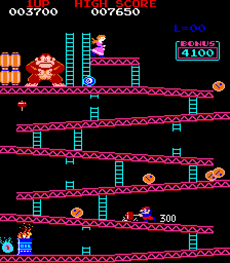

# Donkey Kong, Atari STE

First port and the reference design for the Blitter sprite renderer ("The Blitter sprite renderer" below; the sections
after it: the edge clipping, the tiles, measuring, sound, the translator, playtests).  Paths in this file are relative
to `games/dkong/` (`docs/` is the port's own folder); `engine/`, `port.py` and the shared documents (linked) are in
the repository root, and the commands run from there.  `src/` (`dkong.s` runtime, `render.s` tiles, `sprites.s` Blitter
sprites), `tools/` (`machine.py` reference machine, `dkong_pens.py` palette dumped from MAME, `gen.py`, `assets.py`,
`build.py`, `logic_test.py`, `nmitrace.py`, `insn_bench.py`, `frametimes.py`), `ref/` (coverage `cover.py` /
`cover_stages.py` / `cover_pens.py`, `mame_cmp_dkong.py`, one-off probes in `ref/probes/`), `docs/` (the screenshot,
the coverage logs in `docs/coverage/`).

State: Donkey Kong runs from the static Z80 -> 68000 translation with the Blitter renderer, exact against the reference
emulator and MAME, 50 fps in play (see "Measuring" below).

Controls: **5** coin, **1/2** start, **arrows** move, **Space/Ctrl/Alt** jump, **Esc** quits.  Players take turns: both
joysticks and both pads move Mario (fire jumps).
Jaguar pad / PowerPad (STE enhanced ports, [architecture](../../docs/architecture.md), "Input"): either pad, the D-pad moves, **A / B / C** jump, **Option** coin, **Pause** start, keypad **1/2** start, **5** coin, **\*** + **#** quit.

## Build and run (macOS)

    python3 -m venv venv && venv/bin/pip install numpy pillow machine68k      # once, in the repository root
    python port.py cover dkong          # coverage + palette pens the translator seeds from (~15 min on 8 cores)
    python port.py build dkong          # -> run/dkong/DKONG.PRG (the ROMs embedded: nothing else needed)
    python port.py run dkong shot@30    # Hatari (F030Arcade build), screenshot at 30 s

The coverage and pens runs reproduce the committed logs (`docs/coverage/*.log`) exactly (3766/4949 PCs, 155/115/154 pens).
`VASM`/`VLINK` select the toolchain; the default on macOS is `~/Work/f030dsp3d/tools`.  The program needs about
2.3 MB of RAM (sprite data 0.9 MB, the dispatch table 256 KB).

Tests: `tools/logic_test.py 3000` (whole program, lock-step against the Z80 reference, the NMI injected at the idle loop head),
`tools/nmitrace.py N` (the NMIs from frame N on, instruction by instruction, names the first diverging instruction),
`engine/sprite_blit_test.py` (sprite code against independently masked pixels, DK and Galaga).  `tools/sprite_test.py`: sprites
across the game area's left and right edges; `tools/perf_test.py`: CPU + Blitter cycles a frame on Musashi.  `tools/insn_bench.py`
(single instructions against the Z80 reference; run 2026-11-07): 2420 cases, 1 fails (`ldir`: BC' and DE' differ;
Donkey Kong has no `exx`); the full instruction check is `engine/xbench.py`.  Superseded: it used to stop with
`KeyError: 'pe'` on a conditional RET/CALL on the parity flag.

The game itself is not deterministic across builds: its idle loop counts its spins (`inc ($6019)`), so the attract
sequence and the demo play depend on how much CPU time a frame leaves.  Frame counts of two builds therefore show different
game phases; what compares exactly is a frozen frame of one build against the reference renderer.

## The Blitter sprite renderer (`src/sprites.s`, `engine/sprite_codegen.py`)

The project's first sprite renderer (described in the architecture document until 2026-11-07); the later ports
refined it ([sprite preparation](../../docs/sprite-preparation.md)).

Blitter, like the bob routines of `stefastbobs2/main.s`: one blit per sprite line writes the
four planes of the line (Y count 4, source = destination), and the endmasks are the mask:
END1/END3 hold the outline of the line (holes included) shifted to the two screen words, so
the opaque pixels replace what is below and the rest stays.  No clearing pass, no colour
mixing: the screen equals the reference renderer pixel for pixel (frozen at frames 650, 800,
1000 and 1200: 0 of 57344 pixels differ; frame 800 re-checked after the MAME fixes of 2026-10-08), and
the reference equals MAME's screenshot ([porting guide](../../docs/porting-guide.md), "Checking the reference",
"Against MAME's picture": the sprite row and the palette fixed then).  A sprite's left display column is
u0 = y - 23 (it was y - 22 until that fix: MAME's line buffer fetches a sprite one line ahead).  The masks of every (shape, flip y, skew) are
a table (`dk_spr_masks`, 256 KB), the line words come from colour data baked per colour quad
(`dk_spr_data`, 608 KB: 19 distinct mappings of the pen values to the planes) that the
Blitter's source address walks through, `NFSR` lets the second destination word reuse the
one source word of a plane (a sprite of skew 0 is one word wide), flip x draws the lines
upwards.  The blitter registers of the line loop are written through preloaded pointers
(END1, END3, control, Y count, and the low word of the destination address, advanced with
`add d4,(a3)` as in the demo; sprites whose lines cross a 64 KB boundary of the screen use
full address writes).  The empty lines at both ends of a shape are left out (`dk_spr_span`). The fast
path now selects generated code for the shape/skew (`engine/sprite_codegen.py`): masks
that stay the same are not written again, empty interior lines are skipped, and a
line whose END3 is zero uses X count 1 even at a nonzero skew. Such a line clears
NFSR and sets destination Y increment to 2; a two-word line sets NFSR and Y increment
-6. Both finish eight bytes past their starting destination and consume eight source
bytes. Lines whose END1 alone is zero still use two words: their source would need a
different shift/pipeline arrangement. Colour data remains shared by every skew.
The generated instruction sequences and compressed mask streams are deduplicated
separately. Sprites near a 64 KB boundary retain the original unrolled full-address
path. `-D NOSPRITECODE=1` selects the generic renderer for comparison. END2 is unused.  Not implemented: the 16-sprites-per-
scanline limit and the wrap-around of the arcade hardware. Sprites are clipped at the aligned
left/right picture edges, including the generic 64 KB fallback; top and bottom use guard rows.

Most of the 128 list entries are empty, and visiting them all twice a frame cost 24K
cycles: a frame first lists the entries that are not empty (`tst.l` over the list), and
each draw screen keeps the list it was last drawn with.  Each draw screen remembers per
slot what it got there (list entry, colour bank, rectangle, cells).  A frame restores the
background under the sprites of the screen's old list that changed or are gone, then
draws the active list: a sprite that is unchanged is drawn only if its rectangle touches
an 8x8 cell that was redrawn (tile), restored or drawn (a sprite earlier in the list) in
this frame.  The cells are a bitmap (`tile_marks`, 8 bytes per display row, cleared each
frame); a sprite's cells are a window of four bits in up to three rows, kept in its slot
record, so a test is three `and.l` and a mark three `or.l`.

`z80_dma` (`engine/rt/rtlib.s`) is the 8257 sprite DMA, hooked on the `ld ($7D85),a` stores.

### Sprite blitter revision (2026-10-08)

`venv/bin/python engine/sprite_blit_test.py` builds both paths and executes the
assembled 68000 code on Musashi with a blitter model. For each port it verifies all
8192 shape/skew/line-direction combinations against independent masked pixels,
then compares 48 successive complete sprite renders against the generic path,
including overlap, background restoration, colour changes and 64 KB crossings.
The workload gives 3.2% less CPU plus blitter bus work for Donkey Kong and 4.3% for
Galaga; isolated line bodies save 9.0% and 9.9%. These are simulated cycle counts,
not Hatari frame-rate measurements. Executables grow by about 407 KB and 558 KB;
both ports still fit the configured 4 MB STE. Both rebuilt binaries also completed
5000 VBLs in the pinned Hatari with no crash file; screenshots confirmed the games
running (including Galaga's sprites). Bubble Bobble gained a separate reordered Blitter sprite
renderer in its `src/srender.s`; its tile renderer remains the fallback.

The reference's arbitrary row reordering relies on matching reordered source data.
Copying that order without also preparing matching source data would break their sequential source walk.
This revision retains the source layout and uses register reuse and variable-width blits. The later
`engine/sprite_reorder_audit.py` is an instruction-cost estimate for source seeks, not an executed prototype of
reordered source data; the full preparation experiment remains outstanding (see
[sprite preparation](../../docs/sprite-preparation.md)).

## Sprites clipped at the left and right edges (2026-10-12)

The game area's edges lie on chunk boundaries (GAME_X = 3 chunks, 14 chunks wide), so sprites are clipped there now by
the shared rule ([porting guide](../../docs/porting-guide.md), "Renderer correctness"); here a sprite across an edge
(display column u0 -15..-1 or 209..223) draws only its inner word, one word a line (`sprite_edge` in `src/sprites.s`;
right: the first word, the skewed source under the line's END1 mask; left: the second word, FXSR and source Y
increment 0 under the line's END3 mask, which the line macros write to END1).  Its rectangle and cells are the inner
chunk's, so the side bands stay black and are never restored; a sprite wholly outside is culled as before.  The common
path tests both with one unsigned compare (it was two signed ones); the edge path is the same macro (`sprite_draw 1`)
with the generic masks and full addresses.  Before, sprites hung into the visible side bands (4 band pixels in the last
frame of the run below, none now).

Measured with `tools/perf_test.py 3000 200` (Musashi, the sim build with AUTOSTART=150, the VBL raised at every third
idle-loop visit so both builds play the same frames; 2800 frames, ~4 edge sprites drawn a frame): logic 15423.9
cycles a frame both; picture (render_frame) 34807.6 -> 34818.9 (+0.03%), draw_sprites 24344.7 -> 24356.0; total
50231.5 -> 50242.8 (+0.02%).  Hatari (TIMES build, AUTOSTART=150, 3000 frames; not the same frames, see above): 50
fps both, 0.8% frames late both (the full redraws), drawing 59.8 -> 59.0 Timer D ticks a frame.  There is no
bench script for this port.

Tests: `tools/sprite_test.py` 2048 cases (4 shapes with holes, both flips, 16 shifts, at both edges and outside,
plain and across a 64 KB boundary, the restore a frame later): exact, bands untouched, on the generated-code and
the NOSPRITECODE build; the old code fails it (pixels in the left band).  `engine/sprite_blit_test.py`'s DK part
(8192 checks, 48 renderer comparisons), `port.py test dkong` (3000 frames lock-step).

## Tiles (`src/render.s`)

The 1 KB tile map is compared with a shadow every frame (the 224 visible longs, eight
per turn); changed tiles go into the background screen at once and into a queue for each
draw screen.  A palette bank change (level starts, the title wipe, the title logo's colour
cycle: 48 changes in 96 frames) draws only the visible tiles that look different in the new
bank: `dk_tile_pens` (the pens a tile code uses) against `dk_bank_change` (per old and new
bank and colour code, the pens whose palette index moves), both from `assets.py`.  In the
logo cycle that is about 160 of 896 tiles; the first frame draws all of them.

## Measuring (`tools/build.py` options, `tools/frametimes.py`)

* `--debug`: frame, Timer A, Timer B, VBL and skipped-VBL counters as bits in the top-left
  corner (plane 0, lines 0-4; read them back from a Hatari AVI).  An AVI starts at power
  on; the program starts about 300 VBLs later.
* `--dumpat N`: at frame N write Z80 memory `$6000-$7FFF` to `DUMP.BIN` and freeze the game;
  the screen can then be compared with `tools/machine.py`'s `render_raw()` of the same memory.
  `--dumpbank N`: the same at the Nth palette bank change (frame numbers of two builds show
  different game phases; 20 and 21 are in the title logo's colour cycle).  With TIMES, give
  `--frames` more than the run reaches: the frame count goes on while the game stands still.
* `-D TIMES=1 --debug --frames N`: MFP Timer D (81 us ticks) is started at every VBL and
  its count recorded when the NMI and when the drawing end, with the skipped-VBL count
  and the palette bank; `TIMES.BIN` is written when the program quits after N frames
  (`python games/dkong/tools/frametimes.py TIMES.BIN` prints the histogram).  Run with
  `--run-vbls` of about N*5/4+600.
* `--nosprites`: no sprite drawing (frame-rate comparison).  `-D NAME=VALUE`: any define.
* Profile: in the Hatari debugger `profile on` at one VBL breakpoint and `profile save` at
  a later one; Hatari 2.6 prints the per-address lines to its stdout.

Measured on 2026-10-07 (2400 frames of attract mode and demo play, 50 Hz frame =
160256 cycles): the average frame takes 44% of a frame (Z80 NMI 14%, drawing 30%),
play frames 50-80%, the busiest play frames 96-119% (6 of 2400), 0.5% of the frames run
into the next VBL; before this round the average was 75% and 9% of the VBLs were skipped.
Level starts and the title wipe redraw every tile and take about ten frames each.

Measured on 2026-10-09 (4096 frames, coverage of `port.py cover dkong`, after the
translator speed-up and the selective bank redraw): average 35% (Z80 NMI 9%, drawing 26%),
2.6% of the frames run into the next VBL.  The title logo's colour cycle (96 frames,
1.6 s on the arcade) lost 618 VBLs when every bank change redrew all tiles, now 148 (2 at
a change, 1 the frame after, for the other draw screen; the game's own code takes 32% of
a frame there).  The rest are the start, the title wipe (0 -> 2: nearly every tile) and
single level starts.  The game runs one NMI per 50 Hz VBL: 5/6 of the arcade's speed.

## Sound (2026-10-09)

The arcade's 8035 sound board (tunes on `$7C00`, effects on `$7D03-$7D05`, death on `$7D80`) plays one mono DAC
stream, so it is pre-rendered and played by STE DMA sound (`src/sound.s`, a few hundred cycles a frame, estimated, not measured).
`tools/sound_capture.py` records the board in MAME (the main CPU parked on a `jr $`, a Lua script writes the
ports; needs a full MAME build, default `C:\Arbeit\F030Arcade\third_party\wolfmame-0162\mame.exe`, `$MAME`
overrides), `tools/sound_convert.py` turns the recordings into `build/dkong/dk_sound.s` / `dk_sound.bin`: 8 bit
signed, 6258 Hz (the board low-passes at ~1.9 kHz), 317 KB.  `build.py` runs both only when their output is missing
(~1 min).  Two MAME runs are not sample-exact: a rebuild differs in ~0.3% of the bytes, by a few steps.

What the driver copies from the 8035 (measured in MAME): a one-shot tune starts when `$7C00` changes to it and
plays to its end (the game holds it 3 frames); a background tune (03 04 08 09 0B) loops while `$7C00` holds it and
starts again from its beginning after a one-shot; a rising edge on a pin starts its effect; the newest sound
wins.  The background loops are one measured period each (2.29 s barrels ... 4.92 s out of time), seams in silence.
Walk, jump and stomp (`$7D00-$7D02`) are discrete circuits on the arcade board, independent of the 8035: YM
channels A, B, C, one (tone period, volume) a 50 Hz frame, restarted by a rising edge.  `tools/sound_ym.py`
measures the patches from the MAME recordings (pitch by autocorrelation, stomp: the mean of its own random
5.5-13 ms cycles per frame; level by RMS, matched through Hatari's measured YM volume table and a gain measured in
Hatari, -11.9 dB) -> `build/dkong/dk_ym.s`, plus A/B files in `build/dkong/sound/ym/`.  Loudness and pitch follow
the arcade frame by frame (< 1 dB a frame); the tone is brighter: the arcade circuits are integrated (stomp has
95% of its energy below 200 Hz, nothing above 800 Hz), a YM square puts 7-19% above 800 Hz, and the pitch only
changes 50 times a second (the stomp's real cycles change every 4-6 ms).

`build.py -D AUTOSTART=150` inserts a coin at frame 150 and starts a game a second later; with Hatari's
`--avirecord true --sound 44100 --run-vbls 3000` it records coin, intro, How high, the barrels loop and the
deaths (the AVI says 60 fps for the 50 Hz frames).

## Translator speed (2026-10-08)

`z80x.FAST` (no runtime change was needed: Donkey Kong has no `exx` / `ex af,af'`; `logic_test.py` reads IY from a2).
`engine/xprof.py dkong` (1500 NMI frames of `logic_test.py`): translated code 5.2k -> 4.8k cycles a frame (1.08x, the
direct returns and the flags; the other ports' figures: [architecture](../../docs/architecture.md), "Tests and
measurements of the translator").  `tools/insn_bench.py` learned the swapped BC and the 65536-entry dispatch table
then (it had failed 61 cases since BC was swapped).  Superseded: the note that `logic_test.py` stopped at frame ~1030
(`z80_badjump`, d7 = $2BD); on 2026-11-07 `tools/logic_test.py 3000` ran all 3000 frames in lock-step, as
`port.py test dkong` does.

## Standard PPO exploration

Use `venv/bin/python port.py ppo dkong test --steps 256 --frames 2100` to check the shared training/recording/replay workflow. See [the common PPO guide](../../docs/ppo.md). PPO supplements the existing scripted coverage; canonical replay fixtures are preserved.

## Dreamer Hatari playtest (2026-10-20)

The adjacent Dreamer project now supplies `scripts/stearcade_play.py` for direct
closed-loop Windows Hatari exploration. With patched Hatari SHA256
`f113a3853fd993cac459cb672748f1c20c59ee4ac370501f49d5a6597cbf1796`,
the natural run completed 22,200 ticks (1,800 decisions, 434 learner updates)
without a detected crash, input mismatch or 600 identical RAM observations.
It lost lives and restarted but did not clear barrels. A separate 22,200-tick
assisted run refilled lives and requested stage types 2, 3, 4 and 1 by writing
`$6227`; these are assisted visits, not natural clears. Both fresh-process
replays matched all 185 sampled RAM checkpoints exactly (370 total).

The private build instruments NMI opportunities and owns the input bytes;
keyboard/pad handling, sound, full renderer equivalence and ordinary full-game
progression were not verified. Sampled guest framebuffers showed gameplay.
Complete, issue-free playability remains **unverified**. The Dreamer project's
`docs/stearcade-playtesting.md` describes the commands, instrumentation and
limits; its dated results document records the retained evidence.

The subsequent assisted continuation completed the ROM's board-clear paths for
all four types, entered difficulty 4 after the four-type level 3 sequence, and
then reached the repeating sequence's level 5 → 6 pointer wrap at tick 36,727.
It refilled lives and assisted exit/rivet conditions; the extension did not write
stage, difficulty, pointer or phase state. No missing translation or port crash
was found, so no runtime/translation fix was needed. A fresh process replayed
all 38,200 retained inputs with 318 exact RAM checkpoints and identical
progression. See [the loop regression report](docs/dkong-loop-regression-2026-10-20.md).
This establishes assisted progression, not a natural clear; status remains
yellow, **Verification pending**.

## Full-game verification status

Automated players such as Dreamer can attempt a full playthrough once this port's
adapter and native Hatari replay transport are verified. An attempt or assisted
stage visit does not establish completion; a successful natural Hatari playthrough
and graphics, sound and control checks are required for green **Complete** status.
See the shared [status and verification policy](../../docs/port-status.md) and
[current port status](../../README.md). The assisted replay results above retain their
stated scope and do not certify natural complete playability.
