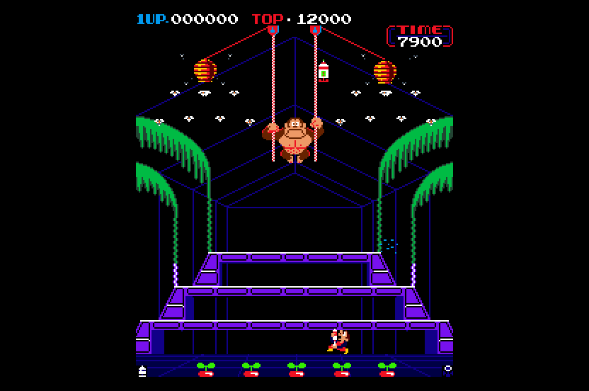

# Donkey Kong 3 (Nintendo, 1983) on the Atari STE



MAME set `dkong3` (`nintendo/dkong.cpp`, `dkong_v.cpp`, `dkong_a.cpp`; the TKG-04 video board of Donkey Kong with a Z80 DMA
instead of the 8257).  The main Z80 (4 MHz) is statically translated to 68000 code (`engine/z80x.py` FAST) and checked in
lock-step against a reference machine (`tools/machine.py`); the Z80 DMA's sprite copy is a runtime routine.  The picture is
Mario Bros.' renderer (`games/mario/src/render.s`) turned to Donkey Kong's portrait screen: 224 x 256, tile playfield plus
generated-code sprites, equal to the reference pixel for pixel in the simulator.  The two sound CPUs (N2A03s, a 6502 with the
NES sound generator) are not run: their output is recorded in MAME per command and mixed on the DMA channel.  Status:
**Incomplete** (root README: the logic, the picture, the sprites and the sound driver's rules are checked in the simulator against the
reference, the sound against MAME's recording in Hatari; no natural playthrough, nobody has listened to it).  Speed (Hatari, 4 MB,
`-D AUTOPLAY=1 -D CHEAT=1`: coins, a start every 4000 VBLs, the three stages in turn, lives and credits poked, 6000 VBLs, 2026-11-08):
54.5 arcade frames a second of 60.6 (90%) and 22.4 pictures a second on average; the slowest quarter of the play 47.8 and 17.5, the
stages' busy play about 12 pictures a second (Speed below).  A 20,000-VBL run through the three stages: no crash, no bad pc.

## Build and run

```sh
python port.py prepare dkong3            # or: python games/dkong3/tools/prepare.py   (assets/roms/dkong3.zip)
python port.py cover dkong3              # coverage (24 seeds of 20000-30000 frames: 13-24 poke MAME's cheats and the stage) and the pens (~6 min)
python games/dkong3/ref/sound_values.py 1 40000   # (seeds 1-8) the latch values the game sends: the sound's capture list
python games/dkong3/tools/build.py       # -> run/dkong3/DKONG3.PRG   (the first build records the sound in MAME: 94 captures, ~25 s;
                                         #    --sim: run/dkong3_sim for the tests; -D AUTOPLAY=1 (a coin, a start, walking and firing);
                                         #    -D CHEAT=1 (with it: lives, credits, the stage $601B poked: a long run); -D NOSOUND=1)
python port.py test dkong3               # the lock-step, picture, sprite and sound tests
python games/dkong3/ref/mame_cmp_dkong3.py 300 1000 1800 3000   # the reference against MAME's picture
powershell -ExecutionPolicy Bypass -File games/dkong3/tools/hatari.ps1 -Frames 3000   # Hatari, hidden: counters (-Avi 1: an AVI for stills, only for short runs; the SSD rule) (-Sound 1: the audio in the AVI)
python games/dkong3/tools/sound_check.py make   # then hatari, simulate, compare: the sound against MAME's for the same commands
```

Supply `assets/roms/dkong3.zip` (MAME's merged set: the parent's 16 files are used; `docs/rom_manifest.json` has their sizes, CRCs
and SHA-1s).  MAME is the F030Arcade checkout's WolfMAME 0.248 (`$MAME` overrides it; it runs on a desktop of its own,
`engine/mamewin.py`); the palette comes from it, the source of 0.286 agrees with its driver.  `VASM` / `VLINK` select the toolchain.
The program needs about 4 MB of RAM (the sprite code and the 256 KB dispatch table are most of it, the sound 0.87 MB).

## Controls

**5** coin, **1/2** start, **arrows** move (4-way: the ladders and vines go up and down), **Space/Ctrl/Z** fire (the spray gun),
**Esc** quits.  Joystick port 1 plays player 1, port 0 player 2; Jaguar pads as the other ports (D-pad, A/B/C fire).  The cabinet
is upright (DSW0 bit 7 clear): both players use the one set of controls (`IN0`), so the second joystick and the second pad move
the same Stanley and fire (their directions and fire also go to `IN1`, the cocktail player's); coins and starts of both pads are
as on the other ports.  Read from the code only: no key was pressed in Hatari (no input injection is set up for this port), so
the keyboard, the joysticks and the pads were not tried there; the AUTOPLAY build writes `IN0` / `IN1` directly.

## State

* **Logic**: exact against the reference.  `tools/logic_test.py` runs the idle loop `$0249` and the NMI in lock-step with the Z80
  reference: 3000 and 8000 frames of random play, and 3000 frames each with other DIP settings (lives, bonus, coinage, cabinet,
  the test mode) and a second seed; RAM, sound latches, latches `$7E81-$7E87`, registers and the unchanged ROM compared.  With `--cheat` (credits,
  lives and the stage byte `$601B` 0-2 poked on both sides at each start; values above 2 are not stages: the game then reads
  garbage tables) 8000 frames each on seeds 1-3 equal.  The natives (below) are checked only through these runs (the registers
  at the idle loop and the memory), not against the translation they replace on random states.
* **Reference against MAME**: the reference's picture equals MAME's snapshot at frames 300, 700, 1000, 1500, 1800, 2500 and 3000
  (0 of 57344 pixels differ; `ref/mame_cmp_dkong3.py`: MAME's RAM at the frame and its latch writes through the reference
  renderer).  Only the screen flip as the game sets it (flip 1) was seen; the unflipped (cocktail) orientation is MAME's source
  formula and Donkey Kong's checked one.  The reference's RAM is not compared with MAME's over time.
* **Picture**: exact.  `tools/render_test.py 3000 --start 100 --every 3` (seeds 1, 2, 5: 967 pictures each) and with `--cheat`
  (the three stages, 4000 frames, seeds 1-3: 1300 pictures each): 0 pixels differ, the side bands black.  `tools/sprite_test.py`: 316 pictures, both screen orientations: sprites across both edges at every pixel
  (16 shifts, generated code and row path), flips, colours, overlaps, the top and bottom guards, 64 KB crossings, consecutive
  pictures with all three buffers; a run with a planted band pixel fails (the test bites).
* **Sound**: `tools/sound_test.py 3000`: the driver's tables equal the converter's, 18000 voice states over 3000 frames equal a
  model of the rules, `snd_mix` against 40 random voice mixes (sample clock, saturation, loops, ends, the ring wrapping): exact.
  `tools/sound_check.py` (2026-11-08): the reference's latch values of a 40 s play fed to MAME and, as a script, to the program
  in Hatari (audio recorded in the AVI, `--sound 44100`): the 50 ms envelopes of the two correlate 0.91, sound is present in 79%
  of the windows in Hatari against 78% in MAME (76% in both), the level is -6.6 dB (the DMA path of this Hatari is -6.0 dB: a
  square wave of 100/127 comes out at 0.39 of full scale; the driver is within 1 dB of MAME).  The driver on Musashi against
  MAME: correlation 0.86, +1.9 dB.  Nobody has listened to it.  A DC offset (MAME's mix of the N2A03s has a large one, 0.14 of
  full scale after the game starts) is taken out of both before comparing: it is not heard.
* **Hatari** (F030Arcade build, STE, 4 MB, TOS 2.06): 20,001 VBLs with AUTOPLAY and CHEAT (five games, the stage poked 0, 1, 2, 0,
  1 at each start, lives and credits poked, Stanley walking right and firing): no crash file, no bad pc, 2 border fallbacks and 1
  late palette event; the stills show the three stages (greenhouse, the grey halls, the roof) with the score climbing to 2000.
* **Not done**: a natural playthrough (the tests and the long run play at random or by script and poke lives and the stage: a stage
  is never cleared, so the code between stages and after the last, the bonus and game-over sequences with a high score, and the
  ending have not run in Hatari; the coverage reached them only as far as its random play and the pokes did); the sound heard; the
  arcade's 16 sprites per scanline limit and the wrap-around of sprites across the bitmap's edge (the reference has the wrap, `render_test.py` and `sprite_test.py`
  turn it off: the STE port does not draw the wrapped part); the Mega STE and a real STE; the speed work of the other ports.

## How it works

### The board and the reference

Memory map and latch bits: the header of `tools/machine.py` (ROM `$0000-$5FFF` and `$8000-$9FFF` (the sound driver's code and
tables), RAM `$6000-$6FFF`, sprite RAM `$7000`, video RAM `$7400`, the sound latches at `$7C00`, `$7C80`, `$7D00` that are also the
inputs and DIP switches when read, the latches `$7E81-$7E87`).  The game programs the Z80 DMA once per frame (`$6900` ->
`$7000`, `$19F + 1` = `$1A0` bytes: the chip transfers the block length plus one byte).  The picture: 32 x 32 tiles of 8 x 8
(codes `+ 256 *` the gfx bank, which is the inverted bit `$7E81`), colours from the PROM per column and four rows, 128 sprites
of 16 x 16 per sprite bank, 256 pens from the resistor network of `dkong3_palette` (`tools/dkong3_pens.py` is MAME's dump), shown
turned by 90 degrees.  The game sets the screen flip (every MAME frame dumped had it set): every tile and sprite is drawn as if turned by 180 degrees; MAME's
flipped sprites run their rows upward (row r on line `y + 8 - r`), which the reference reproduces.

### Translation

`tools/gen.py` translates 12,199 instructions (0 unsupported) from the coverage (`ref/cover.py`, 24 seeds: play, two players, DIPs, the
test mode, MAME's cheats with the three stages poked at the start: 8100-8200 pcs a run) with `z80x.FAST`, a 64 KB block (`block=0x10000`: absolute reads of `$8000+` tables), calls of leaves up to 8
instructions in place.  The reads of the input ports go to unused bytes of the block (`IO_REDIRECT`); two register-indirect
reads of them (`ld hl,$7D00` in the coinage code, the boot test's `ld ix,$7C80`) are patched in the translated image because the
sound latches share their addresses.  Stores at `$0F56`, `$0F68`, `$0F6D`, `$0A62` (through `HL`) and `$338D` (`ld (bc),a`) go to ROM addresses when a pointer is 0 or a table entry empty (the
arcade ignores them): `DK3Emitter` skips them below `$6000`.  Natives (`src/natives.s`): `otir` at `$00DD` (the DMA's program),
`ld a,r`, the sprite list copy `$0251` (33 entries of 16 bytes: -8k a frame) and the two timer loops at `$0114` and `$0138` (-2k);
the store to `$7E85` calls `dk3_dma`.  The stage byte is `$601B` (0 and 1 the two halls, 2 the roof), lives `$601A`, credits `$6BF1`
(MAME's cheat list, `mamecheats/cheat.7z`; its invincibility patches change code and are not used).

### Schedule

As Mario Bros.: the foreground waits for the NMI at its idle loop (`$0249`, `z80_hook`); there the runtime draws the picture when
due, waits for the next arcade frame (the VBL adds one frame each VBL and a second one every fifth: 60 a second against the STE's
50), queues the sound commands (`snd_frame`) and delivers the NMI (`$0066`, token `$E001`) when `$7E84` allows it.

### Picture

`src/render.s` is Mario's renderer with the geometry turned: the picture is 224 wide (screen x 48-271, the side bands black) and
256 lines (`PIC_TOP` 10, `PIC_LINES` 256 as the other 256-line ports), three display buffers of 16 + 256 + 16 lines (sprites reach
the guard lines above and below) and a playfield of 224 x 256 pixels.  A video RAM cell (tx, ty) is the playfield cell (ty - 2,
31 - tx) (rows 2-29 of the map are the visible lines), with the screen flip at (29 - ty, tx) and the tile flipped in both
directions; the tiles and sprites are stored turned (`tools/assets.py`: `np.rot90`, so the arcade's sprite flip x is the picture's
flip y).  A cell is redrawn when its video RAM byte changes (the 1 KB compared with `cmpm.l`), or everything when the gfx bank, the
flip or the palette bank changes; a tile cache and a sprite cache fill on first use.  Sprite entries with y 0 are skipped fast.  A
buffer's rows are restored from the playfield after its last sprites in contiguous Blitter passes (`rowcopy`: the words of up to 8
groups of a line are adjacent, so one pass copies 1-8 lines, at most 32 words; wider rows per plane as before: -7k a picture).
The sprites are the generated code of `engine/sprite_programs.py` for the coverage's 135 shapes (row path for the others), OP 3
copy passes with the opaque pixels as end masks (no AND + OR), clipped at the picture's edges on its 16-pixel groups (the inner
word only), whole into the guard lines above and below.  Colours: 16 fitted to the coverage's pictures (`tools/assets.py`,
`ref/cover_pens.py` seeds 1-12, the later ones with the stages poked; mean error 2.7 levels a channel, the worst the roof stage's yellows).  Position formulas (`draw_sprites`): with
the screen flip clear X = 231 - y, Y = 240 - ((x - 8) & 255); flipped X = y - 23, Y = (x - 8) & 255; the flips inverted.

### Sound

Two N2A03s read the three latches in their vertical-blank NMI.  They are not run: `tools/sound_capture.py` records MAME's output
(`dkong3`, the main CPU parked on a `jr $`, a Lua script writing the latches; both N2A03s reset first) and `tools/sound_convert.py`
turns the recordings into 8 bit clips at 6258 Hz (`dkong3_sound.s`, 49 clips, 0.87 MB).  The standard captures come from
`ref/sound_values.py`'s lists (the values the game sends in 8 runs of 40000 frames): each value as a pulse of 3 frames then silence for
14 s (`P_`), the values the game holds for 30 frames or more as a 5 s hold (`H_`: the tunes `$10`, `$40`, `$60` of latch 1), and every
value that contains a tune's bits as the tune with that value pulsed in (`S_`).  The effect on top of a tune is `S_` minus `H_`: the
difference is zero before and after the effect (checked for `$10` -> `$12`), so the tune goes on while the effect plays.  A pulse
whose sound is still there after 11 s goes on in MAME until another command (a drone: the NES channels left on): its clip is the
start plus a loop of the steady part (`sustained` in `sound_convert.py`: the autocorrelation's period, at least 1 s).  The driver
(`src/sound.s`) has six voices, a tune, an effect and a sustained sound for each CPU (the first N2A03: latches 1 and 2, the second:
latch 3): a changed latch value starts or stops the tune it holds and starts the effect it names (on the sustained voice when
the clip is one); a newer sound of a CPU replaces its older one.  `snd_mix`, every VBL, adds the VBL's share of samples (6258 a
second against 50 VBLs, four at a time) of the voices (saturating) to a 2 KB ring buffer that the DMA plays repeating, started at
the first call with the write position 384 samples ahead; the DMA's address counter is not read (Hatari's stands still).
Limits: a tune loops its 5 s recording from the start (a seam); a sustained sound is stopped only by a newer sound of its CPU, which
is not what MAME's N2A03 does after every command (the stop commands were not looked for); values with no recording (silent in MAME
alone: the ones the game sends only as a state) play nothing; an effect that the CPU plays differently on another tune's bits is the
one recorded on the first; the clips are one level for all (peak 40 of 127: voices add).

## Speed

| Date | Setup | Logic | Pictures | Musashi cycles |
|---|---|---|---|---|
| 2026-11-08 | Hatari, `-D AUTOPLAY=1 -D CHEAT=1 --debug`, 6000 VBLs, 4 MB, MAX_SKIP 5 | 54.5 arcade frames a second, 90%; slowest quarter of the 100-VBL windows 47.8 (79%) | 22.4 a second; median 12, slowest quarter 17.5 | logic 60-75k in play, picture 109k CPU + 49k Blitter bus cycles (`tools/render_test.py --cheat`, seed 1) |
| 2026-11-08 | the same, 20,001 VBLs, MAX_SKIP 5 (the build before the row copies) | 57.4, 95% (windows: median 60.0, p10 51.0) | 23.0; the windows in play 8-10, the intros and the title 40-50 | |
| 2026-11-08 | the same, MAX_SKIP 3, 6000 VBLs | 52.0, 86% | 24.3 | |

MAX_SKIP (arcade frames in a row that are not drawn while the game is behind) trades the two: 3 -> 52.0 / 24.3, 5 -> 54.5 / 22.4
(the first build on the attract-only autoplay: 2 -> 48.3 / 25.1, 8 -> 57 / 27).  In play the stage has about 31 sprites and costs
110-140k CPU + 50-65k Blitter bus cycles a picture and 70-76k a logic frame, so the full arcade speed and 20-25 pictures a second
do not fit one 8 MHz STE together (60.6 x 73k + 20 x 190k = 8.2M of 8M cycles a second); the default favours the game's speed.  By
the goal of 90% and 20-25 pictures a second this is met on the average of the run and not in busy play: the logic is 70k of
translated code with no hot spot over 5% (the sprite list copy, the timer loops, the collision scan at `$8C38` and the sound
driver's `$8150` are the largest), and each sprite costs 1.2k in `draw_cell` before its Blitter code.

Where a picture goes (`tools/profile.py`, the stages): sprite cells 31% (`draw_cell`: the row and group bookkeeping, the cache
lookup), the row restores 25% (before `rowcopy` 30k, now ~20k), the sprite list 15%, the tile compare 7%.  What made it faster:
the generated sprite code against the row path 134.6k + 56.1k -> 117.9k + 53.4k cycles a picture (`-D REN_GEN=0`); natives for the
sprite list copy and the two timer loops 73.5k -> 63.4k of a logic frame; leaves in place (8 instructions) -2%; contiguous row
restores 115.8k -> 108.6k CPU; MAX_SKIP 3 -> 5.  Not tried: writer marks for the video RAM (the 1 KB compare is 7% of a picture), a
native for the collision scan and the sound driver's loop, sprites of unchanged position kept (the damage of a sprite that did not
move is restored and drawn again), cheaper `draw_cell` bookkeeping.  Techniques other ports use:
[speed.md](../../docs/speed.md#techniques-that-look-applicable-elsewhere-2026-11-07).

## Tests and tools

* `tools/logic_test.py N [--seed S] [--cheat] [--dsw0 X --dsw1 Y]`: lock-step.  `tools/render_test.py N --seed S --start F --every K
  [--shots DIR]`: the STE picture against the reference.  `tools/sprite_test.py [--quick]`.  `tools/sound_test.py N`.
  `tools/profile.py N`.  `tools/sound_check.py make|hatari|simulate|compare`: the sound against MAME's (needs MAME and ffmpeg).  `port.py test dkong3` runs them.
* `ref/mame_cmp_dkong3.py`: the reference against MAME's picture.  `ref/cover.py`, `ref/cover_pens.py`, `ref/sound_values.py`: the
  coverage and the data the build is made from (`build/dkong3/`, not committed).
* `tools/prepare.py`, `tools/gen.py`, `tools/assets.py`, `tools/build.py`, `tools/sound_capture.py`, `tools/sound_convert.py`,
  `tools/hatari.ps1` (an AUTOPLAY build in Hatari with the AVI, stills and `COUNTERS.BIN`).

## Lessons

* **A latch can be a read port at the same address** (2026-11-08): `$7C00`, `$7C80`, `$7D00`, `$7D80` are inputs and DIP switches
  when read and the sound latches when written.  The static redirect only covers `ld a,(nn)`; the two reads through a register
  (`ld hl,$7D00; ld a,(hl)`) gave the sound latch's last value: the lock-step test found it at the first frame.
* **A null pointer's stores must not reach the ROM image**: the arcade ignores writes to `$0000-$5FFF`, the translation's block
  holds the ROM.  The lock-step test compares the ROM bytes too (it first showed up as a wrong read of `ld a,($0008)` 230 frames
  later).
* **The flipped sprite's rows run upward** in MAME's line buffer; a first guess (rows downward from `y - 7`) was off in most sprites.
  The pictures of MAME at three frames fitted it exactly.
* **A MAME script's `--keep` directory must be absolute** (the Lua script is started in that directory).
* **Hatari's STE DMA address counter stands still** (`$ffff8909-d` read as the frame start): a ring buffer that follows it writes
  into the played part.  The driver mixes on a sample clock from the VBL count and starts the DMA at its first mix.  Found by a
  trace of the counter (`-D SNDDBG=1`), the ring compared with the simulator's (1930 of 2048 bytes equal, the rest the one-VBL
  phase), and a tone test (`-D SNDTONE=1`: 447 Hz at -6.0 dB).
* **A DC offset is not sound**: the first comparison with MAME said -19 dB and a missing drone; MAME's N2A03 mix carries a 0.14
  offset that Hatari's output blocks.  Compare after a high-pass.
* **Only valid stage values**: poking `$601B` above 2 makes the game read tables past their end and store to ROM addresses; the
  first coverage with values 0-5 produced garbage code paths and ROM writes the guards then had to cover.
* **Hatari's `--help` opens its window and hangs** (it waited for a key): do not call it without a timeout.

## Verification

A 20,001-VBL AUTOPLAY run with lives, credits and the stage poked (`-D CHEAT=1`, 2026-11-08) went through five games and the three
stages in Hatari without a crash; the other checks are simulator tests against the reference (above) and the sound check against
MAME.  No natural playthrough (a stage clear, the stage sequence, the end of the game) and no PPO profile: Go-Explore
(`docs/go-explore.md`) and PPO would need a RAM profile of this game; see the [status policy](../../docs/port-status.md).
