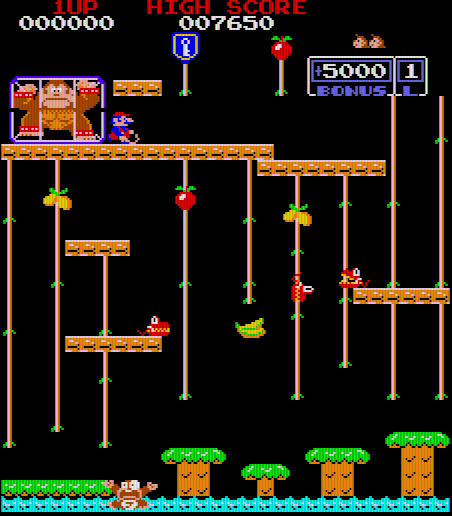

# Donkey Kong Junior, Atari STE

MAME set `dkongjr` (US set F-2, `assets/roms/dkongjr.zip`, the 13 files of `docs/rom_manifest.json`).  Registered in
`port.py` (`build`, `test`, `cover`, `run`, `mame`).  Paths relative to `games/dkongjr/`.

Controls (Donkey Kong's): **5** coin, **1/2** start, **arrows** move, **Space/Ctrl/Alt** jump, **Esc** quits.  Players
take turns: both joysticks and both pads move Junior.  Jaguar pad / PowerPad: the D-pad moves, **A / B / C** jump,
**Option** coin, **Pause** start.

    python port.py build dkongjr        # -> run/dkongjr/DKONGJR.PRG (the ROMs and the sound clips embedded)
    python port.py test dkongjr         # lock-step (3000 frames, with and without a coin), sprites, sound, picture
    python port.py mame dkongjr         # the reference picture against MAME (WolfMAME 0.184, see below)

The first build records the sound board in MAME (`tools/sound_capture.py`, ~5 min) when `build/dkongjr/sound/` is empty.

## The board against Donkey Kong's

Junior runs on Donkey Kong's board (MAME `nintendo/dkong.cpp` in the authoritative 0.286 tree, `AGENTS.md`: `dkongjr_map`,
`ROM_START( dkongjr )`; `dkong_v.cpp`, `resnet.cpp`, `palette.cpp` and `i8257.cpp` checked identical there), so the port starts
from the Donkey Kong port (`games/dkong`):

- **CPU ROMs**: 24 KB ($0000-$5FFF) in three 8 KB chips whose 2 KB / 4 KB pieces are not in address order
  (`tools/prepare.py` puts them back: `assets/roms/extracted/dkongjr/cpu.rom`).
- **Tiles**: 512; bit 0 of a write to `$7C80` adds 256 to every tile code (`dkongjr_gfxbank_w`).  Sprites, the 8257
  DMA ($6900 -> $7000, $180 bytes), the column colour PROM, the palette banks `$7D86/7`, the flip and sprite bank
  latches and the NMI mask `$7D84` are Donkey Kong's.
- **Palette**: Donkey Kong's circuit with Junior's PROMs (2e, 2f).  `tools/dkongjr_pens.py` is MAME's code in Python
  (`compute_res_net`, the tri-state black, `normalize_range`); run on Donkey Kong's PROMs it gives all 256 pens of
  `games/dkong/tools/dkong_pens.py` (MAME 0.289's dump) exactly, and Junior's pictures equal MAME's RGB (below).
- **Inputs**: Donkey Kong's bits.  DSW0 bits 2-3 are the bonus life (10000-25000); IN2 bit 6 reads low (no MCU line).
- **Sound** (MAME `dkong_a.cpp`, `dkongjr_audio`): the 8035 (`djr1-c_3h.3h`) reads the tune from `$7C00` (5 bits) and
  the pins `$7C81`, `$7D03`-`$7D06`, `$7D80` is its IRQ; the discrete circuits are walk (`$7D00`; `$7D07` switches it to
  a second form), jump (`$7D01`), climb (`$7D02`, LFSR noise) and fall (`$7D81`, SOUND9, while held).  The game's driver
  (Z80 `$00E0`) is Donkey Kong's: `$6080`-`$6086` frame counters for the pins, `$6089` the background tune (01-06),
  `$608A`/`$608B` a one-shot held 3 frames (07-0E: 09-0C the stage clears by `$6227` at `$1FB0`, 0C/0D the level
  fanfares by `$6229` at `$1913`, 07, 08, 0E).
- **RAM layout**: the game keeps Donkey Kong's: `$6227` stage (1 springboard, 2 vines = the first, 3 chains,
  4 hideout; setting it during the intro starts that stage), `$6228` lives, `$6229` level, `$60B2` P1 score (BCD),
  `$60B8` high score, `$6100` the table.  The idle-loop head is `$02BD` as in Donkey Kong.

## Files

`tools/`: `prepare.py` (ROMs), `machine.py` (reference machine: Donkey Kong's with the tile bank, a register model of
the 8257, Junior's PROMs), `dkongjr_pens.py`, `gen.py` (translation; the dispatch table covers $0000-$6001, the NMI
return token is $6001), `assets.py`, `build.py`, `logic_test.py` (lock-step against the reference, from Donkey Kong's),
`render_test.py`, `sprite_test.py` (Donkey Kong's on this program), `sound_capture.py` / `sound_convert.py` /
`sound_ym.py` (the sound board recorded in MAME, the DMA clips, the YM patches), `sound_test.py` (the driver's rules on
Musashi), `frametimes.py` (Donkey Kong's).
`src/`: `dkongjr.s` (Donkey Kong's runtime: the ROM size, the token, the DIP switches, the 32 KB guard, test defines
`AUTOSTART`, `STAGE`, `DUMPAT`, `TIMES`), `render.s` (Donkey Kong's with the tile bank: a bank switch redraws every
tile), `sprites.s` (Donkey Kong's), `sound.s` (Donkey Kong's driver with Junior's pins and five discrete sounds).
`ref/`: `cover.py` (coverage and pens: random play, the attract sequence, every stage by `$6227`, lives, a high score
for the name entry), `mame_cmp_dkongjr.py` + `mame184_dump.lua` (the MAME check), `probes/` (bring-up).

## State (2026-10-29)

- The reference machine boots and plays: attract mode, high-score table, coin, the intro, all four stages by `$6227`.
- MAME check (`ref/mame_cmp_dkongjr.py`): the reference picture equals MAME's RGB snapshot, 0 pixels differ, at 13
  attract frames: the high-score table, the demo, the intro, the title in tile bank 1 (palette banks 0-2).  The
  authoritative MAME is the 0.286 source (`AGENTS.md`); no 0.286 binary has the driver (its `m68k.exe` is a subset),
  so this runs WolfMAME 0.184 (F030Arcade-private's `mamearcade64.exe`) after comparing its source with 0.286: the
  palette, the nets, `compute_res_net`, `normalize_range`, the tile info, `draw_sprites`, `screen_update_dkong` and the
  ROM set differ only in syntax.  0.184's Lua: `manager:machine()`, no `emu.wait` in an autoboot script (frame callbacks).
- Coverage: `ref/cover.py` seeds 1-3 (random play), 4-5 (no coin: the whole attract sequence), 11-16 (stages, lives),
  21-23 (also the name entry), 20000-40000 frames each (~8 min in parallel): 7.3k PCs.  A coin cuts the attract
  sequence short: before seeds 4-5 no run reached its steps 3, 5-7 ($600A, the table at $0747), among them the title logo
  ($07CB: palette cycling, tile bank 1, the only write of bank 1 at $07F9).
- Unmapped memory: the game reads `$85A0-$B5F8` at `$24FC` (its loop at `$24F3` steps IX by `$1010` instead of `$10`) and
  writes `$8B21-$C960` at `$0F34` (odd entries of a table).  MAME reads 0 there and ignores the writes; the reference
  does the same, and the runtime has a 32 KB zero guard below `z80_block` (the signed index puts `$8000-$FFFF` there).
- Translation: 9461 instructions, nothing unsupported.  The `rst $28` table at `$1648` has 6 entries
  (`Config.rst28_counts`, a new engine option): the scan read the code after it as two more and followed them into data.
  `$8000`/`$8003` (jumps taken when IN2 bit 0, a service input, is set) stay `z80_badpc` stubs.
- `tools/logic_test.py 3000`: lock-step OK (attract, coin, the first stage); `--nocoin`: OK through the title.
- `tools/build.py`: `run/dkongjr/DKONGJR.PRG` (3.51 MB loaded with the sound, below MAX_LOAD's 3.7 MB).  In Hatari (`-D AUTOSTART=150`) it shows
  the boot self-test, the attract demo, the intro and play on the vines stage.
- `tools/render_test.py` (Galaga's method on Donkey Kong's `DUMPAT` freeze; `-D STAGE=n` starts stage n during the
  intro, a test define in `src/dkongjr.s`): the STE's screen against `render_raw()` of the frozen RAM, 0 pixels differ
  in all 14 frames: attract, intro and play on all four stages, palette banks 1-3, the title in tile bank 1.  The
  freeze counts the frames the program drew, the simulator its VBLs, and a slow frame skips VBLs: the test waits for the
  freeze (without that, a moving sprite was one frame behind the frozen RAM).  The title is caught by `-D DUMPTILE=n`
  (`build.py --dumptile n`: the n-th frame drawn with tile bank 1), not by a frame number: the attract sequence's time
  follows the build's speed (the idle loop counts its spins, the demo's length depends on them), and the sound moved
  the title from frame ~2800 to 1555-2130.  While the logo comes up the program draws ~20 frames in 50 VBLs (its
  palette cycling redraws the tiles).
- `python port.py test dkongjr` (2026-10-29): all pass: lock-step 3000 frames with and without a coin, the build, the
  sprite edges, the sound driver, the picture in play, on the hideout and in the title.
- `games/dkong/tools/sprite_test.py --prg run/dkongjr/DKONGJR.PRG --map build/dkongjr/dkongjr.map` (`sprites.s` is Donkey
  Kong's): 2048 edge cases exact (both edges, 16 shifts, flips, holes, 64 KB, the restore).  A map from another build
  (an `--out` build writes `dkongjr.map` too) makes it fail: rebuild the plain program first.
- Speed (Hatari, `-D AUTOSTART=150 -D TIMES=1 --debug --frames 3000`, `tools/frametimes.py`): a frame takes 35% of the
  50 Hz frame on average with the sound (34% without; Z80 NMI 8%, drawing 27%); 0.9% of the frames run into the next
  VBL (the full redraws: the boot's video RAM test, the tile bank switches, the palette bank changes), as Donkey Kong's
  0.8%.
- Sound: recorded in MAME (WolfMAME 0.184 again: its dkongjr sound board equals 0.286's but for the output route, 1.0
  instead of 0.5; `-volume` does not reach `-wavwrite`, so the climb recording clipped in 283 samples) and played as
  Donkey Kong's: 571 KB of 8 bit 6258 Hz DMA clips (91 s): backgrounds 01-06 loop while `$7C00` holds them (01, 02,
  04, 05 one measured period: 8.37, 2.79, 11.16, 1.57 s; 03 has no period, 06's phrases differ: a stretch of 6 / 8.62 s
  with a 0.15 s crossfade); one-shots 07-0E to their end; the six pins by priority (the IRQ highest).  Consecutive
  periods of the backgrounds differ by 18-30% (mean absolute difference): the 8035's output is not exactly periodic,
  a loop repeats one real period.  The discrete sounds are YM patches, one (period, volume) a 50 Hz frame: jump,
  climb, fall within 1-2 dB a frame of MAME; the walking clicks (two frames) 5-6 dB.  `tools/sound_test.py`: the
  driver's rules on Musashi (backgrounds, one-shots giving the channel back, pin priority, the five patches frame by
  frame, fall cut when `$7D81` drops); a build with the pin priority broken fails it.  In Hatari (`--sound 44100`,
  AVI) the music starts with the game.  Not compared by ear with the arcade.
- Palette: 22 colours besides black are shown; the 7 rarest (each < 2% of the pixels) are merged into neighbours by
  Donkey Kong's fit.  Fit per stage (see the porting guide) if they look wrong.

## Next

1. Play through in Hatari (all four stages, the ending; see `docs/port-status.md`): the status stays yellow until then.
2. Listen against MAME; a palette fitted per stage if the merged colours look wrong.
3. The boot's video RAM test (the first frames, a full redraw each): skip it if it matters.
