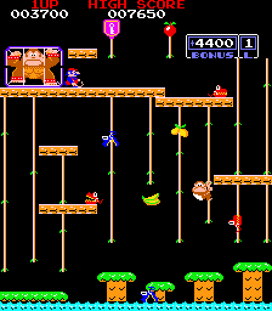

# Donkey Kong Junior (Nintendo, 1982) on the Atari STE



MAME set `dkongjr` (US set F-2; `nintendo/dkong.cpp`, `dkongjr_map`).  Junior runs on Donkey Kong's board, so the port
is Donkey Kong's ([its README](../dkong/README.md)) with this game's ROMs, tile bank, PROMs and sound pins.  The main
Z80 is statically translated to 68000 code (`engine/z80x.py`) and checked in lock-step against a reference machine;
the 8257 sprite DMA is Donkey Kong's runtime routine.  The 8035 sound board is recorded in MAME and played as DMA
sound clips; the five discrete sounds are YM2149 patches.  The picture is Donkey Kong's renderer with the tile bank;
the reference picture equals MAME's RGB and the STE's screen equals the reference.  Status: **Verification pending**
(picture equal to MAME; full-game checks pending).  Speed: one arcade frame per 50 Hz VBL, 50 arcade frames a second
(83% of the arcade's 60.6 Hz) and 50 pictures a second; a frame takes 35% of the 50 Hz frame on average, 0.9% of the
frames late (Hatari, `-D AUTOSTART=150 -D TIMES=1`, 3000 frames, 4 MB, 2026-10-29).

## Build and run

```sh
python port.py cover dkongjr        # coverage + pens: ref/cover.py seeds 1-5, 11-16, 21-23 (~8 min in parallel)
python port.py build dkongjr        # -> run/dkongjr/DKONGJR.PRG (the ROMs and the sound clips embedded)
python port.py test dkongjr         # lock-step (3000 frames, with and without a coin), sprites, sound, picture
python port.py run dkongjr shot@30  # Hatari (F030Arcade build), screenshot at 30 s
python port.py mame dkongjr         # the reference picture against MAME (WolfMAME 0.184, see below)
```

Supply `assets/roms/dkongjr.zip` (the 13 files of `docs/rom_manifest.json`); `tools/prepare.py` unpacks it to
`assets/roms/extracted/dkongjr/` and puts the CPU ROM pieces in order (`cpu.rom`).  The first build records the sound
board in MAME (`tools/sound_capture.py`, ~5 min) when `build/dkongjr/sound/` is empty.  The program is 3.51 MB to load
with the sound (below `tools/release.py` MAX_LOAD's 3.7 MB).  Paths are relative to this folder; `engine/`, `tools/`,
`port.py` and `docs/` at the top are the repository's.

## Controls

Donkey Kong's: **5** coin, **1/2** start, **arrows** move, **Space/Ctrl/Alt** jump, **Esc** quits.  Players take
turns: both joysticks and both pads move Junior.  Jaguar pad / PowerPad: the D-pad moves, **A / B / C** jump,
**Option** coin, **Pause** start.

## State

* **Logic**: exact.  `tools/logic_test.py 3000`: lock-step OK (attract, coin, the first stage); `--nocoin`: OK through
  the title.  `python port.py test dkongjr` (2026-10-29): all pass: lock-step 3000 frames with and without a coin,
  the build, the sprite edges, the sound driver, the picture in play, on the hideout and in the title.
* **Picture**: the reference picture equals MAME's RGB snapshot, 0 pixels differ, at 13 attract frames (the
  high-score table, the demo, the intro, the title in tile bank 1; palette banks 0-2).  `tools/render_test.py`: the
  STE's screen equals `render_raw()` of the frozen RAM, 0 pixels differ in all 14 frames (attract, intro and play on
  all four stages, palette banks 1-3, the title in tile bank 1).  Donkey Kong's `sprite_test.py` on this program:
  2048 edge cases exact (both edges, 16 shifts, flips, holes, 64 KB, the restore).
* **Coverage**: 7.3k PCs (`ref/cover.py`, Translation).
* **Hatari** (F030Arcade build, STE, 4 MB, `-D AUTOSTART=150`): the boot self-test, the attract demo, the intro and
  play on the vines stage; with `--sound 44100` (AVI) the music starts with the game.
* **Sound**: the driver's rules pass `tools/sound_test.py`; jump, climb and fall within 1-2 dB a frame of MAME, the
  walking clicks 5-6 dB.  Not compared by ear with the arcade.
* Not done, most important first: a play-through in Hatari (all four stages, the ending; see
  [the status policy](../../docs/port-status.md)): the status stays yellow until then.  Listening against MAME; a
  palette fitted per stage if the merged colours look wrong.  The boot's video RAM test (the first frames, a full
  redraw each): skip it if it matters.  `$8000`/`$8003` (the service input's jumps) stay `z80_badpc` stubs.

## How it works

### The board and the reference

Junior runs on Donkey Kong's board (MAME `nintendo/dkong.cpp` in the authoritative 0.286 tree, `AGENTS.md`:
`dkongjr_map`, `ROM_START( dkongjr )`; `dkong_v.cpp`, `resnet.cpp`, `palette.cpp` and `i8257.cpp` checked identical
there), so the port starts from the Donkey Kong port (`games/dkong`):

- **CPU ROMs**: 24 KB ($0000-$5FFF) in three 8 KB chips whose 2 KB / 4 KB pieces are not in address order
  (`tools/prepare.py` puts them back: `assets/roms/extracted/dkongjr/cpu.rom`).
- **Tiles**: 512; bit 0 of a write to `$7C80` adds 256 to every tile code (`dkongjr_gfxbank_w`).  Sprites, the 8257
  DMA ($6900 -> $7000, $180 bytes), the column colour PROM, the palette banks `$7D86/7`, the flip and sprite bank
  latches and the NMI mask `$7D84` are Donkey Kong's.
- **Palette**: Donkey Kong's circuit with Junior's PROMs (2e, 2f).  `tools/dkongjr_pens.py` is MAME's code in Python
  (`compute_res_net`, the tri-state black, `normalize_range`); run on Donkey Kong's PROMs it gives all 256 pens of
  `games/dkong/tools/dkong_pens.py` (MAME 0.289's dump) exactly, and Junior's pictures equal MAME's RGB.
- **Inputs**: Donkey Kong's bits.  DSW0 bits 2-3 are the bonus life (10000-25000); IN2 bit 6 reads low (no MCU line).
- **Sound** (MAME `dkong_a.cpp`, `dkongjr_audio`): the 8035 (`djr1-c_3h.3h`) reads the tune from `$7C00` (5 bits) and
  the pins `$7C81`, `$7D03`-`$7D06`, `$7D80` is its IRQ; the discrete circuits are walk (`$7D00`; `$7D07` switches it
  to a second form), jump (`$7D01`), climb (`$7D02`, LFSR noise) and fall (`$7D81`, SOUND9, while held).  The game's
  driver (Z80 `$00E0`) is Donkey Kong's: `$6080`-`$6086` frame counters for the pins, `$6089` the background tune
  (01-06), `$608A`/`$608B` a one-shot held 3 frames (07-0E: 09-0C the stage clears by `$6227` at `$1FB0`, 0C/0D the
  level fanfares by `$6229` at `$1913`, 07, 08, 0E).
- **RAM layout**: the game keeps Donkey Kong's: `$6227` stage (1 springboard, 2 vines = the first, 3 chains,
  4 hideout; setting it during the intro starts that stage), `$6228` lives, `$6229` level, `$60B2` P1 score (BCD),
  `$60B8` high score, `$6100` the table.
- **Unmapped memory**: the game reads `$85A0-$B5F8` at `$24FC` (its loop at `$24F3` steps IX by `$1010` instead of
  `$10`) and writes `$8B21-$C960` at `$0F34` (odd entries of a table).  MAME reads 0 there and ignores the writes; the
  reference does the same, and the runtime has a 32 KB zero guard below `z80_block` (the signed index puts
  `$8000-$FFFF` there).

`tools/machine.py` is the reference machine: Donkey Kong's with the tile bank, a register model of the 8257 and
Junior's PROMs.  The MAME check (`ref/mame_cmp_dkongjr.py` + `mame184_dump.lua`): no 0.286 binary has the driver (its
`m68k.exe` is a subset), so it runs WolfMAME 0.184 (F030Arcade-private's `mamearcade64.exe`) after comparing its source
with 0.286: the palette, the nets, `compute_res_net`, `normalize_range`, the tile info, `draw_sprites`,
`screen_update_dkong` and the ROM set differ only in syntax.  0.184's Lua: `manager:machine()`, no `emu.wait` in an
autoboot script (frame callbacks).

Files: `tools/` `prepare.py` (ROMs), `machine.py`, `dkongjr_pens.py`, `gen.py`, `assets.py`, `build.py`,
`logic_test.py` (from Donkey Kong's), `render_test.py`, `sprite_test.py` (Donkey Kong's on this program),
`sound_capture.py` / `sound_convert.py` / `sound_ym.py` (the sound board recorded in MAME, the DMA clips, the YM
patches), `sound_test.py`, `frametimes.py` (Donkey Kong's).  `src/`: `dkongjr.s` (Donkey Kong's runtime: the ROM
size, the token, the DIP switches, the 32 KB guard, test defines `AUTOSTART`, `STAGE`, `DUMPAT`, `TIMES`), `render.s`,
`sprites.s` (Donkey Kong's), `sound.s`.  `ref/`: `cover.py`, `mame_cmp_dkongjr.py` + `mame184_dump.lua`, `probes/`
(bring-up).

### Translation

`tools/gen.py`: 9461 instructions, nothing unsupported; the dispatch table covers $0000-$6001, the NMI return token is
$6001.  The `rst $28` table at `$1648` has 6 entries (`Config.rst28_counts`, an engine option added for this port).
`$8000`/`$8003` (jumps taken when IN2 bit 0, a service input, is set) stay `z80_badpc` stubs.  Coverage
(`ref/cover.py`): seeds 1-3 (random play), 4-5 (no coin: the whole attract sequence), 11-16 (stages, lives), 21-23
(also the name entry), 20000-40000 frames each (~8 min in parallel): 7.3k PCs.

### Schedule

Donkey Kong's, VBL-locked: one Z80 NMI per 50 Hz VBL, then the drawing; the main thread below.  The idle-loop head is
`$02BD` as in Donkey Kong.

### Picture

Donkey Kong's `render.s` with the tile bank (a bank switch redraws every tile) and Donkey Kong's `sprites.s`
(generated Blitter code per sprite line, edge clipping, the damage records: [its README](../dkong/README.md#picture)).

**Colours**: 22 colours besides black are shown; the 7 rarest (each < 2% of the pixels) are merged into neighbours by
Donkey Kong's fit (a small PROM set merged by distance and the square root of the minimum count; the 2026-11-05
default fitter is not used here, [colours](../../docs/colours.md#what-each-port-uses)).  Fit per stage
([colours](../../docs/colours.md#rules), "Fixed palette, fitted per stage") if they look wrong.

### Sound

Recorded in MAME and played as Donkey Kong's (`src/sound.s`: Donkey Kong's driver with Junior's pins and five discrete
sounds).  `tools/sound_capture.py` runs WolfMAME 0.184 (`$MAME`, default F030Arcade-private's `mamearcade64.exe`) at
`-volume -6`: its dkongjr sound board equals 0.286's but for the output route, 1.0 instead of 0.5.  When 0.184 is
missing it runs the MAME on the path (0.289 on the Mac) at `-volume 0`: 0.286's source routes the board at 0.5 itself
(`nintendo/dkong_a.cpp` `dkongjr_audio`); `MAME_VOLUME` overrides.

The clips: 8 bit 6258 Hz DMA sound, 91 s (571 KB from 0.184; 570,240 bytes, 91.1 s, scale 430.1 from 0.289 on the
Mac): backgrounds 01-06 loop while `$7C00` holds them (01, 02, 04, 05 one measured period: 8.37, 2.79, 11.16, 1.57 s;
03 has no period, 06's phrases differ: a stretch of 6 / 8.62 s with a 0.15 s crossfade); one-shots 07-0E to their
end; the six pins by priority (the IRQ highest).  The discrete sounds are YM patches, one (period, volume) a 50 Hz
frame: jump, climb, fall within 1-2 dB a frame of MAME; the walking clicks (two frames) 5-6 dB.

## Speed

| Date | Setup | Logic | Pictures | Load of a 50 Hz frame |
|---|---|---|---|---|
| 2026-10-29 | Hatari, `-D AUTOSTART=150 -D TIMES=1 --debug --frames 3000`, `tools/frametimes.py`, 4 MB | 50 arcade frames a second, 83% | 50 a second; 0.9% of the frames run into the next VBL | 35% on average with the sound (34% without; Z80 NMI 8%, drawing 27%) |

The late frames are the full redraws: the boot's video RAM test, the tile bank switches, the palette bank changes
(Donkey Kong's 0.8%).  While the title logo comes up the program draws ~20 frames in 50 VBLs (its palette cycling
redraws the tiles).  The renderer and its gains are Donkey Kong's ([its Speed](../dkong/README.md#speed)).

Techniques other ports use that may apply:
[speed.md](../../docs/speed.md#techniques-that-look-applicable-elsewhere-2026-11-07).

## Tests and tools

* `tools/logic_test.py N [--nocoin]`: lock-step against the reference (from Donkey Kong's).
* `tools/render_test.py` (Galaga's method on Donkey Kong's `DUMPAT` freeze; `-D STAGE=n` starts stage n during the
  intro, a test define in `src/dkongjr.s`): the STE's screen against `render_raw()` of the frozen RAM.  The title is
  caught by `-D DUMPTILE=n` (`build.py --dumptile n`: the n-th frame drawn with tile bank 1).
* `games/dkong/tools/sprite_test.py --prg run/dkongjr/DKONGJR.PRG --map build/dkongjr/dkongjr.map`
  (`tools/sprite_test.py` runs it): Donkey Kong's edge test on this program.  A map from another build (an `--out` build writes
  `dkongjr.map` too) makes it fail: rebuild the plain program first.
* `tools/sound_test.py`: the driver's rules on Musashi (backgrounds, one-shots giving the channel back, pin priority,
  the five patches frame by frame, fall cut when `$7D81` drops); a build with the pin priority broken fails it.
* `tools/frametimes.py TIMES.BIN`: the frame-time histogram of a `-D TIMES=1` build (Donkey Kong's).
* `ref/mame_cmp_dkongjr.py`: the reference against MAME's RGB (`port.py mame dkongjr`).

## Lessons

### 2026-11-01: the -6 dB were 0.184's output route

The 0.184 recordings needed -6 dB because WolfMAME 0.184 routes the board at 1.0; 0.286 and 0.289 route it at 0.5
themselves.  The clips recorded with 0.289 on the Mac came out the length of the 0.184 recording and
`port.py test dkongjr` passes with them; not compared by ear with the 0.184 clips.

### 2026-10-29: the sound board's loops

Consecutive periods of the backgrounds differ by 18-30% (mean absolute difference): the 8035's output is not exactly
periodic, a loop repeats one real period.  The first 0.184 recording's climb sound clipped in 283 samples; the note
then said `-volume` does not reach `-wavwrite`, while `tools/sound_capture.py` now passes `-volume -6` to 0.184 (its
docstring: without it the land effect, `$7D02`, clipped).  Not re-checked which holds.

### 2026-10-29: catching a frozen frame

The freeze counts the frames the program drew, the simulator its VBLs, and a slow frame skips VBLs: the render test
waits for the freeze (without that, a moving sprite was one frame behind the frozen RAM).  The attract sequence's time
follows the build's speed (the idle loop counts its spins, the demo's length depends on them), and the sound moved
the title from frame ~2800 to 1555-2130, so the title is caught by `DUMPTILE`, not by a frame number.

### 2026-10-29: a coin hides the attract sequence; a table length

A coin cuts the attract sequence short: before seeds 4-5 no run reached its steps 3, 5-7 ($600A, the table at
$0747), among them the title logo ($07CB: palette cycling, tile bank 1, the only write of bank 1 at $07F9).  The
`rst $28` table at `$1648`: the scan read the code after its 6 entries as two more and followed them into data, hence
`Config.rst28_counts`.

## Verification

No playtest beyond the attract mode and the first stages in Hatari yet; the render test covers all four stages by
`$6227`.

Full-game verification follows the [status policy](../../docs/port-status.md); nothing here claims a complete playthrough.
