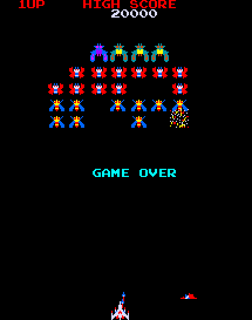

# Galaga (Namco, 1981) on the Atari STE



The MAME set `galaga` (driver `namco/galaga.cpp`, video `namco/galaga_v.cpp`, sound `namco/galaga_a.cpp`): three Z80s
at 3.072 MHz, the Namco 51XX (inputs, coins, credits) and 54XX (the explosion sound) on the 06XX bus, the 05XX
starfield.  All three Z80s are translated to 68000 code (`tools/gen.py`, `engine/z80x.py`); the 51XX's own program
(`namco51.zip`) is translated by `engine/mb88x.py` (one native path, the read at its main loop); the 54XX is
simulated (its explosion as YM noise); the 05XX starfield is computed by the renderer.  The picture: Blitter sprites
with generated code per shape (`engine/sprite_codegen.py`), characters by the CPU, the stars as single pixels, all
exact against the reference renderer at frozen moments; the sound: the WSG's three voices as the YM2149's square
waves.  Status: **Verification pending** (root README): the whole game is translated and drawn, no full natural
playthrough has been checked.  Latest speed (Hatari, 4 MB, `tools/bench.sh 9000`, attract mode, 2026-10-21): 50
arcade frames a second (one a VBL, 82% of the arcade's 60.6), 31.1 pictures a second on average.

## Build and run

```sh
python port.py prepare galaga                    # checks assets/roms/galaga.zip, unpacks it (build does it too)
python port.py build galaga                      # run/galaga/GALAGA.PRG (CPU ROMs embedded; needs namco51.zip)
python port.py build galaga --sim                # run/galaga_sim/GALAGA.PRG, the simulator build the tests use
python port.py build galaga --debug              # counters top left (cnt_vbl, cnt_skip, cnt_render)
python port.py build galaga --full-selftest      # keeps the main CPU's boot RAM test (~600 of the 850 boot frames)
python port.py run galaga shot@30                # Hatari (F030Arcade, tools/hatari.sh), screenshots in /tmp/hrun
python port.py test galaga                       # the test sequence (Tests and tools)
python port.py cover galaga [seed]               # coverage: seeds 1-3, 4-6 (high scores, name entry), 7 (the 51XX)
python port.py mame galaga                       # the reference picture against MAME's (ref/mame_cmp_galaga.py)
games/galaga/tools/bench.sh 9000                 # Hatari frame rate: pictures a second per 500 VBLs, border events
```

ROMs: `assets/roms/galaga.zip`, the 14 files of `docs/rom_manifest.json`; the MCU programs in
`assets/roms/namco51.zip` (`51xx.bin`, crc c2f57ef8) and `namco54.zip` (`54xx.bin`, crc ee7357e0), as MAME 0.289
expects them.  Build switches: `-D N51SIM=1` (the old 51XX simulation), `-D NOSOUND=1`, `-D NOTHROTTLE=1` (all stars
always), `-D NOSTARS=1`, `-D NOZEROFILL=1`, `-D CACHESPRITES=1` (prepared sprite records), `-D NOSPRITECODE=1` (the
generic sprite path), `-D FREEZEAT=N` (from VBL N the game's interrupts stop, the renderer goes on), `-D RATE=N`
(counters to `RATE.BIN`), `-D RESETTRAP=1`, `-D IOLOG=1`.  Layout: `src/` the runtime and renderer (`galaga.s`,
`render.s`, `sprites.s`, `stars.s`), `tools/` the reference machine, translation, assets, sound, build and tests,
`ref/` coverage and the MAME comparisons (one-off probes in `ref/probes/`); coverage pickles and generated files in
`build/galaga/`.  Commands run from the repository root.  Paths are relative to this folder; `engine/`, `tools/`,
`port.py` and `docs/` at the top are the repository's.

## Controls

**5** coin, **1/2** start, **left/right** move, **Space/Ctrl/Alt** fire, **Esc** quits.  Players take turns: both
joysticks and both pads move the fighter.  Jaguar pad / PowerPad (STE enhanced ports,
[architecture](../../docs/architecture.md#input-all-ports)): either pad, the D-pad moves, **A / B / C** fire,
**Option** coin, **Pause** start, keypad **1/2** start, **5** coin, **\*** + **#** quit.

## State

* The reference: `ref/mame_cmp_51xx.py` runs MAME 0.289 and the reference with the real MCUs from power-on: the
  51XX's traffic and data RAM identical over three scripts (2,400 / 6,000 / 3,000 frames, see "MCU").
  `tools/schedule_test.py`: the port's schedule against the interleaved reference: the same game up to about frame
  2000 (the stars one scroll step apart from frame 900); once the scripted player shoots the two drift into different
  games (frame 2500 scores 1110 / 1030).
* The 51XX: `engine/mb88x_test.py` (the translated program against the reference's 51XX, 52,945 / 52,929 runs, 0
  differ: after each run RAM, latch, A, X, Y, TL, PIO), `ref/mcu_events_test.py` (the event-driven 51XX against the
  cycle-exact one, `two` and `coins`, 6,000 frames each: all 15,849 reads and the 51XX's RAM in every frame
  identical), `tools/n51_test.py` (the build's 06XX traffic against the reference, 3,811 ticks, 0 differ).
* Picture: `tools/render_test.py` 0 of 64,512 pixels differ at VBLs 1500, 2200, 3000, 3600, 4400, 5200, 6400 and
  8000; `tools/sprite_test.py` 2,664 positions (2,208 across an edge, 408 culled, all 16 shifts, a 64 KB crossing);
  `engine/sprite_blit_test.py` 8,192 shape / skew / direction checks and 48 renderer comparisons; the reference
  renderer against MAME's picture: 0 pixels differ.
* Sound: `tools/sound_test.py 6000`: the sound CPU's page, the WSG registers and the YM's registers equal the
  reference's and the model's in 5,987 of 5,987 frames (4,856 with sound, 14 explosions); `snd_update` against the
  model on 3,000 random WSG states.
* Hatari: game over, the name entry, Best 5 and seven minutes of the attract mode with the score forced to 30000; the
  attract mode over 9,000 VBLs with no CRASH.TXT and no late border event.
* Missing, most important first: a full natural playthrough (see "Verification").
* Missing: a lock-step test of the main and sub CPU's translated code against the reference (`schedule_test.py`
  checks the reference only; translator changes are checked with `engine/xdiff.py` against the build before).
* Missing: the 54XX's program on the STE (it runs in the reference only; the STE simulates the explosion).
* Open: the reference's blue is MAME 0.289's (`0x51 / 0xAE`, checked against a MAME snapshot); the authoritative 0.286
  source says `0x47 / 0x97` ([porting guide](../../docs/porting-guide.md#against-mames-picture-every-port)): not
  changed yet.
* Open: which 11 of the 288 lines to lose (the STE shows 277 from `CROP_TOP` = 24).
* Open: the starfield change of 2026-11-02 is not measured in Hatari; no PPO profile yet (`engine/ppo_profiles.py`).

## How it works

### The board and the reference

`tools/machine.py` models the arcade from MAME's `galaga.cpp`: three Z80s at 3.072 MHz with the shared map (ROM per
CPU at `0-3FFF`, switches / latches / 06XX at `6800-7100`, RAM `8000-9BFF` with the sprite table at the end of each 1
KB, the video latch `A000`), the IRQ to CPU1 / CPU2 at the vertical blank when enabled, the NMI to CPU3 at lines 64
and 192, the 06XX's NMI clock to CPU1 during transfers, the 51XX simulated as old MAME did or, with
`Galaga(mcu=True)`, the real 51XX and 54XX programs (see "MCU"), the 05XX starfield (the LFSR period walked once a
frame), the renderer (`render_raw`: tiles 36 x 28 through `tilemap_scan`, 64 sprites with the double sizes, stars
under them, characters over them, rotated 90).  It boots to the attract mode in 1500 frames at ~45 frames a second.

MAME's sources: the vendored F030Arcade tree
(`F030Arcade/third_party/jsm68kdisassembler/third_party/mame/src/mame/namco/galaga_v.cpp`, `galaga.cpp`,
`galaga_a.cpp`; commit 5913928b159).  Sprite flags there: bit 0 flip x, bit 1 flip y, bit 2 double width, bit 3 double
height; x = `spriteram_2[offs+1] - 40 + 0x100 * (spriteram_3[offs+1] & 3)`, y = `256 - spriteram_2[offs] + 1`.  Check
against it before trusting `tools/machine.py` or the renderer.

Probes (`ref/probes/`): `galaga1.py` (coin, start and play), `galaga2.py` (the sound CPU can be stopped after its
boot: screens identical over 2400 frames; it only posts its test result `$9101` and clears `$9A00-$9AFF`),
`galaga3.py` (sprites changed per frame mean 4.9, 90% 13, tiles 1.5; every I/O access is a static address except the
NMI handler's `ldi` through hl' and the video latch through hl), `galaga4.py` (13 colours plus black are drawn).  Both
CPUs idle most of the time (about 2,100 translated instructions of work a frame); 5-13 sprites change a frame, 100
stars.

### Translation

* CPU1 (main) `z80x.FAST`, its code in the signed model (a6 = its ROM, the RAM below); CPU2 (sub) and CPU3 (sound)
  `z80x.FAST_LONG`, the long model (CPU2: a6 = its ROM, the RAM above).  Memory: one block [sub ROM 32K | shared RAM
  32K | main ROM 32K]; the register cells `$6800-$7FFF` are per CPU; the dispatch tables are 2 x 256 KB.  `g_ctrl06`
  reads DE' from the upper word of d2.
* The sound CPU (labels X, 841 instructions) runs over its own 64 KB block `g3_block` (its ROM, its I/O cells, its RAM
  at + `$8000`); its boot stays native.  It runs about 960 Z80 instructions a frame.
* Jump tables: Galaga's are `ld hl,T; rst $08 | $10 | add a,l; ld a|e,(hl); inc hl; ld h|d,(hl); .. jp (hl)` (or
  `call $003B`, a `jp (hl)` trampoline); `Config(hl_tables=True)` finds them by walking back from every `jp (hl)`
  (`discover.hl_jump_tables`); `discover.py`'s `callee_jphl` takes the rank check at `$3000` (`ld hl,$31A6; rst 08;
  call $3118`, the called routine reading the table twice before its `jp (hl)`); the sub CPU's script interpreter at
  `$090E` (opcodes `$EF-$FF` through the word table at `$0920`, jumping with `ex (sp),hl; ret`; 17 opcodes).  The
  translator continues after a `halt` (`z80dis`: flow `seq`) and has `rrd` (the end-of-game code's `$0A27`).
* `ei` / `di` keep `g1_iff` / `g2_iff`: an IRQ is only taken when the program enabled it (the NMI disables until its
  `retn`).  The IRQ handler's register state after its run is dropped (it restores the Z80 registers itself).  The
  06XX data port is the whole `$7000-$70FF` (the NMI handler's `ldi` pointer walks through it).
* Writer marks: the video RAM is compared per block of 32 bytes its writers mark (as 1943's character RAM):
  `ref/cover.py` records the instructions that write `$8000-$87FF` (71, all on the main CPU), `gen.py`'s Emitter marks
  the block of a store's address, a block instruction's blocks from DE before to DE after (`vblock_range`), `push` /
  `call` all of it; `scan_cells` compares the marked blocks and 128 bytes a render in case a writer is missing (DEBUG:
  `scan_missed`).  The game rewrites its credit text every frame with the same bytes, so a single "written" flag would
  scan the whole RAM every render.  Checked: no unmarked block changed in 3,594 scans (6,000 game frames); `xdiff`
  against the build before: the same memory at all 4,000 game frames.
* The main CPU's boot RAM test (about 600 of the 850 frames to the attract mode) is patched out of the translation
  (`machine.skip_ram_test`, the bank checksum byte compensates; `--full-selftest` keeps it); the grid screen and the
  handshake wait (`$3719` loops, ~200 frames) remain.

### MCU

The STE program runs the 51XX's own program since 2026-10-21 (the old simulation stays as `-D N51SIM=1`).

* `engine/mb88.py` is the MB8843 / MB8844 core, a port of MAME 0.289's `mb88xx.cpp` (identical to the vendored
  0.286): 64 nibbles of data RAM, the 8-bit PLA on OUTO, the external / timer / serial interrupts, the TC pin, the
  serial timer (the 54XX switches it on); an unconnected input reads 0, as in MAME.  `engine/mb88dis.py` disassembles,
  `engine/mb88_test.py` tests the core on small programs.
* The reference, `Galaga(mcu=True)`: both chips at 256,000 machine cycles a second (12 main-CPU cycles each) behind
  the 06XX as MAME's `namco06.cpp` clocks it: the edges of the divided 48 kHz clock at their exact main-CPU cycles,
  the chip select (the MCU's /IRQ) and the NMI on the falling edge, a read suppressing the first NMI pulse.  The 51XX
  reads K = R/W line and the low three bits of the shared latch, R0-R3 = IN0 / IN1 nibbles, and counts the vertical
  blanks on its TC pin; the 54XX reads its command from K / R0 and its outputs (O nibbles, R1: the discrete explosion
  circuit) are logged in `n54.out`.  The MCUs run lazily up to the time of each 06XX access, edge, latch write and
  frame end.  The latch bit that resets CPU2 / CPU3 holds them too.  With the MCUs and the full boot the reference's
  frames start at line 224 (`frame_line`), as MAME powers on and calls its frame callbacks; the shortened boot
  (`skip_tests`) keeps phase 0 (in MAME's phase it reaches the sub CPUs' handshake at frame 13, while they are still
  in their self-tests).
* `Galaga(mcu=True, mcu_events=True)` runs the 51XX without a clock, from wait point to wait point (`wait51`: the main
  loop at `$182` with the timer unchanged, `$00D` with the chip select high, `$010` with it low; a pending interrupt
  first) at each TC edge, at each chip-select edge right after the main CPU's 06XX access of that edge (at the latest
  200 cycles after it: the first, stretched edge of a read has no NMI), and when the chip select ends.  Over the `two`
  script the frame body takes 170 cycles in 4,902 of 5,279 frames (39-280 otherwise) and a transfer interrupts it only
  in frames 861-864; at every edge the main CPU's access comes first (a write: the NMI handler writes 15-25 Z80 cycles
  after the edge, `INK` reads 28-68 after; a read: the main CPU takes the byte 15-50 cycles after, the 51XX outputs
  the next 220-280 after).  211-249 MB88 instructions a frame.
* `engine/mb88x.py` translates the program into 68000 code with the same wait points: every reachable instruction gets
  a label (582), JPA becomes a table, the chip's four-entry stack holds 68000 addresses (a plain `rts` returns to the
  runtime at any depth); the RAM through a row pointer (`a2` = state + 16 x X, the address `(a2,d2.w)`); a flag
  liveness analysis drops the dead ST / ZF stores; a quick entry returns at once when the chip would stop again; one
  native path (`FAST_51XX`): a read at the main loop's wait (three a frame) in ~40 instructions instead of the
  interrupt, `$002`, `$24F` and RTI.  `build.py` writes `build/galaga/n51_code.s` and `n51_bss.s` from `namco51.zip`.
* `galaga.s`: `g_ctrl06` runs a transfer one clock period a pass as the reference's `ctrl06_port_mcu`: the R/W line
  and the chip select, the NMI handler (a read's first pulse has none: the 51XX puts out its byte first), the 51XX
  after the handler's access, the chip select off (a run only if the chip waits at `$00D` for that).  At every VBL
  `n51_vbl` gives it the inputs (keyboard, joysticks, pads) and pulses its TC pin.  Latch `$6823` holds it in reset; a
  release resets it and runs its boot.  A VBL that comes during a transfer runs the 51XX's frame at the end of the
  pass.  The 51XX is thus called by the vertical blank and by the 06XX transfer after each NMI handler pass (the STE
  schedule runs those synchronously in `ctrl06_w`, as `run_frame_port`); the 54XX is left out of the gameplay path.

The 51XX program (`python engine/mb88dis.py <51xx.bin>`; the code ends at `$2BD`, the rest of the 1 KB is zero):

| address | what |
|---|---|
| $000 | reset: `JPL $07E` |
| $002 | the interrupt (one per 06XX byte): save A, `INK`, `DIS #$04`, `JPA #$01`: a table at $040 + 4 x K, K = R/W line x 8 + the latch's low three bits |
| $040-$05C | the writes (K 0-7): 0, 6, 7 nothing; 1 coinage; 2 credit mode (`M[3]` = 0); 3 / 4 joystick remap off / on (`M[2]`); 5 switch mode (`M[3]` = 1); all leave through $022 (the read pointer `M[6]` back to 4, restore, `EN #$04`, `RTI`) |
| $008 | command 1: inside the interrupt, waits for the chip select to end ($00D: `TSTI` loop) and to come again ($010) four times, `INK` each: the four coinage nibbles into `M[1:3..0]` (a 0 sets the free-play flag `M[1:A]`) |
| $060-$07C | the reads (K 8-15): `JPL $24F`: the byte at `M[2:Y]`, `M[2:Y+1]` (Y = the pointer `M[6]`) as two `OUTO` nibbles, Y + 2, 4 again after $B |
| $07E | init: clears the RAM, defaults, switch mode, `EN #$64` (TC counter, serial, external interrupt) |
| $17E-$186 | the main loop: `TTLA` / `C` against `M[9]` until the timer low nibble changes: the TC pin counts the vertical blanks, so the body below runs once a frame, 4-8 cycles after the blank starts |
| $097 | the frame body: switch mode ($0A4) copies R0-R3 into the output bytes; credit mode ($0BE) does coins (both slots, service), the credits in BCD ($187, $1A4, $1C6), the start buttons ($1D7: one or two credits off), the lamps and coin counters (`OUTP`), the joysticks through the remap table ($272: `JPA #$0A`) and the fire edges, into the output bytes `M[2:4..B]`; the service switch (R3 bit 3) goes to $239 |

The serial port is enabled but nothing reads it back (the program only writes SB with `TAS`).

`ref/mame_cmp_51xx.py [frames] [script]` (MAME 0.289 with `ref/mame_51xx.lua`: the same inputs, every 06XX access of
the main CPU, the MCUs' data RAM at each frame) against the reference from power-on:

| script | frames | 51XX traffic | 51XX data RAM, every frame |
|---|---|---|---|
| `coin`: coin, start, fire and move | 2400 | 8448 accesses identical, values and frames | identical |
| `two`: two coins, two players, play | 6000 | 15861 identical | identical |
| `coins`: coin 2, service, a coin held 100 frames, coins in a game, starts with too few credits | 3000 | 6861 identical | identical |

The 54XX's RAM matches until it leaves reset (see "Lessons").  The 54XX on the STE: a command `$1x` / `$2x` (the main
CPU sends `10 10 20 20` when the player is hit) starts the explosion noise (see "Sound"); `$3x` / `$4x` take four
parameter bytes; no other sound of the game uses the 54XX.

### Schedule

VBL-locked (`run_frame_port` in `tools/machine.py` is the model): the main CPU's program is the foreground thread (its
main loop idles at `$038D` on a flag the IRQ sets); at each VBL the main CPU's IRQ handler and then the sub CPU's run
to completion (the sub CPU's main loop only idles once booted, so it needs no thread), then `g_sound_frame` runs the
sound CPU's NMI handler twice (its RAM is its own: `$9AA0-$9ABB` and `$9A79` are copied in before and out afterwards,
`$9211` in; the main CPU reads `$9AAC`, `$9AB6`, `$9AB9` of its page, the others write only those commands).  The 06XX
NMIs run at the control write as often as the program keeps the clock going (a read puts the chip's byte into the
`$7000` cell before the handler's `ldi`, a write takes it out afterwards).  The boot handshake (CPU1 spins on the
self-test results at `$3589` / `$359C`, CPU2 at `$057F` / `$0596`) runs by yields at those spin loops (`z80_hook`),
the sound CPU's part natively.

The VBL handler then draws with the VBL enabled (`vbl_render`, SR `$2300`): a VBL that interrupts the renderer runs
the two IRQ handlers (the main CPU's with its registers saved in `main_ctx`) and skips the drawing, so the game keeps
its pace and the display drops pictures; the sprite entries are copied (`spr_entries`) when `draw_sprites` starts, the
finished screen is flipped at the next VBL (`frame_ready`).  One game frame a VBL: the arcade's 60.6 a second become
50.

A task of the main CPU's IRQ handler (`$1808` -> `$134C`) waits, with the interrupts off, for the sub CPU's count of
the attacking enemies (`$9287`, written by its IRQ handler in game state 2, table `$003B`) to become 0; on the arcade
the sub CPU runs on meanwhile.  The runtime hooks `$134C` (`g_spin_wait`): inside the main CPU's handler with the
count not 0 it lets the next VBL in (SR `$2300`), which runs the sub and the sound CPU's frames and draws (the main
CPU's IRQ stays off, `g1_iff`), then the wait reads the count again; `machine.py` does the same (`nested_frame`).

### Picture

224 x 288 rotated; the screen buffers hold 384 lines (`DISP_TOP` = 32 lines of slack above), the STE shows 277 of the
288 from `CROP_TOP` = 24; the picture's left and right edges lie on 16-pixel groups (`GAME_X` = 3 chunks, 224 pixels =
14 chunks) of 512-pixel lines.

* Characters: 8 x 8 cells per colour quad (18 quads, 72 KB), pen 0 transparent and black in the background.  Per mark
  bit `ga_mark_cell` gives the display cell; a cell a sprite was drawn in gets its character back masked
  (`chars_over`, which walks only the marked cells that have a character).  `cell_content` is a bitmap in
  `tile_marks`' layout, a bit per background cell whose character has an opaque pixel (`scan_cells` keeps it with
  `ga_char_blank`).
* Sprites (after Donkey Kong's renderer, `src/sprites.s`): the 64 entries gathered into 8 bytes in the arcade's byte
  order (`spr_entries`) and split into up to four 16 x 16 parts (double sizes); 16 colour quads (512 KB), masks 256
  KB.  A line of the blit is a column of the arcade sprite (flip x reverses the lines, flip y is baked into the data);
  the end masks are the shape's outline per line, one blit of 4 planes a line, the source walking through the colour
  data of the shape's quad; the code is generated per shape (`engine/sprite_codegen.py`, `-D NOSPRITECODE=1` the
  generic path).  Per part and draw screen a slot record (`S_RECT`, `S_WORDS`, `S_FLAGS`, the cells); `slot_any` skips
  the part loops of an entry with nothing on screen; `entry_loop` keeps its state in registers, calls `draw_part` only
  for the parts the size flags give (`part_masks`) and draws a one-part changed entry without walking the other three
  records; `draw_part` takes the part's graphics offset, flip y and offsets from `ga_part_tab` and the colour data
  from `ga_spr_vdata` (`assets.py`), the cell marks of both bitmaps from one register.  Restores pass the lines a
  piece (`blit_go_lines`, short HOG passes); when all cells of a changed part are blank in `cell_content` the
  rectangle is cleared with HOP 1 / OP 0 (no source) instead of copied (`-D NOZEROFILL=1` off).  Planes cannot be
  skipped in the sprite blit: it overwrites the destination, and all 16 sprite colour quads use plane 3.
* Edges: sprites are clipped at the left and right edges (the shared rule, [porting
  guide](../../docs/porting-guide.md#renderer-correctness)).  `draw_part`'s left column check is one unsigned compare
  (`cmp #224-16,d0 / bhi .edge_x`); `.edge_x` culls a part wholly outside and marks the others (d0 bits 30 + 31),
  which take the generic path to `edge_blits`: one word a line (X count 1, the 4 planes as the Y count), right edge
  the first word with END1 = the line's first mask, left edge the second word at +8 with FXSR and source Y increment 0
  (END1 = the line's second mask), lines without bits in the inner word skipped.  The record keeps the inner chunk
  only (`S_RECT`, `S_WORDS` 4), so restores and marks never touch the bands.  The stars and characters are drawn in
  the picture only.
* Stars (`src/stars.s`, MAME's `starfield_05xx.cpp`): the LFSR's period is computed once at start, every star's
  position with its STE colour in four lists by set, sorted; a frame is a window of 224 x 256 steps into the period.
  The stars are erased before any screen update (the erase list keeps offset and bit and clears all four planes) and
  plotted after `chars_over`, where the draw screen is black (nothing of the game is black): `draw_stars` calls
  `star_frame`, which plots each
  star as it finds it in the window of the two sets that are on, the colour's planes by a 15-way jump.
* Render throttle (`-D NOTHROTTLE=1` off): every render is timed with MFP Timer D (81 µs ticks, restarted at each VBL;
  a frame is 246 ticks; Timer C's control bits stay).  A render longer than a frame thins the starfield one step
  (every 2nd star, every 4th, none: `star_level`; the filter is the star's period index, so a star is always shown or
  always hidden), 8 renders in a row under half a frame bring a step back.
* Dirty cell lists (2,048 cells per draw screen): a full list sets `list_full` and the draw screen redraws every cell.

Colours: black, the 13 game colours the game draws (`ref/probes/galaga4.py`; three more the lookup PROMs name get the
nearest of them) and two greys for the stars; each of the 64 star colours maps to the nearest of the 16
(`tools/assets.py`).  An explicit colour set with direct indices, not a fitted palette
([colours.md](../../docs/colours.md#what-each-port-uses)).

### Sound

The arcade (MAME `namco/galaga.cpp`, `devices/sound/namco.cpp`): the sound CPU's NMI handler (twice a frame, lines 64
and 192) plays the commands the main and the sub CPU leave at `$9A79` and `$9AA0-$9AB9` on the Namco WSG at
`$6800-$681F`: three voices, each a 32-step 4-bit waveform of `prom-1.1d`, a 16 / 20 bit frequency (96 kHz steps) and
a volume.  The STE runs the translated handler (`machine.py`'s port schedule the same way, `sound_nmis`).

* WSG to YM (`tools/sound.py`, `snd_update` in `galaga.s`): voice n plays on YM channel n as a square wave of the WSG
  voice's pitch (period 1365333 / freq, one octave up for waveform 4, whose shape repeats twice in its 32 steps;
  clamped to 1-4095); loudness 15 + 2 log2(volume / 15 * waveform RMS / 7) (the YM's levels are 3 dB apart, a square
  has RMS 7).  The registers that changed are written once a game frame (skipped when the WSG is as last time).
* The explosion: a 54XX `$1x` / `$2x` command starts a noise burst on channel C (period 26, level 15 for 4 frames,
  then one step down every 3 frames) when it is louder than voice 2.

## Speed

| Date | Setup | Logic | Arcade frames a second | Pictures a second |
|---|---|---|---|---|
| 2026-10-21 | Hatari 4 MB, `tools/bench.sh 9000`, attract mode, the real 51XX | 82% (one a VBL) | 50 | 31.1 average |
| 2026-10-12 | the same, the simulated 51XX, formation windows (500 VBLs) | 82% | 50 | 17.4-20.7 |
| 2026-11-02 | Musashi, CPU + Blitter, `perf_test.py replay` workloads (1,201 renders each, every star) | - | - | 165.5k cycles a render (attract), 125.8k (formation) |

The logic runs at every VBL (VBL-locked), so speed means the picture rate.  Where the time goes: the game's two IRQ
handlers take ~63% of every VBL (2026-10-09; the sub CPU's enemy paths ~45k cycles a VBL in the formation, 2026-10-08,
before the translator speed-up), the stars ~39k cycles a render (2026-11-02), the sprites most of the rest.  The
2026-11-02 workload figures came from the audit's `perf_stats.py`, which is not in the tree; `perf_test.py replay`
gives the attract mean (167.8k).

What made it fast, newest first:

* 2026-11-02, the stars plotted in the window scan (no list between `star_frame` and a second loop, the colour's
  planes by a 15-way jump, the erase list offset and bit only): attract mean 177.0k -> 165.5k cycles a render (-6.5%),
  median 176.3k -> 164.5k, p90 220.7k -> 209.3k; formation 137.4k -> 125.8k (-8.4%), p90 157.9k -> 146.3k; the stars
  50.8k -> 39.2k; `perf_test.py replay` 179.2k -> 167.8k.  All 2,402 renders byte-identical.
* 2026-10-21, the 51XX translation (68000 cycles over the frames the 51XX runs, `engine/mb88x_test.py`): the plain
  translation 16,950 a frame, with the flag liveness and the quick entry 14,429, the row pointer 13,647, the flags of
  an interrupt as bytes 13,038, the native read 7,128.  Hatari: the old simulation 33.2, the real 51XX first 28.6,
  without the runs that change nothing 29.3, with the native read 31.1 pictures a second.
* 2026-10-09, the renderer on a fixed workload (`engine/xdiff.py`'s schedule, game frames 3200-3400, 86 renders):
  137.4k -> 111.7k cycles a render (-19%): `blit_go_lines` (no `divu`), `entry_loop` in registers, `draw_part`'s
  tables (no `mulu`), `spr_entries` in the arcade's byte order (no `ror`), the writer-marked video RAM blocks (19.4k
  -> 7.6k cycles a render).  Hatari (RATE=500, 9,000 VBLs, attract): 28.7 -> 35.6 pictures a second on average, the
  heaviest 500-VBL windows 15.0-15.6 -> 19.5-20.9.
* 2026-10-09, the sprite path (Hatari's profiler, VBLs 3500-3800, the formation): 242.7k -> 208.0k cycles a render,
  81 -> 93 renders in the 300 VBLs.
* 2026-10-09, the render throttle: 14.3 -> 22.3 pictures a second on average (43 in the title phases against 25 with
  all stars; 9-21 with the formation).
* 2026-10-09, the zero-fill restore: 22.6 against 22.2 over the demo (15.4 against 13.8 in the first formation
  phase): ~2% of the render, less than the 5-10k cycles a frame estimated.
* 2026-10-08, the translator (`z80x.FAST` / `FAST_LONG`, the `ldir` clears as long fills, the half registers):
  translated code 47.6k -> 27.6k cycles a game frame (1.73x, `engine/xprof.py galaga`, frames 800-1200); checked with
  `engine/xdiff.py`: the same RAM at all 400 game frames.

Costs taken: the sound 35.0 -> 33.1 pictures a second on average, the heaviest 500 VBLs 18.9 -> 17.4 (2026-10-11,
`-D NOSOUND=1` against the default); the real 51XX 33.2 -> 31.1 (2026-10-21); the side-edge clipping 33.0 -> 33.1,
formation 17.2-20.7 -> 17.4-20.7 (2026-10-12; Musashi `perf_test.py`: `render_frame` 179,912 -> 179,601 a render,
-0.17%, `draw_sprites` 94,872 -> 94,561, 49 edge parts, band bytes in 21 renders before and 0 after;
`render_opt_test.py`, many more sprites at the edges: full frames 38,330,702 -> 38,336,116, +0.01%, forced repaints
17,206,312 -> 17,289,998, +0.5%, the edge parts' per-line loop against the generated code).

Measured, not kept:

* `-D CACHESPRITES=1`, prepared sprite records (12 KB more RAM over both buffers; unchanged damaged parts reuse their
  coordinates, source and routine pointers): -23.0% on forced repaints (18,009,742 -> 13,860,192 cycles), -4.6% on
  full synthetic frames (`render_opt_test.py`: 39,962,194 -> 38,114,802 cycles; the star erase alone 39,536,218,
  -1.1%), but in Hatari's formation windows (VBLs 3000-5500, five 500-VBL windows) 15.0-16.8 pictures a second against
  15.0-17.0 for the star erase alone and 15.1-17.0 before: no gain in the moving formation.
* `-D NOSTARS=1` (2026-10-09): 48-49 pictures a second in the title phases, 9-22 with the formation, 23.8 on average
  against 14.3 with all stars: the stars cost half of a light picture, but the heavy phases are bound by the sprites
  and the translated code.  The throttle keeps the effect.
* A scanline budget in the style of F030Arcade's `ffight`: not tried; the renderer is already sliced (it runs in the
  VBL handler with the VBL enabled, the next VBL's handlers preempt it and it resumes), so a budget would chunk the
  same work differently, not make it cheaper.

Techniques other ports use that may apply:
[speed.md](../../docs/speed.md#techniques-that-look-applicable-elsewhere-2026-11-07).

## Tests and tools

`python port.py test galaga` runs, in order:

```sh
venv/bin/python games/galaga/tools/schedule_test.py 3000   # the port's schedule against the interleaved reference
python port.py build galaga --sim
venv/bin/python games/galaga/tools/sprite_test.py          # side-edge clipping, sizes, flips, 16 shifts, 64 KB
venv/bin/python games/galaga/tools/sound_test.py 3000      # the sound CPU against the reference, the YM mapping
venv/bin/python games/galaga/tools/render_test.py          # the picture at frozen moments (2200 3600 5200)
venv/bin/python games/galaga/ref/mcu_events_test.py 3000   # the event-driven 51XX against the cycle-exact one
venv/bin/python engine/mb88x_test.py 3000                  # the translated 51XX against the event-driven one
venv/bin/python games/galaga/tools/n51_test.py 3000        # the build's 51XX traffic against the reference
```

* `render_test.py [N ...]`: builds `-D FREEZEAT=N -D NOSTARS=1`, runs it on Musashi to VBL N + 12 and compares the
  screen shown with `render_raw()` of the frozen arcade RAM (the palette map of `assets.py`, rotated like the
  display).
* `sprite_test.py [DIR]` (default `run/galaga_sim` with `build/galaga`'s map, so rebuild `--sim` after other builds):
  4 sprites with holes, flags 0 / flip x / flip y / 32 wide / 32 wide flipped / double both, all 16 shifts, plain and
  across a 64 KB boundary, equal to the same columns of the sprite drawn whole in the middle, the side bands
  untouched, the restore after a move to the middle too; the build before the clipping failed it (109 band pixels).
  Passes with `-D CACHESPRITES=1` and `-D NOSPRITECODE=1`.
* `sound_test.py N`: the reference's game in the port schedule and, every frame, the 68000's `g_sound_frame` on the
  same shared bytes (the sound CPU's page but its stack bytes, the WSG and YM registers); then `snd_update` on random
  WSG states.
* `n51_test.py`: the `--sim` build with `-D IOLOG=1` and `run_frame_port` with the same inputs per 51XX tick: the
  transfers, bytes written and read.  The build reads the coinage back 26 ticks later than the reference (its boot
  schedule of the sub CPUs) and the 54XX's explosion commands differ in 2 of 4,001 ticks: the play differs between the
  two from the boot on.
* `perf_test.py capture DIR [first] [count]` / `replay` / `compare`: 1,201 consecutive arcade RAM states of the
  attract mode (VBL 2400-3600, recorded once to `build/galaga/perf_frames.bin`) drawn by each build's `render_frame`
  on Musashi, CPU + Blitter cycles; `compare` checks the game area and the side bands.
* `render_opt_test.py BEFORE_DIR AFTER_DIR`: 48 complete double-buffered frames with stars, character changes and
  partly moving sprites, plus 48 forced repaints; the game area's bytes must match and AFTER's side bands stay clean.
* `tools/bench.sh [frames] [name]` (the Unix `tools/bench.ps1`): a `--debug -D RATE=500` build runs the attract mode
  in the pinned Hatari (4 MB, fast forward) and writes `RATE.BIN` (`cnt_vbl`, `cnt_render` every 500 VBLs, at the
  quit) and `BORDERS.BIN`; renders per VBL x 50 = pictures a second.  By hand:
  `python port.py build galaga --debug -D RATE=500 --frames 9000 --out <dir>/GALAGA.PRG`, Hatari
  `--fast-forward true --run-vbls 9600`.  `bench.ps1 -Name galaga_cache_bench -Extra '-D','CACHESPRITES=1'` on
  Windows.
* `engine/xdiff.py galaga <old.PRG> <old.map>`: two builds side by side with interrupts on a clock of translated
  instructions, so a faster build is not ahead in the foreground; the translator's check.
* `engine/xprof.py galaga`: translated code per game frame.
* `ref/cover.py <seed> <frames>`: coverage pickles (`build/galaga/`); seeds 4-6 poke the score (six digits in the
  video RAM, `$83F8` up) and play the name entry (one player, two players, the timeout); seed 7 plays with the
  event-driven 51XX (64 main-CPU addresses seeds 1-3 did not reach).
* `ref/mame_cmp_51xx.py`, `ref/mame_cmp_galaga.py` (the reference's RAM injected into MAME, `engine/mame_dump.lua`
  `INJECT`, MAME's video code draws it).
* Hatari recipes: the dump addresses are map address + text base (`$188e4`), and they move with every build;
  `b ($addr).l ! ($addr).l` watchpoints are slow (minutes); Hatari's `profile save` writes the per-address lines to
  stdout and only the header to the file (`profagg.py` wants the stdout copy as `<dir>/hatari.out` and the header as
  `<dir>.prof`); an AVI of a 9,000-VBL run takes 5 minutes (PNG), the same run without one 70 s.  Debugger commands go
  through `tools/hatari.sh`'s FIFO (it takes screenshots through `--cmd-fifo` + `hatari-debug screenshot` into
  `/tmp/hrun`, `PRG=` picks another program; `hatari-debug m $addr 8` prints memory to Hatari's stdout).

## Lessons

### 2026-10-21: the reference against MAME with the real MCUs

* The reference's main CPU writes the latch that releases the 54XX 16.4 lines earlier than MAME's (frame 699, line
  150.3 against 166.7: main-CPU timing, not the MCU), so its noise generator runs ~250 cycles ahead; started at MAME's
  moment it matches within MAME's sampling jitter through its first commands, until the commands arrive at slightly
  different times.
* The main CPU's RAM differs in a few stack bytes after the boot handshake and in gameplay from about frame 1500 on
  (the reference's random numbers are not MAME's): a reference property this comparison showed for the first time
  (MAME could not run the game without the MCU ROMs).
* The old simulation against the real 51XX, in the same phase over `coin`: the third byte of a switch-mode read is
  `$FF` (simulation `$00`); in credit mode before a game the joystick bytes have bits 6-7 set (`$FF`, simulation
  `$3F`); coins, start buttons and the fire edge reach the game one frame later.  The commands (05 x4, 01 + coinage,
  02, 03, 00) are the same.
* The coinage at the start (`$3737`: write 8 bytes at the slowest 06XX clock, read 3 back, again until the first is a
  BCD credit count): on the arcade the transfer takes more than a frame, a vertical blank falls into it and the 51XX's
  frame switches its answers to credit mode before the read (MAME reads `$00` the first time).  The reference's
  schedule does it all at once, reads `$FF` and repeats until its next VBL; the STE build reads it right when a VBL
  falls between the write and the read.  Every round sends the same commands: the state afterwards is the same.

### 2026-10-11: the high-score name entry (the 0.2 report)

Eero Tamminen's report on 0.2: Galaga stopped after a short play with "the translated program reached an unknown
address".  A score above 20000 (the fifth default high score) enters the name entry, which no coverage run had
reached, and two jump tables of it had escaped the discovery (the rank check at `$3000`, the sub CPU's script
interpreter at `$090E`, `$094E` the opcode that stopped the game-over sequence; "Translation").  `z80_badpc` writes
CRASH.TXT like the other crashes (vector 98, d7 = the swapped pc * 4, a4 = the CPU's table, the Z80 stack): the two
tables were found from those dumps.  Lesson: cover every phase (coverage seeds 4-6).  Released in 0.2.1.

### 2026-10-11: a wait inside an interrupt handler

The `$134C` wait ("Schedule"): the reference with real timing waits there for up to 300 frames in the attract mode's
demo; `machine.py`'s port schedule hung there (frame 3812 of the attract mode), since the sub CPU's handler only runs
after the main CPU's has returned.  The 68000 build did not reach the wait inside the handler in 8,000 VBLs on Musashi
(its timing differs), so the hang was possible, not seen.  A detector of handlers longer than a frame (seven games of
20,000 frames with random play) found no other such wait.

### 2026-10-10: the restart at the end of every game

A player's "quit in the middle of the game": the code behind the `halt` at `$06DE` (the 51XX back to its credit mode,
the games counter `$99E1`) was never translated; discovery ended every flow at a `halt`, and the translation fell
through into `$0728`, whose `ret nz` popped 0 from an empty stack: the program booted again.  The `halt` at `$055F`
fell into `$0562` the same way.  Found by random keys in Hatari with `-D RESETTRAP=1` (a jump to `$0000` of either CPU
ends in CRASH.TXT, vector 97 / 96, the Z80 stack in its stack words) and Hatari's CPU history: a breakpoint on
`reset_trap1` (map address + `$188e4`) with `:trace :file` running `history save`, the 68000 pcs mapped back to the
Z80 labels through `build/galaga/galaga.map`.

### 2026-10-09: Musashi does not fault on odd word accesses

Two BSS words of the renderer speed-up were odd and only Hatari showed it (address errors): run a Hatari build after a
BSS change.  Also: Hatari's `-D FREEZEAT=5200` (the boss row over "HIGH SCORE") differed by 60-120 pixels where
Musashi's `render_test.py` finds 0.

### 2026-10-08: the first schedule and the first renderer bugs

* Drawing inside the VBL with the VBL masked halved the game speed as soon as drawing took longer than a frame (the
  VBL counter ran twice as fast as the game's frame counter, seen in the `--debug` counters); rendering in the main
  CPU's idle loops (hooks at `$038D` / `$0373`) stalled, since the main loop does not pass those pcs in every phase.
  Hence drawing in the VBL handler with the VBL enabled.
* An in-flight `ldir` keeps its counter in d5 / d7: writing the IRQ handler's registers back corrupted it.  Hooks push
  their resume label (`pea`): vasm makes `jmp` pc-relative, so a fixed "+10" resume was wrong.  Coverage alone missed
  the jump tables at `$179C` and the task table at `$0096` (both crashed with `z80_badpc`).
* The renderer read the entry's flags from offset 4, which took `S_RECT`'s `$FF` bytes: every part looked flipped,
  double and parked at x-high 3, no sprite ever drew (now `S_FLAGS`).  The video latch cells hold the byte the program
  wrote, the latch is its bit 0.
* Found by looking at the screen: the sprite rectangle's line offset was a word shift (lines from 256 on, the ship at
  the bottom, wrapped to the top); flip x was tested as bit 7 (Donkey Kong's attribute), Galaga's is bit 0; the dirty
  cell lists overflowed into `star_count` when the program rewrote the screen for several frames before a screen was
  drawn (bus error in `erase_stars`), now `list_full`.
* The translated code ran at ~9 cycles a 68000 instruction; the costly idioms were the 8-bit halves of the pointer
  pairs (`ld d,(hl)` = move + lsl.w #8 + andi + or = 48 cycles) and `ld h,n` (andi + ori), which `z80x.FAST`
  addressed.

## Verification

Hatari runs of the attract mode (9,000 VBLs), random keys with `-D RESETTRAP=1`, the name entry with a forced score;
coverage seeds 1-7 (20,000-30,000 frames). No recorded natural play and no full playthrough; no PPO profile.

Full-game verification follows the [status policy](../../docs/port-status.md); nothing here claims a complete playthrough.
