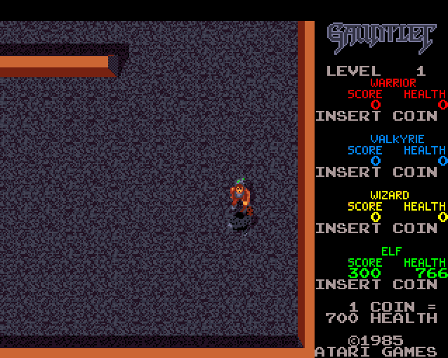

# Gauntlet (Atari Games, 1985) on the Atari STE



STE port of the MAME set `gauntlet` (rev 14; driver `atari/gauntlet.cpp`). Unlike the other ports nothing is
translated: the arcade's main CPU is an MC68010, and its own program runs on the STE's 68000, patched in place; the
sound board's 6502 does not run: its driver is modelled at the level of its voices (music and effects on the YM2149,
speech synthesized offline and played by the DMA sound), and its four replies to the main CPU come from the runtime.
The picture is 320 of the 336 pixels (the side panel moved left), all 240 lines, 16 colours by the shared default
fitter with checker pairs. Status: Verification pending (full-game Hatari verification pending). Latest speed (Hatari,
4 MB, 2026-10-26, a scripted game in level 1 and the attract mode): the game's logic at the arcade's 60 frames a second
(98-100% of the arcade's 59.92 Hz), 32.6 pictures a second in light play, 16.0 in the attract mode (busy scenes cost
up to twice as much). Needs a 4 MB STE and the whole machine: the program takes TOS's memory, so **Esc resets** the
STE (there is no return to the desktop and no CRASH.TXT; a crash turns the screen red and keeps its record at
$3C1000).

## Build and run

```sh
python port.py prepare gauntlet              # verify assets/roms/gauntlet.zip, unpack to assets/roms/extracted/gauntlet/
python port.py cover gauntlet                # the coverage the patcher starts from (~10 minutes)
python port.py build gauntlet                # run/gauntlet/GAUNTLET.PRG (--sim: run/gauntlet_sim/ for the tests)
python port.py test gauntlet                 # logic (attract, seeds 1 and 12), pictures, sprites, the sound player
python games/gauntlet/tools/logic_test.py 8000 --seed 12 [--level 9]   # the patched program against the original
python games/gauntlet/tools/render_test.py --seed 1 [--level 7]   # the pictures against the reference renderer
python games/gauntlet/tools/sprite_test.py   # objects at every edge, 16 shifts, holes, shadows, 64 KB crossings
python games/gauntlet/tools/sound_test.py player|driver|mame|hatari   # the sound player against its model, the driver, MAME
python games/gauntlet/tools/sound_hle_test.py   # the sound board's model against the 6502 (the replies, the coins)
games/gauntlet/tools/shots.sh tap:5@20 down:x@22 up:x@24 shot@30   # its own Hatari: keys (scancodes), shots, dumps
python games/gauntlet/tools/mame_roms.py     # build/gauntlet/mame_roms/: the set as MAME 0.289 wants it (-rompath)
python games/gauntlet/ref/mame_cmp_gauntlet.py [frame ...] [--keep DIR]   # the reference board against MAME 0.289
python games/gauntlet/ref/trace_cmp.py main|sound F0 F1 [--keep DIR]   # one CPU against MAME's trace
```

Supply `assets/roms/gauntlet.zip`: the 20 files of MAME's `gauntlet` under MAME's names (`docs/rom_manifest.json`
has their sizes, CRCs and SHA-1s). All match MAME 0.289 but `136037-104.6p`, the alphanumerics: the archive has the
8 KB dump of the 27128, MAME lists the whole chip (16 KB, the second half $00, crc32 6c276a1d), so
`tools/mame_roms.py` writes MAME a copy padded with zeros. Nothing ROM-derived is in git: the patched program, the
boot state, the graphics and the sound data are made in `build/gauntlet/`. Paths are relative to this folder;
`engine/`, `tools/`, `port.py` and `docs/` at the top are the repository's.

## Controls

**5 / 6 / 7 / 8** coin 1-4 (players 1-4), **arrows** move, **Space / Control / Z** fire, **Alternate / X** magic, which
also **starts** (after a coin), **Esc** resets the STE. Joystick 1 player 1, joystick 0 player 2. Jaguar pad /
PowerPad: pad A player 1, pad B player 2, **A** fire, **B / C** magic, **Option** coin.

## State

* Logic: the patched program equals the original VBL for VBL (`tools/logic_test.py`): attract mode and random plays of
  1-4 players, 8,000-15,000 VBLs each, and in levels 3-30 (`--level`); after the 2026-10-29 interrupt change
  `logic_test` 3000 (attract), 8000 `--seed 1`, 8000 `--seed 12` equal.
* Picture: `tools/render_test.py` 4,950 pictures, 0 differ (2026-10-17, before the checker pairs; the 2026-11-05
  rollout checked 4 gameplay pictures and 307 sprite pictures with them); `tools/sprite_test.py` 305 pictures, 0
  differ.
* Sound: the 68000 player against its model 72,802 ticks, 0 differ; the model against the real driver per channel
  and tick (4-9% of the sounding channel-ticks differ: a retrigger carries the FM envelope over, sub-tick timing);
  pitches against MAME's audio; a Hatari recording.
* The reference board equals MAME 0.289 (both CPUs' traces, memory, pictures, sound commands) in the attract mode.
* Hatari, 3000 VBLs (2026-10-29): no frame with a closed border.
* Not checked yet: play (coins, start, the levels) against MAME; the EEPROM's writes (the high-score table) beyond the
  attract mode; full-game Hatari verification.
* Speed: busy scenes (the attract mode's title, three-player levels) cost up to twice a light scene's picture.

## How it works

### The board and the reference

* **Main**: MC68010 at 14.318181 MHz / 2. `engine/m68kmame.py` is MAME's own Musashi: the build takes MAME 0.289's
  core sources (`m68k_in.lst` through MAME's `m68kmake.py`, the functions of `m68kcpu.cpp` a 68010 needs, unchanged;
  downloaded from github.com/mamedev/mame, tag mame0289, into `build/mame0289/`) and compiles them outside MAME with
  a stand-in for MAME's framework (`engine/m68kmame/emu.h`) and a C interface (`glue.cpp`: 4 KB pages of RAM / ROM /
  unmapped / callback with mirrors, the board's callbacks through ctypes, an instruction hook, a trace buffer,
  coverage per instruction). The copy of MAME in F030Arcade is 0.286 with local changes and its 68010 differs (0.289
  counts no per-bit shift cycles below the 68030).
* **Slapstic** 137412-104 (`mame/atari/slapstic.cpp`): MAME taps the whole program space, so every bus access of
  the 68010, opcode and immediate fetches included, is tested (a read after the access, a write before). The state
  machine runs in `glue.cpp` on the tests `tools/machine.py` builds (MAME's checker); a bank change points the
  window's pages ($38000-$3FFFF, the 8 KB bank four times, and its mirrors) at that bank's copy.
* **Sound**: MOS 6502 at 14.318181 MHz / 8, `engine/m6502mame.py` (generated from MAME's `om6502.lst` by
  `engine/m6502mame_gen.py`: every bus access on MAME's cycle, dummy reads and writes too, resumable inside an
  instruction at a slice's end). YM2151 (timers and status: `engine/m72board.py`'s model; its IRQ is not
  connected), POKEY (`engine/pokey.py`: an execute device of its own in MAME, run after the 6502; a read or write
  is a synchronize()), TMS5220C (`engine/tms5220.py`: the FIFO, the frame parsing, the ready line; its stream is
  rendered at the CPU's reads and writes, its io_ready timer and the 50 Hz sound update). The audio itself is not
  made. Both latches are MAME's generic_latch_8 (a write lands through a synchronize() timer); a sound command
  raises the 6502's NMI and a perfect quantum (the second smallest CPU minimum, 0.56 us) for 100 us.
* **Interrupts**: IRQ 4 at the vertical blank's start (acknowledged by a write to $803140), IRQ 6 while a sound
  response is pending; the 6502's IRQ from the scanline timer on lines 32, 96, 160 and 224.
* **Scheduler** (`tools/machine.py`): MAME's timeslice() in integer attoseconds, the default quantum (1/60 s), the
  three executing devices in device order (maincpu, audiocpu, pokey), the screen's timers (vertical blank begin and
  end, line 0), the scanline timer, the sound manager's 50 Hz update. About 6 ms an arcade frame without the sound
  CPU's devices, 13 ms with them (the 68010 runs native).
* **Memory** (main CPU): ROM $000000-$00FFFF and $040000-$04FFFF (the "BIOS" and the game; the interrupt vectors jump
  through $40000), the slapstic window $38000-$3FFFF, work RAM $800000 (unused in the attract mode: the program's
  variables and stack are in the spare video RAM at $904000), the EEPROM $802000, I/O $803000, video RAM $900000
  (playfield, motion objects, spare, alphanumerics, y scroll at $905F6E, SLIPs), palette $910000, x scroll $930000.
* **Video** (`tools/video.py`, gauntlet.cpp + atarimo.cpp): the playfield 64 x 64 tiles of 8x8 (512 x 512,
  scrolled), the motion objects (linked lists through the SLIP table, 8-line bands; pen 1 is a shadow: it flips the
  playfield colour's bit $80), the alphanumerics 64 x 31 on top; 1024 pens IRGB_4444; 336 x 240 visible at 59.92 Hz.

Checked against MAME (`tools/machine.py`, `ref/mame_cmp_gauntlet.py`, `ref/trace_cmp.py`):

* **Both CPUs exact** against MAME's debugger trace (address, cycle count; the 6502 also its registers): the main
  CPU frames 0-3, 380-420 and 9000-9010 (about 660,000 instructions), the sound CPU frames 370-400, 600-800 and
  9000-9100 (2.9 million, from its release from reset).
* **Memory and pictures**: `ref/mame_cmp_gauntlet.py` from power-on at 43 frames through 19801 (two loops of the
  attract mode: the demo play in the mazes, the monster pages, the high scores, the title): work RAM, video RAM,
  palette, the sound CPU's RAM, the x scroll and every sound command equal; the reference renderer on MAME's memory
  and the board's own picture both 0 differing pixels and 0 differing pens.
* `engine/m6502mame_test.py`, `engine/pokey_test.py`, `engine/tms5220_test.py`: the cores and chips against logs
  of MAME's gauntlet (every bus access of 613,395 sound CPU instructions, every opcode, all decimal ADC / SBC; 2.3
  million TMS5220 accesses with 15 internal fields; 116,000 POKEY accesses with its counters and polynomials).

### Translation

Nothing is translated: the program is the arcade's, patched in place (`tools/patch.py`, `tools/boot.py`,
`src/gauntlet.s`).

* **The ROM where it was**: the patched program (`build/gauntlet/program_ste.bin`) is copied to $000008-$04FFFF, its
  arcade addresses, so no code address, jump table or return address changes. What the STE has no memory for moves
  below 4 MB, with only the high byte changed ($90xxxx -> $3Fxxxx video RAM, $91 -> $3E palette, $80 -> $3D work RAM,
  EEPROM and I/O, $93 -> $3C x scroll): the game keeps the low words of pointers and builds them again (the EEPROM's
  offset from A1's low word), keeps flags in their top byte ($01904DD4) and adds to them ($984DCA, a mirror). The
  patcher rewrites every absolute operand and long immediate that names those areas in the code (the coverage's
  instructions and recursive descent from them: 1,904 places), the long words of a few data tables ($D800, $9DE6, the
  BIOS's tables), and not two `movea.l #$800002` that are packed constants. The descent follows the program's jump
  tables (`move.w (d8,pc,dn.w),dn; jmp (2,pc,dn.w)`: 7 of them). An address the patcher missed is above 4 MB on the
  STE: a bus error, never a silent wrong access.
* **I/O**: the few I/O sites become calls of the runtime (the sound command, the sound CPU's reset bit) or plain RAM
  (inputs, status, watchdog, IRQ acknowledge). The slapstic's bank switch routines become calls that copy the selected
  8 KB bank into the window's first mirror $38000-$39FFF, the only one the game reads (the others see only the
  slapstic's own accesses), with the interrupt mask lowered to 5 (Lessons, 2026-10-29).
* **The runtime** is linked at $50000, behind the program (`src/loader.s` moves it there out of the .PRG); the MFP's
  vectors are at $280 ($100-$27F is the BIOS's jump table the game calls).
* **The writers' marks**: the playfield's writers (three routines writing a maze cell's 2 x 2 tiles, the clear
  routine) call runtime stubs (`SITES` pf_blk_*, mem_clear) that mark the quarter columns (16 tile rows) they write;
  the alphanumerics' 17 writing routines (the BIOS's text, the panel, the high-score entry; logged on the reference
  board) each have one instruction replaced by a call of a generated hook (`HOOKS`, build/gauntlet/hooks.i: the
  mark, the instruction's own bytes, rts). The renderer compares only what was marked (the playfield: the window's
  quarters of a marked column), and one playfield column and one alphanumerics row a picture in turn, so a writer
  the lists miss would show within about a second, not never. `tools/logic_test.py` checks that every change was
  marked by the time the game waits.
* **The boot**: the STE starts where the BIOS hands the game over (`jmp $40000`, frame 378: the self-tests, whose ROM
  checksums would fail on the patched image, and six seconds of waiting are behind it), from the state the reference
  board has there (`tools/boot.py`: memory, registers, slapstic bank; the BIOS's own pointers relocated).
* **Checked** (`tools/stemodel.py`, `tools/logic_test.py`): the original program (arcade map, the real slapstic) and
  the patched one (the STE's map) run on the STE's schedule on two instances of the 68010 core, VBL for VBL (a VBL
  after a fixed number of the program's instructions, not counting the patched sites): the video RAM, palette, work
  RAM, EEPROM and the sound commands equal (a pointer and its STE form count as equal; the dead stack below SP is
  left out), and every change of the playfield and the alphanumerics marked. The coverage (`ref/cover.py`) runs on
  the same schedule, plus the BIOS's boot on the reference board.

### Schedule

Two threads. The picture is the foreground; at each VBL the runtime delivers the game's IRQ 4 (its handler at $34A)
and switches to the game's own thread, which runs until it waits for the next frame: its two wait loops are TRAPs (#14
at $40C28 in the main loop, #13 at $40F88), which switch back. A VBL that comes while the game still runs only
delivers the IRQ 4, as the arcade does. The arcade's 60 Hz: every fifth VBL a sixth IRQ 4 is due, given when the game
next waits at TRAP #14 (its next frame then follows at once; the main loop takes one frame per IRQ 4 while it waits
and loses one that comes while it runs, as on the arcade; `-D TICK50`: one a VBL). The VBL's own work (the picture's
flip, the inputs, the sound) runs on its own stack: the game's lives among its variables in the video RAM.

**The sound board's replies** (`src/sound.s`, `tools/sound_hle.py`): the main CPU only needs four replies: the coin
counts ($03, 2-bit counters per slot, one count a key press), the sound watchdog's ping ($07: 0), a service query
($06) and $FF after a sound reset. They come as the game's IRQ 6 when its frame is done (at the TRAPs) or at the VBL
before its IRQ 4 (`irq6_chain`, at mask 5); a reply at once would miss the BIOS's block pointer, which it sets after
the write: credits doubled. `tools/sound_hle_test.py` checks the protocol against the 6502 on the reference board.

### Picture

`src/render.s`, `tools/assets.py`: 320 x 240 with the top and bottom borders open: the maze is the arcade's x 8-231 at
the STE's 0-223, the panel (the alphanumerics' columns 30-41, the arcade's x 240-335) at 224-319.

* **Playfield**: the 512 x 512 torus kept as a bitmap in STE planes, P, and P' in the shadow colours (pens
  $200-$27F); a tile is drawn into both when the game changes it in the visible window (compared with a copy where the
  game's writers marked it) or when its colours map to other STE colours. Two display rings of 56 words x 880 lines,
  drawn in turn, shown with the hardware scroll (base address, $ffff8265, $ffff820f); every ring position shows a
  fixed place of the torus, so moving the window copies only the strip a ring has never held (with the full-word
  copy dispatcher, 2026-10-19), and a ring copies from P only the damage (objects, characters, the panel's old place).
* **Alphanumerics**: drawn per changed character into a 320 x 240 image; runs of opaque characters (the panel is one
  rectangle) are copied into the ring with the Blitter at the fine scroll, kept when the ring's place and the
  characters are unchanged; transparent characters by the CPU through their pixel masks. Shifted panel and shadow
  copies look up their piece sizes.
* **Motion objects**: as MAME, each band of 8 lines from its SLIP entry along the links; an object is drawn whole
  when every band it covers lists it. Drawn whole into the hidden margin left of the window and the guard lines; the
  panel covers their right overhang. Baked on first use per (code, size, flip, palette, the palette's colour
  mapping) into a 400 KB pool as 32-pixel strips; a row is one HOG OP 3 copy pass (Y count 4, the opaque mask in
  END1-END3, the END registers written only when the mask changes, the source address running on). Shadow pixels
  (pen 1: the playfield's colour with bit 7 flipped) are a pass per row from P' at the same place, so they are exact.
* **Full-width screens**: when the panel's characters are not all opaque (the title, the high scores), the arcade's
  x 240-335 of the playfield and the objects are composed in a separate buffer and copied in.
* Every Blitter pass is HOG and at most 256 bus cycles (`BLIT_STATS=256`).

### Colours

16 by the shared default fitter with checker pairs (2026-11-05; `engine/palette_native.py`,
[colours.md](../../docs/colours.md#the-default-fitter-enginepalette_quantizepy-r-type-2026-11-05)) over the sampled
play's RGB counts in `docs/colour_training.json`, with the four player colours fixed (red, blue, yellow, green); the
pairs are baked in source coordinates. Every IRGB word maps to a pair of STE colours drawn as a checker (`irgb_map`),
the text and HUD glyphs to one (`irgb_map_flat`: +64 KB; the 128 KB alpha tables moved into the BSS below the fixed
buffers at $200000). Black stays slot zero; gameplay and graphics priorities are unchanged. When a pen's colour
changes, what uses it is drawn again. The fitter replaced the k-means palette of `ref/palette_fit.py` /
`docs/palette.json` (mean error 4-5 of 255 a channel).

### Sound

`tools/sound.py`, `src/sound_out.s`, `tools/sound_test.py`. The 6502's driver modelled at the level of its voices: 12
logical channels (POKEY 0-3, YM2151 4-11), 30 voices; a sound starts one voice per channel of its chain (the driver's
tables $5F36 / $63E2, channel $6166, priority $5FBE), a voice of equal priority replaces the old one, lower ones keep
running underneath. $01 / $02 set the floor (the attract mode sends $01: only the title music $42 and priority-63
sounds there); speech has an 8-deep queue by priority and lowers the YM / POKEY gains while it speaks; $DD-$E0 the
mixer, $43 / $48 fades.

* **Recordings**: each sound alone on the reference board at 50 Hz (the music keeps its tempo at the STE's speed).
  POKEY channels become tone or noise; YM2151 loudness from the carriers' envelopes, the timbre from rendering all
  four operators and matching the spectrum to a square wave, YM noise or both (many effects are feedback-7 FM
  noise); voice lifetimes from the driver's lists plus the chip's release; loops where the driver's voice tables
  repeat. On the YM2149 the 3 loudest of the 12 channels each tick.
* **Speech**: 141 phrases synthesized with MAME's TMS5220 lattice filter (0.998 against MAME's waveform), at 6258 Hz
  as 4-bit ADPCM (428 KB for 137 s; 8-bit PCM would need 857 KB), decoded 64 bytes a VBL into a buffer the DMA sound
  plays once.
* Memory ~520 KB in all; `snd_out_vbl` (on its own stack) ~1,600 cycles a VBL, 12k at the 99th percentile.

## Speed

| date | setup | logic | pictures/s | Musashi (CPU + Blitter) |
|---|---|---|---|---|
| 2026-10-26 | Hatari 4 MB, scripted game, level 1 | 60 arcade frames/s (98-100% of 59.92 Hz), ~25-50% of a VBL | 32.6 | |
| 2026-10-26 | Hatari 4 MB, attract mode | 60 arcade frames/s | 16.0 | |
| 2026-10-26 | Musashi, `render_test.py --first 1300 --frames 1600 --every 1` (300 pictures) | | | level 5, three players: 189.8k a picture (median 167.3k); level 2, one player: 138.1k (median 115.6k) |

Musashi, by scenario: 115k-390k cycles a picture in play (median by scenario), about 10-12k an object with its
restore; the attract mode's title (about 260 fading objects, baked again each picture) is the slowest. Per picture in
level 5: object rows 32k, the object list 29k, shadow rows 27k, baking 18k, Blitter copies (restores, the panel) 18k,
comparisons 16k.

What made it fast, newest first:

* 2026-10-26: the arcade's 60 Hz (it ran one frame a VBL: 83%), and the writers' marks: the playfield and the
  alphanumerics compared only where the game's writers marked them, the picture 18-26% cheaper in play: level 5 with
  three players 230.2k -> 189.8k a picture (median 208.8k -> 167.3k), level 2 with one 179.2k -> 138.1k (median
  157.2k -> 115.6k); the comparisons 52k -> 16k. Hatari: pictures 15.8 -> 16.0 a second in the attract mode, 23.4 ->
  32.6 in light play.
* 2026-10-19: incoming playfield strips through the full-word copy dispatcher, shifted panel / shadow copies with
  their piece sizes looked up ([measurements](../../docs/virtual-scroll-performance.md#implementation-results)).

Measured, not kept: the reordered-source variant of the objects (`-D MO_ORDER=1`) measured slower
([sprite-preparation.md](../../docs/sprite-preparation.md#what-the-ports-found)).

Techniques other ports use that may apply:
[speed.md](../../docs/speed.md#techniques-that-look-applicable-elsewhere-2026-11-07).

## Tests and tools

* `tools/logic_test.py [frames] [--seed N] [--level L]`: the patched program against the original, VBL for VBL, and
  the writers' marks (above).
* `tools/render_test.py [--seed N] [--level L] [--first F] [--frames N] [--every K]`: the STE picture equals the
  reference picture through the palette, pixel for pixel (attract mode, play in any level, consecutive pictures in
  both rings); the harness generates its fixed map without program coverage.
* `tools/sprite_test.py`: objects at every edge, all 16 shifts, both flips, 1-8 tiles wide, holes and shadows,
  priority, partial band lists, the transparent panel, 64 KB crossings.
* `tools/sound_test.py player|driver|mame|hatari`: the 68000 player against its Python model, every tick; the model
  against the real driver per channel and tick; pitches against MAME's audio (the right pitch wins for every piece);
  a Hatari recording. `tools/sound_hle_test.py`: the replies and the coins against the 6502.
* `tools/shots.sh`: its own Hatari (the F030Arcade build; not `tools/hatari.sh`, which stops every running Hatari):
  scripted keys (a letter, digit or ST scancode), screenshots, memory dumps (`dump:0xADDR:0xSIZE`); `PRG=`, `OUT=`.
* `ref/mame_cmp_gauntlet.py`, `ref/trace_cmp.py`, `tools/mame_roms.py`: the reference board against MAME 0.289.

## Lessons

### 2026-10-29: the slapstic's bank copy and IRQ 6 held back the borders

Borders stayed closed in ~4% of the attract mode's pictures (Hatari trace). The bank switch copied the 8 KB bank into
all four mirrors (32 KB, ~170k cycles, more than a frame) with the caller's mask 7; it is rare (a few dozen times in
15,000 frames) but ~3 in a frame when it comes. It now copies only the first mirror, at mask 5: coverage with the
mirrors as regions of their own (10 seeds x 15000 frames) shows the game reads only that one; the others see only the
slapstic's own accesses ($416C0-$416EA, $4FED0), whose reads feed nothing but a write the arcade's ROM loses
(`tools/stemodel.py` copies the same). The game's IRQ 6 ran at mask 6, holding Timer A back ~3 lines (a few replies
kept the top border closed in ~2% of the attract mode's pictures); it now runs at 5: the game's interrupts all come
through the VBL (level 4), still masked; the MFP's (borders, keyboard) never enter the game. Hatari, 3000 VBLs: no
frame with a closed border.

### 2026-10-26: jump tables the coverage had not reached

The patcher's descent did not follow the program's jump tables; their cases held 88 window addresses the coverage had
not reached, and level 12 ended in a bus error. It follows the 7 tables now. Because a missed address lands above
4 MB, the miss showed as a bus error, not as a silent wrong access.

## Verification

Lock-step of the patched program against the original over attract mode and random plays of 1-4 players in levels
3-30, the reference board against MAME's traces and memory over two loops of the attract mode, the picture and sprite
tests, the sound tests and a Hatari recording; Hatari runs of the attract mode and scripted level-1 play. No full
playthrough, MARP replay or play against MAME yet.

Full-game verification follows the [status policy](../../docs/port-status.md); nothing here claims a complete playthrough.
