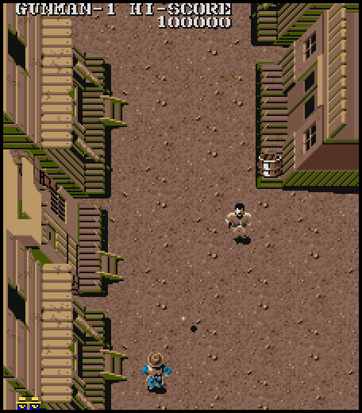

# Gun.Smoke (Capcom, 1985) for Atari STE



MAME set `gunsmoke`. The main Z80 program (fixed ROM and four 16 KB banks) is
statically translated to 68000 code and runs on an unexpanded 8 MHz, 4 MB Atari STE
with keyboard and joystick input. Graphics use a fixed 16-colour Oklab palette; the sound
driver's effects and music play on the STE's YM2149 (see "Sound").

```sh
python port.py prepare gunsmoke      # verify the 32 ROMs, build the MAME regions
python port.py cover gunsmoke        # coverage: 14 seeded runs of 20000 frames (~3 min, needed by the build)
python port.py build gunsmoke        # -> run/gunsmoke/GUNSMOKE.PRG (ROMs and graphics embedded)
python port.py test gunsmoke         # reference, lock-step translation, renderer against the reference
python port.py mame gunsmoke         # the reference renderer against MAME's own picture (needs `mame`)
games/gunsmoke/tools/bench.ps1       # Hatari speed (Windows): ticks and frames a second
```

Controls: **5/6** insert coins, **1/2** start, **arrow keys** move, **Ctrl** or **Z**
shoots left, **Space** or **X** straight, **Alt** or **C** right, **Esc** quits.
Joystick port 1 plays player 1, port 0 player 2 (fire shoots straight). Wait for the attract mode
before inserting a coin.
Jaguar pad / PowerPad (STE enhanced ports, `docs/architecture.md` "Input"): pad A player 1, pad B player 2, the D-pad moves, **A / B / C** shoot left / straight / right, **Option** coin, **Pause** start, keypad **1/2** start, **5/6** coin, **\*** + **#** quit.

## The reference machine

`tools/machine.py` (MAME `capcom/gunsmoke.cpp`): memory map, the four ROM banks (C804
bits 2-3), the sprite latch (C806 copies F000-FFFF), the protection reads C4C9-C4CB,
DSW defaults. **SYSTEM bit 3** is MAME's `IPT_CUSTOM` "VBLANK" without a read callback:
it always reads 1. The first version of the reference returned the real vertical blank
there; the interrupt handler skips its whole body when it reads 0, so the game never
left its first screen (the MAME picture checks did not notice: they render MAME's state).

The program is a cooperative kernel like 1942's: eight tasks at EF80, a scheduler at
00AD-00CE, tasks sleep with `call 0110`. `run_frame_port` is the runtime's schedule:
when the scheduler has found no ready task (00CE) the interrupt (RST 38) runs to
completion, returning to the scheduler's scan at 00B0, and the tasks it woke run until
it idles again.

## The translation

`tools/gen.py` translates the fixed ROM and the code of banks 0 and 2 (8294
instructions, `z80x.FAST`) with virtual pcs per bank, as Black Tiger's generator does:
a jump from fixed code into the window dispatches by the current bank, `ret` and
`jp (hl)` go through `gs_dispatch` with the natural pc. Every indirect read checks for
the window (`(hl)`, `(de)`, `(bc)`, `(ix+d)` and `(iy+d)`: with `FAST`, IY is the low
word of a2, which the first version did not check: `ld a,(iy+7)` read RAM instead of bank
2 at frame 683). Stores are not checked. The bank latch and the layer latch share one
`ld (de),a` (0295 / 02B1), which calls `gs_latch` after the store. E0F8 is a trampoline
the program writes into RAM (`call nnnn / ret`, the round scripts' code): it is native
(`gen.TRAMPOLINE`), and coverage records where computed jumps went (502 entries). The
33 instructions that write the text RAM set `fg_written`. The service mode (code in bank
3) is not translated.

Coverage (`ref/cover.py`): seeds 1-3 play from the attract mode, seeds 4-14 use MAME's
cheats (infinite lives, invincibility, the start round, one-hit bosses) to start at
rounds 1-10 and the ending. The start round cheat patches an instruction's operand
(`ld hl,$8068` at 08C5), so `logic_test.py --seed` patches the same operand in the
translated `move.w #$8068,d3` too (setting the pointer in RAM after a tick is too late:
the round's data is read within the tick). Random play with infinite lives alone never
gets past round 1's boss.

## The renderer

`src/render.s`, the method of Commando's renderer (`docs/porting-guide.md`,
"Scrolling with virtual screens"):

* **Background**: 32 x 32 tiles from the map ROM (2048 columns of 8 tiles), a function of
  the scroll registers alone: D800/D801 along the screen's vertical axis, D802 the map
  rows' horizontal offset. Both axes scroll in hardware. Vertically, three display buffers
  are virtual screens with twin lines (Commando's method); the twin period is 320 (a band
  of 288 lines plus 32 for the overhang of whole 32-line tiles), with 32 lines above and
  below for the twins of tiles that cross line 320. Each buffer draws the tile rows that
  scrolled into its band since it was last drawn, and blacks the side bars of those line
  pairs (they may hold what an earlier window position drew there).
* **D802 in hardware** (Black Tiger's method): the tiles stay where they are on the
  512-pixel lines (map row k at x = 32 + 32k, and 256 further for the wrap), and D802 moves
  the Shifter's window: the video address by chunks, `$ffff8265` by pixels, the line
  width `$ffff820f` 4 words less when the fine scroll is not 0. The game slides D802 0 ->
  48 a pixel a frame at each round's poster and jumps back to 0: a buffer whose window
  moved draws only the columns that came into it (a word of each tile a blit, FXSR and
  skew) and blacks the columns that went into the side bars (`hw_strips`). A slide frame
  costs 238k cycles (821k with a band redraw, 441k with the earlier in-place shift of the
  buffer). D802 above 192 (never seen) moves the tiles instead, and a change there redraws.
  Background on/off and jumps of more than 200 lines redraw the band (about 1M cycles).
* **The screen shows 48 pixels on each side of the 224-pixel window**: whole tiles and
  sprites drawn into the side bars would be visible there, so each tile that reaches a
  side clears its part there and each sprite over a side clears its 16 lines of 16 pixels
  (masked: the window's edges are anywhere in a word); the damage list restores them from
  their black twins. `render_test.py` checks the bars.
* **Sprites** (128, entry 0 on top, 2048 codes, a y flip that mirrors on the screen):
  `tools/assets.py` generates the Blitter routines and mask streams of
  `games/1942/tools/spritegen.py` for the shapes (code, flip) the coverage drew most,
  within 900 KB: 1074 of the 1818 shapes seen, 96.5% of the draws. All 2008 shapes would
  take 2.85 MB. The other shapes go through `any_part`: the same Blitter calls, a row at
  a time, the end masks made from the shape's opaque rows (stored with the baked sprite).
* **Text**: a strip per text row (15 chunks of 8 lines and the opaque pixels as a plane),
  composed with `movep.l` from the baked characters when the row changes, drawn at the
  window's pixel offset with the Blitter: NOT mask AND screen, then the four planes ORed
  in (8 blits a row, only its chunks with characters); `movep.l` alone could only write at
  8-pixel steps. The transparent pens of a colour are those the lookup PROM marks $4F.
* **Baking**: tiles, sprites and characters are kept as pixel-value bit planes; a miss
  of the hashed cache makes the 16 pen masks of each row and a generated routine per
  colour bank ORs them into the four STE planes. One pool per kind.
* **Timers and HOG blits**: a HOG pass holds the CPU and its interrupts; started near the
  VBL or a timer event it made a border stay closed or the palette come late. The border
  code (`engine/rt/borders.s`, shared by the Blitter ports) has each event come early and
  sync itself to the video, so no pass waits: Timer B fires 2 lines before the palette on,
  the bottom border and the palette off and polls its counter to the exact line end; the
  bottom border event starts Timer A for the next frame's top border (line-exact, so a
  late VBL does not move it), which fires ~3 lines early and picks the right HBL by
  reading Timer A. A pass may hold the CPU only ~1.5 lines: `blit_go` runs passes over 32
  words in pieces (64-word pieces still let a palette event start late now and then). The
  palette off is line-exact now (the last picture line was sometimes black from a varying
  x before). The DEBUG build counts late events (`bench.ps1`: 0 in 6000 VBLs; `-D
  BD_PCLOG=1` logs the interrupted PCs of late events). The VBL writes the video counter
  too (the STE loads the base into it before the VBL: without it a frame showed the
  previous buffer's address under the new fine scroll, 3 pixels off, as Black Tiger found).

Memory: 3.07 MB of program, data and buffers on the 4 MB machine.

## Speed (2026-10-09)

`tools/bench.ps1` (DEBUG + AUTOPLAY build, 6000 VBLs in Hatari, boot and attract
included): 53-54 game ticks a second (~90% of the arcade's 59.6) and 26-28 drawn frames a
second (the autoplay run differs from build to build). `render_test.py` (Musashi, CPU + Blitter): a frame of consecutive play costs
84-380k cycles (median 89k in round 1, 251k in round 3), a frame of a D802 slide 238k, a
full redraw about 1M (the scroll sweep, with tile offsets above D802 192, 1.5-1.8M).

Short Blitter passes (2026-10-11): no HOG pass is longer than ~256 bus cycles (`engine/rt/borders.s` `blit_go`: the
masked foreground passes now run in pieces of 16 words), so the top border interrupt is never held back long.  Hatari
(DEBUG + AUTOPLAY, 6000 VBLs, sound on): 50.6 -> 48.9 game ticks and 24.2 -> 23.0 drawn frames a second; no border
event started late in that run.

## Sound (2026-10-11)

The sound board (MAME `capcom/gunsmoke.cpp`): a Z80 at 3 MHz, two YM2203 at 1.5 MHz, four IRQs a frame.  Its driver is
Capcom's of Commando (the same code at other addresses), so the port uses the engine's generalisation of Commando's
method, `engine/capsnd.py` (recording, models, checks) and `engine/rt/capsnd.s` (the 68000 player): translating the
driver would cost about 3,800 Z80 instructions a frame.  `tools/sound.py` describes the driver (RAM C000, latch C800,
the command table at 0085, the effect slots C500-C580 / C600-C680, the music slots C100-C400) and records:

* **Effects** (29 commands, the SSG only): each recorded alone in the four phases of the IRQ counter, a stream of the
  SSG registers per IRQ.  This driver has five slots a chip, and its output ends the lower slots under the one shown
  unless their byte 31 is $FF (0A97 / 0C54; an effect opcode sets it, 077A, and nothing clears it): the byte is
  recorded with the registers, the player keeps it per slot.
* **Music** (32 tunes, FM only): each channel of each tune recorded alone through `engine/opn.py` (the YM2203's
  envelopes after ymfm) as a YM2149 period and volume per tick, with its own loop (confirmed over a period more) or the
  release of its notes as a tail.
* **Stops**: found by running every command's handler (00 / 1E clear the lower four effect slots, 1F the music).

`build/gunsmoke/cs_data.s` holds 87 KB of streams.  The STE runs the driver's four IRQs of a tick and the music's tick
when it delivers the game's tick (`z80_hook`), then writes the YM registers that changed: the chip whose shown effect
started last, the loudest music channels on the YM channels it leaves.  About 8,000 cycles a tick in the game's play
(Musashi; ~5% of the CPU at 54 ticks a second). Hatari (DEBUG + AUTOPLAY, 6000 VBLs): 50.6 game ticks and 24.2 drawn frames a
second; the same build without the sound (`-D NOSOUND=1`) 52.7 and 26.1.

Checks: `sound.py check 6000` runs the real driver beside the model: the music streams through the decoder 0 of
379,557 channel ticks differ; the effects with random commands 26 of 48,000 chip-IRQs differ audibly and with the
game's own commands (`ref/cover.py`'s play) 14 of 48,000: the noise period at an effect's first IRQs, left by the
effect before (another 300-400 differ only in registers of silent channels).  `sound_test.py` (in `port.py test`):
the 68000 player against the model, 0 of 20,000 ticks differ.  Hatari: the attract music and the play's effects in a
recording (`--sound 44100 --avirecord true`).  `build.py --sound` records again (~15 min on 8 cores).

## Validation

* All 32 ROM files pass the checked-in MAME CRC32/SHA1 manifest.
* The reference renderer and palette matched MAME's screenshots exactly at frames 100,
  700, 1500, 2500, 4000 and 6000 and in play (checked on the machine with MAME 0.289; this
  Windows machine has no current MAME, so the VBLANK fix of the reference is checked
  against the driver source and the attract mode, not a MAME run).
* `logic_test.py`: the translation equals the reference (RAM, video RAM, latches, bank,
  sprite latch, every text RAM change flagged) for 6000 frames each of seeds 1, 2, 4, 5,
  6, 9, 12 and 14: attract, coin, start, play, deaths, rounds 1, 2, 3, 6, 9 and the
  ending.
* `render_test.py`: pixel exact through the colour map in consecutive play (rounds 1, 3,
  7, the ending), spaced samples (rounds 6, 9), a sweep of S and D802 over their range,
  and whole sprites at the window's edges; the side bars stay black; consecutive frames
  through the D802 slides of rounds 1 and 7 (the window at every pixel offset 0-48).
* Hatari (F030Arcade build, STE, 4 MB, TOS 2.06): attract mode, coin, start, the round
  poster with its sideways slide (screenshots in the middle of it: the fine scroll), play;
  57 screenshots (6 in the middle of the slide) without a dropped or shifted picture,
  colour in the side bars or in the line above the picture.

Not done: the flip screen (the DIP switch is upright), the service mode. The last
line of the picture is sometimes black from a varying x on: Timer A's palette off comes
in that line (seen in Hatari screenshots before and after the hardware scrolling).
