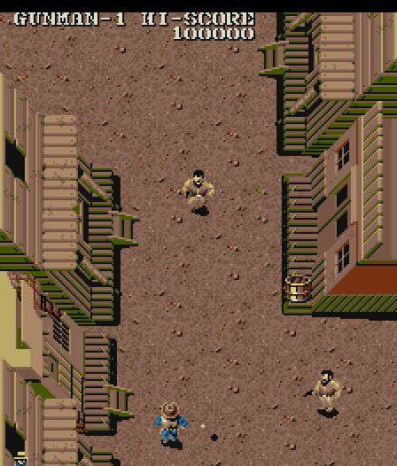

# Gun.Smoke (Capcom, 1985) on the Atari STE



STE port of MAME set `gunsmoke` (driver `capcom/gunsmoke.cpp`) for an 8 MHz STE with 4 MB and no accelerator.  The
main Z80 program (the fixed ROM and the code of four 16 KB banks) is statically translated to 68000 code, with window
guards at the coverage's sites, inline leaves and a native trampoline; the sound Z80 and its two YM2203s are not run:
the driver's effects and music are recorded per command and played on the YM2149.  The picture: the background
scrolled in hardware on both axes (twin-line virtual screens, D802 by the Shifter's window), 128 sprites by generated
Blitter code, the text as OP 3 copy passes, one 16-colour palette from the shared fitter with checker pairs.  Status
**Verification pending**: full-game Hatari verification is pending; flip screen and service mode are not done.
Speed (Hatari, recorded play, 4 MB, 2026-10-24): logic 92% of the arcade's 59.6 frames a second (about 54.8 arcade
frames a second), 25.8 pictures a second; the Musashi gains of 2026-11-02 (pictures -3.4%, logic -1.4%) are not
measured in Hatari yet.

## Build and run

```sh
python port.py prepare gunsmoke      # verify the 32 ROMs, build the MAME regions
python port.py cover gunsmoke        # coverage: 14 seeded runs of 20000 frames (~3 min, needed by the build)
python port.py build gunsmoke        # -> run/gunsmoke/GUNSMOKE.PRG (ROMs and graphics embedded)
python port.py test gunsmoke         # reference, lock-step translation, renderer against the reference
python port.py run gunsmoke          # Hatari (tools/hatari.sh)
python port.py mame gunsmoke         # the reference renderer against MAME's own picture (needs `mame`)
```

All 32 ROM files are checked against the MAME CRC32/SHA1 manifest (`docs/rom_manifest.json`).  Paths are relative to
this folder; `engine/`, `tools/`, `port.py` and `docs/` at the top are the repository's.

## Controls

**5/6** insert coins, **1/2** start, **arrow keys** move, **Ctrl** or **Z** shoots left, **Space** or **X** straight,
**Alt** or **C** right, **Esc** quits.  Joystick port 1 plays player 1, port 0 player 2 (fire shoots straight).  Wait
for the attract mode before inserting a coin.  Jaguar pad / PowerPad (STE enhanced ports,
[architecture.md "Input"](../../docs/architecture.md#input-all-ports)): pad A player 1, pad B player 2, the D-pad
moves, **A / B / C** shoot left / straight / right, **Option** coin, **Pause** start, keypad **1/2** start, **5/6**
coin, **\*** + **#** quit.

## State

* The reference renderer and palette matched MAME's screenshots exactly at frames 100, 700, 1500, 2500, 4000 and
  6000 and in play (MAME 0.289; the VBLANK fix of the reference, see Lessons, is checked against the driver source and
  the attract mode, not a MAME run).
* `logic_test.py`: the translation equals the reference (RAM, video RAM, latches, bank, sprite latch, every text RAM
  change flagged) for 6000 frames each of seeds 1, 2, 4, 5, 6, 9, 12 and 14 (attract, coin, start, play, deaths,
  rounds 1, 2, 3, 6, 9 and the ending), and 3000 ticks of the recorded play (`--play`, 2026-11-02).
* `render_test.py`: pixel exact through the colour map in consecutive play (rounds 1, 3, 7, the ending), spaced
  samples (rounds 6, 9), a sweep of S and D802 over their range, whole sprites at the window's top and bottom, and
  consecutive frames through the D802 slides of rounds 1 and 7 (the window at every pixel offset 0-48); the side bars
  stay black.  2026-11-02: `render_test.py 300 seq --first 1500`, seeds 1 / 6 / 12, all 900 pictures exact.
* `sprite_test.py`: 3600 edge cases exact, every changed byte under a damage rectangle.  `sound_test.py`: the 68000
  player equals the model.  The 2026-11-05 palette: 40 gameplay, scrolling and guard pictures and the 3600 edge cases
  ([colours.md "Validation of the rollout"](../../docs/colours.md#validation-of-the-rollout-2026-11-05)).
* Hatari (F030Arcade build, STE, 4 MB, TOS 2.06): attract mode, coin, start, the round poster with its sideways slide
  (screenshots in the middle of it: the fine scroll), play; 57 screenshots (6 in the middle of the slide) without a
  dropped or shifted picture, colour in the side bars or in the line above the picture.  No border event late.
* Memory: a build of 2026-11-07 needs 3,310,662 bytes (text + data + BSS, `build/gunsmoke/gunsmoke.map`), under the
  load budget of [porting-guide.md "Memory and release"](../../docs/porting-guide.md#memory-and-release).
* Missing: the flip screen (the DIP switch is upright), the service mode (its code in bank 3 is not translated).
* Open: the 2026-11-02 changes are not measured in Hatari (by the budget about +1 picture a second).  The header
  comment of `src/render.s` still describes the old AND + OR text passes.

## How it works

### The board and the reference

`tools/machine.py` (MAME `capcom/gunsmoke.cpp`): memory map, the four ROM banks (C804 bits 2-3), the sprite latch
(C806 copies F000-FFFF), the protection reads C4C9-C4CB, DSW defaults.  **SYSTEM bit 3** is MAME's `IPT_CUSTOM`
"VBLANK" without a read callback: it always reads 1 (see Lessons).

The program is a cooperative kernel like 1942's: eight tasks at EF80, a scheduler at 00AD-00CE, tasks sleep with
`call 0110`.

### Translation

`tools/gen.py` translates the fixed ROM and the code of banks 0 and 2 (8294 instructions, `z80x.FAST`) with virtual
pcs per bank, as Black Tiger's generator does: a jump from fixed code into the window dispatches by the current bank,
`ret` and `jp (hl)` go through `gs_dispatch` with the natural pc.

* **Window guards**: an indirect read checks for the window (`(hl)`, `(de)`, `(bc)`, `(ix+d)` and `(iy+d)`: with
  `FAST`, IY is the low word of a2) at the sites the coverage saw reading the window as data and at the sites it never
  ran (since 2026-10-11: 229 of 1,479 indirect accesses, kept in `docs/window-sites.json`).  `W_GUARD_ALL=1` checks
  every one; `logic_test.py --audit` traces a run for reads of the block's own window area, which only an unguarded
  site makes: none in either run.  Stores are not checked.
* **Latches**: the bank latch and the layer latch share one `ld (de),a` (0295 / 02B1), which calls `gs_latch` after
  the store; `gs_latch` returns at once when the bank bits did not change (C804 / D806 are stored often).
* **E0F8** is a trampoline the program writes into RAM (`call nnnn / ret`, the round scripts' code): it is native
  (`gen.TRAMPOLINE`), and coverage records where computed jumps went (502 entries).
* **Writer marks**: the 33 instructions that write the text RAM set `fg_written`.
* **Inline leaves** (2026-11-02): calls of leaf functions of up to 32 instructions in the fixed ROM are emitted in
  place (`gen.py` `INLINE`, z80x `inline_leaves` with `inline_rst` / `inline_jumps`, Commando's setting; 188 sites);
  `logic_test.py` leaves out the return address such a call writes below SP in the reference (dead, as for the merged
  push/pop).

Coverage (`ref/cover.py`): seeds 1-3 play from the attract mode, seeds 4-14 use MAME's cheats (infinite lives,
invincibility, the start round, one-hit bosses) to start at rounds 1-10 and the ending.  The start round cheat patches
an instruction's operand (`ld hl,$8068` at 08C5), so `logic_test.py --seed` patches the same operand in the translated
`move.w #$8068,d3` too.

### Schedule

`run_frame_port` is the runtime's schedule: when the scheduler has found no ready task (00CE) the interrupt (RST 38)
runs to completion, returning to the scheduler's scan at 00B0, and the tasks it woke run until it idles again.
`MAX_SKIP` 3 (Commando's choice: the game keeps more of its speed in heavy scenes).  The sprite latch copy
(`buffer_sprites`, unrolled, 20 cycles an entry) is skipped for a tick whose picture will be skipped.

### Picture

`src/render.s`, the method of Commando's renderer (twin-line virtual screens; see
[speed.md "Scrolling"](../../docs/speed.md#scrolling) and [Commando's README](../commando/README.md)):

* **Background**: 32 x 32 tiles from the map ROM (2048 columns of 8 tiles), a function of the scroll registers alone:
  D800/D801 along the screen's vertical axis, D802 the map rows' horizontal offset.  Both axes scroll in hardware.
  Vertically, three display buffers are virtual screens with twin lines; the twin period is 320 (a band of 288 lines
  plus 32 for the overhang of whole 32-line tiles), with 32 lines above and below for the twins of tiles that cross
  line 320.  Each buffer draws the tile rows that scrolled into its band since it was last drawn, and blacks the side
  bars of those line pairs (they may hold what an earlier window position drew there).  Scrolling strip clears use a
  HOP 0 fill path and damage restores the full-word copy path (2026-10-19).
* **D802 in hardware** (Black Tiger's method): the tiles stay where they are on the 512-pixel lines (map row k at x =
  32 + 32k, and 256 further for the wrap), and D802 moves the Shifter's window: the video address by chunks,
  `$ffff8265` by pixels, the line width `$ffff820f` 4 words less when the fine scroll is not 0.  The game slides D802
  0 -> 48 a pixel a frame at each round's poster and jumps back to 0: a buffer whose window moved draws only the
  columns that came into it (a word of each tile a blit, FXSR and skew) and blacks the columns that went into the side
  bars (`hw_strips`).  D802 above 192 (never seen; `HW_MAX`) moves the tiles instead, and a change there redraws.
  Background on/off and jumps of more than 200 lines redraw the band.
* **The side bars**: the screen shows 48 pixels on each side of the 224-pixel window.  When the window starts on a
  16-pixel group (`cur_wx & 15 = 0`, D802 a multiple of 16: nearly always) a tile across a side draws only its inner
  chunk (`draw_tile_chunk`) and a sprite only its inner word (`sprite_edge`, after 1943's `clip_part`: one word a
  line; right edge the first word under the stream's END1; left edge the second word, FXSR and the source Y increment
  0, under the stream's END3; the shapes of `any_part` the same with their row masks; its damage that one chunk): the
  bars stay black.  The hot path keeps one unsigned compare (`spr_sx > 208`).  Else (the poster slides: the edges
  inside a word) the tile is drawn whole and clears its part in the bar, and the sprite is drawn whole and clears its
  16 lines of 16 pixels beside the window (`clear_span`, masked); the damage list restores them from their black
  twins.  Sprites wholly outside are culled; top and bottom stay whole in the guard lines.
* **Sprites** (128, entry 0 on top, 2048 codes, a y flip that mirrors on the screen): `tools/assets.py` generates the
  Blitter routines and mask streams of `games/1942/tools/spritegen.py` for the shapes (code, flip) the coverage drew
  most, within 900 KB: 1074 of the 1818 shapes seen, 96.5% of the draws (all 2008 shapes would take 2.85 MB).  The
  other shapes go through `any_part`: the same Blitter calls, a row at a time, the end masks made from the shape's
  opaque rows (stored with the baked sprite).  The scan (`draw_sprites`) is a register loop with two tests: raw y
  1-239, and attribute bit 5 clear (top row 240 - x) or x above 240 (bit 5 set: 496 - x, rows 241-255), ~50 cycles an
  entry.  A part's damage rectangle covers the rows from its code's first to its last opaque row (`spr_vrange`, 2 bytes
  a code), and a part one chunk beside the last rectangle, on the same lines with the same rows, extends it to 12 words
  instead of adding 8.
* **Text**: a strip per text row (15 chunks of 8 lines and the opaque pixels as a plane), composed with `movep.l` from
  the baked characters when the row changes (`fg_compose`) and cut into stefastbobs2's pieces (`fg_pieces_build`): per
  line the chunks with opaque pixels, two (or one) from the left, their mask words, destination steps and planes in
  pass order.  A picture draws a piece as one OP 3 copy pass (HOP 2, the four planes in the pass: destination X
  increment 8, Y count 4) at the window's pixel offset, whose end masks are the mask words shifted by the window's skew
  (with a skew: one destination word more, NFSR); the shifted masks are kept per row while the skew stays
  (`fg_shift_masks`, `fg_sskew`).  `movep.l` alone could only write at 8-pixel steps.  The transparent pens of a
  colour are those the lookup PROM marks $4F.
* **Baking**: tiles, sprites and characters are kept as pixel-value bit planes; a miss of the hashed cache makes the 16
  pen masks of each row and a generated routine per colour bank ORs them into the four STE planes.  One pool per kind.
* **Timers and HOG blits**: the shared `engine/rt/borders.s` and short HOG passes (`blit_go`, at most ~256 bus cycles:
  the masked foreground passes in pieces of 16 words), see
  [architecture.md "Border removal"](../../docs/architecture.md#border-removal).  Timer B also switches the palette on
  and off around the picture; the palette off is line-exact.  64-word pieces still let a palette event start late now
  and then, so passes over 32 words run in pieces.  The DEBUG build counts late events (`-D BD_PCLOG=1` logs the
  interrupted PCs of late events).  The VBL writes the video counter too (see Lessons).

### Colours

Since 2026-11-05 the ordinary build uses the default fitter (`engine/palette_quantize.py`) with checker pairs baked in
source coordinates: two row-conversion routines generated per colour, trained on the all-round `palette_stats.json`
(`ref/palette_stats.py`).  Text and HUD glyphs stay flat; black stays slot zero; gameplay and graphics priorities are
unchanged.  See [colours.md](../../docs/colours.md) for training, native checks and limits.

### Sound

The sound board (MAME `capcom/gunsmoke.cpp`): a Z80 at 3 MHz, two YM2203 at 1.5 MHz, four IRQs a frame.  Its driver
is Capcom's of Commando (the same code at other addresses), so the port uses the engine's generalisation of Commando's
method, `engine/capsnd.py` (recording, models, checks) and `engine/rt/capsnd.s` (the 68000 player): translating the
driver would cost about 3,800 Z80 instructions a frame.  `tools/sound.py` describes the driver (RAM C000, latch C800,
the command table at 0085, the effect slots C500-C580 / C600-C680, the music slots C100-C400) and records:

* **Effects** (29 commands, the SSG only): each recorded alone in the four phases of the IRQ counter, a stream of the
  SSG registers per IRQ.  This driver has five slots a chip, and its output ends the lower slots under the one shown
  unless their byte 31 is $FF (0A97 / 0C54; an effect opcode sets it, 077A, and nothing clears it): the byte is
  recorded with the registers, the player keeps it per slot.
* **Music** (32 tunes, FM only): each channel of each tune recorded alone through `engine/opn.py` (the YM2203's
  envelopes after ymfm) as a YM2149 period and volume per tick, with its own loop (confirmed over a period more) or the
  release of its notes as a tail.
* **Stops**: found by running every command's handler (00 / 1E clear the lower four effect slots, 1F the music).

`build/gunsmoke/cs_data.s` holds 87 KB of streams.  The STE runs the driver's four IRQs of a tick and the music's tick
when it delivers the game's tick (`z80_hook`), then writes the YM registers that changed: the chip whose shown effect
started last, the loudest music channels on the YM channels it leaves.  About 8,000 cycles a tick in the game's play
(Musashi; ~5% of the CPU at 54 ticks a second).

Checks: `sound.py check 6000` runs the real driver beside the model: the music streams through the decoder 0 of
379,557 channel ticks differ; the effects with random commands 26 of 48,000 chip-IRQs differ audibly and with the
game's own commands (`ref/cover.py`'s play) 14 of 48,000: the noise period at an effect's first IRQs, left by the
effect before (another 300-400 differ only in registers of silent channels).  `sound_test.py` (in `port.py test`):
the 68000 player against the model, 0 of 20,000 ticks differ.  Hatari: the attract music and the play's effects in a
recording (`--sound 44100 --avirecord true`).  `build.py --sound` records again (~15 min on 8 cores).

## Speed

| | logic | pictures/s |
|---|---|---|
| 2026-10-24, Hatari, recorded play (`PLAY=1 tools/bench.sh`, 6000 VBLs, 4 MB; 2-second windows from the first tick) | 92% of 59.6 (about 54.8 arcade frames/s) | 25.8 (median 22.5, 10th percentile 16.5) |
| 2026-11-02, Musashi CPU + Blitter, the whole recording after the boot (`PERF_NOBUILD=1 tools/perf_test.py 9000 1000`, 8000 ticks) | 38,806 cycles a tick | a picture 148,600 cycles (mean; median 136,718, p90 225,106) |

Other costs (Musashi): a frame of a D802 slide 238k cycles, a band redraw about 1M (the scroll sweep, with tile
offsets above D802 192, 1.5-1.8M); `render_test.py 300 seq --first 1500` seeds 1 / 6 / 12 a picture 131.4k / 266.0k
/ 276.1k (mean).  Left: the text pieces (~17-23k a picture, mostly their passes) and the damage restore (~25k), both
near what the method allows; the sound player (~9k a tick, `engine/rt/capsnd.s`, shared with 1943 and Trojan).

What made it fast, newest first:

* **2026-11-02: sprite damage of the opaque rows only** (32% of the restored words were whole clean lines), **side-by-
  side parts merged** (22-25% of the restored words were restored twice), **inline leaves**: a picture 153,765 ->
  148,600 cycles (-3.4%; median 144,082 -> 136,718, p90 231,126 -> 225,106), the logic 39,343 -> 38,806 a tick
  (-1.4%); `logic_test.py 3000 --play` 32,664 -> 32,102 cycles a tick; `render_test.py 300 seq --first 1500` seeds 1 /
  6 / 12 131.4k -> 131.4k / 272.6k -> 266.0k / 281.7k -> 276.1k.
* **2026-10-24: the sprite scan** (from ~230 cycles an entry in memory variables, ~29k a picture for ~7 drawn sprites,
  to ~50), **edge tiles as inner chunks**, **text end masks kept per skew**, **the sprite latch unrolled** (38 -> 20
  cycles an entry) and skipped for skipped pictures (the game latches every frame: 2,996 of 3,000 in the reference),
  **the bank latch's early return**, **`MAX_SKIP` 2 -> 3**: Musashi, ticks 1000-3000 of the play, a picture 159.2k ->
  133.0k cycles (mean; median 143.9k -> 122.8k), the logic 37.5k -> 35.4k a tick; Hatari 22.9 -> 25.8 pictures a
  second (median 19 -> 22.5, 10th percentile 14 -> 16.5), the game 84% -> 92% of the arcade's speed.
* **2026-10-24: text drawn like sprites** (OP 3 copy pieces instead of an AND and an OR pass per plane):
  `render_test.py 200 seq --first 1500` median 135.8k -> 110.5k cycles a picture (-19%).
* **2026-10-19: HOP 0 strip fills and full-word damage copies**: Hatari 23.013 -> 23.508 pictures and 49.108 ->
  49.850 ticks a second (`(6001,2762,5894)` -> `(6000,2821,5982)` VBLs, pictures, ticks); Musashi
  `render_test.py 100 seq --first 1300 --seed 6` median 143,100 -> 141,062 (-1.42%), the artificial jump sweep
  (`20 scroll --first 1100 --seed 6`) 2,245,409 -> 2,256,314 (+0.49%: the safety dispatch is more conservative)
  ([virtual-scroll-performance.md](../../docs/virtual-scroll-performance.md#implementation-results)).
* **2026-10-12: sprites clipped at the window's sides**: `render_test.py` seq, seeds 1 / 2 / 6 / 9 / 12 / 14, 3400
  frames, 231,154 -> 230,933 cycles a frame (-0.10%; seed 1 -0.26%, seed 6 -0.18%); no frame costs more, 125 cost less
  (up to 15.9k).  An edge sprite 5.1k -> 3.6-3.8k cycles (a whole sprite inside: 3.0k).  Hatari: within the autoplay
  run's variation (Lessons).
* **2026-10-11: window guards at the coverage's sites only**: the logic 40.5k instead of 37.3k cycles a frame in
  `logic_test.py 3000` with `W_GUARD_ALL=1`, 44.3k instead of 40.4k with `--seed 9`.
* **D802 in hardware**: a slide frame 238k cycles (821k with a band redraw).

The fixed costs (Hatari, DEBUG + AUTOPLAY, 6000 VBLs): the sound 52.7 -> 50.6 game ticks and 26.1 -> 24.2 drawn
frames a second (`-D NOSOUND=1` against the sound build, 2026-10-11); the short HOG passes 50.6 -> 48.9 ticks and
24.2 -> 23.0 frames a second (2026-10-11).

Measured, not kept: the buffer shifted in place for D802 (441k cycles a slide frame against 238k).

Techniques other ports use that may apply:
[speed.md](../../docs/speed.md#techniques-that-look-applicable-elsewhere-2026-11-07).

## Tests and tools

```sh
python games/gunsmoke/tools/logic_test.py 3000 --seed 9   # lock-step against the reference (--play: the recording, --audit: unguarded reads)
python games/gunsmoke/tools/render_test.py 300 seq --first 1500   # pictures against the reference renderer (seq / scroll / edges)
python games/gunsmoke/tools/sprite_test.py  # sprites across the window's sides (also run by port.py test)
python games/gunsmoke/tools/sound_test.py   # the 68000 sound player against the model (also run by port.py test)
python games/gunsmoke/tools/sound.py check 6000           # the real sound driver beside the recorded model
python games/gunsmoke/tools/perf_test.py 9000 1000        # Musashi CPU + Blitter on the recorded play, by routine
games/gunsmoke/tools/bench.sh        # Hatari speed: ticks and frames a second (bench.ps1 on Windows)
PLAY=1 games/gunsmoke/tools/bench.sh # the same on the recorded play (tools/play_search.py, -D PLAYBACK=1)
```

* `perf_test.py`: the logic and a picture a tick on the recorded play; `profile` / `logic` by routine (absolute
  symbols left out, `blit_go`'s passes charged to their caller as `caller>blit_go`, the generated sprite routines as
  one line), `PERF_PCS=name` by instruction, `PERF_NOBUILD=1` reuses the build.
* `sprite_test.py` (fails on the code before 2026-10-12): 3600 edge cases, 4 generated and 2 `any_part` shapes with
  holes, both flips, all 16 shifts, both edges, windows at 48 / 64 / 80 (clipped: equal to the whole sprite's columns,
  the bars untouched, one chunk of damage) and 53 / 59 (whole, the bars black), plain and across a 64 KB boundary,
  every changed byte under a damage rectangle.
* `bench.sh` / `bench.ps1`: a DEBUG build, 6000 VBLs in Hatari, boot and attract included; it also counts late border
  events.

## Lessons

### 2026-10-12: measuring the edge clipping

The edge code sits after `any_part`: placed between `sprite_part` and `generic_part` it turned `bhi generic_part` into
a word branch, +4 cycles a sprite.  A 64 KB crossing sends a sprite to `generic_part`, so the layout alone moves a
frame by ~2k cycles: the old build was padded to the same buffer addresses for the comparison.  In Hatari (`bench.sh`,
6000 VBLs) before 2794-2795 frames drawn (23.3 /s), 5917 ticks (49.3 /s); after 2775-2787 (23.1-23.2 /s), 5904-5917
ticks; the new code with the clipping switched off gave 2770 / 5888: the autoplay run's build-to-build variation is
larger than the change.

### 2026-10-11: cheaper logic that Hatari does not show

The window guards at the coverage's sites only made the logic 8% cheaper, but the autoplay bench (49.3 ticks, 83%, and
23.3 frames a second with the sound and the short passes) changed by less than the run-to-run variation: the frames
are the larger part.

### 2026-10-09: the reference, the IY guard and the borders

* The first version of the reference returned the real vertical blank at SYSTEM bit 3; the interrupt handler skips its
  whole body when it reads 0, so the game never left its first screen.  The MAME picture checks did not notice: they
  render MAME's state.
* With `FAST`, IY is the low word of a2, which the first window guards did not check: `ld a,(iy+7)` read RAM instead
  of bank 2 at frame 683.
* The start round cheat: setting the pointer in RAM after a tick is too late (the round's data is read within the
  tick), hence the patched operand.  Random play with infinite lives alone never gets past round 1's boss.
* The last picture line was sometimes black from a varying x: the shared border code's palette off is line-exact.
* The STE loads the video base into the counter before the VBL: without the VBL writing the counter a frame showed the
  previous buffer's address under the new fine scroll, 3 pixels off (as Black Tiger found).

## Verification

The recorded play (`tools/play_search.py`, `engine/playbot.py`) runs in lock-step for 3000 ticks and drives the Hatari
bench; the coverage seeds reach rounds 1-10 and the ending only with MAME's cheats.  No natural playthrough.

PPO exploration: `venv/bin/python port.py ppo gunsmoke test --steps 256 --frames 2100` ([the PPO guide](../../docs/ppo.md)).
Full-game verification follows the [status policy](../../docs/port-status.md); nothing here claims a complete playthrough.
