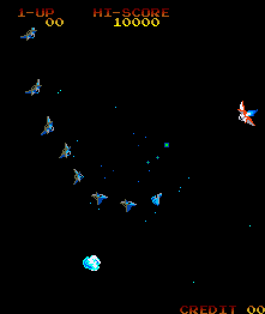

# Gyruss (Konami, 1983) on the Atari STE



MAME set `gyruss` (Konami GX347, `konami/gyruss.cpp`).  Both game CPUs are statically translated to 68000 code: the
main Z80 (24 KB, inline leaves) and the sub CPU, a KONAMI-1 (an MC6809 with encrypted opcodes, 8 KB) that projects the
objects and multiplexes the sprites by racing the beam (a beam model in the translation; its hottest routines are
natives).  The sound board's Z80 driver is translated as well and plays its five AY-3-8910s on the YM2149 (three of the
fifteen channels); the i8039's sampled effects are rendered offline and played through the DMA sound.  The picture is
MAME's ROT90 picture, 224 x 256, centred in the 320-pixel screen, top and bottom borders open, sprites by generated
sprite code (`engine/sprite_programs.py`).  Logic and picture are exact against the reference; status **Incomplete**:
the flip screen (cocktail) and the service mode are not done.  Speed (2026-11-02, Hatari, 4 MB STE, `bench.sh 4000`
AUTOPLAY): 33.4 arcade frames a second (55% of the arcade's 60.61) and 12.7 pictures a second; the three translated
CPUs, not the picture, limit it.  The program loads 3.47 MB (the budget 3.7 MB).

## Build and run

```sh
python port.py prepare gyruss            # verify assets/roms/gyruss.zip, unpack to assets/roms/extracted/gyruss/
python port.py cover gyruss              # coverage: ref/cover.py seeds 1-12, ref/cover_sound.py 0-3 (~1 h in parallel)
python port.py build gyruss              # -> run/gyruss/GYRUSS.PRG (--sim: run/gyruss_sim; --tag: another folder)
python port.py test gyruss               # logic, render, sprite and sound tests (see "Tests and tools")
python port.py run gyruss                # Hatari (tools/hatari.sh)
python port.py mame gyruss               # the reference against MAME
python games/gyruss/tools/prepare.py     # the same steps by the port's own scripts
python games/gyruss/tools/build.py
games/gyruss/tools/shots.sh tap:5@14 tap:1@16 shot@30     # its own Hatari: keys, screenshots
```

Supply `assets/roms/gyruss.zip` (MAME's 15 files under MAME's names; `docs/rom_manifest.json` has their sizes, CRCs and
SHA-1s).  Nothing ROM-derived is in git: the graphics, colours, effects and ROM images are made into `build/gyruss/`
and assembled into the program.  Paths are relative to this folder; `engine/`, `tools/`, `port.py` and `docs/` at the
top are the repository's.

## Controls

**5/6** coin 1 / 2, **1/2** start, **arrow keys** move the ship around the circle, **Space / Control / Z** fire,
**Esc** quits.  Joystick port 1 player 1, port 0 player 2.  Jaguar pad / PowerPad: pad A player 1, pad B player 2, the
D-pad moves, **A / B / C** fire, **Option** coin, **Pause** start, keypad **1/2** start, **5/6** coin, **\*** + **#**
quit.  DIP switches: MAME's defaults (3 lives, bonus 30k / 90k / every 60k, difficulty 5, demo sounds and music on).

## State

* **Logic**: exact against the reference's port schedule (`machine.GyrussPort`, below).  `tools/logic_test.py` runs the
  translation on Musashi frame by frame: the main CPU's video RAM and RAM ($8000-$87FF, $9000-$A7FF, the shared RAM
  included), the latches, the sub CPU's RAM ($4000-$47FF, the sprite RAM), the sound commands, every changed video RAM
  row marked: 6,000 frames each of seeds 1, 4, 5, 9, 10, 11 and 12 (attract, coin, start, play, deaths and game over,
  infinite lives, two players, the other DIP switches).
* **Picture**: exact in the shown colours.  `tools/render_test.py` compares every frame's published buffer with the
  reference renderer (MAME's partial updates included, below) through the pen map: 0 differences in 2,000 consecutive
  pictures of seed 1 and in samples of seeds 5, 9 and 11; the side bands black.  `tools/sprite_test.py`: 144 made-up
  pictures exact.  No HOG pass longer than 256 bus cycles.
* **Sound**: `tools/sound_test.py`: the STE's AY register files, YM registers and channel choice equal the model's
  (`tools/sound.py STEBoard`) in every frame of 4,000 (8,952 YM writes, 226 effects), and its sound RAM but the dead
  stack below SP.  The i8039's DAC writes equal MAME 0.289's for all seven effects (32,858 writes, cycle and value:
  `tools/i8039.py --mame`).
* **The reference against MAME** (`ref/mame_cmp_gyruss.py`, 2026-10-12): 0 of 320 pens and 0 pixels differ (frames
  60-3600); the MAME-timed reference's RAM equals MAME's but for a few stack bytes.
* **Hatari** (F030Arcade build, STE, 4 MB, TOS 2.06): attract, coin, start and play by keyboard; no crash, no late
  border event in 4,000 VBLs; an AVI recording with sound has the music and the effects in the demo play.
* Open: the flip screen (cocktail), the service mode.
* Open: MAME's analog stage after the AYs and the DAC (the filters the AYs' port B selects, the DAC's low-pass) is not
  modelled.
* Open: the speed (55%): the logic of three CPUs (the sound driver 39% of it); `fast_forms` for the sub CPU is untried.
  No recorded-play bench yet.

## How it works

### The board and the reference

* **Main CPU**: Z80 at 3.072 MHz.  $0000-$5FFF ROM, $8000-$83FF colour RAM, $8400-$87FF video RAM, $9000-$9FFF RAM,
  $A000-$A7FF shared RAM; reads $C000 DSW2, $C080 SYSTEM, $C0A0 P1, $C0C0 P2, $C0E0 DSW1, $C100 DSW3; writes $C080 the
  sound IRQ, $C100 the sound latch, $C180-$C187 an LS259 (Q0 the NMI mask, Q5 flip).  NMI at the VBLANK.
* **Sub CPU**: KONAMI-1 at 1.536 MHz.  $0000 the beam's line, $2000 the IRQ mask, $4000-$47FF RAM ($4040-$40FF the 48
  sprites), $6000-$67FF the shared RAM, $E000-$FFFF ROM; IRQ at the VBLANK.
* **Screen**: 256 x 224 visible of 396 x 256 at 6.144 MHz (60.61 Hz), ROT90.  A 32 x 32 tilemap of 2bpp tiles (512),
  sprites 8 x 16 4bpp (2 x 256), the front tiles over the sprites.
* **Sound board**: a Z80 at 3.579545 MHz with five AY-3-8910s, the main CPU's command by IRQ (its handler $0038 puts it
  into the driver's slots), a main loop that waits for bit 2 of the third AY's port A (a counter of the CPU's clock: a
  tick every 5120 cycles, 11.536 an arcade frame) and then steps the effect slots and nine music channels; an i8039
  that synthesises effects on a DAC.
* **The reference** (`tools/machine.py`): `Gyruss` with MAME's timing (the CPUs interleaved by lines, `sprite_bands`
  for the partial updates), `GyrussPort` the port's schedule.  `engine/z80.py` and `engine/m6809.py` (KONAMI-1:
  `engine/konami1_test.py` replays MAME traces of this sub CPU).

### Translation

* **Main CPU** (`tools/gen.py`): inline leaves (`INLINE = 16`: leaf calls up to 16 instructions, the `rst` helpers and
  their inner jumps in place, as Time Pilot's and Pooyan's; `logic_test` leaves out the 64 bytes below SP, which the
  inlined calls no longer write).  The static reads of $C000-$C1FF read `io_in`, the stores land in the Z80 block (the
  runtime reads $C180 / $C185 / $C100), `ld ($C080),a` (the sound IRQ) puts the latch into the command ring.  `rst $30`
  is a jump through the word table behind it; gen.py's RST30_TABLES bounds each table by the code before the site (the
  coverage's computed jumps all land in them).  The video RAM's writers list the cells they hit (writer marks:
  `gy_mark_*` routines into `cell_list`, once each) for the renderer.
* **Sub CPU** (`tools/gen_sub.py`, `engine/m6809x.py` on a flat program; the KONAMI-1 decryption and
  `Program.indirect_slots`: [porting guide](../../docs/porting-guide.md#6809-hd6309-and-konami-1-enginem6809xpy)):
  slot 2 the sub's RAM (a3: the direct page $42xx and the stack), slot 3 the main CPU's shared RAM (a4: the Z80 block's
  $A000), slot 7 the ROM; the static pointers `[$4200]`, `[$4211]` (the sort lists) use the slot the coverage saw.
  `call_summaries = True` (since 2026-10-29): a direct call's live flags come from its callees' summaries instead of
  the union of every caller's needs at their returns.
* **Natives** (`src/sub.s`, `src/natives.s`): the first phase's list copy (F48B / F4E4), the scans for a free entry
  (F6A2 / F6FB), the object projections (F273, F2DC, F386, F3F1): all exact in lock-step.
* **Sound CPU** (`tools/sndgen.py`): the static `out`s inline into the five register files, the `rst` I/O helpers,
  leaf calls up to 16 instructions and their inner jumps in place; the nine music channels' countdowns (`call $0281` at
  0164-01A0) in place, the call made only when a countdown runs out; the `rst $28` table jump at its three `ld hl,nn`
  sites a direct table (`snd_jt<base>`).

### Schedule

`machine.GyrussPort`, `src/gyruss.s`, `src/sub.s`.

* **Main CPU**: its foreground is a task loop (05F4-0601: a queue at ([$5865] << 8) + [$9433], an empty entry has bit
  7); the game runs in the NMI handler ($0066 -> $0103).  The idle hook is 05F7 with an empty queue: the runtime draws
  the picture when due, waits for the next arcade frame and delivers the NMI (when the latch's Q0, $C180, allows it)
  with TOKEN ($7FFE) as its return address.  The VBL counts 60 arcade frames a second (a second one every 5th), at most
  3 waiting, a picture at least every third frame.
* **Sub CPU**: all its work is its IRQ handler (F0B8); in the arcade both CPUs start at the VBLANK and meet at two
  semaphores in the shared RAM ($A701: the sub copies the previous frame's sorted list into the sprite RAM; $A702: the
  main has copied its object list, the sub projects it).  The data are disjoint, so the port runs the sub's IRQ after
  the main's NMI returned, in one go; the wait at F0CA is a hook that goes on at F0CF.  The sub boots (a delay loop, its
  tests) at the main's first idle.
* **Sound**: each arcade frame, the commands of the frame before each run the IRQ handler, then the frame's ticks run
  the loop from $010C to its head (the waits left out; `TickBoard`, `snd_frame`): ~2,540 Z80 instructions an arcade
  frame in play.

### Sprite multiplexing and the beam

The method (MAME's partial updates, a beam model for the translation, the reference rendered per band): [porting
guide](../../docs/porting-guide.md#against-mames-picture-every-port), "Partial updates" and "Sprite multiplexers that
race the beam".  Gyruss shows more than the 48 hardware sprites: after its first phase filled the entries, the sub CPU
scans them between its processing steps (F695 / F6EE), reading the beam's line at $0000 for each entry, and gives an
entry whose sprite the beam has passed (`line + y` carries) to the next object.  An object placed above the beam is not
shown that frame (61% of them in the MAME-timed reference).

The model: the k-th read of an IRQ gives line 25 + 0.6 k (at most 239), fitted to the MAME-timed reference
(`tools/machine.py Gyruss`, rms 9 lines); the first phase's writes count as the VBLANK's.  The reference port renders
per band (`GyrussPort.bands`); the STE logs each reused entry's old content and line (`sub_spr_seg` after F6CA / F723)
and draws every content clipped to its columns (`clip_slot`: the slot's row masks cut to the band).

### Picture

`src/render.s`.

* **Turned**: picture pixel (X, Y) is the raw pixel (x = Y, y = 239 - X); a raw 8 x 16 sprite is a 16 x 8 cell, a tile
  an 8 x 8 cell at X = 232 - 8 ty, Y = 8 tx (a byte of each plane: drawn with movep.l).  `tools/assets.py` turns the
  graphics at build time (np.rot90 of the decoded gfx: the same as the reference's turn).
* **Buffers**: three display buffers and a clean screen of 280 lines x 160 bytes (PIC_TOP lines above the picture,
  guard lines below).  The tiles change rarely (0.6 cells a frame in play): the tile writers list their cells
  (`cell_list`, no row scans); a changed cell is drawn into the clean screen and listed for each buffer.  A buffer is
  brought to the new picture from the clean screen: its last sprites' damage (the lines and words each sprite drew, a
  HOG copy each in short pieces, `restore_damage`), its listed cells (movep.l); then the sprites (the 48th entry
  first), then the front tiles (colour bit 4: MAME's group 0, opaque) copied back over the sprites that cover one (a
  long of front rows per cell column decides).
* **Sprites**: baked on first use per (bank, code, flips, colour) into a 1024-slot cache (the opaque rows, their masks,
  the plane words in blit order, the same aligned in their source words for the generated code).  An entry of a shape
  the coverage drew (1,381 shapes: bank, code, raw flips) runs its generated code per pass-type pattern with its
  shift's end-mask stream (`draw_one`: 4,510 routines, 441 KB of masks, an unrolled loop with the Blitter registers
  held; a one-word pass for a row whose pixels stay in one word: most stars and shots).  Entries cut to multiplexing
  bands, near front tiles or across a 64 KB boundary take the row path (`draw_cell`: a HOG pass a row, the pass type's
  Blitter registers written only when it changes).  Both clip at the group-aligned edges (screen x 48 and 272: the
  inner word only) and cull an entry wholly in a band.  See [sprite-preparation.md](../../docs/sprite-preparation.md).

### Colours

`tools/assets.py` `palette` (since 2026-11-05): the arcade shows 28 colours (a 32-byte PROM); the shared default
fitter, flat ([colours.md](../../docs/colours.md#the-default-fitter-enginepalette_quantizepy-r-type-2026-11-05);
`engine/palette_native.py` `prom`, `engine/palette_quantize.py`: one STE index per PROM pen, black fixed in slot 0),
trained on the coverage's pen counts; text and HUD glyphs stay flat, gameplay and graphics priorities unchanged.  Its
audit: non-black error 1.631 -> 2.892, sprites 4.835 -> 2.618 OKLab x 100, against the former fit (black and 15 by a
weighted k-means in Oklab, `fit`, now unused: mean error per channel under 1 of 255).

### Sound

`src/sound.s`, `tools/sound.py`, `tools/sndgen.py`, `tools/i8039.py`.

* **YM2149**: each arcade frame the three loudest audible of the fifteen AY channels
  ([Kung-Fu Master's method](../kungfum/README.md#sound)), periods x 2000000 / 1789772, noise and envelope from the
  chip of the first chosen channel that uses them.
* **The i8039's effects**: `engine/mcs48.py` (MAME's MCS-48 core) runs its program for each command (1-7) offline;
  `tools/i8039.py` resamples the DAC to the DMA's 6258 Hz (47 KB, effect 7 is 6.1 s).  As on the board a new IRQ
  restarts the effect from the latch, 0 and 8-15 stop it; one voice in a 2 KB ring filled 700 bytes ahead of the DMA's
  counter once an arcade frame.

## Speed

| measured | setup | logic | pictures | Musashi |
|---|---|---|---|---|
| 2026-11-02 | Hatari, `bench.sh 4000` (AUTOPLAY), the tree after 7d63539 | 33.4 /s (55%) | 12.7 /s | logic seed 5 145.2k, seed 1 139.7k, seed 9 168.6k cycles a frame |
| 2026-10-25 | Musashi, `render_test.py 1600 --start 1000` (seed 1's play, 600 pictures) | | | a picture 75.4k CPU + 12.7k Blitter |

The logic of three CPUs limits the speed; the sound driver is 39% of it ([speed.md](../../docs/speed.md#sound-and-memory)).

What made it fast (newest first):

* **Inline leaves in the main CPU and the sound driver, the music channels' countdowns in place, `rst $28` as a direct
  table** (2026-11-02): `tools/logic_test.py 6000` (Musashi, exact): seed 5 158.2k -> 145.2k, seed 1 150.2k -> 139.7k,
  seed 9 182.0k -> 168.6k (-7% to -8%); seeds 4, 10, 11 and 12 exact too; `tools/sound_test.py 4000` exact.  Hatari
  (`bench.sh 4000`, AUTOPLAY, the tree before 7d63539): 32.7 -> 36.0 arcade frames a second (54% -> 59%), 12.5 -> 13.6
  pictures a second.
* **`call_summaries`** for the sub CPU (2026-10-29, [the 6809 translator](../../docs/porting-guide.md#6809-hd6309-and-konami-1-enginem6809xpy)).
* **Aligned sprite rows** (2026-10-25, no FXSR one-word passes): `render_test.py 3000 --start 1000` 76.9k + 13.2k ->
  77.1k + 12.6k a picture (-0.45%; the control word from the stream at every group takes most of the Blitter's saving
  back); the program 3.03 -> 3.46 MB.
* **Generated sprite code** (2026-10-25, `engine/sprite_programs.py`, as Time Pilot's, with drawn-lines damage and the
  tile writers' cell lists): `render_test.py 1600 --start 1000` (exact) 116.1k CPU + 28.4k Blitter -> 75.4k + 12.7k a
  picture.  Hatari (`bench.sh 6000`, AUTOPLAY): 54% -> 55% of the arcade's speed, 11.6 -> 12.1 pictures a second.
* **Natives in the sub CPU** (2026-10-17: the list copy, the free-entry scans, the projections): sub CPU 99k -> 55k
  cycles a frame.

The sound's share, measured once (2026-10-17, before the sub's natives, Hatari AUTOPLAY): 31.9 arcade frames a second
with sound, 38.7 without (`EXTRA="-D NOSOUND=1"`).

Measured, not kept:

* **Grouping equal row masks** in the sprite rows: gains nothing (the masks rarely repeat;
  [sprite-preparation.md](../../docs/sprite-preparation.md)).
* **The control word written only where it changes** in the generated code (to take back the aligned rows' CPU cost):
  it splits the code by the rows' alignments, +320 KB of code, over the load budget.

Techniques other ports use that may apply:
[speed.md](../../docs/speed.md#techniques-that-look-applicable-elsewhere-2026-11-07) (`fast_forms` for the sub CPU is
listed there).

## Tests and tools

```sh
python games/gyruss/tools/logic_test.py 6000 --seed 5        # both translated CPUs in lock-step with the reference
python games/gyruss/tools/render_test.py 3000 --start 1000   # the STE picture against the reference, every frame
python games/gyruss/tools/sprite_test.py                     # edges, all 16 shifts, holes, bands, 64 KB crossings
python games/gyruss/tools/sound_test.py 4000                 # the STE's sound player against its model
python games/gyruss/tools/i8039.py --rate 6258 --cap 7 [--mame]   # the i8039's effects (--mame: against MAME)
python games/gyruss/ref/mame_cmp_gyruss.py [frame ...]       # the reference against MAME 0.289
games/gyruss/tools/bench.sh 4000          # Hatari speed: logic and pictures a second
```

`port.py test gyruss` runs prepare, the simulator build, `logic_test.py` (3000 frames, and 6000 of seed 5: play,
infinite lives), `render_test.py 3000 --start 1000 --every 3`, `sprite_test.py` and `sound_test.py 4000`.

## Lessons

### 2026-11-02: the AUTOPLAY bench depends on the border timing

The same program measured 36.0 arcade frames (59%) and 13.6 pictures a second on the tree before 7d63539 (the border
pulses moved) and 33.4 (55%) and 12.7 after it: the AUTOPLAY run follows another path at another speed.  No baseline
was run after 7d63539, so compare only builds measured on the same tree; a recorded play would remove the dependence.

### 2026-10-25: the sprite kernel is only part of the gain

With the generated code the per-sprite setup, the drawn-lines damage and the tile writers' cell lists (no row scans)
gave as much as the kernel; the picture went from 145k to 88k cycles, yet Hatari's rate rose only 11.6 -> 12.1
pictures a second, since the logic limits it.

## Verification

The coverage seeds (attract, coin, play, deaths, game over, infinite lives, two players, the DIP switches) are the
lock-step and render evidence above; no recorded play or playtest of the later stages yet.

Full-game verification follows the [status policy](../../docs/port-status.md); nothing here claims a complete playthrough.
