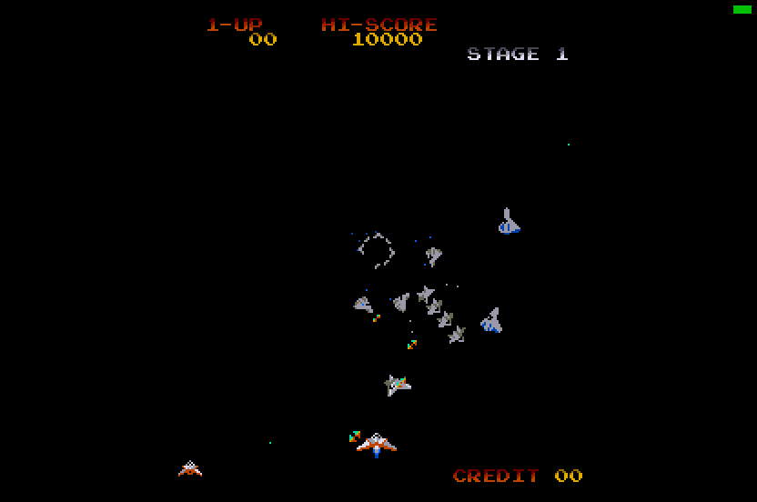

# Gyruss (Konami, 1983) for Atari STE



MAME set `gyruss` (Konami GX347).  Both game CPUs are statically translated to 68000 code: the main Z80 (24 KB) and
the sub CPU, a KONAMI-1 (an MC6809 with encrypted opcodes, 8 KB) that projects the objects and multiplexes the
sprites.  The picture is MAME's ROT90 picture: 224 x 256, centred in the 320-pixel screen, top and bottom borders
open.  The sound board's Z80 driver is translated as well; it plays its five AY-3-8910s on the YM2149 (three of the
fifteen channels).  The i8039's sampled effects are rendered offline and played through the DMA sound.  For a 4 MB
STE (the program needs 1.2 MB).

```sh
python games/gyruss/tools/prepare.py      # verify assets/roms/gyruss.zip, unpack to assets/roms/extracted/gyruss/
python port.py cover gyruss               # coverage: ref/cover.py seeds 1-12, ref/cover_sound.py 0-3 (~1 h in parallel)
python games/gyruss/tools/build.py        # -> run/gyruss/GYRUSS.PRG (--sim: run/gyruss_sim; --tag: another folder)
python games/gyruss/tools/logic_test.py 6000 --seed 5    # both translated CPUs in lock-step with the reference
python games/gyruss/tools/render_test.py 3000 --start 1000   # the STE picture against the reference, every frame
python games/gyruss/tools/sprite_test.py                  # edges, all 16 shifts, holes, bands, 64 KB crossings
python games/gyruss/tools/sound_test.py 4000              # the STE's sound player against its model
python games/gyruss/tools/i8039.py --rate 6258 --cap 7 [--mame]   # the i8039's effects (--mame: against MAME)
games/gyruss/tools/bench.sh 4000          # Hatari speed: logic and pictures a second
games/gyruss/tools/shots.sh tap:5@14 tap:1@16 shot@30     # its own Hatari: keys, screenshots
python games/gyruss/ref/mame_cmp_gyruss.py [frame ...]    # the reference against MAME 0.289
```

Supply `assets/roms/gyruss.zip` (MAME's 15 files under MAME's names; `docs/rom_manifest.json` has their sizes, CRCs
and SHA-1s).  Nothing ROM-derived is in git: the graphics, colours, effects and ROM images are made into
`build/gyruss/` and assembled into the program.

Controls: **5/6** coin 1 / 2, **1/2** start, **arrow keys** move the ship around the circle, **Space / Control / Z**
fire, **Esc** quits.  Joystick port 1 player 1, port 0 player 2.  Jaguar pad / PowerPad: pad A player 1, pad B player
2, the D-pad moves, **A / B / C** fire, **Option** coin, **Pause** start, keypad **1/2** start, **5/6** coin,
**\*** + **#** quit.  DIP switches: MAME's defaults (3 lives, bonus 30k / 90k / every 60k, difficulty 5, demo sounds and
music on).

## State

* **Logic**: exact against the reference's port schedule (`machine.GyrussPort`, below).  `tools/logic_test.py` runs
  the translation on Musashi frame by frame: the main CPU's video RAM and RAM ($8000-$87FF, $9000-$A7FF, the shared
  RAM included), the latches, the sub CPU's RAM ($4000-$47FF, the sprite RAM), the sound commands, every changed
  video RAM row marked: 6,000 frames each of seeds 1, 4, 5, 9, 10, 11 and 12 (attract, coin, start, play, deaths and
  game over, infinite lives, two players, the other DIP switches).
* **Picture**: exact in the shown colours.  `tools/render_test.py` compares every frame's published buffer with the
  reference renderer (MAME's partial updates included, below) through the pen map: 0 differences in 2,000 consecutive
  pictures of seed 1 and in samples of seeds 5, 9 and 11; the side bands black.  `tools/sprite_test.py`: 144 made-up
  pictures exact.  No HOG pass longer than 256 bus cycles.
* **Sound**: `tools/sound_test.py`: the STE's AY register files, YM registers and channel choice equal the model's
  (`tools/sound.py STEBoard`) in every frame of 4,000 (8,952 YM writes, 226 effects), and its sound RAM but the dead
  stack below SP.  The i8039's DAC writes
  equal MAME 0.289's for all seven effects (32,858 writes, cycle and value: `tools/i8039.py --mame`).
* **Hatari** (F030Arcade build, STE, 4 MB, TOS 2.06): attract, coin, start and play by keyboard; no crash, no late
  border event in 4,000 VBLs; an AVI recording with sound has the music and the effects in the demo play.
* **The reference against MAME** (`ref/mame_cmp_gyruss.py`, 2026-10-12): 0 of 320 pens and 0 pixels differ (frames
  60-3600); the MAME-timed reference's RAM equals MAME's but for a few stack bytes.
* Not done: the flip screen (cocktail), the service mode, MAME's analog stage after the AYs and the DAC (the filters
  the AYs' port B selects, the DAC's low-pass).

## Speed

`tools/bench.sh 4000` (DEBUG build with sound, the AUTOPLAY script, Hatari): **31.9 arcade frames a second (53% of
the arcade's 60.61), 11.7 pictures a second**; in play 22-36 frames and 7-12 pictures a second.  The arcade frame's
costs on Musashi in play: the main CPU ~56k cycles, the sub CPU ~55k (its hottest routines native, below), the sound
driver ~52k, the YM mix-down ~8k, a picture ~110k CPU cycles and ~27k Blitter bus cycles.  Without the sound
(`EXTRA="-D NOSOUND=1"`) the logic ran at 38.7 frames a second before the sub's natives.

**The sprites' generated path** (2026-10-25, `engine/sprite_programs.py`, as Time Pilot's; docs/sprite-preparation.md):
the coverage's 1,381 shapes (bank, code, raw flips) get code per pass-type pattern and end-mask streams (4,510
routines, 441 KB of masks), a one-word pass for a row whose pixels stay in one word after the shift (most stars and
shots); the entries an unrolled loop with the Blitter registers held (`draw_one`), the entries cut to multiplexing bands,
near front tiles or across a 64 KB boundary still the row path (`draw_cell`); the damage the drawn lines and words; the
tile writers list their cells (`cell_list`, no row scans).  `tools/render_test.py 1600 --start 1000` (seed 1's play,
600 pictures, exact): 116.1k CPU + 28.4k Blitter -> 75.4k + 12.7k cycles a picture.  Hatari (`bench.sh 6000`,
AUTOPLAY): 54% -> 55% of the arcade's speed, 11.6 -> 12.1 pictures a second: Gyruss's three translated CPUs, not
its picture, limit it.  Load size ~3.03 MB (the limit 3.7 MB).

## The schedule (machine.GyrussPort, src/gyruss.s, src/sub.s)

* **Main CPU**: its foreground is a task loop (05F4-0601: a queue at ([$5865] << 8) + [$9433], an empty entry has
  bit 7); the game runs in the NMI handler ($0066 -> $0103).  The idle hook is 05F7 with an empty queue: the runtime
  draws the picture when due, waits for the next arcade frame and delivers the NMI (when the latch's Q0, $C180, allows
  it) with TOKEN ($7FFE) as its return address.  The VBL counts 60 arcade frames a second (a second one every 5th),
  at most 3 waiting, a picture at least every third frame.
* **Sub CPU**: all its work is its IRQ handler (F0B8); in the arcade both CPUs start at the VBLANK and meet at two
  semaphores in the shared RAM ($A701: the sub copies the previous frame's sorted list into the sprite RAM; $A702:
  the main has copied its object list, the sub projects it).  The data are disjoint, so the port runs the sub's IRQ
  after the main's NMI returned, in one go; the wait at F0CA is a hook that goes on at F0CF.  The sub boots (a delay
  loop, its tests) at the main's first idle.
* **Memory-mapped I/O**: the static reads of $C000-$C1FF read `io_in` (gen.py), the stores land in the Z80 block
  (the runtime reads $C180 / $C185 / $C100), `ld ($C080),a` (the sound IRQ) puts the latch into the command ring.
* **Jump tables**: `rst $30` is a jump through the word table behind it; gen.py's RST30_TABLES bounds each table
  by the code before the site (the coverage's computed jumps all land in them).
* **The sub CPU's translation** (`tools/gen_sub.py`, engine/m6809x.py on a flat program): the KONAMI-1 opcodes
  decrypted (`Program.opcode_reader`), slot 2 the sub's RAM (a3: the direct page $42xx and the stack), slot 3 the main
  CPU's shared RAM (a4: the Z80 block's $A000), slot 7 the ROM; the indirect operands through static pointers
  (`[$4200]`, `[$4211]`: the sort lists) use the slot the coverage saw (`Program.indirect_slots`).  Natives
  (src/sub.s, src/natives.s): the first phase's list copy (F48B / F4E4), the scans for a free entry (F6A2 / F6FB),
  the object projections (F273, F2DC, F386, F3F1): sub CPU 99k -> 55k cycles a frame, all exact in lock-step.

## Sprite multiplexing and the beam

Gyruss shows more than the 48 hardware sprites: after its first phase filled the entries, the sub CPU scans them
between its processing steps (F695 / F6EE) and gives an entry whose sprite the beam has passed (`line + y` carries:
it reads the beam's line at $0000 for each entry) to the next object.  MAME redraws the screen up to the beam before
every sprite RAM write (`update_partial`), so an entry shows its old sprite above the line of the write and the new
one below; an object placed above the beam is not shown that frame (61% of them in the MAME-timed reference).

The port cannot follow the beam, so it models it: the k-th read of an IRQ gives line 25 + 0.6 k (at most 239),
fitted to the MAME-timed reference (`tools/machine.py Gyruss`, rms 9 lines); the first phase's writes count as the
VBLANK's.  The reference port renders per band (`GyrussPort.bands`, MAME's method); the STE logs each reused entry's
old content and line (`sub_spr_seg` after F6CA / F723) and draws every content clipped to its columns (`clip_slot`:
the slot's row masks cut to the band).

## The picture (src/render.s)

* **Turned**: picture pixel (X, Y) is the raw pixel (x = Y, y = 239 - X); a raw 8 x 16 sprite is a 16 x 8 cell, a
  tile an 8 x 8 cell at X = 232 - 8 ty, Y = 8 tx (a byte of each plane: drawn with movep.l).  `tools/assets.py` turns
  the graphics at build time (np.rot90 of the decoded gfx: the same as the reference's turn).
* **Buffers**: three display buffers and a clean screen of 280 lines x 160 bytes (PIC_TOP lines above the picture,
  guard lines below).  The tiles change rarely (0.6 cells a frame in play): the marked rows of the video RAM are
  compared with a copy; a changed cell is drawn into the clean screen and listed for each buffer.  A buffer is brought
  to the new picture from the clean screen: its last sprites' rectangles (two 4-line HOG passes each), its listed
  cells (movep.l); then the sprites (the 48th entry first), then the front tiles (colour bit 4: MAME's group 0, opaque)
  copied back over the sprites that cover one (a long of front rows per cell column decides).
* **Sprites**: baked on first use per (bank, code, flips, colour) into a 1024-slot cache (the opaque rows, their
  masks, the plane words in blit order), a HOG pass a row; clipped at the group-aligned edges (screen x 48 and 272:
  the inner word only), culled when wholly in a band; the pass type's Blitter registers written only when it
  changes.  Grouping equal row masks was measured and gains nothing (`docs/sprite-preparation.md`).
* **Colours** (`tools/assets.py`): the arcade shows 28 colours (a 32-byte PROM); black and 15 fitted by a weighted
  k-means in Oklab to the coverage's pictures, snapped to the STE's 4 bits a gun; every pen maps to the nearest.  The
  mean error per channel, weighted by pixels, is under 1 of 255.

## Sound (src/sound.s, tools/sound.py, tools/sndgen.py, tools/i8039.py)

* **The board** (MAME konami/gyruss.cpp): a Z80 at 3.579545 MHz with five AY-3-8910s, the main CPU's command by
  IRQ (its handler $0038 puts it into the driver's slots), a main loop that waits for bit 2 of the third AY's port A
  (a counter of the CPU's clock: a tick every 5120 cycles, 11.536 an arcade frame) and then steps the effect slots
  and nine music channels; an i8039 that synthesises effects on a DAC.
* **The STE's schedule** (`TickBoard`, `snd_frame`): each arcade frame, the commands of the frame before each run the
  IRQ handler, then the frame's ticks run the loop from $010C to its head (the waits left out).  The driver is
  translated (`tools/sndgen.py`: the static `out`s inline into the five register files, the `rst` I/O helpers in
  place); ~2,540 Z80 instructions an arcade frame in play.
* **YM2149**: each arcade frame the three loudest audible of the fifteen AY channels (Kung-Fu Master's method),
  periods x 2000000 / 1789772, noise and envelope from the chip of the first chosen channel that uses them.
* **The i8039's effects**: `engine/mcs48.py` (MAME's MCS-48 core) runs its program for each command (1-7) offline;
  `tools/i8039.py` resamples the DAC to the DMA's 6258 Hz (47 KB, effect 7 is 6.1 s).  As on the board a new IRQ
  restarts the effect from the latch, 0 and 8-15 stop it; one voice in a 2 KB ring filled 700 bytes ahead of the DMA's
  counter once an arcade frame.

## The board (MAME konami/gyruss.cpp)

* **Main CPU**: Z80 at 3.072 MHz.  $0000-$5FFF ROM, $8000-$83FF colour RAM, $8400-$87FF video RAM, $9000-$9FFF RAM,
  $A000-$A7FF shared RAM; reads $C000 DSW2, $C080 SYSTEM, $C0A0 P1, $C0C0 P2, $C0E0 DSW1, $C100 DSW3; writes $C080
  the sound IRQ, $C100 the sound latch, $C180-$C187 an LS259 (Q0 the NMI mask, Q5 flip).  NMI at the VBLANK.
* **Sub CPU**: KONAMI-1 at 1.536 MHz.  $0000 the beam's line, $2000 the IRQ mask, $4000-$47FF RAM ($4040-$40FF the
  48 sprites), $6000-$67FF the shared RAM, $E000-$FFFF ROM; IRQ at the VBLANK.
* **Screen**: 256 x 224 visible of 396 x 256 at 6.144 MHz (60.61 Hz), ROT90.  A 32 x 32 tilemap of 2bpp tiles
  (512), sprites 8 x 16 4bpp (2 x 256), the front tiles over the sprites.
* **The reference** (`tools/machine.py`): `Gyruss` with MAME's timing (the CPUs interleaved by lines, `sprite_bands`
  for the partial updates), `GyrussPort` the port's schedule.  engine/z80.py and engine/m6809.py (KONAMI-1:
  engine/konami1_test.py replays MAME traces of this sub CPU).

## Full-game verification status

Automated players such as Dreamer can attempt a full playthrough once this port's
adapter and native Hatari replay transport are verified. An attempt or assisted
stage visit does not establish completion; a successful natural Hatari playthrough
and graphics, sound and control checks are required for green **Complete** status.
See the shared [status and verification policy](../../docs/port-status.md) and
[current port status](../../README.md). Existing test results above retain their
stated scope; this note does not claim a new successful run or Dreamer integration.
