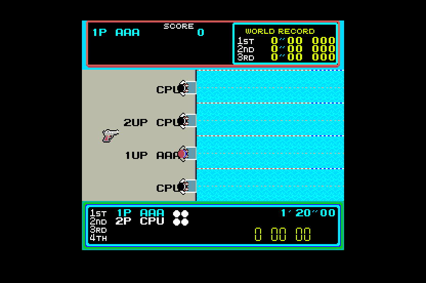

# Hyper Sports (Konami, 1984) for Atari STE



MAME set `hyperspt` (Konami GX330).  The main CPU, a KONAMI-1 (an MC6809 with encrypted opcodes, 48 KB of ROM), is
statically translated to 68000 code (`engine/m6809x.py`) and checked against a reference board in lock-step; the
picture is MAME's, 256 x 224, centred in the 320-pixel screen with the top and bottom borders open.  The port is
Track & Field's (`games/trackfld`: the same board family, the same runtime and renderer design) with this board's
memory map.  Sound (2026-10-29): Track & Field's player (`games/trackfld/src/sound.s`, `tools/sndgen.py`,
`tools/sound.py`) with this board's driver: the Z80 translated, the SN76489A on the YM2149, the VLM5030's speech and the
DAC tunes rendered offline onto the DMA sound (see Sound).  Work in progress: one fitted 16-colour palette.  Started
2026-10-29.

```sh
python games/hyperspt/tools/prepare.py      # verify assets/roms/hyperspt.zip, unpack to assets/roms/extracted/hyperspt/
python port.py cover hyperspt               # coverage: ref/cover.py seeds 1-12 (~1 min in parallel)
python games/hyperspt/tools/build.py        # -> run/hyperspt/HYPERSPT.PRG (--sim: run/hyperspt_sim; --assets: colours again)
python games/hyperspt/tools/logic_test.py 20000 --seed 5  # the translation in lock-step with the reference
python games/hyperspt/tools/render_test.py 3000 --seed 5 --start 500   # the STE picture against the reference
python games/hyperspt/tools/sprite_test.py                # edges, all 16 shifts, holes, guards, 64 KB crossings
python games/hyperspt/tools/native_test.py 2000           # src/natives.s against the 6809, edge cases included
games/hyperspt/tools/bench.sh 6000          # Hatari speed (its own Hatari, killed by PID): logic and pictures a second
python games/hyperspt/ref/mame_cmp_hyperspt.py [frame ...]  # the reference against MAME 0.289
python games/trackfld/ref/cover_sound.py hyperspt <seed> 20000  # sound coverage: seeds 1-12 the game's, 101-103 random
python games/hyperspt/tools/sound_test.py 6000 --seed 1   # the STE's sound player against the model every frame
python games/trackfld/ref/sound_cmp.py hyperspt 1 4000    # the STE's sound schedule against the MAME-timed board
SOUND=1 AVI=1 games/hyperspt/tools/bench.sh 6000          # Hatari with sound: run/hyperspt_bench/hyperspt.avi, .wav
```

Supply `assets/roms/hyperspt.zip` (MAME's parent set; `docs/rom_manifest.json` has the files' sizes, CRCs and
SHA-1s).  Nothing ROM-derived is in git: the graphics, colours and ROM image are made into `build/hyperspt/` and
assembled into the program.

Controls: **5/6** coin 1 / 2, **1/2** start; the left button (run, fire left) **Left / Z**, the right button **Right /
C**, the action (jump, the angle, lift: hold) **Up / Space / Control / X**; **Esc** quits.  Joystick port 1 player 1,
port 0 player 2: left and right the two buttons, up and fire act.  Jaguar pad / PowerPad: pad A player 1, pad B player
2, the D-pad's left / right and **A / C** the buttons, **B** and up act, **Option** coin, **Pause** start.  DIP
switches: MAME's defaults (the game over after the last event, demo sounds on, the records kept, difficulty "Normal 8").

## The board and the port's schedule

`tools/machine.py` follows MAME's `konami/hyperspt.cpp`: the KONAMI-1 at 1.536 MHz, 60 Hz, the IRQ at the VBLANK while
the LS259 latch's Q7 is 1; sprite RAM $1000-$10BF (48 entries: attributes, y, code, x; attributes bit 5 the code's
bit 8: 512 sprites of 16 x 16, 4 bpp) and the row scrolls $10C0-$10FF, the watchdog $1400, the latch $1480-$1487, the
sound latch $1500, DSW2 $1600, SYSTEM / P1_P2 / P3_P4 / DSW1 $1680-$1683, video and colour RAM $2000-$2FFF (64 x 32
tiles of 8 x 8, 4 bpp, 1024 codes: the colour byte's bits 7 and 6 are the code's bits 8 and 9), RAM $3000-$37FF,
NVRAM $3800-$3FFF, ROM $4000-$FFFF.  `ref/mame_cmp_hyperspt.py` (2026-10-29): 0 of 512 pens and 0 pixels differ at
frames 60-3600; the MAME-timed reference's RAM equals MAME's but for 1-3 stack bytes.

The port (`machine.HyperSportsPort`, `src/hyperspt.s`): the foreground is a task loop ($41B1: LDX <$1E; LDD ,X; ASLA;
BCS: an empty queue entry has bit 7); the IRQ handler ($44F5) plays the game and queues tasks.  The idle point $41B1
with an empty queue is a native (`hs_idle`, gen.py NATIVES): the picture is drawn when due, the next arcade frame
awaited and the IRQ delivered (Q7 1) with $41B1 as its return address; its RTI comes back there.  Six arcade frames
to five VBLs; MAX_SKIP 3.

The translation (`tools/gen.py`): the 6809's 64 KB are one block (`hs_mem`), so every slot's base is the same.  The
sites the coverage saw touch the I/O or store to the video RAM go through `main_io_r` / `main_io_w` (they route every
address as the board does: the boot's test of $1000-$13FF reads 0 from the unmapped $1100-$13FF); a video RAM store
lists its cell for the renderer.  ROM page $E000-$FFFF holds data only: no dispatch table.  As Track & Field's:
`fixed_slots` (no page checks), `fast_forms`, the return compares ordered by the coverage's return counts, and
`call_summaries` (a call's live flags from its callee's summary): together 16-21% off the logic.

## State

* **Logic**: exact against the reference's port schedule.  `tools/logic_test.py`: the sprite RAM and scrolls
  $1000-$10FF, the video RAM, RAM and NVRAM $2000-$3FFF, the latch (Q0, Q7), the sound commands (Q1's rising edges).
  Seeds 1-12 20,000 frames each (attract, the name entry, play to the game over and again; every event from its start
  by MAME's cheats with always the first try and no false starts; two players; the other DIP switches).  The logic
  costs ~30-56k Musashi cycles an arcade frame (seeds 1-12 over 20,000 frames each: 29.6k-56.0k; seed 5's skeet
  shooting 52.8k, seed 9's weightlifting 56.0k), more than Track & Field's (~2,200 6809 instructions a frame); the
  sound adds 20-36k (Sound).
* **Natives** (`src/natives.s`, gen.py NATIVES): the IRQ handler's copies of the sprite RAM ($4FBD: $3600 -> $1000,
  144 bytes) and the scrolls ($4FD2: 64 bytes) as long moves, and the division at $A62B (0:D rotated, the divisor
  normalized, shift and subtract, the quotient in X, the remainder rotated back) in registers, step for step as the
  6809 does it (the count byte that wraps for a divisor of $1000 or more, the bytes <$5B-$5F, the flags at the RTS).
  The logic without them / with them (20,000 frames): seed 1 47.7k / 39.3k, seed 5 59.8k / 52.8k, seed 9 82.7k /
  56.0k.  The play gives the division small divisors only, so `tools/native_test.py` checks the natives against the
  6809 (the reference CPU) in 2,000 random states and the edge cases (X = 0, $1000 and more): it found the routine's
  CLRs clearing C before the first ROLB, which the play never shows.
* **Picture**: exact in the shown colours.  `tools/render_test.py`: 0 differences in 715 sampled pictures of seed 1
  and 786 of seed 5 (skeet shooting); `tools/sprite_test.py`: 154 made-up pictures exact (both side edges at every
  shift, holes, flips, overlaps, MAME's x - 256 wrap, the guard lines, 64 KB crossings, 60 pictures in a row with
  moving sprites, scrolls and tiles).  `BLIT_STATS=256`: every pass HOG, the longest 132 bus cycles.
* **Hatari** (F030Arcade build, STE, 4 MB, TOS 2.06): boot, attract, coin, the name entry, swimming, the game over;
  no crash, no late border event in 6,000 VBLs.
* **Colours**: black and 15 fitted in Oklab (`tools/assets.py`): mean error 1.0 a channel, weighted by pixels; the
  worst-matched pens are rare (a pink, a brown).
* Not done: the DAC's pulses outside the tunes (Sound), the cocktail flip, the service mode, players 3 and 4 (P3_P4).

## Speed (2026-10-29)

`tools/bench.sh 6000` (DEBUG build, the AUTOPLAY script: coin, start, the name, running): with the sound and the
generated sprite code **83% of the arcade's speed (median 56 arcade frames a second), pictures 24.6 a second on
average, median 23.5, 10th percentile 8.5** (every sprite on the row path: 83%, 23.6, 23, 8.5); without the sound (`EXTRA="-D NOSOUND=1"`): 93% (median 60), 34.6, 34.5, 15 (before the natives: 91%, 31.6, 30, 12;
before the translator's flag work: 89%, 28.4, 26.5, 11.5).  The sound's cost is in Sound: the driver's music in
attract and in the events (fast ticks) costs up to ~80k cycles an arcade frame.  A picture
(`tools/render_test.py 1600 --seed 5 --start 1000`, Musashi): 79.8k CPU + 48.0k Blitter bus cycles (every sprite on
the row path, `-D REN_GEN=0`: 87.6k + 50.4k); the renderer is Track & Field's (see its README: the playfield, the rows
drawn only where their scroll or cells changed or sprites were, the sprites' generated code and row path).  The
generated code covers the most drawn shapes up to 98% of the coverage's draws (`tools/assets.py` SHARE: 147 of 405
shapes, 1,612 routines, 126 KB of streams; 6 transparency classes): code for all of them would need ~1.6 MB and take
the program over the load budget (4.67 MB against `tools/release.py` MAX_LOAD 3.7 MB); now 3.50 MB.

## Sound

The sound board is Track & Field's family (MAME 0.286 `konami/hyperspt.cpp` sound_map, `trackfld_a.cpp`); the model,
the translation and the player are Track & Field's, shared (`games/trackfld/tools/sound.py` GAMES, `sndgen.py`,
`src/sound.s`, `ref/cover_sound.py`, `ref/sound_cmp.py`; its README's Sound has the design).  This board, without
mirrors: a Z80 at 3.579545 MHz, ROM $0000-$3FFF (c10, c09), RAM $4000-$4FFF, the command latch $6000, $8000 the timer
(total cycles / 1024, & 3) with BSY in bit 2, the VLM5030's data $A000 and pins $C000-$DFFF (A4 ST, A5 RST; its 8 KB
ROM c08), the DAC $E000, the SN76489A's latch $E001 and strobe $E002.

The driver (16 KB): the loop's head $0238 (`ei`), a rising edge of the timer's bit 1 (4096 cycles), or bit 0 (2048:
"fast ticks") while $400B is set (the DAC envelope of some effects); the three channels, the DAC envelope twice a tick
in fast mode, the speech queue ($044C), the output-enable pins (`$03F4`, every tick), the tune check ($0231).  The IRQ
handler: 0 all off, $01-$3F effects, $40-$47 the tunes, $60-$68 effects $36-$3E, $80-$D9 phrases into the queue, $FF
speaks it.  The tunes ($030D:
`rst $10` through $2198) reset the VLM first (RST pulsed: a phrase stops), then play the DAC waveform and the SN:
tune 0 4.5 s (a game's start; the only one the game's coverage sends), 1-7 4.0, 4.7, 8.6, 13.2, 23.0, 17.1 and 2.9 s
(random commands only).

* **The STE's schedule** (`TickBoard`): Track & Field's; a frame is 119,318 half Z80 cycles (60 Hz), a tick 8,192, a
  fast tick 4,096 (chosen by $400B at the tick's start).  A tune's effect includes the VLM reset (the busy time cleared,
  the DMA's phrase stopped, the data byte latched).  `ref/sound_cmp.py hyperspt 1 4000`: each SN voice's audible states
  in order **97.6%** equal (2,758 of 2,825), the phrases and tunes started 9 of 9 in the same order.
* **Coverage**: seeds 1-12 (the game's commands) and 101-103 (random), 20,000 frames each: 3,110 instructions, 9 pin
  sites (`ld (hl),a`); BSY is read with the timer's bits in the same byte (the waits are left out: the STE's read gives
  BSY with timer bits 0; the driver masks with 4).
* **DMA**: 73 phrases (29.5 s) and the 8 tunes (77.9 s) at 12,517 Hz: 1,344 KB.
* **Test** (`tools/sound_test.py`, 2026-10-29): seeds 1, 5 and 9, 6,000 frames each: the sound RAM, the SN's and the
  YM's registers, the YM's channels, the schedule's time, the VLM's busy time and the DMA's requests equal every frame
  (9, 6 and 35 phrases, tune 0).  The logic, render, sprite and native tests pass with the sound build.  Hatari
  (`SOUND=1 AVI=1 tools/bench.sh 6000`): silent until the AUTOPLAY's coin (21 s), then 85 of the 110 seconds after it
  sound (the effects, the speech, tune 0, the event music); the dominant frequencies 150-940 Hz.
* **Cost**: Musashi, the logic with the sound / without (`logic_test.py`): seed 1 58.3k / 29.8k cycles an arcade
  frame (3,000 frames), seed 5 77.1k / 57.2k (3,000 frames; 20,000 frames: 89.3k / 52.8k).  The driver runs ~2,100 Z80
  instructions an arcade frame on average, ~5,400 with the three channels' music in fast ticks (~186 a tick, 29 ticks
  a frame); the idle-tick native (`snd_idle`) and the pins' store skipped when unchanged took 15% off.  Hatari: 93% ->
  **83%** of the speed, the pictures 34.6 -> **23.6** a second (Speed).  The program grows from 381,843 to 2,154,009
  bytes (the samples 1,344 KB, the dispatch table 256 KB, the 64 KB block): 2,879,340 bytes to load (MAX_LOAD
  3,700,000); packed with LZ4 690,820 bytes: it still fits a 720 KB floppy.
* Not done: the DAC's pulses outside the tunes (the $400B envelope: 600-8,300 pulses in a 20,000-frame game seed, the
  attract's most; Track & Field's README), natives for the driver's hot paths (the channels' note step $0C03 / $0C2E,
  the per-tick skeleton), which the music's cost asks for; the relative levels of the YM and the DMA are a guess.

## Full-game verification status

Automated players such as Dreamer can attempt a full playthrough once this port's
adapter and native Hatari replay transport are verified. An attempt or assisted
stage visit does not establish completion; a successful natural Hatari playthrough
and graphics, sound and control checks are required for green **Complete** status.
See the shared [status and verification policy](../../docs/port-status.md) and
[current port status](../../README.md). Existing test results above retain their
stated scope; this note does not claim a new successful run or Dreamer integration.
