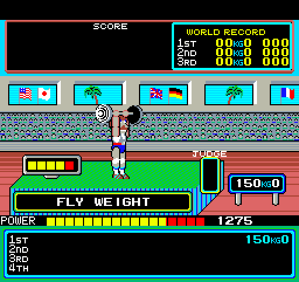

# Hyper Sports (Konami, 1984) on the Atari STE



MAME set `hyperspt` (Konami GX330; `konami/hyperspt.cpp`, `trackfld_a.cpp`).  The port is Track & Field's
([its README](../trackfld/README.md): the same board family, the same runtime and renderer design) with this board's
memory map.  The main CPU, a KONAMI-1 (an MC6809 with encrypted opcodes, 48 KB of ROM), is statically translated to
68000 code (`engine/m6809x.py`) and checked against a reference board in lock-step; the idle point, the sprite RAM and
scroll copies and a division are natives.  The sound board's Z80 driver is translated with Track & Field's player
(the SN76489A on the YM2149, the VLM5030's speech and the DAC tunes rendered offline onto the DMA sound; the driver's
tick and note step natives).  The picture is MAME's, 256 x 224, centred in the 320-pixel screen with the top and bottom
borders open, exact against the reference in the shown colours; one 16-colour palette by the shared default fitter,
flat.  Status: **Incomplete** (85% speed with sound, 26.9 pictures a second on average; no full-game verification
yet).  Speed: 85% of the arcade's rate (median 57 arcade frames a second), 26.9 pictures a second on average, median
28, 10th percentile 9.5, with the sound (Hatari, `tools/bench.sh 6000`, the AUTOPLAY script, DEBUG build, 4 MB,
2026-10-29); the 2026-11-02 changes (logic -15.7%, a picture -7.6% on Musashi) are not yet measured in Hatari.

## Build and run

```sh
python port.py cover hyperspt               # coverage: ref/cover.py seeds 1-12 (~1 min in parallel)
python port.py build hyperspt               # -> run/hyperspt/HYPERSPT.PRG
python port.py test hyperspt                # lock-step (seeds 1, 5, 9), render (seed 5), sprite edges, natives
python port.py run hyperspt shot@30         # Hatari (F030Arcade build), screenshot at 30 s
python port.py mame hyperspt                # the reference against MAME 0.289 (ref/mame_cmp_hyperspt.py)
python games/hyperspt/tools/prepare.py      # verify assets/roms/hyperspt.zip, unpack to assets/roms/extracted/hyperspt/
python games/hyperspt/tools/build.py        # -> run/hyperspt/HYPERSPT.PRG (--sim: run/hyperspt_sim; --assets: colours again)
python games/hyperspt/tools/logic_test.py 20000 --seed 5  # the translation in lock-step with the reference
python games/hyperspt/tools/render_test.py 3000 --seed 5 --start 500   # the STE picture against the reference
python games/hyperspt/tools/sprite_test.py                # edges, all 16 shifts, holes, guards, 64 KB crossings
python games/hyperspt/tools/native_test.py 2000           # src/natives.s against the 6809, edge cases included
games/hyperspt/tools/bench.sh 6000          # Hatari speed (its own Hatari, killed by PID): logic and pictures a second
python games/hyperspt/ref/mame_cmp_hyperspt.py [frame ...]  # the reference against MAME 0.289
python games/trackfld/ref/cover_sound.py hyperspt <seed> 20000  # sound coverage: seeds 1-12 the game's, 101-103 random
python games/hyperspt/tools/sound_test.py 6000 --seed 1   # the STE's sound player against the model every frame
python games/trackfld/ref/sound_cmp.py hyperspt 1 4000    # the STE's sound schedule against the MAME-timed board
SOUND=1 AVI=1 games/hyperspt/tools/bench.sh 6000          # Hatari with sound: run/hyperspt_bench/hyperspt.avi, .wav
```

Supply `assets/roms/hyperspt.zip` (MAME's parent set; `docs/rom_manifest.json` has the files' sizes, CRCs and
SHA-1s).  Nothing ROM-derived is in git: the graphics, colours and ROM image are made into `build/hyperspt/` and
assembled into the program.  The program with the sound and the generated sprite code (the 0.7 release, 2026-11-02):
3,500,396 bytes to load (`tools/release.py` MAX_LOAD 3,700,000), its floppy an 800 KB image.  Paths are relative to
this folder; `engine/`, `tools/`, `port.py` and `docs/` at the top are the repository's.

## Controls

**5/6** coin 1 / 2, **1/2** start; the left button (run, fire left) **Left / Z**, the right button **Right / C**, the
action (jump, the angle, lift: hold) **Up / Space / Control / X**; **Esc** quits.  Joystick port 1 player 1, port 0
player 2: left and right the two buttons, up and fire act.  Jaguar pad / PowerPad: pad A player 1, pad B player 2, the
D-pad's left / right and **A / C** the buttons, **B** and up act, **Option** coin, **Pause** start.  DIP switches:
MAME's defaults (the game over after the last event, demo sounds on, the records kept, difficulty "Normal 8").

## State

* **Logic**: exact against the reference's port schedule.  `tools/logic_test.py`: the sprite RAM and scrolls
  $1000-$10FF, the video RAM, RAM and NVRAM $2000-$3FFF, the latch (Q0, Q7), the sound commands (Q1's rising edges).
  Seeds 1-12 20,000 frames each (attract, the name entry, play to the game over and again; every event from its start
  by MAME's cheats with always the first try and no false starts; two players; the other DIP switches).
  `tools/native_test.py`: the natives equal the 6809 in 2,000 random states and the edge cases.
* **Picture**: exact in the shown colours.  `tools/render_test.py`: 0 differences in 715 sampled pictures of seed 1
  and 786 of seed 5 (skeet shooting); `tools/sprite_test.py`: 154 made-up pictures exact (both side edges at every
  shift, holes, flips, overlaps, MAME's x - 256 wrap, the guard lines, 64 KB crossings, 60 pictures in a row with
  moving sprites, scrolls and tiles).  `BLIT_STATS=256`: every pass HOG, the longest 132 bus cycles.  The reference
  equals MAME (How it works).
* **Sound**: `tools/sound_test.py`: the STE player equals its model every frame (seeds 1, 5, 9); `ref/sound_cmp.py`:
  97.6% of the SN voices' audible states equal to the MAME-timed board's; in Hatari the effects, the speech, tune 0
  and the event music play (Sound).
* **Hatari** (F030Arcade build, STE, 4 MB, TOS 2.06): boot, attract, coin, the name entry, swimming, the game over;
  no crash, no late border event in 6,000 VBLs.
* Not done, most important first: a full-game playthrough; the speed (85% with the sound, 9.5 pictures a second at
  the 10th percentile); the DAC's pulses outside the tunes (Sound); the cocktail flip; the service mode; players 3
  and 4 (P3_P4).

## How it works

### The board and the reference

`tools/machine.py` follows MAME's `konami/hyperspt.cpp`: the KONAMI-1 at 1.536 MHz, 60 Hz, the IRQ at the VBLANK
while the LS259 latch's Q7 is 1; sprite RAM $1000-$10BF (48 entries: attributes, y, code, x; attributes bit 5 the
code's bit 8: 512 sprites of 16 x 16, 4 bpp) and the row scrolls $10C0-$10FF, the watchdog $1400, the latch
$1480-$1487, the sound latch $1500, DSW2 $1600, SYSTEM / P1_P2 / P3_P4 / DSW1 $1680-$1683, video and colour RAM
$2000-$2FFF (64 x 32 tiles of 8 x 8, 4 bpp, 1024 codes: the colour byte's bits 7 and 6 are the code's bits 8 and 9),
RAM $3000-$37FF, NVRAM $3800-$3FFF, ROM $4000-$FFFF.  `ref/mame_cmp_hyperspt.py` (2026-10-29): 0 of 512 pens and 0
pixels differ at frames 60-3600; the MAME-timed reference's RAM equals MAME's but for 1-3 stack bytes.

### Translation

`tools/gen.py`: the 6809's 64 KB are one block (`hs_mem`), so every slot's base is the same.  The sites the coverage
saw touch the I/O or store to the video RAM go through `main_io_r` / `main_io_w` (they route every address as the
board does: the boot's test of $1000-$13FF reads 0 from the unmapped $1100-$13FF), except the byte stores whose
address is in $2000-$2FFF: those write the byte and list the cell for the renderer themselves (`video_inline`, 218 of
264 sites; word stores still call `main_io_w`).  ROM page $E000-$FFFF holds data only: no dispatch table.  As Track &
Field's: `fixed_slots` (no page checks), `fast_forms`, the return compares ordered by the coverage's return counts,
and `call_summaries` (a call's live flags from its callee's summary): together 16-21% off the logic.

### Natives

`src/natives.s`, gen.py NATIVES: the IRQ handler's copies of the sprite RAM ($4FBD: $3600 -> $1000, 144 bytes) and
the scrolls ($4FD2: 64 bytes) as long moves, and the division at $A62B (0:D rotated, the divisor normalized, shift and
subtract, the quotient in X, the remainder rotated back) in registers, step for step as the 6809 does it (the count
byte that wraps for a divisor of $1000 or more, the bytes <$5B-$5F, the flags at the RTS).  The play gives the
division small divisors only, so `tools/native_test.py` checks the natives against the 6809 (the reference CPU) in
2,000 random states and the edge cases (X = 0, $1000 and more).

### Schedule

The port (`machine.HyperSportsPort`, `src/hyperspt.s`): the foreground is a task loop ($41B1: LDX <$1E; LDD ,X; ASLA;
BCS: an empty queue entry has bit 7); the IRQ handler ($44F5) plays the game and queues tasks.  The idle point $41B1
with an empty queue is a native (`hs_idle`, gen.py NATIVES): the picture is drawn when due, the next arcade frame
awaited and the IRQ delivered (Q7 1) with $41B1 as its return address; its RTI comes back there.  Six arcade frames
to five VBLs; MAX_SKIP 3.

### Picture

Track & Field's renderer ([its README](../trackfld/README.md#picture)): the playfield in STE planes, the rows drawn
only where their scroll or cells changed or sprites were (sprite-only rows over the sprites' 16-pixel groups), the
sprites' generated code and row path, clipped at the group-aligned edges, whole into guard lines.  The generated code
covers the most drawn shapes up to 98% of the coverage's draws (`tools/assets.py` SHARE: 147 of 405 shapes, 1,612
routines, 126 KB of streams; 6 transparency classes): code for all of them would need ~1.6 MB and take the program
over the load budget (4.67 MB against `tools/release.py` MAX_LOAD 3.7 MB); with the 147 shapes 3.50 MB.

**Colours** (2026-11-05): black and 15 by the shared default fitter, flat (`engine/palette_native.py`, one STE index
per PROM pen; text and HUD glyphs flat, black slot zero; [colours](../../docs/colours.md)): mean OKLab distance x 100
over the non-black pixels 1.617 (the old Oklab k-means fit 0.733), sprite pixels 1.447 (2.681), tile pixels 0.799
(0.330): the sprites gain, the tiles lose.

### Sound

The sound board is Track & Field's family (MAME 0.286 `konami/hyperspt.cpp` sound_map, `trackfld_a.cpp`); the model,
the translation and the player are Track & Field's, shared (`games/trackfld/tools/sound.py` GAMES, `sndgen.py`,
`src/sound.s`, `ref/cover_sound.py`, `ref/sound_cmp.py`; [its Sound](../trackfld/README.md#sound) has the design).
This board, without mirrors: a Z80 at 3.579545 MHz, ROM $0000-$3FFF (c10, c09), RAM $4000-$4FFF, the command latch
$6000, $8000 the timer (total cycles / 1024, & 3) with BSY in bit 2, the VLM5030's data $A000 and pins $C000-$DFFF
(A4 ST, A5 RST; its 8 KB ROM c08), the DAC $E000, the SN76489A's latch $E001 and strobe $E002.

The driver (16 KB): the loop's head $0238 (`ei`), a rising edge of the timer's bit 1 (4096 cycles), or bit 0 (2048:
"fast ticks") while $400B is set (the DAC envelope of some effects); the three channels, the DAC envelope twice a tick
in fast mode, the speech queue ($044C), the output-enable pins (`$03F4`, every tick), the tune check ($0231).  The IRQ
handler: 0 all off, $01-$3F effects, $40-$47 the tunes, $60-$68 effects $36-$3E, $80-$D9 phrases into the queue, $FF
speaks it.  The tunes ($030D: `rst $10` through $2198) reset the VLM first (RST pulsed: a phrase stops), then play the
DAC waveform and the SN: tune 0 4.5 s (a game's start; the only one the game's coverage sends), 1-7 4.0, 4.7, 8.6,
13.2, 23.0, 17.1 and 2.9 s (random commands only).

* **The STE's schedule** (`TickBoard`): Track & Field's; a frame is 119,318 half Z80 cycles (60 Hz), a tick 8,192, a
  fast tick 4,096 (chosen by $400B at the tick's start).  A tune's effect includes the VLM reset (the busy time
  cleared, the DMA's phrase stopped, the data byte latched).  `ref/sound_cmp.py hyperspt 1 4000`: each SN voice's
  audible states in order **97.6%** equal (2,758 of 2,825), the phrases and tunes started 9 of 9 in the same order.
* **Coverage**: seeds 1-12 (the game's commands) and 101-103 (random), 20,000 frames each: 3,110 instructions, 9 pin
  sites (`ld (hl),a`); BSY is read with the timer's bits in the same byte (the waits are left out: the STE's read
  gives BSY with timer bits 0; the driver masks with 4).
* **Natives** (2026-10-29, `src/sound.s`): the tick (`snd_tick`, $024F-$02D0: the channels' bookkeeping, the DAC
  envelope's counter, the speech queue's check, the VLM's pins in 68000 code; the translated code entered only where
  there is work, with return addresses $FFE0-$FFEA on the Z80 stack whose dispatch entries come back: `sndgen.py`
  TICK_TOKENS) and the channels' note step (`snd_note`: the handlers $0E76 / $0E7E / $0E86 and $0C03 / $0C2E while
  the note's counter runs); the idle-tick native (`snd_idle`) and the pins' store skipped when unchanged.
* **DMA**: 73 phrases (29.5 s) and the 8 tunes (77.9 s) at 12,517 Hz: 1,344 KB.  With the sound the program grew from
  381,843 to 2,154,009 bytes (the samples 1,344 KB, the dispatch table 256 KB, the 64 KB block).
* Not done: the DAC's pulses outside the tunes (the $400B envelope: 600-8,300 pulses in a 20,000-frame game seed, the
  attract's most; [Track & Field's Sound](../trackfld/README.md#sound)); the relative levels of the YM and the DMA are
  a guess.

## Speed

| Date | Setup | Logic | Pictures | Musashi cycles |
|---|---|---|---|---|
| 2026-11-02 | Musashi, seed 5's skeet shooting (`render_test.py 4000 --seed 5 --start 1000 --every 4`; the logic `logic_test.py 3000 --seed N`) | | | logic with the sound 62.4k an arcade frame (seed 5), 52.4k (seed 9); a picture CPU + Blitter mean 92.3k, median 94.5k, p90 202.7k |
| 2026-10-29 | Hatari, `tools/bench.sh 6000` (the AUTOPLAY script: coin, start, the name, running), DEBUG build, 4 MB, with the sound | 85%, median 57 arcade frames a second | 26.9 on average, median 28, 10th percentile 9.5 | |
| 2026-10-29 | the same without the sound (`EXTRA="-D NOSOUND=1"`) | 93%, median 60 | 34.6, median 34.5, 10th percentile 15 | |

The logic is dearer than Track & Field's (~2,200 6809 instructions a frame): ~30-56k Musashi cycles an arcade frame
without the sound (seeds 1-12 over 20,000 frames each, 2026-10-29: 29.6k-56.0k; seed 5's skeet shooting 52.8k, seed
9's weightlifting 56.0k).  The sound adds 20-36k: the driver runs ~2,100 Z80 instructions an arcade frame on average,
~5,400 with the three channels' music in fast ticks (~186 a tick, 29 ticks a frame), up to ~80k cycles an arcade frame
in attract and in the events.  The logic with the sound / without (`logic_test.py`, 2026-10-29): seed 1 58.3k / 29.8k
(3,000 frames), seed 5 77.1k / 57.2k (3,000 frames; 20,000 frames: 89.3k / 52.8k).  The rest of the sound after its
natives (~8.6k cycles a frame in seed 5's play, against ~67k for the game's logic) is spread thinly: the channels'
handlers, the runtime's tick loop (`snd_next`, `snd_frame`), the SN writes.  A picture (2026-10-29,
`tools/render_test.py 1600 --seed 5 --start 1000`, Musashi): 79.8k CPU + 48.0k Blitter bus cycles.

What made it fast, newest first:
* **Sprite damage restores only the sprites' groups** (2026-11-02, Track & Field's renderer): a picture, CPU +
  Blitter, mean 100.0k -> 92.3k (-7.6%), median 100.0k -> 94.5k, p90 206.2k -> 202.7k; the Blitter 35.1k -> 24.7k,
  the CPU 64.8k -> 67.7k.
* **Video RAM stores inline** (2026-11-02, `video_inline`): the logic 74.0k -> 62.4k cycles an arcade frame (seed 5,
  -15.7%: the I/O handler was 37% of it), seed 9 59.2k -> 52.4k (-11.5%); in the render run mean 96.2k -> 84.0k,
  median 104.3k -> 90.2k, p90 118.3k -> 102.3k, the screen changes' maximum 1.24M -> 0.94M.  The program +12 KB.
* **The sound's natives** (2026-10-29: the tick, the note step): seed 5's logic (`logic_test.py 3000 --seed 5`) 77.2k
  -> 75.2k (the tick) -> 74.0k cycles an arcade frame; Hatari 83% -> 85%, 24.6 -> 26.9 pictures a second (median
  23.5 -> 28, 10th percentile 8.5 -> 9.5).  Before them the idle-tick native (`snd_idle`) and the pins' store skipped when
  unchanged took 15% off.
* **Generated sprite code** (2026-10-29): a picture 87.6k + 50.4k -> 79.8k + 48.0k (`-D REN_GEN=0`: every sprite on
  the row path); Hatari 23.6 -> 24.6 pictures a second (83% both; median 23 -> 23.5, 10th percentile
  8.5 both).
* **Logic natives** (2026-10-29, Natives): without them / with them (20,000 frames): seed 1 47.7k / 39.3k, seed 5
  59.8k / 52.8k, seed 9 82.7k / 56.0k; without the sound in Hatari 91% -> 93%, 31.6 -> 34.6 pictures a second (median
  30 -> 34.5, 10th percentile 12 -> 15).
* **The translator's flag work** (2026-10-29, `fixed_slots`, `call_summaries`): 16-21% off the logic; without the
  sound in Hatari 89% -> 91%, 28.4 -> 31.6 pictures a second (median 26.5 -> 30, 10th percentile 11.5 -> 12).

Measured, not kept: generated code for all 405 shapes (~1.6 MB, 4.67 MB to load: over the load budget; Picture).

Techniques other ports use that may apply:
[speed.md](../../docs/speed.md#techniques-that-look-applicable-elsewhere-2026-11-07).

## Tests and tools

* `tools/logic_test.py N --seed S`: lock-step against the reference (the compared state: State); the logic's Musashi
  cycles an arcade frame.
* `tools/render_test.py N --seed S --start F [--every K]`: the STE picture against the reference, with per-picture
  cycle percentiles; `-D REN_GEN=0` builds put every sprite on the row path.
* `tools/sprite_test.py`: made-up pictures (edges, 16 shifts, holes, flips, overlaps, the x - 256 wrap, guards, 64 KB).
* `tools/native_test.py N`: `src/natives.s` against the 6809 in N random states plus the edge cases.
* `tools/bench.sh N`: Hatari, logic and pictures a second (`EXTRA="-D NOSOUND=1"` without the sound; `SOUND=1 AVI=1`
  records the AVI and WAV).
* `tools/sound_test.py N --seed S` (2026-10-29): seeds 1, 5 and 9, 6,000 frames each: the sound RAM, the SN's and the
  YM's registers, the YM's channels, the schedule's time, the VLM's busy time and the DMA's requests equal every frame
  (9, 6 and 35 phrases, tune 0); `sound_test.py` seeds 1, 5, 9 equal with the sound natives too.  The logic, render,
  sprite and native tests pass with the sound build.
* `games/trackfld/ref/sound_cmp.py hyperspt SEED N`, `games/trackfld/ref/cover_sound.py hyperspt SEED N`: shared with
  Track & Field.
* `ref/mame_cmp_hyperspt.py [frame ...]`: the reference against MAME.
* Hatari with sound (`SOUND=1 AVI=1 tools/bench.sh 6000`): silent until the AUTOPLAY's coin (21 s), then 85 of the 110
  seconds after it sound (the effects, the speech, tune 0, the event music); the dominant frequencies 150-940 Hz.

## Lessons

### 2026-10-29: a native's edge cases are not in the play

The play gives the division at $A62B small divisors only; `tools/native_test.py`'s random states and edge cases found
the routine's CLRs clearing C before the first ROLB, which the play never shows.

## Verification

No playtest beyond the AUTOPLAY script (coin, start, the name entry, running) in Hatari; the lock-step seeds reach
every event by MAME's cheats.

Full-game verification follows the [status policy](../../docs/port-status.md); nothing here claims a complete playthrough.
