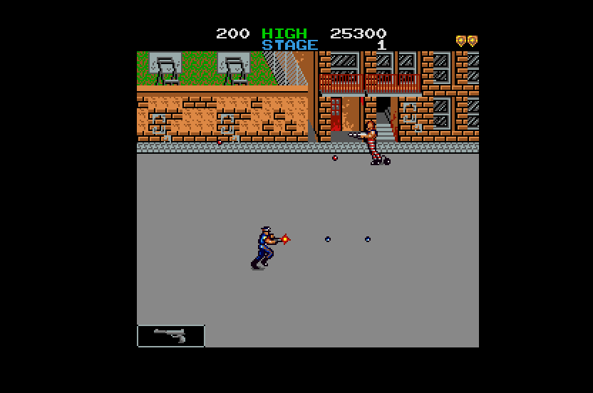

# Jail Break (Konami, 1986) on the Atari STE



MAME set `jailbrek` (Konami GX507; `konami/jailbrek.cpp`, `k005849.cpp`; the clones `jailbrekb`, `manhatan` are not
used).  The main CPU, a KONAMI-1 (an MC6809 with encrypted opcodes, 32 KB of ROM), is statically translated to 68000
code (`engine/m6809x.py`, 6,052 instructions) and checked against a reference board in lock-step; its idle point is a
native that delivers the Konami 005849's interrupts (eight NMIs and the IRQ a frame).  The VLM5030's BSY pin, which
the game polls, is modelled (in the reference and in the runtime); the SN76489A plays on the YM2149 and the
VLM5030's 24 phrases on the DMA sound (sound is new: Hatari-checked, not heard by a person).  The picture is MAME's, 240 x 224, at screen x 48-287 with the top and bottom borders open, sprites by
generated code (`engine/sprite_programs.py`), exact against the reference in the shown colours; one 16-colour palette
by the shared default fitter.  Status: **Incomplete** (no full-game verification; sound judged by measurement only).
Speed (Hatari, STE, 4 MB, `tools/hatari.ps1`, the AUTOPLAY script, DEBUG build, sound on, 2026-11-08): over the whole
3,001-VBL run (boot and attract mode included) 40.5 arcade frames a second (67% of 60.6) and 15.4 pictures a second; in
play-only windows before the audit (2026-11-07) 46-54 frames (76-90%) and 11-13 pictures; see Speed.

## Build and run

```sh
python port.py cover jailbrek               # coverage: ref/cover.py seeds 1-12 (~10 min in parallel)
python port.py build jailbrek               # -> run/jailbrek/JAILBREK.PRG
python port.py test jailbrek                # lock-step (seeds 1, 3, 6), render (seed 3), sprite edges
python port.py run jailbrek shot@30         # Hatari (F030Arcade build), screenshot at 30 s
python port.py mame jailbrek                # the reference against MAME (ref/mame_cmp_jailbrek.py)
python games/jailbrek/tools/prepare.py      # verify assets/roms/jailbrek.zip, unpack to assets/roms/extracted/jailbrek/
python games/jailbrek/tools/build.py        # -> run/jailbrek/JAILBREK.PRG (--sim: run/jailbrek_sim; --assets: colours again)
python games/jailbrek/tools/logic_test.py 20000 --seed 3  # the translation in lock-step with the reference
python games/jailbrek/tools/render_test.py 3000 --seed 3 --start 700   # the STE picture against the reference
python games/jailbrek/tools/sprite_test.py                # edges, all 16 shifts, holes, guards, 64 KB crossings
powershell -File games/jailbrek/tools/hatari.ps1          # hidden Hatari: AVI, stills and counters (AUTOPLAY build)
python games/jailbrek/ref/mame_cmp_jailbrek.py [frame ...]  # the reference against MAME (wolfmame-0248)
```

Supply `assets/roms/jailbrek.zip` (MAME's parent set; `docs/rom_manifest.json` has the files' sizes, CRCs and
SHA-1s).  Nothing ROM-derived is in git: the graphics, colours and ROM image are made into `build/jailbrek/` and
assembled into the program.  The program is 3,583,298 bytes (with the 262 KB of speech) (text + data + BSS + 256) to load (`tools/release.py` MAX_LOAD 3,700,000).  Paths
are relative to this folder; `engine/`, `tools/`, `port.py` and `docs/` at the top are the repository's.

## Controls

**5/6** coin 1 / 2, **1/2** start, player 1: arrows move, **Space / Control** fire (button 1), **X / Alt** select
the weapon (button 2); player 2: **W A S D** move, **Q** fire, **E** select.  **Esc** quits.  Joystick port 1 player 1,
port 0 player 2.  Jaguar pad / PowerPad: pad A player 1, pad B player 2, the D-pad moves, **A / C** fire, **B**
selects, **Option** coin, **Pause** start.  DIP switches: MAME's defaults (3 lives, upright, bonus 30K 70K+, difficult,
demo sounds on, no flip, single controls).

## State

* **Logic**: exact against the reference's port schedule.  `tools/logic_test.py`: RAM $0000-$203F (colour and video
  RAM, sprite RAM, work RAM, scroll RAM), the video chip's control registers, the speech chip's BSY pin and its count,
  every frame.  Seeds 1-12, 20,000 frames each (attract, coin, start, random play to the game over and again; lives
  and weapons by MAME's cheats; two players; the other DIP switches).
* **Picture**: exact in the shown colours.  `tools/render_test.py`: 0 differences in the sampled pictures of seed 3's
  play (frames 700-3000) and of its attract mode; `tools/sprite_test.py`: 136 made-up pictures exact (both side edges
  at every shift, holes, flips, overlaps, x from -256, the guard lines, 64 KB crossings, 60 pictures in a row with
  moving sprites, scrolls and tiles).  `BLIT_STATS=256`: every pass HOG, the longest 124 bus cycles.  The reference
  equals MAME (How it works).
* **Hatari** (F030Arcade build, STE, 4 MB, TOS 2.06): boot (the RAM test), attract, coin, start, play (the scripted walk and fire: score 0 -> 400 in
  the stills, the 1UP, the lives, the weapon box, the car, enemies and shots), the score ranking; no crash, no late border event in 3,001 VBLs (2 border
  fallbacks).  Colours as the arcade's (a 16-colour fit).
* **Sound** (2026-11-07, Hatari with `hatari.ps1 -Sound 1`, audio extracted from the AVI): silent through the boot, then
  the attract mode's tones (peaks in the spectrum at the SN's periods, e.g. 1,508 / 2,980 Hz for periods 32 / 16 at
  1.536 MHz, held for seconds as in the reference's register log); a phrase asked at the start (`-D SPEECHTEST=144`)
  correlates 0.79 with its rendered samples in the recording at the expected time.  Not heard by a person: the
  YM mapping (the three loudest of four voices) is Track & Field's and loses the fourth voice.
* Not done, most important first: a full-game playthrough (the coverage is random play with lives and weapons
  cheats: the stages beyond the first were seen only as far as that play got); the cocktail flip (ctrl 4 bit 3: the
  reference renderer stops there); the 005849's column-scroll mode (ctrl 2 bit 2: in the reference renderer, never
  set by the game, not in `render.s`); the service mode; speed (below).

## How it works

### The board and the reference

`tools/machine.py` follows MAME's `konami/jailbrek.cpp` and `k005849.cpp`: the KONAMI-1 at 1.536 MHz, 60.6 Hz, 264
lines of 96 cycles.  The Konami 005849's timer runs every 16 lines: an NMI every 32 lines from line 16 (eight a frame;
its enable is ctrl 4 bit 0), the IRQ at line 240 (bit 1; an FIRQ every other frame, bit 2, never used), writing ctrl
4 with an enable bit 1 -> 0 clears that line.  RAM: colour RAM $0000-$07FF, video RAM $0800-$0FFF (a 64 x 32 tilemap of
8 x 8 tiles, 1024 of them: colour RAM bits 6-7 are code bits 8-9), 48 sprites at $1000 (code, attributes, x, y:
16 x 16, 512 of them, x 9 bits), work RAM to $1FFF, scroll RAM $2000-$203F (a row scroll a tile row, bit 8 in the second
half), ROM $8000-$FFFF.  The picture is 240 x 224 (bitmap columns 8-247, lines 16-239); colours are a 32-entry palette
PROM (4-4-4 bits) through two lookup PROMs.  A sprite pixel whose lookup entry is 0 is transparent.

The game reads the VLM5030's BSY pin at $6000 in the NMI handler and waits for the end of a phrase before it goes
on: the reference models the chip's BSY exactly as `vlm5030.cpp` does (ST rising raises it; ST falling starts the
phrase at the table entry the data latch names; the phrase's frames are walked as the chip does, six bytes a frame,
silent frames and the end mark by their command byte; BSY falls on the sample grid clock / 440).  Without it the
game's speech state never ends and the frame sequence of MAME is not reproduced.

`ref/mame_cmp_jailbrek.py` (MAME 0.248's `wolfmame-0248` from F030Arcade; the 0.286 source is the truth): **0 of 512
pens and 0 pixels differ** at frames 60, 300, 600, 1200, 1500, 1548, 2000, 3000, 4000, 6000 (the renderer draws MAME's
own memory).  The reference machine's RAM equals MAME's at frames 100 and 200 exactly and to frame 1548 but for the
stack bytes below the stack pointer and the NMI handler's scratch ($1706-$1721, $16C0-$16C5), then drifts by one and then two
arcade frames against the 0.248 binary: MAME's frame 1555 equals the reference's 1554, its 1600 the reference's 1598 and 1700
its 1698 (the first speech comes at frame 1570 in MAME, 1568 in the reference); its picture is equal to MAME's again at 4000 and
6000.  **Cause found (2026-11-08): the binary is not the source.**  `ref/mame_ctrl_trace.py` runs the 0.248 binary with
`ref/mame_ctrl_trace.lua`, which logs the writes to the control registers and the reads of the interrupt vectors with the
main CPU's local time in cycles; compared with the reference's own vector reads:
* the IRQ and NMI are first enabled at frame 248: until then nothing differs, so nothing could show a difference;
* the 0.248 binary raises the NMI every 32 lines (3072 cycles) from power-on, free-running and not tied to the frame
  (its phase against the frame moves every frame), and the IRQ at the frame's end
  (its time origin is the vblank start); the 0.286 source (`k005849.cpp`, the reference) raises the NMI at the lines 16, 48,
  ..., 240 of every frame (a 40-line gap at the frame's wrap) and the IRQ at line 240 -- the same rate, 8 a frame, but a
  different phase against the game's tick, which is why the speech and the tick drift apart after 1550 where the game has no
  time to spare;
* `JailBreak.mame248 = True` (`run_frame_248`: the NMI as a pulse every 3072 cycles from power-on while ctrl 4 bit 0 is set, the IRQ
  at the frame's end) with `JB248=1 python games/jailbrek/ref/mame_cmp_jailbrek.py 100 1200 1548 1555 1600 1700 2000 3000 4000 6000`:
  **no frame differs but for 1-6 stack bytes below the stack pointer ($17C4-$17EF)**, at 1555, 1600, 1700, 2000, 3000, 4000 and 6000, with 0
  pixels and 0 pens differing.  The drift is therefore the binary's interrupt schedule; the port and the default reference keep the
  source's (the authoritative one).  There is no 0.286 binary with this driver here to check the source against.

### Translation

`tools/gen.py`: the 64 KB are one block (`jb_mem`), every slot's VB is the same address.  Coverage (`ref/cover.py`, 12
seeds of 20,000 frames: about 5,100 pcs) decides which accesses go through the runtime: the video chip's control
registers ($2040-$2047), the inputs and sound ports ($3000-$6000), stores to the colour and video RAM (listed as dirty
cells for the renderer; byte stores inline).  The direct page is $15 (set once, at the start of the RAM test; the work
RAM, the queue and the stack share the first slot).  A read-modify-write of the video RAM (`dec $0830` at $907B, a
timer on the screen) cannot go through the runtime (`m6809x` has no such form): `gen.py` runs it on the memory and
lists its cell afterwards (`RMW_VIDEO`).  No engine file was changed.

### Schedule

The foreground is the Konami task loop of Track & Field and Hyper Sports ($8073 `ldx <$3C; ldd ,x; asla; bcs`, the
queue's read pointer at $153C).  The NMI handler ($B05D) steps three random generators ($16C0-$16C5) and polls BSY;
the IRQ handler ($8A57) plays the game and queues tasks.  The idle point is a native (`jb_idle`): with an empty queue
it draws the picture when due, waits for the next arcade frame, then delivers one interrupt per idle visit: seven NMIs,
an NMI and the IRQ (the arcade's order at line 240), each with $8073 as the return address; the speech chip's BSY
count (in NMIs: 16.27 speech samples each) goes down after each NMI handler.  60 arcade frames to 50 VBLs as in the
other Konami ports.

### Picture

`src/render.s` is Hyper Sports' with the playfield shown through the Shifter's fine scroll (see the speed table; `src/render_rows.s` is the version before, which copies each row at its exact scroll). The rest of this section describes the row version: a 64 x 32 tilemap in a 768-pixel-wide playfield of STE planes, a tile cache, three
display buffers whose rows are copied at their scroll (+ 8: the picture starts at bitmap column 8; 15 words a line),
a sprite cache baked on first use, generated code per (transparency class, code, flips) shape (544 shapes of the
coverage, 100% of the draws: 7,457 routines, 477 k lines, 682 KB of end-mask streams), Blitter HOP 2 / OP 3 passes with
the opaque pixels as end masks (no AND + OR pairs), rows grouped by mask, clipped at the picture's group-aligned edges
(screen x 48 and 288).  Jail Break differs in the geometry (240 pixels, left edge at group 3: bands of 48 and 32
pixels), the 9-bit sprite x, the first-to-last order (the last on top), 512 sprite codes, no tile flips.

### Sound

`src/sound.s` (no sound CPU: the main CPU drives both chips; `NOSOUND=1` keeps the register writes and plays nothing).
* **SN76489A** ($3100): the register file `jb_sn` (MAME's `sn76496_base_device::write`) is kept by `nat_sn_AF96` (the
  game's write routine at $AF96, a native: N Z from A, V clear, C kept as the translation leaves them; checked against
  the 6809 for every byte, random register files, latches and entry flags by `tools/native_test.py`) and by
  `main_io_w` for any other site; once an arcade frame `snd_ym` (Track & Field's player: a voice's key by its
  attenuation, the three loudest on the YM2149's channels, a voice keeping its channel, tone periods x 4e6 / 1.536e6,
  the noise on its channel, the attenuation to the YM's level) writes the YM registers that changed.  The fourth voice
  is lost when all four sound.  `logic_test.py` compares `jb_sn` with the reference's register file every frame.
* **VLM5030**: the pins and the data latch are in `main_io_w` (the BSY count); ST's falling edge asks the DMA sound for
  the phrase of (data latch, the parameter RST's falling edge latched): the 24 pairs the game can ask for (sound commands
  $80-$98: `ref/speech_combos.py`) were rendered by `engine/vlm5030.py` at build time (`tools/assets.py`: 12,517 Hz, 8
  bits, scaled together; 262 KB), start at the end of the arcade frame (the last request of a frame wins) and stop when
  RST rises on a busy chip.  `logic_test.py` checks the requests against the reference's log.
* Not done: the speech's loudness against the SN's (both unmixed: DMA and YM at the STE's fixed levels), the SN's noise
  shapes beyond the YM's one noise generator, a mix of the DMA with a fourth voice.

## Speed

Before the audit (2026-11-07), Hatari, 3,001 VBLs of the AUTOPLAY build (a coin, start, then walking and firing), sound on: 2,362 arcade
frames (39.4 a second over everything, the boot's RAM test and the attract mode included), 825 pictures; in play
(RATE.BIN, windows of 100 VBLs) 91-109 arcade frames and 22-27 pictures per 100 VBLs: about 46-54 arcade frames
(76-90%) and 11-13 pictures a second.  Musashi (`tools/render_test.py 1400 --seed 3 --start 1000`): the logic ~104,000
cycles an arcade frame (108,000 before the SN native), a picture 78,000 CPU cycles + 75,000 Blitter bus cycles
(`--prof`: `draw_rows` 38%, `draw_cell` 23%, `draw_sprites` 12%, `bake_sprite` 6%, `tile_draw` 5%).

* **Logic profile** (`render_test.py --prof logic`, `PROF_M=1` splits by arcade address, `PROF_N` lines): the SN76489A
  write routine ($AF96, 65 writes a frame: the NMI handler's three sound updates eight times a frame and the silencing
  loop) cost a quarter of the logic through the inline range check and `main_io_w` (13k + 13k cycles); as a native it
  is ~9k (134 cycles a call, 54 of them keeping C).  The rest is flat: the NMI handler and its sound routines ~40%
  (~5k an NMI), the IRQ handler's tick ~25%, `main_dispatch` 8.6k (returns not among the six compared first, RTI,
  jump tables), `jb_idle` 6.7k (9 interrupt deliveries), `main_io_w` 4.4k, `snd_ym` 2.3k.
* **The picture's biggest cost is one scroll value**: rows 2-25 (the playfield) always share one scroll value
  (measured over 1,000 frames of play: 744 frames change it, then all 24 rows; rows 0, 1, 26, 27 stay at 0).
  `draw_rows` recopies all 24 rows (8 lines x 4 planes x 15 words each: 4 HOG passes a line, ~158 CPU cycles a line, ~75k
  Blitter bus cycles) whenever it moves.  The real saving is the virtual-screen scheme of `docs/speed.md` ("Hardware
  scroll over virtual screens"): the band shown at its scroll by the video address and fine scroll, a Blitter copy only
  when the scroll crosses a 16-pixel group, the four static rows drawn each picture at the fine offset (they would move
  with the Shifter's fine scroll), sprites at their screen position plus the fine offset.  Not done: it changes the
  sprite geometry and the playfield cache; to propose to the user.  Merging equal-scroll rows in `draw_rows` would save
  only the per-row setup (~250 cycles x 24, 7% of a picture's CPU).  Two-line HOG passes (~240 bus cycles) would save
  ~30% of the CPU time of the row copies.
* **Speed audit (2026-11-08)**: logic 108k (before the SN native) -> 98k -> 88k cycles an arcade frame (Musashi);
  Hatari, 3,001 VBLs AUTOPLAY, sound on: 2,362 frames / 825 pictures (13.7 a second) -> **2,429 frames (40.5 a second) /
  926 pictures (15.4 a second)**.  The game is CPU-bound: pictures are drawn every fourth arcade frame while behind
  (`MAX_SKIP`), so pictures a second follow the arcade frame rate, and a logic cycle is worth ~3x a picture cycle.

  | Technique | Status | Before -> after |
  |---|---|---|
  | Natives at hot routines | applied: SN write `$AF96`, sprite-RAM copy `$9272` (`src/natives.s`, `native_test.py`, lock-step 8000 frames x 4 seeds) | 108k -> 98k (SN); 98k -> 88k (copy; the 8 x 8 priority loop ~15k -> 5k) |
  | 6809 inline_calls | applied for the 5 direct `JSR $AF96` sites (`_nf` forms); the `JMP $AF96` tail calls cannot | 93.8k -> 92.2k |
  | call_summaries, fast_forms, ret_weights, fixed_slots, video_inline | applied (translation settings) | - |
  | Window guards at coverage sites only | n/a (one flat 64 KB block) | - |
  | Hardware scroll (`src/render.s`, the default since 2026-11-08; `-D REN_ROWS=1` builds the older `render_rows.s`): the picture's 16 groups copied unshifted at the scroll's 16-pixel step, the fine part in HSCROLL (LINEWID -4), the side slivers cleared with end-mask passes, tile writes restore only their groups | applied, exact (render_test, sprite_test, lock-step) | picture 78k CPU + 75k Blitter -> 81k + 61k Musashi; Hatari 3,001 VBLs: 2,429 frames / 926 pictures -> 2,401 / 937 (a tie: -1.2% frames, +1.2% pictures); a halftone-masked copy (HOP 3) crashed Hatari (RAM corrupted after ~2,000 VBLs) and was replaced by a plain copy + clear; not checked on a real STE |
  | Tile column spans instead of whole-row redraws on a tile write | applied (in the option only) | whole rows 6.3 a picture -> spans |
  | Sprite programs (reordered-source passes), per-slot sprite cache, guard rows, damage by rows/groups | applied (before this audit) | - |
  | Palette stamps, colour cycling, parallax, two layers | n/a (one 16-colour palette, one scrolling layer) | - |
  | HUD as its own image (BD_VSWITCH) | not tried: the four HUD rows are 14k Blitter cycles only on scroll steps | - |
  | Spreading redraws, pictures-per-second schedule | `MAX_SKIP` 3 kept; 0 gives 23 pictures a second at 23 arcade frames | - |
  | Remaining logic | NMI handler's three sound interpreters (`$B0C6`, 8 a frame, ~25k), `main_dispatch` 8.6k, `jb_idle` 6.7k, the sound RTS dispatch | not done |

* Candidates not done: the NMI handler's random generators and sound sequencing as natives (the handler is ~5k cycles an NMI
  and eight NMIs come a frame: all writes the game repeats unchanged), a cheaper return for the 42 return points of
  $AF96's RTS (six compared, the rest through `main_dispatch`).
* The generated sprite code against the row path (`-D REN_GEN=0`, `render_test.py 1600 --seed 3 --start 1000`, 600
  pictures, Musashi, exact both): 91.6k CPU + 86.5k Blitter bus cycles -> 79.7k + 84.7k (kept).
* The code for all of the coverage's 544 shapes: 7,457 routines, 477 k lines; the order table is computed where a
  sprite is baked (`bake_sprite`).

## Tests and tools

`ref/cover.py` (coverage and pens), `ref/mame_cmp_jailbrek.py` (reference against MAME), `tools/prepare.py`,
`tools/gen.py`, `tools/assets.py` (palette fit, the speech chip's BSY table, the YM tables and the rendered phrases), `tools/native_test.py` (`nat_sn_AF96`), `ref/speech_combos.py`, `tools/build.py` (`--sim`, `--debug`,
`-D AUTOPLAY=1`), `tools/logic_test.py`, `tools/render_test.py`, `tools/sprite_test.py`, `tools/hatari.ps1`.
`python port.py test jailbrek` runs them.

## Lessons

* **A chip's busy pin is game state** (2026-11-07): the NMI handler polls the VLM5030's BSY at $6000 and clears a
  flag ($170D) when it falls; with BSY always 0 the reference left the RAM and the picture of MAME at the first speech
  (frame ~800).  Modelling it as `vlm5030.cpp` does put the speech sequences right; the port counts it in NMIs, with a
  table per bit-rate step and speed (the parameter latch's bits 0-1 and 3-5 both change a phrase's length: 17 =
  4800 bps halves it).
* **`screen().height()` is the total height** (264), not the visible one: the video chip's timer wraps after line 256.
  Its NMI is edge-triggered; the game clears and re-enables the line in the handler.
* **The reference's `frame_done` is not the interrupt**: see How it works; do not chase RAM equality at line 240 when
  two interrupts are due there.
* **A read-modify-write of a video RAM byte** (`dec $0830`) is outside `m6809x`: handled in `gen.py`.
* **The MAME snapshot is 240 x 224** (visible area x 8-247): the reference's `render_rgb` returns that.

## Verification

Playtest evidence: the Musashi tests above; the hidden Hatari run (`tools/hatari.ps1`: `tools/hatari.ps1`: coin, start and play to a score of 400 and beyond, in 3,001 VBLs, no crash, no late border event; the
stills are in `run/jailbrek_hatari/` (not in git)).  The full-game
status stays **Incomplete** (no playthrough; sound by measurement only); see the [status policy](../../docs/port-status.md).

**Long run (2026-11-08)**: `tools/hatari.ps1 -Frames 20000` (AUTOPLAY: a coin, start, then walking in four directions and firing, repeated every 4,000 arcade frames: it plays first levels and game-overs, **not the later stages**): 20,001 VBLs, 20,058 arcade frames (50.1 a second), 7,639 pictures (19.1 a second), no crash, no late border event.  In windows of 100 VBLs: arcade frames median 106 of 120 (88%), worst 47 (39%); pictures median 14.5 a second, worst 5.5 (busy stretches: sprite-heavy play).  An earlier run crashed at arcade frame 3,176 (bad pc): the discarded random coverage had never run the routine `$AA2A` of a jump table; the entries of all jump tables are now translation roots (`gen.py JUMP_TABLES`, the ones that decode), the crash dump (CRASH.TXT) also shows the arcade frame, the 6809 stack and the object at `$1340`.  Lock-step (`logic_test.py`, seeds 2 and 6, 8,000 frames; AUTOPLAY's inputs, 4,000 frames), `render_test`, `sprite_test` and `native_test` pass after it.  Not done: logic at ~90% of the arcade in busy play and 20+ pictures a second there (the game is CPU-bound: `MAX_SKIP=1` gives 19.4 pictures a second at 58% logic, `MAX_SKIP=3` 15.6 at 67% over the 3,001-VBL benchmark; the remaining logic cost is the NMI handler's sound interpreters and the return dispatch); a run that reaches later stages (cheats / Go-Explore / PPO, coverage of their routines); the audio capture compared with MAME's (nobody has listened to the sound).
