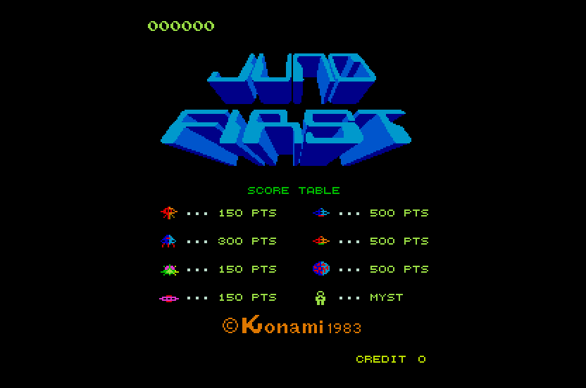

# Juno First (Konami, 1983) on the Atari STE



MAME set `junofrst` (Konami GX310, `konami/junofrst.cpp` with `tutankhm_v.cpp`).  The main CPU, a KONAMI-1 (an MC6809
with encrypted opcodes: ROM $A000-$FFFF and sixteen 4 KB banks in a window at $9000-$9FFF, nine of them with code) is
statically translated to 68000 code.  The picture is the arcade's 256 x 256 bitmap of 4 bpp turned as MAME's ROT90
turns it (224 x 256, centred in the 320-pixel screen, borders open); the CPU and the 16 x 16 blitter draw into it, and
here both draw into the planar STE picture directly.  The sound board is translated too: its Z80 driver runs on
the 68000 against an emulated AY-3-8910 whose three channels are the YM2149's, and the i8039's effects were rendered
offline to PCM for the DMA sound.  Status **Experimental**: logic, picture and the sound board's state are exact against
their references (the translated program against the reference machine, the sound driver against a Python Z80 model),
the program runs at about 61% speed in Hatari (MAX_SKIP 6), and the sound has never been compared with MAME's audio or listened to.

## Build and run

```sh
python port.py prepare junofrst          # verify assets/roms/junofrst.zip, unpack to assets/roms/extracted/junofrst/
python port.py cover junofrst            # coverage: ref/cover.py seeds 1-12 (30,000 frames each, ~15 min in parallel), then the
                                         # sound commands (ref/sound_log.py) and the sound Z80 (ref/cover_sound.py)
python port.py build junofrst            # -> run/junofrst/JUNOFRST.PRG (--sim: run/junofrst_sim; --tag: another folder)
python port.py test junofrst             # logic and render tests
python port.py mame junofrst             # the reference against MAME (WolfMAME 0.248: set MAME=...\wolfmame-0248\mame.exe)
powershell -File games/junofrst/tools/hatari.ps1 -Frames 4000 -Every 400    # hidden Hatari, AVI stills in run/junofrst_hatari
```

Supply `assets/roms/junofrst.zip` (MAME's 14 files under MAME's names; `docs/rom_manifest.json` has their sizes, CRCs
and SHA-1s).  Nothing ROM-derived is in git.  Paths are relative to this folder; `engine/`, `tools/`, `port.py` and
`docs/` at the top are the repository's.

## Controls

**Arrow keys** move the ship, **Space / Control / Z** fire (X: the second button), **5/6** coin 1 / 2, **1/2** start,
**Esc** quits.  Joystick port 1 player 1, port 0 player 2; Jaguar pads: D-pad and A / B / C, **Option** coin,
**Pause** start.  Player 2 on the keyboard: R F A D move, G fires.  DIP switches: MAME's defaults (3 lives, difficulty 1,
1 coin 1 credit, demo sounds on).

## State

* **The reference against MAME** (`ref/mame_cmp_junofrst.py`, WolfMAME 0.248, frames 60-3600, no input): 0 of 16 pens
  and 0 pixels differ; the reference's RAM ($0000-$800F, $8100-$8FFF) equals MAME's at every frame checked.
* **Logic**: `tools/logic_test.py`: the translation on Musashi frame by frame against the reference's port schedule
  (`machine.JunoPort`): RAM, palette RAM, the picture (the planar `vram` against the reference's video RAM, lines 16-239),
  the latch, the bank register and the sound commands, 6,000 frames in each of the seeds 1-12 (attract, coin, start, random
  play and game overs, 256 lives, coin 2, two players, other DIP switches).
* **Picture**: `tools/render_test.py`: every published display buffer and palette equals the reference picture through
  the pen map, 3,000 consecutive frames of seed 1 (run before the speed work below; the logic test compares `vram`
  after it, in all 12 seeds).  `tools/sprite_test.py`: the fast blitter path against the reference blit.
* **Hatari** (F030Arcade build, STE, 4 MB, TOS 2.06, `tools/hatari.ps1 -Frames 4000`, looked at by eye, not compared):
  title screen and score table (all 256 lines, the colours as MAME's) and the first wave's warp intro; no crash, no
  late border event in 4,001 VBLs (2 fallbacks of the top border).  Play beyond the first seconds of wave 1 was not
  watched there.
* **Sound** (`tools/logic_test.py --sound`, `tools/sound.py`, `tools/sndgen.py`, `src/sound.s`): the translated Z80 driver
  (1,853 instructions, `tools/sndgen.py` from `ref/cover_sound.py`'s coverage of the game's commands and random ones) runs
  every arcade frame on the sim; after each frame the AY's 16 registers, the YM registers written, the driver's RAM
  ($2000-$23FF above the stack) and the i8039 status equal `tools/sound.py`'s `STEBoard` (the same driver run by the Python
  Z80, the same schedule), 6,000 frames in each of the seeds 1-12.  What that does and does not say: the translation of
  the driver and the YM mix-down equal the model; the model's schedule (14.42 ticks an arcade frame, the commands
  handed over per frame, the loop's waits left out) is an approximation of the board's timing and **the audio has not
  been compared with MAME's or listened to** (Hatari ran with `--sound off`; the DMA player, a copy of Gyruss's, is
  only exercised there for crashes).
  Known gaps: (1) the commands $4C and $55 (bit 6 of the slot: the loop passes run at once, not on the tick) play
  by writing the AY's volume register thousands of times a second (a digitised effect on the real board): the YM gets the
  volume as it stands once a frame, so these are silent or buzz; the passes are capped at 64 an arcade frame (the
  real ones take 300-900 Z80 cycles of the frame's 29,500); (2) the AY's port B (the filters' capacitors, MAME's
  `flt_rc`) is not modelled; (3) the i8039's effects (1-8, 53 KB at 6,258 Hz) are the rendered DAC output of its own
  program, not compared with MAME's DAC writes (Gyruss's equivalent check was against a private MAME build);
  the peak of effect 3 sets the scale so the others are quiet; (4) the effects' timing against the music is the
  frame's, not the board's; (5) commands $59-$5B run the driver into garbage (the game never sends them).
* **Not done / not verified**: the flip (cocktail) screen; coverage is random play only (12 seeds,
  ~13,700 translated instructions): later waves, the high-score entry and other rarely reached code may run into
  `main_badpc`; no PPO / Go-Explore profile; no recorded-play comparison; the compare with MAME has no input.

## Speed

**With the sound (2026-11-08)**: Hatari `hatari.ps1 -Frames 4000`: 2,694 arcade frames in 4,001 VBLs (33.7 a second, 55.6% of
60.6) and 765 pictures (9.6 a second), no crash, no late border event.  The sound cost 11% of the speed first (31.5 a
second: the driver's 14.4 ticks an arcade frame, ~28,000 Musashi cycles a frame, 17% of the logic's average); then
`vram_wr` was rewritten (one table lookup for the plane byte and the pixel row, the pixel values' bit patterns in
`vw_bt`, 4 registers saved, a separate path for a zero byte: 532 -> 462 cycles a write, ~330 for zero bytes) and the
sound's tick loop runs inside the driver's hook without saving the registers between ticks (-6,000 cycles a frame).
Musashi logic average a frame, seed 1, 3,000 frames: 157,000 without sound, 192,000 with it, 168,000 now
(`logic_test.py --sound`; the 75th percentile of the frames 311,000, the 90th 450,000: a game tick's frame costs 300-500k and
the one between ~14,000 + the sound).  What is left:
`vram_wr` (~154 calls a frame on average, 40% of the cycles in play: the CPU's own sprite loops at $9EE0-$9F13 and the
dot routines $B380-$B4C0), the title screens' $98EA copy loop, the 5,193 "wrapped" sites, the full-picture copy.  The
per-write cost has no big cut left (4 `movep` + the table lookups ~ 330 cycles): the gain must come from natives that
draw whole shapes.

(The earlier measurement below, 2026-11-07, is without sound.)

Hatari 2026-11-07, `hatari.ps1 -Frames 4000` (AUTOPLAY: coin, start, move, the ship dies and the game plays on): 2,822
arcade frames in 4,001 VBLs (35.3 a second, 58% of the arcade's 60.6; 13.2 before the work below) and 935 pictures
(11.7 a second).  Musashi (`tools/logic_test.py`, 6,000 frames, seeds 1-12): the IRQ comes every other arcade frame, so
the cost is per game tick (two arcade frames, 264,000 cycles at full speed): the frames between cost about 14,000; the
75th percentile of the ticks is ~320,000-360,000 cycles, the 90th ~400,000-450,000, the maximum 1.5 million (a screen
that the program draws with its CPU loops).  What was done, in the order of the gain:

* the blitter (4-18 blits a frame): prepared images (`tools/assets.py`, 169 images, 865 KB: every non-empty 256-aligned
  image of the blitter ROM and every source the coverage saw; 16 shifts x 16 lines of two mask words and the plane words)
  drawn by 16 short HOG Blitter passes each (HOP 2 / OP 3 with the opaque pixels as the end masks, an erase HOP 0 /
  OP 0 with the same masks; one pass is 8 words, <= 96 bus cycles), ~2,300 cycles a blit instead of ~40,000; the words
  outside the picture are not drawn (group-aligned edges), a source without an image or a row that wraps (x > 240)
  takes the pixel by pixel path (`blit_slow`, the reference).  `tools/sprite_test.py`: 1,000 random cases (all 16
  shifts, every edge, copy and erase, unprepared sources, past the ROM) equal the reference blit;
* the program's clear loops ($A0ED, the boot's $A055) are natives (`native_clear_*`: Blitter fills of the picture's
  columns, short HOG pieces by `blit_go_fill`) instead of 29,000 byte stores each;
* `vram_wr` (the CPU's byte stores to the video RAM, ~140 a frame; the 98F0 copy loop of the title screens is the
  largest user): a table of every byte's plane address (`vw_ptr`, 128 KB) and `movep.l` read-modify-write of the four
  planes: ~350 cycles a byte instead of ~1,000.

What is left, by cost: `vram_wr` is still half of the logic's cycles (the CPU's own drawing loops, e.g. the byte copy at
$98EA that draws the title's image from ROM: a native that converts whole rows would remove most of it); the
translation's indexed accesses (`wrapped` in the translation report: 5,193 sites, not examined); the full-picture
Blitter copy of `render_frame` (40 KB, ~80,000 bus cycles a picture: a dirty-column copy would cut it).  Nothing
had to be dropped from the game so far.

### Speed audit (2026-11-08, docs/speed.md checklist)

Logic = Musashi cycles a frame (seed 1, 3,000 frames, with sound); Hatari = `hatari.ps1 -Frames 4000` autoplay.

| Technique | Status | Before -> after |
|---|---|---|
| `fast_forms`, `call_summaries`, `ret_weights`, `fixed_slots`, `slot_ctx` (6809) | applied from the start | switched off: +0.9%, +0.3%, +0.08% (169,941 / 168,952 / 168,604 vs 168,473): the logic is video stores, not translated code |
| `vram_wr` rewrite (tables, erase path) | applied | 532 -> 462 cycles a write; logic 185.7k -> 168.5k |
| sound tick loop in the hook | applied | -6k cycles a frame |
| natives: video clears, blit passes | applied | see Speed above |
| picture schedule `MAX_SKIP` | changed 3 -> 6 | 33.7 / 9.6 pictures a s -> 37.1 (61%) / 8.1; MAX_SKIP 12: 38.2 / 6.7 (not taken) |
| `video_inline` / writer marks | rejected (est.) | picture is the planar truth, no RAM compare; an inline range check saves ~18 of ~460 cycles a write |
| skip idle sound ticks / sound as recordings | rejected | silent frames still run 787 Z80 instructions (active 1,079): the sequencers keep counting |
| dirty-line picture copy (40 KB Blitter copy ~1 VBL) | rejected (not measured) | the starfield dirties every line in play |
| inline_calls, flags_at=set(), hardware scroll, palette epochs, sprite_programs for CPU drawing | n/a | no leaf calls worth it found; custom idle hook; no scroll; 16 fixed pens; CPU drawing is single bytes |
| whole-shape natives ($9EE0, $B3xx, $98EA, $CA00) | not done | next lever: `vram_wr` is ~40% of play |

## How it works

### The board and the reference (`tools/machine.py`)

* **Main CPU**: KONAMI-1 at 1.536 MHz (25,344 cycles a frame).  $0000-$7FFF video RAM (a 256 x 256 bitmap, 128 bytes a
  line, the even x in the low nibble), $8000-$800F palette RAM (one byte a pen, 3-3-2 bits through a resistor network),
  $8010 DSW2, $8020 SYSTEM, $8024 P1, $8028 P2, $802C DSW1, $8030-$8037 an LS259 (Q0 the IRQ enable, Q4 / Q5 the flips),
  $8040 the sound IRQ, $8050 the sound latch, $8060 the bank register, $8070-$8073 the blitter, $8100-$8FFF RAM,
  $9000-$9FFF the bank window, $A000-$FFFF ROM.  The IRQ comes on every other frame (a flip-flop at the VBLANK that has
  toggled once before frame 1: the first IRQ is the second frame).
* **Blitter** (`blitter_w`): 16 x 16 pixels from the 24 KB blitter ROM (nibble address, the high nibble first) to the
  video RAM at a nibble address (a row is 256 nibbles on); source pixels of 0 are skipped, the others are written, or a
  0 when bit 0 of the source address is clear (erasing).
* **Screen**: 256 x 224 visible (lines 16-239), ROT90: MAME's snapshot is 224 x 768 (every arcade column three rows);
  `np.rot90(rgb, +1)` equals it, picture line = 255 - x, column = y - 16.
* **Port schedule** (`JunoPort`): the foreground is a task loop at $A010 (queue read pointer $8872); the IRQ ($A00A) is
  delivered there on every other frame and the foreground then runs the queued tasks to the idle point again.
* **Difference to the 0.286 source**: the game writes Q4 = Q5 = 1 from frame 28 on; the 0.286 source's
  `flip_screen_x_w` flips the picture with the bit as is, but WolfMAME 0.248 shows the unflipped picture (what the
  reference matches: it flips while the bits are 0).  Not tested against a 0.286 arcade binary (none here).

### The translation (`tools/gen.py`, `engine/m6809x.py`)

* The window's code is virtual pages 8 + bank (slot 4's upper half), a context per bank (`ctx_banks`, a6; the bank
  register switches a6 and keeps the CC's E F H I); every data access of the program is flat (every VB is `jf_mem`).
* `engine/m6809x.py` got two backwards compatible Program options for this: `a3_pb` (DP and the stack are in slot 4,
  above $7FFF, out of reach of a 68000 displacement from VB: a3 = jf_mem + $8000, the static accesses `$offset(a3)`) and
  `indirect_io` (the pointer of `JSR [A,U]` / `JMP [A,U]` with the table in the bank window's data is read through
  `main_io_r`).  The constructor's assertion allows `a3_slot` up to 7.
* The accesses of the video RAM, $8000-$80FF and $9000-$9FFF go through `main_io_r` / `main_io_w`; the idle point is a
  native (`jf_idle`).

### The picture (`src/render.s`)

* The video RAM is not kept as bytes: `vram` is the picture, 256 lines of 160 bytes, planar.  `vram_wr` / `vram_rd`
  turn a byte (two pixels) into pixel writes / reads, `blit_run` runs the blit pixel by pixel; pixels in the arcade's
  lines 0-15 and 240-255 (not shown) are dropped.
* `render_frame`: a free one of three display buffers gets `vram` by one Blitter copy (HOG pieces, `borders_blit_go`) and
  the 16 palette RAM bytes through `ste_pal_tab` (the 16 pens are the 16 STE colours: exact, no fit; `tools/assets.py`),
  and is published for the next VBL (as Gyruss).
* Not optimised (see "Speed").

## Layout

`tools/` (prepare, machine, gen, assets, build, logic_test, render_test, hatari.ps1), `ref/` (cover, mame_cmp_junofrst),
`src/` (junofrst.s the runtime, render.s), `docs/` (rom_manifest.json, screenshot.png).
