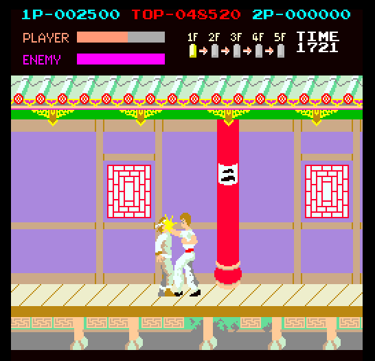

# Kung-Fu Master (Irem, 1984) on the Atari STE



MAME set `kungfum` (Irem M62, `irem/m62.cpp`, `m62_v.cpp`, the sound board `irem/audio/irem.cpp`).  The main Z80
program (32 KB, flat) is statically translated to 68000 code with inline leaves, run on idle hooks.  The sound board's
M6803 driver is translated too and plays its two AY-3-8910s on the YM2149 (three of the six channels); the MSM5205
ADPCM voices are decoded offline and played through the DMA sound.  The picture (all 256 x 256 arcade pixels, centred
in the 320-pixel screen, top and bottom borders open) is drawn by `src/render.s`: a hardware-scrolled playfield in
twin-column rings, Blitter sprites with generated sprite code (`engine/sprite_programs.py`), the score panel as an image
of its own.  Logic and picture are exact against the reference; status **Incomplete**: the flip screen (cocktail) and
the service mode are not done.  Speed (2026-11-02, Hatari, 4 MB STE, recorded play): 52.6 arcade frames a second (93% of
the arcade's 56.34) and 33.6 pictures a second.  The program loads 3.17 MB (the budget 3.7 MB).

## Build and run

```sh
python port.py prepare kungfum            # verify assets/roms/kungfum.zip, unpack to assets/roms/extracted/kungfum/
python port.py cover kungfum              # the 13 coverage seeds, 20,000 frames each (~3 min in parallel)
python port.py build kungfum              # -> run/kungfum/KUNGFUM.PRG (--sim: run/kungfum_sim for the tests)
python port.py test kungfum               # logic, render, sprite and sound tests (see "Tests and tools")
python port.py run kungfum                # Hatari (tools/hatari.sh)
python port.py mame kungfum               # the reference against MAME
python games/kungfum/tools/prepare.py     # the same steps by the port's own scripts
for s in $(seq 1 13); do python games/kungfum/ref/cover.py $s 20000; done
python games/kungfum/tools/build.py
games/kungfum/tools/shots.sh tap:5@26 tap:1@29 shot@40   # its own Hatari: keys, screenshots
```

Supply `assets/roms/kungfum.zip` (MAME's 28 files under MAME's names; `docs/rom_manifest.json` has their sizes, CRCs
and SHA-1s).  Nothing ROM-derived is in git: the graphics, palettes and the ROM image are made into `build/kungfum/`
(`tools/assets.py`) and assembled into the program.  Paths are relative to this folder; `engine/`, `tools/`, `port.py`
and `docs/` at the top are the repository's.

## Controls

**5/6** coin 1 / 2, **1/2** start, **arrow keys** move (up jumps, down crouches), **Space / Ctrl / Z** punch,
**Alt / X** kick, **Esc** quits.  Joystick port 1 player 1, port 0 player 2 (fire punches).  Jaguar pad / PowerPad:
pad A player 1, pad B player 2, the D-pad moves, **A** punch, **B** kick, **Option** coin, **Pause** start, keypad
**1/2** start, **5/6** coin, **\*** + **#** quit.  For scripted Hatari events: coin `5`, start `1`, `Left` / `Right`,
`z` punch, `x` kick.  DIP switches: MAME's defaults.

## State

* **Logic**: exact.  `tools/logic_test.py` runs the translation (Musashi) in lock-step with the reference's port
  schedule (`machine.KungFuPort`): RAM, tile RAM, sprite RAM, scroll and the sound commands equal every frame, every
  changed tile RAM row marked: 20,000 frames each of the 13 coverage seeds (attract, coin, start, play, deaths, game
  over and the high-score entry, all five floors and their bosses, floor 2's pots, the ending, the invulnerability and
  level selection DIP switches) and the 9,000 frames of the recorded play.
* **Picture**: exact in the shown colours.  `tools/render_test.py` compares every frame's STE picture (panel image +
  the published ring at its window) with the reference renderer through the scene's pen map: 0 differences in 20,000
  frames of each of the 13 seeds and in the 9,000 of the recorded play; the bands black but where a sprite overhangs
  an edge inside a word (below).  No HOG pass longer than 256 bus cycles, none without HOG (`BLIT_STATS=256`).
* **Sprites**: `tools/sprite_test.py`: 1,122 made-up pictures (cells across both edges at every pixel offset for 24
  window offsets, 1-, 2- and 4-cell sprites with transparent rows and holes, flips, overlaps, the three rings' 64 KB
  crossings, moving sprites and window: damage restores, strips): exact; the band check fails 737 of them if no
  overhang is allowed (all at windows inside a word: at group-aligned windows the clipping is exact).
* **Sound**: the model of the sound board equals MAME instruction for instruction (all 2,066,844 port, acknowledge and
  ADPCM writes over 6,000 frames); the STE's player equals the model in the STE's schedule (`tools/sound_test.py`).
* **MAME**: the reference board equals MAME 0.289 in RAM, sprite RAM, scroll, sound commands and picture up to frame
  13,802 of the attract sequence (`ref/mame_cmp_kungfum.py`).
* **Hatari** (F030Arcade build, STE, 4 MB, TOS 2.06): attract, coin, start, play by keyboard and by the recorded play;
  no crash, no late border event (DEBUG counters, 6000 VBLs).
* Open: the flip screen (cocktail; the reference renderer raises); the service mode (its code at $7666 is not
  translated: DSW2 bit 7 is off).
* Open: the dips at the 512-pixel wrap (the ring's whole window copied) and at a new floor (the caches flushed); the
  twin window nearest the previous position at a wrap is untried.
* `tools/logic_test.py --play` fails at frame 700 (before and after the inline calls): the recording's infinite-lives
  poke reaches only the reference.

## How it works

### The board and the reference

* **Main CPU**: Z80 at 18.432 MHz / 6 = 3.072 MHz.  Map: $0000-$7FFF ROM, $A000 / $B000 write the scroll register's
  low / high byte, $C000-$C0FF sprite RAM (write only), $D000-$D7FF tile codes, $D800-$DFFF tile attributes,
  $E000-$EFFF RAM (stack at $F000 down).  I/O: reads 0 SYSTEM, 1 P1, 2 P2, 3 DSW1, 4 DSW2; writes 0 sound command,
  1 flip screen + coin counters.  IM 1; IRQ once a frame at the VBLANK (irq0_line_hold: held until acknowledged).
  The IRQ handler ($0038) copies the sprite list from RAM ($EB25.., 24 entries from $C020) and writes the scroll
  register right at the VBLANK, so the picture never changes mid-frame.
* **Sound board** (M6803 + 2 AY-3-8910 + 2 MSM5205, see "Sound"): it only receives the command byte (bit 7 0 raises the
  M6803's IRQ); nothing comes back to the main CPU: `sound_log` keeps (frame, command), `sound_times` the exact times
  for `ref/mame_sound_kungfum.py`.  In the attract sequence the game sends commands only at boot and around frame 2986
  (no demo sounds).
* **Screen**: 6.144 MHz pixel clock, 384 x 284 total, 256 x 256 visible (x 128-383, lines 0-255), 56.34 Hz: 192 CPU
  cycles a line, 54528 a frame.
* **Tiles**: a 64 x 32 tilemap (512 x 256 pixels) of 8x8 3bpp tiles (1024, `g-4c/4d/4e`): code = $D000 byte + attr
  bits 6-7 << 8, colour = attr bits 0-4 (32 sets of 8 pens), attr bit 5 flips x.  Opaque.  Rows 0-5 (the score panel,
  48 lines) are never scrolled, rows 6-31 by the one 16-bit scroll register (x only).  Over the sprites: rows 0-5 and
  every tile whose colour >> 1 is above 12 (colours 26-31).
* **Sprites**: 32 entries of 8 bytes (colour, y 9 bits, code 11 bits + flip x/y, x 9 bits), 16x16 3bpp (1024 cells,
  `b-*`), drawn first to last (the last on top), pen 0 transparent.  The height PROM `b-5f` (by code >> 5) makes a
  sprite 1, 2 or 4 cells tall (16x16, 16x32, 16x64).
* **Colours**: two 256-pen palettes from 4-bit-a-gun PROMs (tiles `g-1j/1f/1h`, sprites `b-1m/1n/1l`; 2.2k / 1k / 470 /
  220 ohm, 470 ohm pulldown, MAME's compute_res_net), then m62_amplify_contrast scales both by 255000 / the brightest
  luminance.  MAME's `pen_color` (what the Lua sees) is the colour before that scaling, the screen after.
* **DIP switches**: MAME's defaults (DSW1 $FF: easy, slow energy loss, 3 lives, 1 coin 1 credit; DSW2 $FD: upright,
  coin mode 1, no cheats).

**The reference** (`tools/machine.py`): `KungFuMaster` runs the Z80 with `engine/z80mame.py` (MAME's core, resumable
mid-instruction).  The schedule is MAME's: the screen starts at the VBLANK, frame k ends at k x the frame period.  A CPU
cycle (325520833333 as) is a little longer than two pixels (2 x 162760416666 as), so up to frame k's end the CPU gets
54528 k - 1 cycles (and may finish its last M-cycle beyond); the IRQ is taken at the next instruction.  `Video` draws a
frame from the tile RAM, the sprite RAM and the scroll register (numpy, `engine/mamegfx.py`).

**Against MAME** (`ref/mame_cmp_kungfum.py`): one MAME run (`engine/mame_frames.lua`) dumps $D000-$EFFF at each frame
and taps the write-only registers (sprite RAM, scroll, I/O ports 0 and 1); a second short run takes the sprite
palette's pens.  Pens: 0 of 512 differ (both palettes, before the contrast).  Render: the reference renderer from
MAME's memory, 0 differing pixels at 60, 120, 300, 600 ... 3600 (attract, the intro, the demo play with scrolling, the
high-score table), every 600 frames from 4200 to 13800, and 13801-13802.  Logic: the reference from power-on, 0 of
8192 RAM bytes and 0 sprite RAM bytes differ, the scroll register and the sound commands of the frame equal, at all the
same frames (up to 13802, MAME's 250 s limit); its own picture differs from MAME's in 0 pixels.  Not covered: the flip
screen, play with coins and inputs (the comparison runs the attract sequence only).

### Translation

`tools/gen.py`: the Z80 program from the coverage roots, inline leaves (`INLINE = 16`: leaf calls up to 16
instructions, the `rst` helpers and their inner jumps in place, as Time Pilot's and Pooyan's).  The jump tables:
coverage targets and the 5th floor boss's table (`gen.py TABLES`); the other `jp (hl)` tables run whole or hold entries
outside the ROM.  `ld a,r` (the game's random numbers) reads a shift register the reference has too.  The tile RAM's
23 writers (from the coverage) mark the 64-byte row they hit (writer marks); the renderer compares only marked rows
with its copy.  The I/O ports: `in a,(n)` reads `io_ports`, `out (0)` puts the sound command into a ring, `out (1)`
the flip latch.  `logic_test` leaves out the 64 bytes below SP, which the inlined calls no longer write.

### Schedule

`src/kungfum.s`.  The game's foreground waits for the IRQ in spin loops on RAM the IRQ handler changes ($E882: frames
to wait, $E020 the intro's sequence, $E000 the state, $E904 / $E906 the inputs), and in play it runs a loop of HUD
work (time, score, extra lives) over and over while the IRQ handler plays the game.  Those pcs are idle hooks
(`machine.KungFuPort.HOOKS`, the translation's `z80_hook`): at a hook whose condition says the game waits, the runtime
draws the picture when due, waits for the next arcade frame and delivers the IRQ (RST 38) with a token as its return
address; the return continues at the hook (its instruction runs before the condition is looked at again), and a
handler that restarts the foreground (`jp $0217` at 012A / 0396: a coin in the attract mode) simply comes to the next
hook.  The play loop's head always yields: it runs once a frame instead of as often as the arcade's spare time allows
(its work is gated by the IRQ's counters, so the state is the same).  The VBL counts 56.25 arcade frames a second (a
second one every 8th VBL), at most 3 waiting; a picture at least every third frame.

### Picture

`src/render.s`.

* **Two sources**, switched by `engine/rt/borders.s`' Timer B events (BD_HUD + BD_VSWITCH, as R-Type's status bar):
  the score panel (lines 0-47) from an image of its own with its own 16 colours, the playfield (lines 48-255) from a
  hardware-scrolled ring with the scene's 16 colours.  TA_DATA 98, PIC_TOP 10, PIC_LINES 256.
* **Virtual screens**: three rings and a clean screen of 304 lines x 424 bytes; buffer x b shows tilemap x (b mod 512)
  (twin columns up to 848), so the window Wx = (scroll + 96) mod 512 is contiguous: the video address by words,
  `$ffff8265` by pixels.  The tile RAM's changed cells are drawn (movep.l, baked per code, colour and scene in a cache)
  into the clean screen and marked in each ring's bitmap; a ring is brought to its picture from the clean screen with
  short HOG Blitter passes (`blit_go`): the columns the window's move brought into the picture span, the band columns
  blackened, its last sprites' rectangles, the marked cells (movep.l when inside the span).  Ring copies use the
  full-word dispatcher, masked strip piece sizes a lookup, the black-band fills HOP 0 (no source reads).
* **Sprites**: an unclipped cell whose shape the coverage made (99% of the draws: 598 of 935 code / flip combinations)
  runs its generated routine (`REN_GEN=1`, the default; `engine/sprite_programs.py` in stream mode, see
  [sprite-preparation.md](../../docs/sprite-preparation.md)): one routine per row structure (365 shared), per shift a
  stream of the values that change (the destination step, END1, END3, the Y increment, the X count, the control word;
  each row baked aligned in its source word, a one-word pass for a row whose pixels stay in one word); flip y maps the
  rows when drawing (the slot keeps the unflipped order); the destination's whole address is stepped, so the rings'
  64 KB boundaries need no fallback.  A blank cell (no opaque row) is skipped before its damage is listed.  Clipped
  cells and the rare rest take the row loop on the slot's second, unaligned copy: cells baked on first use in natural
  row order (`REN_ORDER=0`), a HOG pass a row (4 planes, under 2 x 4 words), END1 / END3 from the row mask only when it
  changes, full destination addresses.  The streams take 978 KB.
* **Edges**: the picture's edges are at Wx + 32 and Wx + 288: a cell across the word boundary at or outside an edge
  draws only its inner word (left: FXSR, source X increment 0; right: the first word), a cell wholly outside is culled.
  With Wx a multiple of 16 that is the edge itself (AGENTS.md); with the edge inside a word up to 15 pixels of a sprite
  show in the band (as Black Tiger's band words; nothing is erased after drawing), and the ring's next picture
  blackens them with its damage restore.  Top and bottom: whole cells into the guard lines (the panel covers the top).
* **Priority**: the tiles of colours 26-31 (MAME's category 1) copied back from the clean screen over the sprites'
  cells after drawing.

### Colours

`tools/assets.py`: not the shared default fitter ([colours.md](../../docs/colours.md#what-each-port-uses)) but
separate count fits for the playfield and the panel.  A scene per floor (while a game or the demo runs) and one for
the attract screens, each 16 colours: black (the bands) and 15 fitted by a weighted k-means in Oklab to that scene's
pixels in the coverage runs, snapped to 4 bits a gun; every pen maps to the nearest.  The mean error per channel is
3.8-6.0 of 255 (the playfield shows 30-51 colours a scene, 88 in all).  The panel: 15 fitted to its 36 pens (5.4).  A
change of scene flushes the caches and draws everything again.

### Sound

`src/sound.s`, `tools/sound.py`, `tools/sndgen.py`.  The board (MAME `irem/audio/irem.cpp`, m62): an M6803
(3.579545 MHz / 4) writes two AY-3-8910s through its ports (port 1 the bus, port 2 the strobe, address / data and chip
select), feeds two MSM5205 ADPCM voices from its NMI (the MSM5205's VCK, 4 kHz) and gets the commands by IRQ, reading
them from the first AY's port A.  The driver (a-3h): the NMI counts ($BD each, $C0 each 16th: the sequencers' 250 Hz
tick) and feeds the voices; the main loop, once an NMI (each AY write waits for one), handles a command (0 stop, 1-7 a
voice, $10-$24 a sequence into one of four slots; $20-$23 the tunes reset everything first), steps the slots whose
timer ran out (scripts of AY register writes, loops, calls, envelopes), and the volume decays.  The 45L's port A (the
netlist drums of other M62 games) is never written: Kung-Fu Master has no drums.

* **The model** (`tools/sound.py Board`, `engine/m6801.py`'s core in expanded mode): MAME's 6803 cycle table, its E
  clock rounded up (894,887 Hz), the NMIs fitted to MAME's debugger traces (the first at E cycle 1156.86, every
  223.72), interrupts seen only where MAME's core looks (a timeslice's start, CLI after one more instruction, RTI), the
  DDRs reading $FF, the command latch visible from the start of the main CPU's timeslice that wrote it, the IRQ
  acknowledged only once the latch has bit 7.  Against MAME (`ref/mame_sound_kungfum.py 6000 --play`, the commands at
  the reference main board's exact times): all 2,066,844 port, acknowledge and ADPCM writes equal, in order; the AY
  register writes equal in every one of the 5,998 frames.
* **The STE's schedule** (`TickBoard`): no NMIs; the busy waits (an AY write's wait for $BD, a voice start's five NMIs)
  and the loop's port B write (the MSM5205 resets) are left out, and the main loop runs once per command (`$BC` set)
  and once per tick (`$C0` = 1; 4.4375 ticks an arcade frame).  The driver writes the same values; within a tick the
  arcade spreads them over the tick's NMIs and does the volume steps an iteration later, so the AY registers at the
  end of an arcade frame equal the exact board's in 55% of the frames (3,000 frames of play), the others differ by
  that sub-tick order (the tones' and volumes' steps, a few ms).
* **Translated, not recorded**: the commands share state (the slots write any AY register, the mixer masks and the
  volume envelopes are per channel), so recording each command alone would miss what an effect does to a tune; the
  driver is small (580 instructions, `tools/sndgen.py`: `engine/m6801x.py`'s emitter, the ROM at $E000, words at odd and
  indexed addresses as byte pairs: the driver keeps words at odd RAM addresses, which Musashi accepts and the 68000
  does not).  Its iterations cost ~6k cycles an arcade frame (Musashi), a tune's start up to 55k.
* **YM2149** (`snd_ym`, `sound.py YM`): each arcade frame the three loudest audible AY channels (volume or envelope
  mode, tone or noise on) go to the YM, a channel keeping its YM channel while it stays chosen; periods x 2000000 /
  894886, noise and envelope from the chip of the first chosen channel that uses them, only changed registers written
  (none in a frame without AY writes).  ~2k cycles.
* **Voices** (`snd_voice`, `snd_mix`, `sound.py VoiceMix`): the seven voice samples (the shouts and screams) are the
  MSM5205's output decoded offline with MAME's algorithm (the exact board playing each command alone), resampled to
  the DMA sound's 6258 Hz, 46 KB.  Voice 1 (commands 1-2) and voice 2 (3-7) restart with their commands and end with 0
  and the tunes (checked on the exact board); `snd_mix` adds the two into a 2 KB ring the DMA plays in a loop, four
  bytes at a time (biased bytes: no carry between them), 700 bytes ahead of the DMA's counter, from the main flow once
  an arcade frame (no interrupt).  ~1.6k cycles an arcade frame.
* **Checks**: `tools/sound_test.py` runs snd_frame and snd_mix on Musashi beside STEBoard and VoiceMix: the AY register
  files, the YM's registers and channel choice, the DMA ring, every frame: equal in 20,000 frames of random commands
  (all of the driver's commands) and 20,000 each of the game's commands (seeds 1 and 9).  Hatari (recorded play, 6000
  VBLs, DEBUG): no late border event; the music's pitch classes over the first tune match MAME's audio (`-wavwrite`)
  best unshifted.  The sound adds 127 KB (the voices 46 KB, the driver's translation, its 64 KB memory image).

## Speed

`tools/bench.sh` (DEBUG build, 6000 VBLs from power-on, Hatari, 4 MB STE): the logic (arcade frames a second; the
arcade 56.34) and the pictures a second, separately; per 100 VBLs in RATE.BIN.

| measured | setup | logic | pictures | Musashi |
|---|---|---|---|---|
| 2026-11-02 | Hatari, recorded play (`PLAY=1`), the whole run | 52.6 /s (93%) | 33.6 /s | logic seed 4 51.5k, seed 7 48.0k cycles a frame (with the sound's ~10k) |
| 2026-10-25 | Musashi, `render_test.py 1200 --seed 4 --start 600` | | | a picture 89.0k CPU + 20.0k Blitter (seed 7 95.4k + 20.4k) |
| 2026-10-16 | Hatari, recorded play, in play only (VBLs 2000-6000) | 55-56 /s (~99%) | 20-34 /s | |

The whole run includes the attract mode and the floor changes; in play the logic is close to the arcade's rate.  The
dips in the pictures' timeline are the scene changes (a new floor: the caches flushed, everything baked and drawn
again) and the window's jumps at the 512-pixel wrap (the ring's whole window copied).

What made it fast (newest first):

* **Inline leaves** (2026-11-02, `gen.py INLINE`): `tools/logic_test.py 4000` (Musashi, exact): seed 4 53.3k -> 51.5k
  cycles a frame, seed 7 49.7k -> 48.0k (-3.4%).  Hatari (`PLAY=1 bench.sh 6000`, the tree before 7d63539): 33.0 ->
  33.6 pictures a second, the logic at 93% both.
* **Aligned sprite rows** (2026-10-25, no FXSR one-word passes): `render_test.py --seed 4` 110.9k + 33.0k -> 110.9k +
  32.1k a picture (-0.6%; the stream wrote every control word before); the program 3.09 -> 3.16 MB.
* **Generated sprite code** (2026-10-25, `engine/sprite_programs.py` in stream mode; the whole-code variant would have
  needed ~3.4 MB): `render_test.py 1200 --seed 4 --start 600` (exact) 131.3k CPU + 25.1k Blitter -> 89.0k + 20.0k a
  picture.  Hatari recorded play 27.4 -> 33.2 pictures a second (93% both).  Part of the gain is skipping blank cells
  before listing their damage: before, a blank cell widened the sprite's damage rectangle and with it the span copies
  and the front tiles drawn again (cut by two thirds).
* **Scrolling** (2026-10-19, [the scrolling audit](../../docs/virtual-scroll-performance.md#implementation-results)):
  ring copies by the full-word dispatcher, masked strip piece sizes by lookup, black-band fills without source reads
  (`render_test.py 2200 --start 1400 --seed 4` mean picture 171,358 -> 170,574, -0.46%).
* **Writer marks** on the tile RAM rows and idle hooks (2026-10-16, the first build).

Where a picture's time went before the generated code (2026-10-16, `render_test.py --prof`, seed 4, the row loop): the
sprite rows 25%, the front tiles over the sprites 13%, bringing the ring to the window 11%, the sprite list 10%, cell
copies 9%, the tile RAM compare 7%.  The sound costs ~9% of the pictures: 2026-10-16 recorded play 52.4 -> 51.9 arcade
frames and 29.5 -> 27.1 pictures a second with it (`EXTRA="-D NOSOUND=1"` builds without).

Measured, not kept:

* **Grouping equal row masks** in the row loop (`-D REN_ORDER=1`, 2026-10-16, `render_test.py --seed 4`, 6000 frames,
  Musashi): 142,050 against 141,536 CPU cycles a picture for the natural order (draw_cell 39.3k against 39.9k, the bake
  0.5k dearer), 31,263 Blitter bus cycles both.  END1:END3 prepared for all 16 shifts per slot (`-D REN_SHIFTS=1`, +1 KB
  a slot): 141,951.  The fighters' rows rarely repeat a mask, so neither pays; both stay as options.
* **Front-cell stamps** (2026-10-19, a 4 KB stamp array to narrow the priority tiles drawn again to the sprites'
  overlap; [the scrolling audit](../../docs/virtual-scroll-performance.md#verification-and-rejected-work)): the
  tested busy-scene render cost ~2% lower, but Hatari's AUTOPLAY average 30.21 -> 29.99 pictures a second, the
  minimum window no better.  Removed.

Techniques other ports use that may apply:
[speed.md](../../docs/speed.md#techniques-that-look-applicable-elsewhere-2026-11-07) (the twin window nearest the
previous position at the 512-pixel wrap is listed there for this port).

## Tests and tools

```sh
python games/kungfum/tools/logic_test.py 20000 --seed 4     # the translation in lock-step with the reference
python games/kungfum/tools/render_test.py 20000 --seed 4    # the STE picture against the reference, every frame (--prof)
python games/kungfum/tools/sprite_test.py                   # sprites at the edges, all shifts, holes, 64 KB crossings
python games/kungfum/tools/sound_test.py 20000 --random     # the STE's sound against its model (--seed N: the game's)
python games/kungfum/ref/mame_sound_kungfum.py 6000 --play  # the sound board's model against MAME 0.289
python games/kungfum/ref/mame_cmp_kungfum.py [frame ...]    # the reference against MAME 0.289
python games/kungfum/tools/play_search.py 9000              # the recorded play (build/kungfum/play_inputs.bin)
python games/kungfum/tools/play_replay_test.py RECORDING    # a recording in lock-step (--every 1: every picture)
games/kungfum/tools/bench.sh 6000          # Hatari speed (PLAY=1: the recorded play): logic and pictures a second
```

`port.py test kungfum` runs prepare, the simulator build, `logic_test.py` (3000 frames, and 6000 of seed 7: play),
`render_test.py 6000 --seed 9`, `sprite_test.py` and `sound_test.py 6000 --random`.  `BLIT_STATS=256` counts Blitter
passes over 256 bus cycles.  `play_replay_test.py` validates a recording without changing the canonical artifacts.

## Lessons

### 2026-10-25: the sprite kernel is only part of the gain

The generated code's gain came as much from the per-sprite setup and from what the damage list drives (span copies,
front tiles drawn again, restores) as from the kernel: blank cells had widened every damage rectangle.  Profile the
whole sprite path, not only the row kernel.

### 2026-10-17: the row loop's default order

The natural row order (`REN_ORDER=0`, `REN_SHIFTS=0`) became the default after the measurement above (the defaults had
been the slower options).  Checked: 1,122 synthetic edge pictures exact (54 crossing 64 KB), 200 consecutive reference
pictures (`tools/render_test.py 800 --seed 4 --start 600 --stop`); pinned Hatari `tools/bench.sh 2000`: 2,001 VBLs, zero
late border or palette events (two startup fallback armings).

### 2026-10-16: the reference's IRQ timing and the random numbers

Rounding the CPU's cycles up to frame k's end (54528 k instead of 54528 k - 1) takes the IRQ one instruction late at
some frames, and the game's random numbers (`ld a,r` into $E010-$E013) drift.  MAME's debugger trace (`trace` with
`totalcycles`) showed the one-cycle difference.

### 2026-10-16: words at odd addresses in the sound driver

The M6803 driver keeps words at odd RAM addresses: Musashi accepts such accesses, the 68000 does not.  The emitter
writes words at odd and indexed addresses as byte pairs.

## Verification

The coverage seeds (13 x 20,000 frames: all five floors and their bosses by MAME's cheat, the ending, the high-score
entry, the DIP switches) and the recorded play (9,000 frames, `play_search.py`) are the lock-step and render evidence
above.  The retired Kev experiment's [benchmark report](docs/gameplay-bot-benchmark.md) (2026-10-17) is kept as
evidence; its weights and runtime were removed.

### PPO RAM policy trained in MAME

An optional PPO controller of this port's own trains on the original `kungfum` board in MAME 0.289 (not the Python
reference) and records the count/SYSTEM/P1 replay format; a native Hatari audit checks the recordings.  Results and the
method in detail: [the PPO coverage report](docs/ppo-coverage.md) (2026-10-17: 3 policy recordings, 678 Hatari
checkpoints against `KungFuPort` with zero differences, 10,800 logic frames in the replay harness; every run stayed on
floor 1).

```sh
python3.13 -m venv build/ppo-venv                 # a separate Python 3.13 environment
build/ppo-venv/bin/pip install -r games/kungfum/tools/ppo-requirements.txt
build/ppo-venv/bin/python games/kungfum/tools/ppo_test.py --mame
build/ppo-venv/bin/python games/kungfum/tools/play_ppo.py train --steps 4096
build/ppo-venv/bin/python games/kungfum/tools/play_ppo.py record --model build/kungfum/ppo/policy.zip --seed 1
venv/bin/python games/kungfum/tools/ppo_hatari.py build/kungfum/ppo/ppo_1.bin   # native Hatari audit
venv/bin/python games/kungfum/tools/play_replay_test.py build/kungfum/ppo/ppo_1.bin
```

* `MAME`, `HATARI` and `TOS` override the executable / ROM paths (default: the pinned F030Arcade Hatari and TOS);
  `--out DIR` isolates a campaign.  Each decision executes 12 MAME frames; `--frames 3600` includes the 900-frame
  coin/start bootstrap; `--steps` counts decisions, rounded up to a 256-step rollout; `record --random` runs a uniform
  baseline over the same 21 actions, without rewinds.
* Observation: E000-E8FF work/object RAM, C000-C0FF sprite shadow and the scroll bytes, normalised, two consecutive
  observations; separate 64/64-unit actor and critic, on CPU.  Reward: global and episodic novelty of main-ROM
  instruction addresses (one-shot MAME debugger breakpoints at every address 0000-7FFF after frame 900; it can find
  code missing from the disassembly), within-floor scroll progress and new floors, small death / time penalties.
  Coin/start, DIP switches and infinite lives follow the existing recorder's contract; no stage skips, infinite energy
  or death rewinds.
* Outputs under the ignored `build/kungfum/ppo/`: `policy.zip`, `training.json`, RLE `.bin` recordings, MAME
  `.states.jsonl` checkpoints, per-run coverage / metrics `.json`.
* `ppo_hatari.py` assembles an isolated `REPLAY_AUDIT` program (absent from normal builds; it writes through GEMDOS, so
  its wall time is no speed benchmark) that records RAM / sprites / scroll and the port RNG at completed arcade-frame
  idle hooks every 12 frames from 900, and compares them with native MAME and separately with `KungFuPort` (only the
  dead merged-PUSH/POP stack bytes excluded, as in `logic_test.py`).  `divergences.json` names the earliest captured
  checkpoint that differs.  Native MAME has other CPU timing, a refresh-register RNG and the next frame's lives poke
  in its checkpoints, so a MAME mismatch alone is no translation bug; a Hatari vs `KungFuPort` mismatch, a crash, a
  missing checkpoint or a timeout fails the audit.

PPO exploration: `venv/bin/python port.py ppo kungfum test --steps 256 --frames 2100` ([the PPO guide](../../docs/ppo.md)).
Full-game verification follows the [status policy](../../docs/port-status.md); nothing here claims a complete playthrough.
