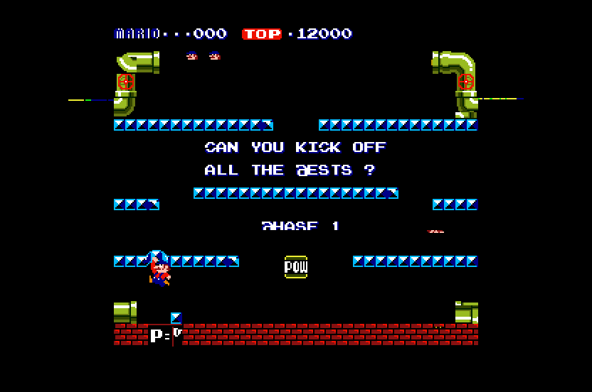

# Mario Bros. (Nintendo, 1983) on the Atari STE

MAME `mario`, US revision E (`nintendo/mario.cpp`).  Z80 at 4 MHz, a Z80 DMA for the sprite copy, a sound MCU (M58715,
internal ROM not dumped) with discrete sound.  256 x 224, horizontal, 59.185 Hz.  Status: **Incomplete** (root README):
the logic and the picture are exact against the reference, the sound is checked in the simulator only, there is no
full-game verification.



Speed (Hatari, STE, 4 MB, `tools/hatari.ps1`, `-D AUTOPLAY=1`, 3000 VBLs, 2026-11-08): 57.9 arcade frames a second
(98% of 59.185) and 29.9 pictures a second; 2 border fallbacks, no late border events.

Long run (Hatari, `-D AUTOPLAY=1 -D CHEAT=1`: the lives cheat keeps the game going, 30,000 VBLs = 10 minutes, no video,
2026-11-08): no crash, 59.8 arcade frames a second (the schedule's 60 against the arcade's 59.185: 1% fast) and 30.3
pictures a second.  The scripted input only walks and jumps, so it does not clear phases: the later phases are not
reached in Hatari yet.

## Build and run

```sh
python port.py cover mario                  # coverage (12 seeds), then
python games/mario/ref/cover_pens.py <seed> 12000   # (seeds 1-6) the colour fit's training data (tools/assets.py)
python games/mario/tools/build.py           # -> run/mario/MARIO.PRG   (--sim: run/mario_sim for the tests; -D AUTOPLAY=1)
python games/mario/tools/logic_test.py 3000 # lock-step translation vs reference
python games/mario/tools/render_test.py 3000 --seed 1 --start 100 --every 3   # the STE picture vs the reference
python games/mario/tools/sprite_test.py     # sprites at the edges, 16 shifts, flips, guards, 64 KB crossings
python games/mario/tools/sound_test.py 3000 --seed 5       # the sound driver vs the game's commands (clips: tools/sound_capture.py --all, MAME)
python games/mario/tools/profile.py 600     # where a picture's CPU time goes
powershell -ExecutionPolicy Bypass -File games/mario/tools/hatari.ps1 -Frames 3000   # Hatari, hidden: AVI, stills, counters
```

## Controls

**5** coin, **1/2** start, **Left/Right** move, **Up/Space/Ctrl/Z** jump, **Esc** quits; joystick port 1 player 1, port 0
player 2; Jaguar pads as the other ports.

## State

* Reference machine (`tools/machine.py`): the picture equals MAME's within a few pixels (`ref/mame_cmp_mario.py`, the
  WolfMAME 0.248 binary; 0 / 1 / 4 pixels differ in frames 1500 / 2500 / 700, fast sprites a step ahead).
* Translation: 10450 instructions, 0 unsupported; lock-step against the reference over 8000 frames.
* Picture: `tools/render_test.py` (seeds 1 and 5, 967 frames each) and `tools/sprite_test.py` (316 pictures, both screen
  orientations) show 0 differing pixels in the simulator.
* Sound: MAME's recordings of the board on the DMA channel; checked in the simulator only, **not listened to**.
* Not done: a coverage that reaches the later phases, full-game checks (`docs/port-status.md`), the DMA's bus cycles (6
  clocks a byte are modelled), the mid-frame latch writes (the title screen writes the gfx and palette bank at line 19),
  the cocktail flip, the MAME 0.286 palette (the pens come from WolfMAME 0.248, a binary; the 0.286 source tree is
  authoritative, AGENTS.md).

## How it works

### The board and the reference

Memory map and latch bits: the header of `tools/machine.py`.  The game programs the Z80 DMA once per frame (`$6900` ->
`$7000`, `$180 + 1` bytes: the chip transfers the block length plus one byte); the port uses the shared `z80_dma`
(`$180` bytes: the extra byte read as 0 in every captured frame).  The picture is MAME's with the LS259 latch's flip bit
set in play: the tile map is flipped, sprite positions are already physical (`flip_screen_set` flips only the tile map).
`ld a,r` reads the port's random byte like the other ports.

### Translation

`tools/gen.py`, `src/natives.s`: `otir` (`$00CD`, the DMA's program) and `ld a,r` are native routines; the self-test's
stores to unmapped `$EC00-$EC02` go to unused bytes.  The dispatch table has 65535 entries (the ROM at `$F000` holds
code; `z80_init_dispatch` compares words); the NMI token is `$E001`; the upper ROM lies below the Z80 block (signed word
index).  The NMI is delivered at the idle loop `$01CB`.

### Picture

`src/render.s` (after Track & Field's renderer): 256 x 224 centred with the borders open, black side bands of 32 pixels;
a playfield of 32 x 32 tiles in STE planes with the scroll and the flip, drawn row by row into three display buffers;
changed cells found by comparing the video RAM with a copy as longs; a tile cache; sprites from a cache of baked images
drawn by generated Blitter code (`engine/sprite_programs.py`, HOP 2 / OP 3 passes) or the row path; one 16-colour palette
fitted to the coverage's pens (`tools/assets.py`).

### Sound

The board's output (tunes and effects the game commands, recorded in MAME by `tools/sound_capture.py`) is converted to
8 bit clips at 6258 Hz (`tools/sound_convert.py`, about 122 KB) and played on the DMA channel by `src/sound.s`: one
clip at a time, the newest wins.  The walk pulses and the ice sound are silent in MAME's netlist and not played.

## Speed

Hatari 2026-11-08, see the top.  Musashi: logic about 39k cycles an arcade frame; a picture about 96k CPU cycles + 45k
Blitter bus cycles (113k + 45k before the speed work).  `tools/profile.py` shows the rest: sprites about 60% of the
picture's CPU, row copies 15%, the tile compare 8%.  Applied: a fast skip of the unused sprite entries (-8k), the tile
compare with `cmpm.l` / `dbne` (-8.5k).  Not tried: writer marks for the video RAM, the baking cost, the sprite setup in
`draw_cell`.

## Tests and tools

| part | state |
|---|---|
| `tools/prepare.py`, `docs/rom_manifest.json` | the 15 files of revision E verified (`mario.zip`, an older merged set: files from `marioe/` and the top level) |
| `tools/machine.py` | reference machine (Z80, Z80 DMA, latch, NMI, tile map + sprites) |
| `ref/mame_cmp_mario.py` | the picture against MAME (`mario_pens.py` is the binary's pen dump) |
| `ref/cover.py` | coverage, 12 seeds of 20000 frames (play, free play + lives by MAME's cheats, two players, DIPs, service mode) |
| `tools/logic_test.py` | lock-step against the reference at the idle loop with the NMI injected: OK over 8000 frames |
| `tools/render_test.py`, `tools/sprite_test.py` | the STE picture against the reference: 0 pixels differ |
| `tools/sound_test.py` | the DMA registers name the clip each command starts |
| `tools/profile.py`, `tools/hatari.ps1` | cycle profile of a picture; Hatari run with counters and stills |

## Lessons

* The Musashi simulator does not raise address errors; Hatari does (an odd-address `clr.l` on the sound state crashed
  only in Hatari).
* Runtime code that runs inside the VBL must not clobber the translated code's registers (`d2` = DE): the AUTOPLAY block
  did, and the Z80 pc was corrupted.
* A dispatch table that compares words holds at most `$FFFF` entries.
* The sound clips of two commands in the same frame start in an order the test accepts either way.

## Verification

Evidence: MAME comparison, lock-step over 8000 frames, render and sprite tests, a Hatari run with counters.  No recorded
or PPO play, no full-game run, the sound never heard: see the [status policy](../../docs/port-status.md); the port is
**Incomplete**.
