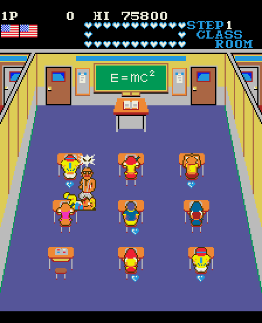

# Mikie (Konami, 1984) on the Atari STE



MAME set `mikie` (Konami GX469; `konami/mikie.cpp`).  The main CPU, a plain MC6809E (not KONAMI-1: the opcodes are not
encrypted), is statically translated to 68000 code (`engine/m6809x.py`) and checked against a reference board in
lock-step.  The picture is MAME's ROT270 picture (**the monitor is turned: 224 x 256, portrait**), centred in the
320-pixel screen with the top and bottom borders open, sprites by generated code (`engine/sprite_programs.py`), exact
against the reference in the shown colours; one 16-colour palette by the shared default fitter, flat; the sound board's Z80
driver translated too, its two SN76489As on the YM2149 (three of the eight voices at a time).  Status: **Experimental**: the
picture, the logic and the sound driver are verified (below), the YM mix-down (three voices of eight) is a reduction by
design, and no full-game play has been verified.

## Build and run

```sh
python port.py cover mikie                  # coverage: ref/cover.py seeds 1-9 (30000 frames each, ~10 min in parallel), ref/cover_sound.py
python port.py build mikie                  # -> run/mikie/MIKIE.PRG (-D NOSOUND=1: without the sound)
python port.py test mikie                   # lock-step (seeds 1, 4, 7), render (seed 4), sprite edges, sound (game and random commands)
python port.py mame mikie                   # the reference against MAME (ref/mame_cmp_mikie.py)
python games/mikie/tools/prepare.py         # verify assets/roms/mikie.zip, unpack to assets/roms/extracted/mikie/
python games/mikie/tools/build.py           # -> run/mikie/MIKIE.PRG (--sim: run/mikie_sim; --assets: colours again)
python games/mikie/tools/logic_test.py 20000 --seed 4     # the translation in lock-step with the reference
python games/mikie/tools/render_test.py 3000 --seed 4 --start 500   # the STE picture against the reference
python games/mikie/tools/sprite_test.py                   # edges, all 16 shifts, holes, guards, 64 KB crossings
python games/mikie/tools/sound_test.py 6000 --seed 4 [--random]   # the STE's sound player (Musashi) against tools/sound.py, every frame
python games/mikie/ref/sound_cmp.py 1 4000                # the STE's tick schedule against the timed Z80 board (SN voices' states)
python games/mikie/ref/mame_sound_cmp.py 1500             # the timed Z80 board against MAME's SN writes (attract, 100.00%)
powershell -ExecutionPolicy Bypass -File games/mikie/tools/hatari.ps1 -Frames 3000 [-Sound 1]   # hidden Hatari (F030Arcade build), AVI stills (and its audio: mikie.wav) in run/mikie_hatari
```

Supply `assets/roms/mikie.zip` (MAME's parent set; `docs/rom_manifest.json` has the files' sizes, CRCs and SHA-1s).
Nothing ROM-derived is in git: the graphics, colours and ROM image are made into `build/mikie/` and assembled into the
program.  Paths are relative to this folder; `engine/`, `tools/`, `port.py` and `docs/` at the top are the repository's.

## Controls

**5/6** coin 1 / 2, **1/2** start, the arrows move, **Space / Control / Z** button 1, **Alternate / X** button 2, **Esc**
quits.  Joystick port 1 player 1, port 0 player 2 (direction, fire = button 1).  Jaguar pad / PowerPad: pad A player 1,
pad B player 2, the D-pad, **A / C** button 1, **B** button 2, **Option** coin, **Pause** start.  DIP switches: MAME's
defaults (3 lives, upright, bonus 20k 70k 50k+, easy, demo sounds on; DSW3 flip off).

## State

* **Reference board** (`tools/machine.py`, from `mikie.cpp`; MAME's source tree of F030Arcade, 0.286): the picture and
  the pens equal MAME's: `ref/mame_cmp_mikie.py` at frames 60 / 300 / 600 / 900 / 1500 / 2400 / 3600 / 5000 / 7000 /
  9000 / 12000: **0 of 4096 pens and 0 differing pixels** in every frame (palette banks 0 and 7 seen), and the RAM
  ($0000-$00FF, $2800-$3FFF) equal except the bytes the interrupt pushes on the stack (frame 3600).  MAME was
  WolfMAME 0.248 (`F030Arcade/third_party/wolfmame-0248`, through `engine/mamewin.py`); no difference to the 0.286 source
  was found.  Found by this check: the tilemap has no transparent pen (a front tile covers its whole 8 x 8; sprites'
  pen 0 is transparent), and ROT270 turns the 256 x 224 raw picture a quarter counter-clockwise.
* **The port's schedule** (`MikiePort`): the boot self-tests (RAM / ROM checks, the test grid: 692 frames) are skipped,
  the program starts at its own initialisation `$6093`.  This part of the reference is **not compared with MAME** (the
  timing differs); only the unpatched board is.  The foreground is a task loop (`$61BC`, queue `$2A40`); its idle point
  `$61C5` and the `CWAI #$EF` of `$6FFF` (a task waiting for the frame) are natives that deliver the IRQ at the vertical
  blank (`mk_idle`, `mk_cwai` in `src/mikie.s`; the CWAI pushes its state at once as the 6809 does).
* **Translation**: 8540 instructions, none unsupported or missing (the CWAI is the native).  One instruction that
  static descent reached, an `LBRA $D791` into zero padding at `$6E80` that never runs, is a `main_dead` hook
  (`gen.py` DEAD); this needed a small, backwards compatible addition to `engine/m6809x.py` (`Program.no_follow`: pcs whose
  successors discovery does not follow).
* **Logic**: exact against the reference's port schedule.  `tools/logic_test.py`: RAM $0000-$00FF and $2800-$3FFF (sprite
  RAM, RAM, video and colour RAM), the latch (Q6, Q7), the palette bank, the sound commands (Q2's rising edges).  Seeds 1-9
  20,000 frames each (attract, coin, start, random play with and without kept lives, two players, other DIP switches), all
  PASS.  (The pushed CC's H bit is ignored on the stack: the translation keeps H only where DAA reads it.)
* **Coverage** (`ref/cover.py`, 30,000 frames x 9 seeds): 5,300+ pcs.  Random play only: it reaches the title, the first
  room(s) and the attract mode; **later rooms, the ending, the high-score entry and a service mode were not reached on
  purpose** and are not covered: the static descent translates what it finds, but a jump through a table that no seed used
  would stop at `main_badpc`.
* **Picture**: exact in the shown colours.  `tools/render_test.py`: 0 differences in 280 sampled pictures of seed 1 (frames
  100-1500) and 656 each of seeds 2, 4 and 6 (frames 100-6000); `tools/sprite_test.py`: 154 made-up pictures exact (both
  side edges at every shift, holes, flips, overlaps, the guard lines above the picture, 64 KB crossings, 60 pictures in
  sequence).
* **Sound** (`tools/sound.py`, `tools/sndgen.py`, `src/sound.s`, after Track & Field's; the board: a Z80 at 3.58 MHz, ROM `n10.6e`,
  two SN76489As, the main CPU's command latch, a timer read; no speech, DAC or tune loops).  The Z80 driver is translated to
  68000 code (`engine/z80x.py`; coverage `ref/cover_sound.py`: the game's commands of seeds 1-9 and random commands, 1049
  instructions, none unsupported) and runs in the schedule of a tick (the driver's main loop waits for the timer's bit 2:
  every 4096 Z80 cycles, 14.4 a frame): each arcade frame the commands the game wrote since the last frame run the IRQ
  handler, then the frame's ticks.  Its writes fill two SN76489A register files; each frame their eight voices go to the
  YM2149's three channels (the three loudest, a voice keeping its channel; the noise as the YM's; one noise period).
  Verified: (1) `ref/mame_sound_cmp.py`: MAME's two SN chips' writes in 1500 attract frames (1467 and 1461 bytes, 21
  commands) equal the timed Z80 reference's, **100.00%, in order**; (2) `ref/sound_cmp.py`: the tick schedule's SN voice
  states against the timed reference, 99.2% of 10028 states equal in order (an effect starts up to a frame late); (3)
  `tools/sound_test.py`: the STE's player (Musashi) against its model every frame (sound RAM, both chips' registers, the
  YM's registers and channel choice, the schedule's time): seeds 1, 4 and 7 (4000-8000 frames) and random commands (seeds
  1-3, 6000 frames, added to the game's own): PASS; (4) Hatari (`-Sound 1`, the AVI's audio): music-like tones at the pitches
  MAME's audio shows in the attract (about 782, 590, 528, 132 Hz), silence between; **not heard by a person, and no
  waveform comparison with MAME was made**.  Reductions by design: three of the eight voices at a time (the YM has three
  channels: the loudest win; a tone's pitch is on the YM's period grid), the YM's
  levels by a coarse table (3 dB steps); the SN's noise on one YM noise generator at the chip's nearest period (periods
  above 31 are clamped); the main loop's `ei` windows are not interrupt points (a command waits for the next tick: up to
  a frame later than the arcade).  The driver's own self-test and boot RAM test are skipped (it starts at `$0156`).
  Speed: the sound adds about 6000 68000 cycles an arcade frame (the schedule's idle ticks and each channel's counting
  ticks are natives: a quiet tick is free, a counting-only run of ticks is skipped in one step).
* **Sprite list sort** (`mk_sort`, a native at `$9933`: the game's bubble sort of its 3-byte sprite records, the largest single
  cost in a profile of the logic, replaced by an equal stable insertion sort; lock-step equal, seeds 1-9 x 20000 frames, below).
* **Hatari** (F030Arcade build, hidden, `tools/hatari.ps1 -Frames 3000 -Sound 1`, AUTOPLAY build: a coin, start, walking and
  hitting): the title, the attract picture and the first classroom run and look right in the AVI stills (colours,
  turned picture, sprites, the heart and flag HUD); 3001 VBLs with the sound on: 3290 arcade frames (54.8 a second, 91% of
  60), 2090 pictures (34.8 a second), 2 border fallbacks, no late border events (before the sound and the sort native:
  55.8 a second without sound; the cost of the sound is about 2 points of rate, the sort gained back about 1).  The game
  does not reach the full arcade rate: **it runs at 91% in Hatari's attract and first room**.  Not measured: sustained
  play, later rooms.
* **Not done / not verified**: the cocktail cabinet and the flip screen (`render_raw` raises `NotImplementedError` for the flip
  latch; the STE renderer ignores it); the service mode; a full game; the other sets (`mikiej`, `mikiek`, `mikiehs` share the
  main program: the graphics ROMs differ); the driver's paths no seed's commands reached (random commands 0-$7F reach most
  of the effect range; a jump through a table entry nothing used would stop at `snd_badpc`); sprite preparation
  measurements against the other methods (`docs/sprite-preparation.md`: this port uses the shared generated code as Track
  & Field does, not measured separately); the Mega STE; hearing the result on real hardware or an emulator by a person.

## How it works

* **Memory** (`machine.py`): RAM $0000-$00FF, sprite RAM $2800-$288F (36 sprites of attribute, y, code, x), RAM
  $2890-$37FF, colour RAM $3800-$3BFF, video RAM $3C00-$3FFF, ROM $6000-$FFFF; the LS259 latch at $2000-$2007 (Q0 / Q1 coin
  counters, Q2 sound trigger, Q6 flip, Q7 IRQ enable), the palette bank at $2200, the sound latch at $2400, inputs at
  $2400-$2403 and the DIP switches at $2500 / $2501.
* **Video**: a 32 x 32 tilemap of 8 x 8 4bpp tiles, category 1 (colour bit 4) drawn over the sprites; palette PROMs by a
  2.2k / 1k / 470 / 220 ohm resistor network (`machine.mikie_pens`); the palette bank (0-7) selects the colour sets; the
  renderer flushes its caches and draws every cell again when the bank changes.
* **Picture on the STE** (`src/render.s`, after Time Pilot's and Track & Field's): three display buffers and a clean screen;
  changed tiles are converted per (code, colour, flips) into a tile cache and drawn with `movep.l`; sprites are baked per
  (code, colour, flips) into the sprite cache and drawn by generated Blitter code (HOG passes of one or two words, end masks
  = the opaque pixels, no AND + OR passes), edges clipped on 16-pixel groups, whole sprites into the guard lines (eight
  hidden lines above the picture hold the sprites that leave it at the top); the damage is restored from the clean screen.
* **Assets** (`tools/assets.py`): the tiles and sprites are turned (the picture's frame; MAME's flip x is the picture's row
  flip, flip y its column flip), the 4096 pens fitted to 16 colours (`engine/palette_native.py`).
* **Shared code changed**: `engine/m6809x.py` only (the `no_follow` set, above).  Everything else is this folder, the
  registration lines in `port.py` / `tools/release.py` (fixed here: the first commit's Mikie entry had real line breaks inside
  its strings) and the README's table.
