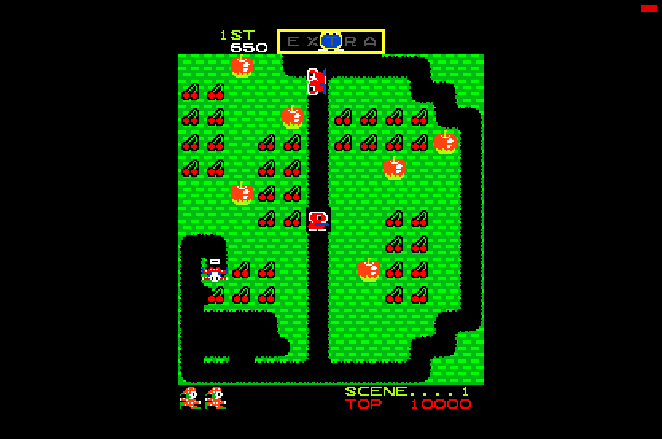

# Mr. Do!, Atari STE

Port started 2026-10-29.  Set: MAME `mrdo`, Mr. Do! (Universal), 1982; one Z80, two SN76489s, two 2-bit tile layers
and 64 sprites of 16 x 16 (2 bits).  Paths in this file are relative to `games/mrdo/`; the method is
`docs/porting-guide.md`, the driver MAME 0.286's `universal/mrdo.cpp`, `mrdo_v.cpp` (the authoritative source tree).

State (2026-10-29): the reference machine's picture equals MAME's frame for frame (2696 of 2701 frames of the attract
mode; the other five differ in a tile column written at the frame's end); the Z80 program is translated and runs on
the 68000 in lock-step with the reference's port schedule (12 seeds, 144,000 frames exact); the renderer draws every
picture exact against the reference (32,000 pictures of four seeds: the title's and intermissions' scrolling, every
scene, two players; 476 made-up pictures of sprites at the edges, every scroll value).  In Hatari the logic keeps the
arcade's 60 frames a second in most of play with 40-50 pictures a second (about 22 on the title).  Sound: the two
SN76489s' tones on the YM2149 (`src/sound.s`).  Not registered in `port.py` yet.

* `src/mrdo.s` the runtime (schedule, IRQ delivery, borders, inputs, sound bytes into a ring, crash dump);
  `src/render.s` the picture (two tile layers composited per cell, the background scrolled; generated sprite code);
  `src/sound.s` the sound (the SN76489s' registers, their tones on the YM)
* `tools/prepare.py` the ROMs; `tools/machine.py` the reference machine (`MrDo`) and the port's schedule (`MrDoPort`);
  `tools/gen.py` the translation; `tools/assets.py` the graphics, colours and sprite code; `tools/build.py`;
  `tools/logic_test.py` the lock-step test; `tools/render_test.py` the pictures against the reference;
  `tools/sprite_test.py` made-up pictures (edges, shifts, 64 KB crossings, scroll values); `tools/sound.py` the
  sound player's model, `tools/sound_test.py` the player against it; `tools/bench.sh` Hatari's speed (macOS;
  `AVI=1`: stills, `SOUND=1`: the sound, also as a WAV), `tools/hatari.ps1` the same run on Windows (counters, AVI)
* `ref/cover.py` coverage; `ref/pens.py` the pens shown (the palette fit); `ref/mame_cmp_mrdo.py` the reference
  against MAME's picture

From the repository root: `python games/mrdo/tools/prepare.py`, coverage `python games/mrdo/ref/cover.py <seed> 20000`
for seeds 1-12 (`build/mrdo/cover<seed>.pkl`, needed by the translation; about 20 minutes each, run them in
parallel), `python games/mrdo/tools/build.py --sim` (`run/mrdo_sim/MRDO.PRG`), then
`python games/mrdo/tools/logic_test.py 12000 --seed <n>`; the palette needs `python games/mrdo/ref/pens.py <seed>`
for seeds 7, 10, 11, 12 (`build/mrdo/pens<seed>.pkl`, ~5 minutes each), then `tools/assets.py` (or `build.py
--assets`); `tools/render_test.py 8000 --seed 10 --every 4`, `tools/sprite_test.py`.  `build.py` without `--sim` builds `run/mrdo/MRDO.PRG`.
Controls (planned as on the other ports): arrows or joystick move, Space / Control / Z fire, **5** / **6** coin,
**1** / **2** start, **Esc** quits; either Jaguar pad plays (the players take turns on the upright cabinet).

## ROMs

`python games/mrdo/tools/prepare.py` verifies the fifteen files against `docs/rom_manifest.json` and writes them to
`assets/roms/extracted/mrdo/` and `build/mrdo/mame_roms/mrdo/` (MAME's `-rompath`).  The archive is
`assets/roms/mrdo.zip`, MAME's merged set; the parent's files are at its top.

## Reference machine

`tools/machine.py` (`MrDo`), from MAME's driver:

* Z80 at 4.1 MHz (8.2 MHz / 2).  The screen: 312 x 262 pixel clocks at 4.9 MHz (19.6 MHz / 4), 59.943 Hz, so
  68398.04 CPU cycles a frame (kept fractional: a frame ends at the exact cycle); visible raw x 8-247, y 32-223
  (240 x 192), ROT270.
* ROM 0000-7FFF; background video RAM 8000-87FF (attributes 8000: bit 7 code bit 8, bit 6 opaque, bits 0-5 colour;
  codes 8400), foreground 8800-8FFF (the same; its writes also latch the PAL U001, which does nothing in the `mrdo`
  set); sprite RAM 9000-90FF (write only); 9800 flip screen, 9801 / 9802 the SN76489s, 9803 the protection; inputs
  A000 P1, A001 P2 (coins), A002 / A003 the DIP switches (defaults $DF / $FF); RAM E000-EFFF; scroll x F000-F7FF,
  y F800-FFFF (written only at F000 / F800).  Unmapped reads give 0.
* The protection read `$9803` gives the ROM byte at HL: MAME's stand-in for the PAL (`mrdo_state::protection_r`, "HACK:
  workaround until accurate PAL emulation").  The program reads it once (`$0494`, with HL in a ROM table at `$0547`).
* IRQ0 at the vertical blank (line 224), `irq0_line_hold`: held until taken; IM 1 (RST 38).  A frame starts at the
  vertical blank (`frame_line=224`, MAME's phase): `render_raw` after `run_frame` is the picture MAME draws.
* Colours: `palette_init`'s diode / resistor levels (150, 120, 100, 75 ohm, 220 pull-down, 0.7 V) computed in single
  precision as the C++ does; 256 character pens, 64 sprite pens through the lookup PROM `f10--1.bin`.
* Renderer: the background (scrolled: screen x + scroll x, screen y + scroll y) then the foreground, 32 x 32 tiles of
  8 x 8 each; a tile's pen 0 is transparent unless its attribute bit 6 makes it opaque.  The sprites from entry 63 down
  to 0 (entry 0 on top), x = byte 3, y = 256 - byte 1, skipped when byte 1 is 0, clipped to the visible area; pen 0
  transparent.  MAME flips the tile layers for the cocktail cabinet but not the sprites; the reference draws upright
  only.  `python games/mrdo/tools/machine.py 900 out.png` boots and saves a picture.

## Checked against MAME

`python games/mrdo/ref/mame_cmp_mrdo.py [seconds]` records MAME's attract mode with F030Arcade's WolfMAME 0.162
(`-aviwrite`; the local 0.286 builds `m68k.exe` / `mpatrol.exe` have no `mrdo`) and looks every MAME frame up among the
reference's frames by its exact RGB picture.  WolfMAME's `-listxml` gives the same clocks and screen as the 0.286
source.  2026-10-29, 45 s (2701 frames):

* 2696 frames equal a reference frame; all 14 colours on screen are exactly MAME's.
* 5 others (frames 3, 517, 2074, 2075, 2077) differ from the nearest reference frame in 67-1100 pixels within one or
  two tile columns: video RAM written right at the frame's end, a few Z80 cycles apart (the old core's timing).

Not checked yet: play with input, the flip screen (cocktail; the port is upright), sound.

## The port's schedule

The whole game runs from the IRQ (RST 38, the handler at `$00B8`): the objects through a table of 20 handlers at
`$0156`, the sound, the screen.  Its end looks at `$E001`: bit 0 restarts the maze search (`$54EC`, a flood fill over the
13 x 12 cells, which runs on into `$558E` and `$5647`) on a fresh stack at `$0138`; bit 2 runs `$558E` at `$0141` and
returns to the interrupted code through the registers the IRQ saved; bit 4 restarts `$5647` at `$014D`; bits 1 / 3 (a
search runs) return to it.  The searches run with interrupts enabled, and on the arcade the next IRQ cuts into them.
Otherwise the foreground spins at `$00AC` (after the boot) or `$0154` (after a search).

`machine.MrDoPort` (the reference) and `src/mrdo.s` (the runtime) do the same: the IRQ is delivered only at those two
spins (the idle hooks), with TOKEN (`$FFFE`) as the interrupted pc; the handler runs to its return to TOKEN (the
foreground goes on at the hook) or into a search, which runs to its end at `$0154`.  So a search never sees an IRQ in
its middle.  Measured in the reference with the arcade's timing (attract and random play, 4000 frames): the handler
takes 22.8k Z80 cycles a frame (median; 46.5k at the 99th percentile; 307k once, while a scene is drawn), a search up
to 59k (0.86 frame), and a search was still running at the next IRQ in about 75 frames of the 4000.  Those frames get
longer here and the search's result comes a frame or two earlier than on the arcade; the arcade's restart of a running
search by a new dig cannot happen.  Yield points inside the searches (their loop heads `$552E`, `$5609`, `$5665`, with
a deterministic budget) would keep the arcade's pace if the long frames show in Hatari.

## Coverage

`ref/cover.py <seed> [frames]` (20000 frames each, the seeds in its docstring): random play to the game over, MAME's
cheats (infinite lives `$E097`, the start scene `$E09B`), two players, the other DIP switches, the rack test switch.
2026-10-29: 8824 pcs; scenes 1-12 and 21-23 reached.  The service test (both fire buttons at power on, `$56AF`) and
the cocktail cabinet are left out.

What it found:

* The SN76489s are written with `ld (nn),a` (`$5AE7`, `$5AEE`) and with `ld (bc),a` (`$5C3A`, `$5C3E`, `$5C45`: C is
  the chip, $01 / $02); every other I/O store is the flip latch, the sprite RAM or the scroll registers.
* Inputs are read with `ld a,(nn)` only: the runtime keeps them at `$A000-$A003` in the block.
* 28 computed jumps (the object table at `$0156`, `jp (hl)` dispatchers); no `in` / `out`, `halt` or `ld a,r`.

## Translation

`tools/gen.py`: the program flat (32 KB) in a 64 KB block (`signed` mode, the fast register map), IY / F' at `$9E00` /
`$9E02` (unmapped on the board).  10980 instructions (8824 seen by the coverage, 2156 found by discovery), nothing
unsupported, nothing missing.  The protection read at `$0494` is translated as `ld a,(hl)`.  The SN76489 stores call
`md_sound1` / `md_sound2` (`ld (nn),a`) or `md_sound_bc` (`ld (bc),a`: the chip from C), which put (chip, byte) pairs
into `snd_ring`; the 36 video RAM store sites list their cell (`md_mark_*`: the address & $3FF, + $400 for the
foreground) for the renderer.

`tools/logic_test.py` compares every frame: the video, sprite and work RAM, the flip latch, the scroll registers, the
SN76489 bytes of the frame, and that every changed video RAM cell is listed.  2026-10-29: seeds 1-12, 12000 frames
each (144,000 frames), all exact.  The logic takes 35-54k 68000 cycles an arcade frame over those runs (Musashi; 43-46k
in attract and normal play, 51-54k with the cheats' longer games).

Found on the way, fixed in `engine/z80x.py` (`pv_block_before`): the two-player game copies a player's maze with
`ldi; inc hl; jp pe,$10C6`, and the translator produced P/V only for a `jp pe/po` right after the block instruction;
past the `inc hl` it read a stale flag (seed 7 differed from frame 1043 on).  No other port's generated code has that
shape.

Hatari (`tools/hatari.ps1`, DEBUG + AUTOPLAY, 3000 VBLs, the stand-in renderer): no crash, 59.5 arcade frames a
second (the arcade's 59.94).

## The picture (src/render.s, tools/assets.py)

After Time Pilot's renderer; the method's details are in `src/render.s`'s header.

* **Turned** as MAME's ROT270: picture pixel (X, Y), 192 x 240, is the raw pixel (x = 247 - Y, y = 32 + X); raw cell
  (tx, ty) is the 8 x 8 cell at X = 8 ty - 32, Y = 240 - 8 tx (a byte of each plane); a sprite is the 16 x 16 square
  at X = 224 - byte 1, Y = 232 - byte 3 (raw flip x reverses its turned rows, flip y its columns).  Centred: screen x
  64-255 (the edges on 16-pixel groups), `PIC_TOP` 18, `PIC_LINES` 240; 24 guard lines above the picture (a sprite
  reaches 23 lines above it) and 20 below.
* **Two tile layers**: the background is kept converted to STE planes as a 256-pixel band per raw column tx
  (`bg_img`), the foreground per cell as plane bytes and the bits it keeps of what lies below (`fg_cache`, `fg_kind`:
  empty, partly transparent, opaque).  A changed video RAM cell (the writers' list, compared with a copy) converts its
  layer and marks its screen cells (a background cell two when the scroll is not a multiple of 8); a marked cell is
  composited (the background's chunk, or two chunks shifted, then the foreground) into the clean screen and copied
  into each display buffer.  The converter takes the colour's four pens from a table (`sel_tab`, from the pen map), so
  another palette needs no new code.
* **The scroll**: only the background's raw y scroll is used (x is only ever cleared), by the title (the stripes
  behind the logo) and the intermissions (the big characters walk across): a horizontal move in the picture.  A new
  scroll value marks the rows with background content (or content since the last change), not under opaque
  foreground: about 130 cells a picture on the title, ~180k CPU cycles.
* **Sprites** over everything (entry 63 first, entry 0 on top): Time Pilot's preparation (`engine/sprite_programs.py`:
  rows grouped by mask, one- or two-word passes per row and shift, code per shape and pass-type pattern, end masks from
  a stream) for the coverage's 203 shapes (code x flips): 2,964 routines, 332 KB of streams; others and 64 KB crossings
  the row path (`draw_cell`).  Clipped at the group-aligned side edges (the inner word only), culled wholly outside;
  whole into the guard lines.  Damage: the drawn lines and words, restored by short HOG copies.
* **Colours**: the arcade shows 26 colours (at most 15 in one picture); one palette of black and 15 fitted in Oklab
  to `ref/pens.py`'s counts with square-root weights: mean error 3.7 a channel; pure blue (some sprite colours) shows
  as a duller blue, the three yellow-greens, the two pale yellows and the ochres merge.  Per-scene palettes (exact:
  each picture has at most 15) would need a switch by scene with a full redraw and a sprite cache flush.

Measured (`tools/render_test.py`, Musashi, CPU + Blitter bus cycles a picture, exact): seed 4's play (frames
1600-2200) 30.1k + 12.9k with the generated sprite code, 43.0k + 14.6k with every sprite on the row path
(`-D REN_GEN=0`); the title ~263k + 0.  `tools/bench.sh 4000` (Hatari, AUTOPLAY, 2026-10-29): no crash, no late
border event; per 2 s the logic 59-60 arcade frames a second in 33 of 40 windows (the first one boots; 38-55 in six
others: scene starts and long maze searches), pictures 44-50 in play, 22-24 on the title.

## Sound (src/sound.s, tools/sound.py)

The board's two SN76489s (4.1 MHz each, written by the main Z80 at $9801 / $9802; MAME `sn76496.cpp`) go to the
STE's YM2149.  The runtime puts the game's bytes into a ring (`md_sound*`); once an arcade frame, before the IRQ,
`snd_frame` writes them into two register files as MAME does (a latch byte selects a register and writes its low 4
bits; a data byte writes a tone period's bits 4-9, or a volume's low 4 bits; after reset every volume is the loudest
and every period 0, which counts as 1024), then puts the voices on the YM:

* the three loudest audible of the six tone voices (ties: the lower voice), a YM channel that holds a chosen voice
  keeping it (Pooyan's and Gyruss's method); in play 0-5 voices sound at once, 1.3-1.5 on average;
* periods N -> N * 40 / 41 (the SN's 4.1 MHz / (32 N) against the YM's 2 MHz / (16 P)); attenuation a (2 dB a step)
  -> the YM's fixed level 15 - round(2 a / 3) (~3 dB a step), 15 -> silent; only the changed registers written;
* the noise is left out: the game never programs it (no write to register 6 in any of the coverage's seeds).

`tools/sound_test.py` (the game in lock-step as `render_test.py`, the reference logging the bytes from the boot on):
the register files, latches, the YM's channel choice and registers equal to `tools/sound.py` every frame: seeds 1,
7, 10, 12 (3,000-8,000 frames, ~400,000 SN bytes).  Hatari (`SOUND=1 AVI=1 tools/bench.sh 2500`): the attract mode
silent as on the reference, the music and effects from the coin on, pitches 270-1,500 Hz.  The sound costs ~2-3k
68000 cycles a frame: `tools/bench.sh 4000` 3,237 -> 3,048 pictures (-6%), the logic's pace unchanged.

## Next steps

1. Hatari: the logic's pace with the long search frames (the dips to 38-55 frames a second); yield points if they
   show in play.  The title's scroll compositing (~180k a picture) could use the Blitter for rows without foreground.
2. Per-scene palettes (exact colours).
3. Registration in `port.py` (GAMES, COVER, TESTS) and `tools/release.py`.
