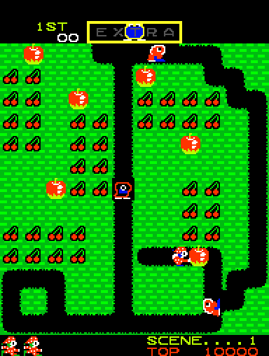

# Mr. Do! (Universal, 1982) on the Atari STE



MAME set `mrdo` (Mr. Do! (Universal); MAME 0.286's `universal/mrdo.cpp`, `mrdo_v.cpp`, the authoritative source tree).
The board has one Z80, two SN76489s, two 2-bit tile layers and 64 sprites of 16 x 16 (2 bits).  The Z80 program is
statically translated to 68000 code with inline leaves and runs in lock-step with the reference's port schedule, the
IRQ delivered at the game's idle spins.  The two SN76489s' tones play on the YM2149 (the noise is never used).  The
picture is MAME's ROT270 picture, 192 x 240, both tile layers composited per cell, the background scrolled, sprites
by generated sprite code (`engine/sprite_programs.py`).  Status **Verification pending**: logic and picture exact
against the reference; full-game checks pending.  Speed (2026-10-29, Hatari, 4 MB STE, `bench.sh 4000` AUTOPLAY):
the logic at the arcade's 59.94 frames a second (59-60, 100%) in 33 of 40 two-second windows, 44-50 pictures a second
in play, 22-24 on the title (measured before the sound, which costs ~6% of the pictures).

## Build and run

```sh
python port.py prepare mrdo               # verify assets/roms/mrdo.zip, unpack (see below)
python port.py cover mrdo                 # coverage, seeds 1-12 (build/mrdo/cover<seed>.pkl; ~20 min each, in parallel)
python port.py build mrdo                 # -> run/mrdo/MRDO.PRG (--sim: run/mrdo_sim/MRDO.PRG; --assets: the assets again)
python port.py test mrdo                  # logic, render, sprite and sound tests (see "Tests and tools")
python port.py run mrdo                   # Hatari (tools/hatari.sh)
python port.py mame mrdo                  # the reference against MAME (WolfMAME 0.162, below)
python games/mrdo/tools/prepare.py        # the same steps by the port's own scripts
python games/mrdo/ref/cover.py <seed> 20000
python games/mrdo/ref/pens.py <seed>      # the pens shown, seeds 7, 10, 11, 12 (build/mrdo/pens<seed>.pkl, ~5 min each)
python games/mrdo/tools/assets.py         # the graphics, colours and sprite code (or build.py --assets)
python games/mrdo/tools/build.py [--sim]
python games/mrdo/tools/machine.py 900 out.png        # the reference boots and saves a picture
```

`tools/prepare.py` verifies the fifteen files against `docs/rom_manifest.json` and writes them to
`assets/roms/extracted/mrdo/` and `build/mrdo/mame_roms/mrdo/` (MAME's `-rompath`).  The archive is
`assets/roms/mrdo.zip`, MAME's merged set; the parent's files are at its top.  The palette needs the `pens*.pkl`
recordings before `tools/assets.py`.  Paths are relative to this folder; `engine/`, `tools/`, `port.py` and `docs/`
at the top are the repository's.

## Controls

`key_table` in `src/mrdo.s`: **arrows** or either joystick move, **Space** / **Control** / **Z** fire, **5** / **6**
coin, **1** / **2** start, **Esc** quits.  Jaguar pad / PowerPad (`engine/rt/jagpad.s`): either pad plays (the players
take turns on the upright cabinet), the D-pad moves, **A / B / C** fire, **Option** coin, **Pause** start, keypad
**1/2** start, **5/6** coin, **\*** + **#** quit.

## State

* **Reference against MAME** (`ref/mame_cmp_mrdo.py`, 2026-10-29, 45 s of the attract mode, 2701 frames): 2696 frames
  equal a reference frame; all 14 colours on screen are exactly MAME's.  The other 5 (frames 3, 517, 2074, 2075, 2077)
  differ from the nearest reference frame in 67-1100 pixels within one or two tile columns: video RAM written right at
  the frame's end, a few Z80 cycles apart (the old core's timing).
* **Logic**: `tools/logic_test.py` compares every frame (the video, sprite and work RAM, the flip latch, the scroll
  registers, the SN76489 bytes of the frame, and that every changed video RAM cell is listed): 2026-10-29, seeds 1-12,
  12000 frames each (144,000 frames), all exact.
* **Picture**: `tools/render_test.py` exact against the reference: 32,000 pictures of four seeds (the title's and the
  intermissions' scrolling, every scene, two players).  `tools/sprite_test.py`: 476 made-up pictures exact (sprites at
  the edges, every shift, 64 KB crossings, every scroll value).
* **Sound**: `tools/sound_test.py`: the register files, latches, the YM's channel choice and registers equal
  `tools/sound.py` every frame: seeds 1, 7, 10, 12 (3,000-8,000 frames, ~400,000 SN bytes).  Hatari (`SOUND=1 AVI=1
  tools/bench.sh 2500`): the attract mode silent as on the reference, the music and effects from the coin on, pitches
  270-1,500 Hz.
* **Hatari** (`tools/bench.sh 4000`, AUTOPLAY): no crash, no late border event.
* Open: the logic's pace in the long maze-search frames (the dips to 38-55 arcade frames a second); yield points inside
  the searches if they show in play (see Schedule).
* Open: colours: one palette of 16 for the game's 26 colours; per-scene palettes would be exact (each picture has at
  most 15) but need a switch by scene with a full redraw and a sprite cache flush.
* Open: the title's scroll compositing (~180k CPU cycles a picture) could use the Blitter for rows without foreground.
* Not checked against MAME: play with input, sound.  Not done: the flip screen (cocktail; the port is upright), the
  service test (both fire buttons at power on, `$56AF`).

## How it works

### The board and the reference

`tools/machine.py` (`MrDo`), from MAME's driver:

* Z80 at 4.1 MHz (8.2 MHz / 2).  The screen: 312 x 262 pixel clocks at 4.9 MHz (19.6 MHz / 4), 59.943 Hz, so 68398.04
  CPU cycles a frame (kept fractional: a frame ends at the exact cycle); visible raw x 8-247, y 32-223 (240 x 192),
  ROT270.
* ROM 0000-7FFF; background video RAM 8000-87FF (attributes 8000: bit 7 code bit 8, bit 6 opaque, bits 0-5 colour;
  codes 8400), foreground 8800-8FFF (the same; its writes also latch the PAL U001, which does nothing in the `mrdo`
  set); sprite RAM 9000-90FF (write only); 9800 flip screen, 9801 / 9802 the SN76489s, 9803 the protection; inputs A000
  P1, A001 P2 (coins), A002 / A003 the DIP switches (defaults $DF / $FF); RAM E000-EFFF; scroll x F000-F7FF, y
  F800-FFFF (written only at F000 / F800).  Unmapped reads give 0.
* The protection read `$9803` gives the ROM byte at HL: MAME's stand-in for the PAL (`mrdo_state::protection_r`, "HACK:
  workaround until accurate PAL emulation").  The program reads it once (`$0494`, with HL in a ROM table at `$0547`).
* IRQ0 at the vertical blank (line 224), `irq0_line_hold`: held until taken; IM 1 (RST 38).  A frame starts at the
  vertical blank (`frame_line=224`, MAME's phase): `render_raw` after `run_frame` is the picture MAME draws.
* Colours: `palette_init`'s diode / resistor levels (150, 120, 100, 75 ohm, 220 pull-down, 0.7 V) computed in single
  precision as the C++ does; 256 character pens, 64 sprite pens through the lookup PROM `f10--1.bin`.
* Renderer: the background (scrolled: screen x + scroll x, screen y + scroll y) then the foreground, 32 x 32 tiles of 8
  x 8 each; a tile's pen 0 is transparent unless its attribute bit 6 makes it opaque.  The sprites from entry 63 down
  to 0 (entry 0 on top), x = byte 3, y = 256 - byte 1, skipped when byte 1 is 0, clipped to the visible area; pen 0
  transparent.  MAME flips the tile layers for the cocktail cabinet but not the sprites; the reference draws upright
  only.

**Against MAME** (`ref/mame_cmp_mrdo.py [seconds]`): records MAME's attract mode with F030Arcade's WolfMAME 0.162
(`-aviwrite`; the local 0.286 builds `m68k.exe` / `mpatrol.exe` have no `mrdo`) and looks every MAME frame up among the
reference's frames by its exact RGB picture.  WolfMAME's `-listxml` gives the same clocks and screen as the 0.286
source.

**Coverage** (`ref/cover.py <seed> [frames]`, 20000 frames each, the seeds in its docstring): random play to the game
over, MAME's cheats (infinite lives `$E097`, the start scene `$E09B`), two players, the other DIP switches, the rack
test switch.  2026-10-29: 8824 pcs; scenes 1-12 and 21-23 reached.  The service test and the cocktail cabinet are left
out.  What it found: the SN76489s are written with `ld (nn),a` (`$5AE7`, `$5AEE`) and with `ld (bc),a` (`$5C3A`,
`$5C3E`, `$5C45`: C is the chip, $01 / $02); every other I/O store is the flip latch, the sprite RAM or the scroll
registers.  Inputs are read with `ld a,(nn)` only: the runtime keeps them at `$A000-$A003` in the block.  28 computed
jumps (the object table at `$0156`, `jp (hl)` dispatchers); no `in` / `out`, `halt` or `ld a,r`.

### Translation

`tools/gen.py`: the program flat (32 KB) in a 64 KB block (`signed` mode, the fast register map), IY / F' at `$9E00` /
`$9E02` (unmapped on the board), inline leaves (`INLINE`, `MD_INLINE`: leaf calls up to 16 instructions, `rst` helpers
and inner jumps in place).  10980 instructions (8824 seen by the coverage, 2156 found by discovery), nothing
unsupported, nothing missing.  The protection read at `$0494` is translated as `ld a,(hl)`.  The SN76489 stores call
`md_sound1` / `md_sound2` (`ld (nn),a`) or `md_sound_bc` (`ld (bc),a`: the chip from C), which put (chip, byte) pairs
into `snd_ring`; the 36 video RAM store sites list their cell (writer marks, `md_mark_*`: the address & $3FF, + $400
for the foreground) for the renderer.

### Schedule

The whole game runs from the IRQ (RST 38, the handler at `$00B8`): the objects through a table of 20 handlers at
`$0156`, the sound, the screen.  Its end looks at `$E001`: bit 0 restarts the maze search (`$54EC`, a flood fill over
the 13 x 12 cells, which runs on into `$558E` and `$5647`) on a fresh stack at `$0138`; bit 2 runs `$558E` at `$0141`
and returns to the interrupted code through the registers the IRQ saved; bit 4 restarts `$5647` at `$014D`; bits 1 / 3
(a search runs) return to it.  The searches run with interrupts enabled, and on the arcade the next IRQ cuts into them.
Otherwise the foreground spins at `$00AC` (after the boot) or `$0154` (after a search).

`machine.MrDoPort` (the reference) and `src/mrdo.s` (the runtime: schedule, IRQ delivery, borders, inputs, sound bytes
into a ring, crash dump) do the same: the IRQ is delivered only at those two spins (the idle hooks), with TOKEN
(`$FFFE`) as the interrupted pc; the handler runs to its return to TOKEN (the foreground goes on at the hook) or into a
search, which runs to its end at `$0154`.  So a search never sees an IRQ in its middle.  Measured in the reference with
the arcade's timing (attract and random play, 4000 frames): the handler takes 22.8k Z80 cycles a frame (median; 46.5k
at the 99th percentile; 307k once, while a scene is drawn), a search up to 59k (0.86 frame), and a search was still
running at the next IRQ in about 75 frames of the 4000.  Those frames get longer here and the search's result comes a
frame or two earlier than on the arcade; the arcade's restart of a running search by a new dig cannot happen.  Yield
points inside the searches (their loop heads `$552E`, `$5609`, `$5665`, with a deterministic budget) would keep the
arcade's pace if the long frames show in Hatari.

### Picture

`src/render.s`, `tools/assets.py`; after Time Pilot's renderer, the method's details in `src/render.s`'s header.

* **Turned** as MAME's ROT270: picture pixel (X, Y), 192 x 240, is the raw pixel (x = 247 - Y, y = 32 + X); raw cell
  (tx, ty) is the 8 x 8 cell at X = 8 ty - 32, Y = 240 - 8 tx (a byte of each plane); a sprite is the 16 x 16 square at
  X = 224 - byte 1, Y = 232 - byte 3 (raw flip x reverses its turned rows, flip y its columns).  Centred: screen x
  64-255 (the edges on 16-pixel groups), `PIC_TOP` 18, `PIC_LINES` 240; 24 guard lines above the picture (a sprite
  reaches 23 lines above it) and 20 below.
* **Two tile layers**: the background is kept converted to STE planes as a 256-pixel band per raw column tx (`bg_img`),
  the foreground per cell as plane bytes and the bits it keeps of what lies below (`fg_cache`, `fg_kind`: empty, partly
  transparent, opaque).  A changed video RAM cell (the writers' list, compared with a copy) converts its layer and
  marks its screen cells (a background cell two when the scroll is not a multiple of 8); a marked cell is composited
  (the background's chunk, or two chunks shifted, then the foreground) into the clean screen and copied into each
  display buffer.  The converter takes the colour's four pens from a table (`sel_tab`, from the pen map), so another
  palette needs no new code.
* **The scroll**: only the background's raw y scroll is used (x is only ever cleared), by the title (the stripes behind
  the logo) and the intermissions (the big characters walk across): a horizontal move in the picture.  A new scroll
  value marks the rows with background content (or content since the last change), not under opaque foreground: about
  130 cells a picture on the title, ~180k CPU cycles.
* **Sprites** over everything (entry 63 first, entry 0 on top): Time Pilot's preparation (`engine/sprite_programs.py`:
  rows grouped by mask, one- or two-word passes per row and shift, code per shape and pass-type pattern, end masks from
  a stream; [sprite-preparation.md](../../docs/sprite-preparation.md)) for the coverage's 203 shapes (code x flips):
  2,964 routines, 332 KB of streams; others and 64 KB crossings the row path (`draw_cell`).  Clipped at the
  group-aligned side edges (the inner word only), culled wholly outside; whole into the guard lines.  Damage: the drawn
  lines and words, restored by short HOG copies.

### Colours

The arcade shows 26 colours (at most 15 in one picture).  Since 2026-11-05 one palette of black and 15 from the shared
default fitter, flat ([colours.md](../../docs/colours.md#the-default-fitter-enginepalette_quantizepy-r-type-2026-11-05);
`engine/palette_native.py`, one STE index per PROM pen, black slot 0), trained on `ref/pens.py`'s counts (the
retained `pens*.pkl` recordings); text and HUD glyphs stay flat, gameplay and graphics priorities unchanged.

### Sound

`src/sound.s`, `tools/sound.py`.  The board's two SN76489s (4.1 MHz each, written by the main Z80 at $9801 / $9802;
MAME `sn76496.cpp`) go to the STE's YM2149.  The runtime puts the game's bytes into a ring (`md_sound*`); once an arcade
frame, before the IRQ, `snd_frame` writes them into two register files as MAME does (a latch byte selects a register
and writes its low 4 bits; a data byte writes a tone period's bits 4-9, or a volume's low 4 bits; after reset every
volume is the loudest and every period 0, which counts as 1024), then puts the voices on the YM:

* the three loudest audible of the six tone voices (ties: the lower voice), a YM channel that holds a chosen voice
  keeping it ([Pooyan's](../pooyan/README.md#sound) and Gyruss's method); in play 0-5 voices sound at once, 1.3-1.5 on
  average;
* periods N -> N * 40 / 41 (the SN's 4.1 MHz / (32 N) against the YM's 2 MHz / (16 P)); attenuation a (2 dB a step) ->
  the YM's fixed level 15 - round(2 a / 3) (~3 dB a step), 15 -> silent; only the changed registers written;
* the noise is left out: the game never programs it (no write to register 6 in any of the coverage's seeds).

## Speed

| measured | setup | logic | pictures | Musashi |
|---|---|---|---|---|
| 2026-10-29 | Hatari, `bench.sh 4000` (AUTOPLAY), before the sound | 59-60 /s (100%) in 33 of 40 two-second windows (the first boots; 38-55 in six others: scene starts and long maze searches) | 44-50 /s in play, 22-24 on the title | logic 35-54k cycles an arcade frame (43-46k in attract and normal play, 51-54k with the cheats' longer games) |
| 2026-10-29 | Musashi, `render_test.py`, seed 4's play (frames 1600-2200) | | | a picture 30.1k CPU + 12.9k Blitter; the title ~263k + 0 |

The sound costs ~2-3k 68000 cycles a frame: `tools/bench.sh 4000` 3,237 -> 3,048 pictures (-6%), the logic's pace
unchanged.

What made it fast:

* **Generated sprite code**: seed 4's play 30.1k + 12.9k a picture against 43.0k + 14.6k with every sprite on the row
  path (`-D REN_GEN=0`), exact both.
* **Inline leaves** and writer marks (the 36 video RAM store sites list their cells) from the first build.

The biggest remaining cost is the title's and the intermissions' stripe scroll (~180k of a 263k picture).  Techniques
other ports use that may apply: [speed.md](../../docs/speed.md#techniques-that-look-applicable-elsewhere-2026-11-07)
(natives for the flood fill `$54EC` / `$558E` / `$5647` are listed there).

## Tests and tools

```sh
python games/mrdo/tools/logic_test.py 12000 --seed <n>        # the lock-step test
python games/mrdo/tools/render_test.py 8000 --seed 10 --every 4   # the pictures against the reference
python games/mrdo/tools/sprite_test.py                        # made-up pictures: edges, shifts, 64 KB, scroll values
python games/mrdo/tools/sound_test.py 3000                    # the sound player against tools/sound.py
python games/mrdo/ref/mame_cmp_mrdo.py [seconds]              # the reference against MAME's picture (WolfMAME 0.162)
games/mrdo/tools/bench.sh 4000          # Hatari's speed (macOS; AVI=1: stills, SOUND=1: the sound, also as a WAV)
powershell -File games/mrdo/tools/hatari.ps1                  # the same run on Windows (counters, AVI)
```

`port.py test mrdo` runs prepare, the simulator build, `logic_test.py` (3000 frames, and 6000 of seed 7: two players,
the maze copies), `render_test.py 3000 --seed 10 --every 4` and `3000 --seed 4 --start 1600 --every 3` (play),
`sprite_test.py` and `sound_test.py 3000`.

## Lessons

### 2026-10-29: P/V after a block instruction and an `inc`

The two-player game copies a player's maze with `ldi; inc hl; jp pe,$10C6`, and the translator produced P/V only for a
`jp pe/po` right after the block instruction; past the `inc hl` it read a stale flag (seed 7 differed from frame 1043
on).  Fixed in `engine/z80x.py` (`pv_block_before`).  No other port's generated code has that shape.

### 2026-10-29: the old fit merged colours

The palette fit before 2026-11-05 (Oklab with square-root weights, mean error 3.7 a channel) showed pure blue as a
duller blue and merged the three yellow-greens, the two pale yellows and the ochres.

## Verification

The coverage seeds (random play to the game over, scenes 1-12 and 21-23 by MAME's cheats, two players, the DIP
switches, the rack test) are the lock-step and render evidence above.  Wanted: a natural playthrough in Hatari (every
scene type, the intermissions, the build identity and the input recording kept; the controls and the sound checked by
hand).

Full-game verification follows the [status policy](../../docs/port-status.md); nothing here claims a complete playthrough.
