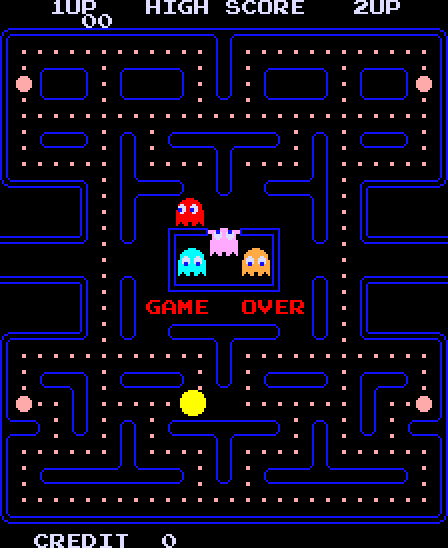

# Pac-Man (Midway, 1980) on the Atari STE



MAME set `pacman` (Pac-Man (Midway), `pacman/pacman.cpp`, `pacman_v.cpp`); the closest existing port is
[Galaga](../galaga/README.md) (the same Namco tile and sprite hardware, the same WSG sound chip).  The one Z80 is
statically translated to 68000 code with inline leaves and runs in lock-step with the reference, the IRQ delivered at
the task loop's spin; the boot's ROM / RAM tests are patched out.  The WSG's three voices play as square waves on the
YM2149 (Galaga's method).  The picture is MAME's ROT90 picture, 224 x 288 at screen x 48-271, 274 of its 288 lines shown
(Hatari's lines with both borders open), tiles from the translated writers' marks, sprites by generated sprite code
(`engine/sprite_programs.py`), the colours the arcade's own indices.  Status **Verification pending**: logic and picture
exact against the reference, full speed; full-game checks pending.  Speed (2026-10-29, Hatari, 4 MB STE, AUTOPLAY with
sound, 3001 VBLs): 3492 arcade frames and 2877 pictures, 58.2 arcade frames a second (96% of the arcade's 60.606, ~109
frames lost at the boot, then full speed) and 47.9 pictures a second.

## Build and run

```sh
python port.py prepare pacman             # verify assets/roms/puckman.zip, unpack (see below)
python port.py cover pacman               # coverage, seeds 1-12 (build/pacman/cover<seed>.pkl; ~3 min each)
python port.py build pacman               # -> run/pacman/PACMAN.PRG (--sim: run/pacman_sim/PACMAN.PRG)
python port.py test pacman                # logic, render, sprite and sound tests (see "Tests and tools")
python port.py run pacman                 # Hatari (tools/hatari.sh)
python port.py mame pacman                # the reference against MAME (WolfMAME 0.162, below)
python games/pacman/tools/prepare.py      # the same steps by the port's own scripts
python games/pacman/ref/cover.py <seed> 20000
python games/pacman/tools/build.py [--sim]
python games/pacman/tools/machine.py 900 out.png     # the reference boots and saves a picture
powershell -File games/pacman/tools/hatari.ps1 -Frames 3000 -Sound 44100 -Extra -DAUTOPLAY=1   # a hidden Hatari run
```

`tools/prepare.py` verifies the ten files against `docs/rom_manifest.json` and writes them with MAME's names to
`assets/roms/extracted/pacman/` and `build/pacman/mame_roms/pacman/` (MAME's `-rompath`).  The archive is
`assets/roms/puckman.zip`, MAME's merged Puck Man set: the Midway set's files are in three clone folders (`pacman/`,
`newpuckx/pacman.6f`, `hangly/pacman.5e`, `hangly/pacman.5f`) and the parent's PROMs (`pm1-1.7f` = `82s123.7f`, ...).
The manifest's `member` names each one's path; `engine/roms.extract` reads it (added for this set).  The coverage
pickles are needed by the translation and the sprite code.  Paths are relative to this folder; `engine/`, `tools/`,
`port.py` and `docs/` at the top are the repository's.

## Controls

Arrows or joystick move, **5** / **6** coin, **1** / **2** start, **Esc** quits.  Jaguar pad / PowerPad
(`engine/rt/jagpad.s`): either pad's D-pad moves Pac-Man (the players take turns), **Option** coin, **Pause** start,
keypad **1** / **2** start, **5** / **6** coin, **\*** + **#** quit.

## State

* **Reference against MAME** (`ref/mame_cmp_pacman.py`, 2026-10-29, 45 s of the attract mode, 2701 frames): 2638 frames
  equal a reference frame; all 11 colours on screen are exactly MAME's.  62 others are the boot's RAM test (its patterns
  caught mid-test: they depend on the exact Z80 cycle timing).  1 is an energizer's blink one frame apart (MAME frame
  1495, 30 pixels): a write near the blank, the same timing cause.  The AVI is 60 fps from a 60.606 Hz board: WolfMAME
  drops about one frame in 99, so the frame offset grows; the lookup by picture is independent of it.
* **Logic**: `tools/logic_test.py` compares every frame against `PacmanPort` (RAM `$4000-$47FF` and `$4C00-$4FFF`, the
  dead stack below SP left out; latch bit 0, the vector, IFF1, the WSG registers, the sprite coordinates; every changed
  video RAM cell marked): 2026-10-29, seeds 1-12 pass (seed 1 3000 frames, 2-12 12000 each).  Seeds 13 and 14 (random
  play the coverage never ran, 15000 frames each) pass too: no code outside the coverage's was reached (it would stop
  at `z80_badpc`).
* **Picture** (2026-10-29): `render_test.py` 9000 frames of seeds 2, 4, 6, 7, 11 and 12 (play, levels 1-28 and 250-255,
  the intermissions, two players), every third from frame 300: 17,400 pictures equal to the reference, side bands
  black.  `BLIT_STATS=256`: 121,916 HOG passes from 691 places, the longest 256 bus cycles, none sharing the bus.
* **Sprites**: `sprite_test.py`: 168 made-up pictures exact (both edges at every pixel, flips, 40 codes with holes, the
  black-pen patterns, 36 pictures with 64 KB crossings, the bands, the wrapped copy, moving sequences in all three
  buffers).
* **Sound** (`sound_test.py`, 2026-10-29): 4000 frames of a played game (after every frame the YM's registers equal
  `ym_image` of the reference's WSG registers) and 2000 random register sets, all equal.
* **Hatari** (`tools/hatari.ps1`, 2026-10-29): no crash; the stills match the reference (attract screens, the demo maze,
  frightened ghosts, Pac-Man's death; in play the score, the lives and fruit rows, the game over, the high score kept).
  The recorded audio of a 6000-VBL AUTOPLAY run sounds from the start (12 s) to the game over (66 s), its strongest
  frequencies 530-890 Hz in play.
* Open: the sound against MAME's audio (Pac-Man's attract mode is silent, and the WolfMAME 0.162 here has no Lua input
  to start a game; the pitch of waves 4 and 5 is the analysis's, not heard) and the play against MAME's with input (a
  MAME with input: MAME 0.289's Lua, a recorded `.inp`, or a MARP recording, [porting
  guide](../../docs/porting-guide.md#recorded-arcade-games-as-an-acceptance-test-marp-black-tiger-2026-10-22)).
* Open: the keyboard, the joystick and the pads checked by hand; the sound by ear.
* Not done: the flip screen (cocktail; the port is upright), the service mode (its tests never wait for a frame, and the
  port has no switch for it).  No PPO profile (`engine/ppo_profiles.py`: deferred).

## How it works

### The board and the reference

`tools/machine.py` (`Pacman`), from MAME's `pacman/pacman.cpp` and `pacman_v.cpp`:

* Z80 at 3.072 MHz, 192 cycles a line, 264 lines, 50688 cycles a frame (60.606 Hz).
* ROM 0000-3FFF; video RAM 4000, colour RAM 4400, RAM 4C00-4FEF, sprite RAM 4FF0 (code/flip, colour) and 5060 (y, x;
  write only); A15 is not decoded, A13 is ignored above $4000.  Latch 5000-5007 (IRQ enable, sound enable, flip, coin
  counter), WSG registers 5040-505F (kept in `.sound`), watchdog 50C0; inputs IN0 5000, IN1 5040, DSW1 5080 (default
  $C9: 1 coin 1 credit, 3 lives, bonus 10000), DSW2 50C0 ($00).  4800-4BFF reads $BF.
* IM 2: the vector is the byte last written to I/O port $00.  The boot writes $FA ($3FFA -> $3000, the RAM/ROM test with
  its grid), the game $FC ($3FFC -> $008D, the frame handler).  The IRQ is a level from the vertical blank (line 224),
  held until the program writes latch bit 0 = 0.
* A frame starts at the vertical blank (`frame_line=224`, MAME's phase): `render_raw` after `run_frame` is the picture
  MAME draws at that frame's end.
* The boot reaches the game's vector at frame 250: its IRQ target `$3000` checks the ROM and tests the RAM (255 passes)
  for about 295 frames of Z80 time.  The port patches that out (`machine.skip_tests`, `PacmanPort(skip=True)` and
  `gen.image`; the MAME check uses the original): `$3000` becomes `ld b,$01 / jp $30BD`, the point the tests reach when
  they pass (the RAM and the video RAM cleared, "memory OK", the vector `$FC`, the switches' screen, the game's init at
  `$234B`).  No later code checks the ROM.  Frame 0 then takes 47 frames of Z80 time (the boot's own delay loops): the
  first picture after about 1.8 seconds in Hatari, where the full test took 6.
* The foreground is a task queue: the program spins at `$238D` (`ld hl,($4C82); ld a,(hl); and a; jp m,$238D`) until
  the IRQ handler posts a task in the ring at $4CC0.
* No `ld a,r` in the program: no random source to replace.
* Renderer: 36 x 28 tiles with the Namco column/row mapping (Galaga's), 8 sprites of 16 x 16 drawn 7 down to 0, sprites
  0-2 one raw line lower (MAME's `xoffsethack`), clipped to raw x 16-271 and also drawn at x - 256.  A sprite pen is
  transparent where its colour lookup entry is 0 (`transpen_mask`); tiles are opaque.  Colours: MAME's
  `compute_resistor_weights` (red and green 1k / 470 / 220 ohm, blue 470 / 220, scaled to the largest net), rounded as
  `combine_weights` does.

**Against MAME** (`ref/mame_cmp_pacman.py [seconds]`): records MAME's attract mode with F030Arcade's WolfMAME 0.162
(`-aviwrite`; this machine has no MAME 0.289) and looks every MAME frame up among the reference's frames by its exact
RGB picture.

**Coverage** (`ref/cover.py <seed> [frames]`, 20000 frames each, about 3 minutes; the seeds in its docstring): random
4-way play to the game over, MAME's cheats (infinite lives `$4E14`, "finish this level" `$4E0E` = `$F4`, the level
`$4E13`) for levels 1-28 and 250-255 and the intermissions, two players, the other DIP switches, the rack test.
2026-10-29: 4973 pcs.  The service mode is left out.  What it found:

* The text printer (`$2C5E`) takes screen positions with bit 15 set from its string table (the top and bottom rows): A15
  is not decoded, so they are video RAM.  `gen.py IX_A15`: IX loses bit 15 after `add ix,de` at `$2C69`.  No other
  access to a mirror.
* `$205D` reads the empty `$4800-$4BFF` ($BF): the runtime fills those bytes of the block, nothing writes them.
* Inputs are read with `ld a,(nn)` only: `IO_IN` redirects them to `$5100-$5103`, the runtime's input bytes (the stores
  to `$5000-$50FF` stay plain stores: latch, WSG, sprite coordinates, watchdog).

### Translation

`tools/gen.py` (`engine/z80x.py` FAST, signed 64 KB block, `translate.compile_code`, inline leaves: `INLINE`,
`PM_INLINE`, 16 instructions): 5419 instructions (the coverage's 4973 and what discovery adds), nothing unsupported,
nothing missing.  The restarts that take data after the call are `discover`'s `rst_data` (2026-10-29; the default leaves
other ports unchanged): `rst $20` (32 sites) jumps through the word table after it, indexed by A; `rst $28` (76) posts a
task, 2 inline bytes, into the ring at `$4CC0` and returns past them; `rst $30` (33) puts 3 inline bytes in a free slot
of the 16 timed tasks at `$4C90` and returns past them (with all slots full its `ret` at `$005A` would return into the
data: never seen).  The continuations are joins.  21 jump tables; `$2F01`'s ends in entries that are single `ret`s
(empty sound handlers).  `out ($00),a` stores the vector (`pm_vector`), `ei` / `di` IFF1 (`pm_iff`), `halt` jumps to
`pm_halt`; the 102 stores to the video and colour RAM mark their cell (writer marks, `pm_mark_*`) for the renderer.

### Schedule

`machine.PacmanPort` (the reference) and `src/pacman.s` (the runtime: schedule, IRQ delivery, borders, inputs, crash
dump) do the same.  The foreground waits at two places: the task loop's spin at `$238D` while the task ring's read entry
(the byte at the address in `$4C82`) has bit 7 set, and the boot's `halt` at `$234A` (the program's only one).  There an
arcade frame ends (the idle hook of 1942's schedule, [porting guide](../../docs/porting-guide.md)).  The next one
delivers the IRQ when latch bit 0 (`$5000`) and IFF1 allow it: the address the foreground waits at is pushed on the Z80
stack and the IM 2 vector's target entered (the word at `$3F00` + the vector: `$3000` at boot, which never returns;
`$008D` the frame handler, whose `reti` goes back to `$238D` through the dispatch table, where the hook looks at the
ring again).  Without the IRQ the frame passes.  The runtime resets the 68000 stack before it enters the IRQ (the
foreground waits at its top level); the boot's push at SP `$FFFF` is written byte by byte (an odd address).

Unlike the arcade, the IRQ never cuts into a running task, and the boot runs inside frame 0 (it never waits; its tests
are patched out): the attract mode starts earlier than on the board, the game is otherwise the same.  A task that took
longer than a frame on the arcade makes a longer frame here.

### Picture

`src/render.s`, after Time Pilot's renderer.  The arcade's 224 x 288 picture is turned as MAME's ROT90 turns it and sits
at screen x 48-271 (black side bands of three 16-pixel groups: the edges lie on group boundaries), the top and bottom
border open (`engine/rt/borders.s`, Galaga's timing, one palette).

* **The lines.**  Hatari shows 274 lines from the video base with both borders open: measured 2026-10-29 by matching a
  recorded picture with the reference line for line (the picture's first line at the window's first; its last two lines
  black).  Which 14 of the 288 to leave out was measured over the coverage's play (every line's use, 4 seeds x 8000
  frames): lines 7, 8 and 272 are never drawn; row 2 (lines 16-23) and line 273 only on the level-256 split screen; line
  287 hardly ever (393 of 10664 pictures); 274 is the top line of the life and fruit icons (the least visible loss:
  every text row stays whole).  Shown: lines 0-6, 9-15, 24-271, 275-286 (`tools/assets.py SHOWN`).  The maze and every
  sprite keep one offset: buffer line = arcade line (10 guard lines above the display); the HUD rows move (`hud_line`).
  MAME clips sprites to lines 16-271, so a sprite's lines in the HUD bands are copied back from the clean screen
  (`band_restore`); MAME's second copy of each sprite 256 lines up is drawn where it reaches the maze.
* **Drawing.**  Tiles into a clean screen when the translated writers marked their cell and its code or colour changed
  (per colour and line range a generated converter, `pm_tconv`), copied into each display buffer (`movep.l`).  Sprites
  from a cache baked on first use (rows grouped by opaque mask), drawn with `engine/sprite_programs.py`'s generated code
  for the 65 shapes the coverage drew (767 routines, a 55 KB stream; [sprite-preparation.md](../../docs/sprite-preparation.md))
  and the row path for the rest; across a side edge only the inner word, wholly outside culled (`AGENTS.md`).  Three
  display buffers; damage restored with HOG passes of at most 32 words.

### Colours

Explicit colour indices, not a fitted palette ([colours.md](../../docs/colours.md#what-each-port-uses)): the STE pixel is
the arcade's colour index.  The colour lookup PROM only ever selects the palette PROM's first 16 colours (and never its
black duplicates 4, 8, 10), so `pm_pal` is that PROM on the STE's 4 bits a gun.  A sprite pen is transparent where its
colour is black: three patterns ({0}, {0, 2}, {0, 3}); 11 colours draw nothing.

### Sound

`tools/sound.py` (the model) and `snd_update` in `src/pacman.s` (the same in 68000 code), [Galaga's
method](../galaga/README.md): the same Namco WSG at 96 kHz with the same register map (MAME `namco.cpp pacman_sound_w`,
checked).  Each voice becomes a square wave on its YM2149 channel: the period from the WSG frequency (`1365333 / freq`,
the formula Galaga checked against MAME's audio) divided by the waveform's strongest harmonic, the level from the volume
and the waveform's RMS (3 dB a step).  Pac-Man's waveforms (`82s126.1m`) are not Galaga's: their strongest harmonics are
1, 1, 2, 1, 8, 16, 1, 2, so wave 4 (used by voice 1) sounds three octaves above its fundamental and wave 5 four
(Galaga's rule followed one octave only).  Latch bit 1 (`$5001`) switches the sound off.  `snd_update` runs once an
arcade frame, as the frame is delivered, on the registers the previous frame's handler wrote; it writes only the YM
registers that changed.

## Speed

| measured | setup | logic | pictures | Musashi |
|---|---|---|---|---|
| 2026-10-29 | Hatari, `hatari.ps1 -Frames 3000 -Sound 44100 -Extra -DAUTOPLAY=1` (the pads in, the boot patched): 3001 VBLs, 3492 arcade frames, 2877 pictures | 58.2 /s (96%; ~109 frames lost at the boot, then full speed) | 47.9 /s | logic 27-29k cycles a frame; a picture 16-49k CPU (the higher when levels change often: a maze redraw) + 6-7k Blitter |
| 2026-10-29 | Hatari, `hatari.ps1`, the attract mode, no input, before the sound: the last 3000 of 4500 VBLs | 59.9 /s (99%) | 49.8 /s | |
| 2026-11-07 | Musashi, seed 2, 1000 frames, 40-cycle slices | | | logic 29.3k (`logic_test.py`) and 29.1k (`render_test.py`) a frame |

The game runs at the arcade's rate after the boot.  What keeps it there: writer marks on the 102 video / colour RAM
store sites, generated sprite code and per-colour tile converters, inline leaves.  No recorded-play bench yet.

Techniques other ports use that may apply:
[speed.md](../../docs/speed.md#techniques-that-look-applicable-elsewhere-2026-11-07).

## Tests and tools

```sh
python games/pacman/tools/logic_test.py 12000 --seed <n>        # the lock-step test (Musashi against PacmanPort)
python games/pacman/tools/render_test.py 3000 --seed <n> --every 3   # the picture against the reference
python games/pacman/tools/sprite_test.py                        # the sprites at the edges, holes, bands, wrap, 64 KB
python games/pacman/tools/sound_test.py 4000                    # snd_update against tools/sound.py
python games/pacman/ref/mame_cmp_pacman.py [seconds]            # the reference against MAME's picture
powershell -File games/pacman/tools/hatari.ps1                  # a hidden Hatari run (AVI with sound, counters)
```

`tools/hatari.ps1`: `-Extra -DAUTOPLAY=1` puts in a coin, starts and plays from the VBL.  `port.py test pacman` runs
prepare, the simulator build, `logic_test.py` (3000 frames, and 6000 of seed 6: levels and intermissions),
`render_test.py 3000 --seed 2 --start 300 --every 3` and `--seed 12 ... --every 5` (level 250+), `sprite_test.py` and
`sound_test.py 3000`.

## Lessons

### 2026-11-07: the lock-step scripts' printed cycles overstate the logic

`logic_test.py` runs Musashi in slices of 2000 cycles and stops four times a frame, so each stop adds up to a slice of
idle spin: it printed 34-44k a frame on 2026-10-29.  Rerun with 40-cycle slices (seed 2, 1000 frames), `logic_test.py`
and `render_test.py` agree: 29.3k and 29.1k a frame (with the default slices 37.8k over 3000 frames and 33.8k).  The
logic is 27-29k a frame; the old estimate of 35-45% of a VBL came from the inflated figure.

### 2026-10-29: where a frame starts

Starting the reference's frames at line 0 left about one frame in ten of the demo different from MAME: the foreground
task writes the screen between line 0 and the blank.  Frames start at the vertical blank (`frame_line=224`, MAME's
phase).

### 2026-10-29: Pac-Man's waveforms are not Galaga's

Galaga's rule followed the strongest harmonic one octave only; Pac-Man's wave 4 has its strongest harmonic at 8 and
wave 5 at 16, so the period has to be divided by the harmonic itself.

## Verification

The coverage seeds (random play to the game over, levels 1-28 and 250-255 and the intermissions by MAME's cheats, two
players, the DIP switches, the rack test) and two random-play seeds outside the coverage are the lock-step and render
evidence above; AUTOPLAY runs in Hatari reached the game over.  Wanted for **Complete**: a natural playthrough in Hatari
(no cheats or RAM pokes), with the build identity, the input recording and a fresh replay kept.  Pac-Man has no
ending: decide what counts first (every distinct level up to about 21, where they stop changing, and the three
intermissions).

Full-game verification follows the [status policy](../../docs/port-status.md); nothing here claims a complete playthrough.
