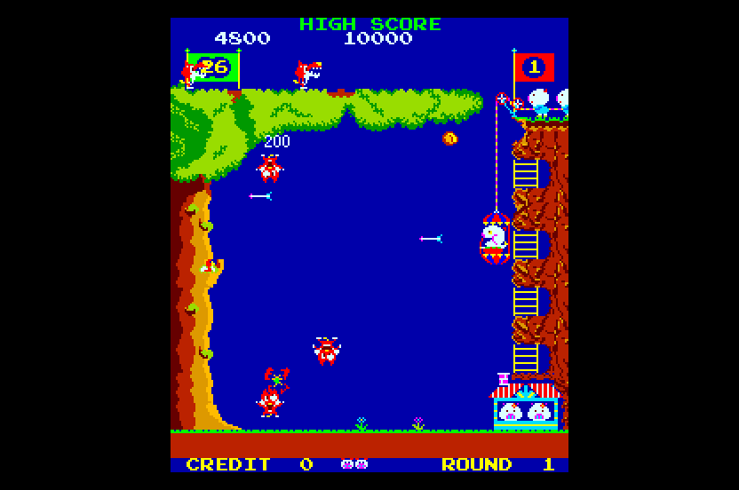

# Pooyan (Konami, 1982) for Atari STE



MAME set `pooyan` (the Konami parent; the zip also holds the clones `pooyans` and `pootan`).  Started 2026-10-29:
the reference board, its check against MAME, coverage, the translation, the runtime and the renderer, all exact
against the reference; full speed in Hatari.  No sound yet.  The board is Time Pilot's sibling (MAME: "very similar
to Time Pilot"), so the port follows `games/timeplt`: a 3.072 MHz Z80 statically translated to 68000 code and checked
in lock-step, a runtime that delivers the NMI at the game's idle point, a Blitter renderer.

```sh
python games/pooyan/tools/prepare.py       # verify assets/roms/pooyan.zip, unpack to assets/roms/extracted/pooyan/
python games/pooyan/tools/machine.py       # the reference in the port's schedule: 600 frames
python games/pooyan/ref/cover.py <seed> 20000          # coverage, seeds 1-13 -> build/pooyan/cover<seed>.pkl
python games/pooyan/ref/mame_avi_cmp.py [--keep DIR]   # the reference against WolfMAME 0.162, every frame
python games/pooyan/tools/gen.py           # -> build/pooyan/code_main.s, translation.json (needs the 13 coverage pickles)
python games/pooyan/tools/build.py         # -> run/pooyan/POOYAN.PRG (--sim: run/pooyan_sim, the Musashi build)
python games/pooyan/tools/logic_test.py 6000 --seed 4  # the translation in lock-step with the reference
python games/pooyan/tools/render_test.py 3000 --start 1000 --every 3   # the STE picture against the reference
python games/pooyan/tools/sprite_test.py   # made-up pictures: both edges at every shift, holes, 64 KB crossings
powershell -File games/pooyan/tools/hatari.ps1 -Frames 3000   # Hatari: counters, an AVI, stills (DEBUG + AUTOPLAY)
```

Controls (as Time Pilot's): **5/6** coin 1 / 2, **1/2** start, **up / down arrows** move the basket, **Space / Control /
Z** fire, **Esc** quits; joystick port 1 player 1, port 0 player 2; Jaguar pads.  DIP switches: MAME's defaults (3
lives, bonus 50K 80K+, difficulty 1, demo sounds on).

Supply `assets/roms/pooyan.zip` (MAME's set; `docs/rom_manifest.json` has the 13 files' sizes, CRCs and SHA-1s).
Nothing ROM-derived is in git.

## The board

`tools/machine.py` follows MAME's `konami/pooyan.cpp`: a 3.072 MHz Z80; 384 x 264 pixel clocks a frame (a line is
192 Z80 cycles, a frame 50,688: 60.6 Hz), lines 16-239 visible, VBLANK and the NMI at line 240 (while latch Q0 is 1);
ROT90.  ROM $0000-$7FFF (32 KB, no banking), colour RAM $8000-$83FF, video RAM $8400-$87FF, RAM $8800-$8FFF, the two
sprite RAMs $9000-$90FF / $9400-$94FF (mirrored in $9000-$9FFF), the I/O in $A000-$FFFF with mirrors (DSW1, IN0-IN2,
DSW0; watchdog, the sound command $A100, the LS259 at $A180-$A187: Q0 NMI enable, Q1 sound trigger, Q2 mute, Q3/Q4
coin counters, Q7 flip).  Unlike Time Pilot: no beam register (no sprite multiplexing), no `ld a,r`, one tile layer
without priority, tiles and sprites 4 bits a pixel (256 tiles, 64 sprite codes), 24 sprites drawn first to last (the
last on top), a sprite pen transparent where its lookup entry is colour 0.  Colours: one 32 x 8 PROM through
resistor networks (MAME's `compute_resistor_weights`, `engine/mamegfx.py`): 19 distinct colours, tiles from 16-31,
sprites from 0-15.  The sound board is Time Pilot's (`timeplt_audio`: a Z80 and two AY-3-8910, ROMs `xx.7a`, `xx.8a`).

The foreground is a task loop: `$020F` takes the entry at `$8800 + [$88A1]`; bit 7 set means empty, and the loop
calls `$0254` (a ROM check of the NMI handler, `$208C`, or the blinking 1UP / 2UP labels rewritten from RAM: the same
bytes on every pass) and goes round at `$021C`.  The port's hook is `$021C`, after one idle pass with an empty queue:
there the NMI ($0066 -> $066D) is delivered with the token $B000 as its return address (`machine.PooyanPort`).

RAM found so far: the score at `$88A2-$88A3` (BCD, in hundreds), the round at `$8907` (0-based; `$8947` the player's copy), lives
`$8908` and "wolves left" `$8901` (MAME's cheats).

## State

* **Reference against MAME** (`ref/mame_avi_cmp.py`, 2026-10-29): no MAME with the 0.289 Lua API on this machine, so
  F030Arcade's WolfMAME 0.162 records the attract mode with `-aviwrite` (uncompressed, native size) and the reference
  (MAME's schedule, `Pooyan.run_frame`) renders its memory at each VBLANK: **2,700 of 2,701 frames (45 s) equal to
  the pixel, colours included**.  The one other frame is boot frame 30, where the AVI repeats a frame of the screen
  test (it equals the reference's frame 30; from frame 31 on the offset is +1).  The reference follows the
  authoritative MAME 0.286 source (`AGENTS.md`: `F030Arcade/third_party/jsm68kdisassembler/third_party/mame`,
  `konami/pooyan.cpp` and `emu/video/resnet.cpp`); WolfMAME 0.162's picture agrees with it, colours included, so
  there is no difference to note.
* **Port schedule** (`PooyanPort.run_frame_port`): boots, attract mode, coin, start, play through the rounds and the
  bonus stage in the reference.
* **Coverage** (`ref/cover.py` seeds 1-13, 20,000 frames each; see its docstring): 9,557 pcs; the cheated seeds 4-8
  reach rounds 3-6, the bonus stages and the round-2 climb (wolves going up).  Colours seen (the pens of every 8th
  picture): 17 of the PROM's 19, black never (the sky is (0, 0, 171), 76% of the pixels); two are nearly unused
  ((33, 71, 251) 0.002%, (104, 0, 251) 0.001%), so one fixed STE palette of 16 can be all but exact.
* **Translation** (`tools/gen.py`, Time Pilot's settings: `z80x.FAST`, the flat 64 KB block, 16-instruction leaves
  in place): 14,786 instructions, every one the coverage ran translated; 101 colour / video RAM write sites marked;
  the five input ports read only at their base addresses (redirected to $B100-$B104: DSW1's $A000 is also the
  watchdog's write address).  Pooyan keeps loop counters in the **I register** (`ld i,a` / `ld a,i`, 22 sites) and
  runs one undocumented `dec iyh`: `engine/z80x.py` got `Config.iaddr` (I as a byte of the block, here $B1F4; a live
  P/V after `ld a,i`, which is IFF2, stops the build) and inc / dec of IYH / IYL.  12 instructions outside the
  coverage stay unsupported (`in`, `out` and P/V readers: data decoded as code; they stop loudly at
  `z80_unsupported`).
* **Runtime** (`src/pooyan.s`, Time Pilot's without the clouds, the checksum natives and the random byte): the NMI at
  the hook $021C with the token, the inputs at $B100-$B104 (keyboard, joysticks, Jaguar pads as in Time Pilot), the
  sound commands into a ring at latch Q1's rising edge (`py_sound`), the written cells listed (`py_mark_*`), six
  arcade frames to five VBLs.
* **Logic** (`tools/logic_test.py`, 2026-10-29): exact against the reference's port schedule every frame (RAM
  $8000-$8FFF, the sprite RAMs, latch Q0, the sound commands, every changed cell marked): seed 1 6,000 frames (attract,
  coin, play), seeds 4, 5, 7 8,000 each (infinite lives, rounds 3-4), 9 6,000 (the high score), 10 6,000 (two
  players), 12 6,000 (5 lives, the hardest difficulty, no demo sounds): 48,000 frames.  **The logic: ~44-49k 68000
  cycles an arcade frame in play** (Musashi, no drawing), against Time Pilot's ~52k: no tuning yet.
* **Renderer** (`src/render.s`, after Time Pilot's, much simpler: one tile layer, no front tiles, score bands or
  clouds): the turned 224 x 256 picture centred with black 48-pixel side bands (the edges on 16-pixel groups), borders
  open, three display buffers and a clean screen.  Tiles: a changed cell's image (code, flips, colour) baked on first
  use into a directly indexed table (16,384 x 32 bytes) and drawn with `movep.l`.  Sprites: the entry at $10 first
  (the last on top), baked on first use per (code, colour, flips) into a 512-slot cache; a pen is transparent where
  its colour's lookup entry is colour 0, so the masks depend on the colour: 8 transparency classes.  The coverage's 84
  shapes (class, code, flips) have generated code (`engine/sprite_programs.py`: 1,398 routines, 132 KB of end-mask
  streams), the rest and 64 KB crossings take the row path; clipped at the side edges (the inner word only), whole into
  the guard lines.  Colours (`tools/assets.py`): black and the 15 most frequent of the 17 the arcade shows; the two
  left out ((104, 0, 251), (33, 71, 251): 0.003% of the pixels) map to the nearest; mean error 0.5 a channel, nearly
  all of it the STE's 4 bits a gun.
* **Picture** (`tools/render_test.py`, 2026-10-29): exact in the shown colours, the side bands black: seed 1 667
  pictures of play (every 3rd of frames 1000-3000), seed 5 900 (rounds 2-4), seed 9 700 (the high score), seed 10 625
  (two players).  `tools/sprite_test.py`: 158 made-up pictures exact (both side edges at every shift, flips, the
  colours with holes, generated and row path, 64 KB crossings, the top and bottom, 60 moving pictures in a row; 193,000
  sprite pixels).  `BLIT_STATS=256`: every pass HOG, the longest 256 bus cycles, none on a shared bus.
* **Speed** (Musashi): a picture in play 25-33k CPU + 7.5-16k Blitter bus cycles; the generated sprite code against
  the row path alone (`-D REN_GEN=0`, the same pictures, exact both): seed 1 31.6k + 10.0k against 40.0k + 12.4k,
  seed 5 25.1k + 8.2k against 32.2k + 10.4k: kept.  **Hatari** (`tools/hatari.ps1`, DEBUG + AUTOPLAY, 3,000 VBLs): no
  crash, no late border event; in play **60 arcade frames and 50 pictures a second** in most 2-second windows, 28-42
  pictures at a round's start (many new tiles baked); 57.9 frames and 46.3 pictures a second over the whole run with
  the boot and the attract mode.
* Not done: sound (Time Pilot's board: none of the ports has it yet), the cocktail flip, a recorded play
  (`PLAYBACK`), registration in `port.py`, `tools/release.py` and the README table's screenshot; full-game Hatari
  verification.
