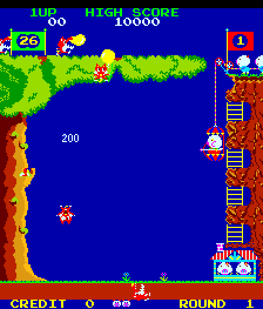

# Pooyan (Konami, 1982) on the Atari STE



MAME set `pooyan` (the Konami parent, `konami/pooyan.cpp`; the zip also holds the clones `pooyans` and `pootan`).  The
board is Time Pilot's sibling (MAME: "very similar to Time Pilot"), so the port follows [Time
Pilot's](../timeplt/README.md): the 3.072 MHz main Z80 is statically translated to 68000 code with inline leaves and
checked in lock-step, the runtime delivers the NMI at the game's idle point.  The sound board (Time Pilot's,
`shared/timeplt_a.cpp`) has its Z80 driver translated too; its two AY-3-8910s are mixed onto the YM2149.  The picture is
the turned 224 x 256 picture centred in the 320-pixel screen, drawn by a Blitter renderer with generated sprite code
(`engine/sprite_programs.py`).  Status **Verification pending**: logic and picture exact against the reference, full
speed; full-game checks pending.  Speed (2026-10-29, Hatari, 4 MB STE, `bench.sh 6000` AUTOPLAY with sound): 58.3
arcade frames a second (96% of the arcade's 60.6, the boot and attract mode included; 60 in most of play) and 43.5
pictures a second (median 46.5, 10th percentile 32.0).

## Build and run

```sh
python port.py prepare pooyan             # verify assets/roms/pooyan.zip, unpack to assets/roms/extracted/pooyan/
python port.py cover pooyan               # coverage, seeds 1-13 -> build/pooyan/cover<seed>.pkl
python port.py build pooyan               # -> run/pooyan/POOYAN.PRG (--sim: run/pooyan_sim, the Musashi build)
python port.py test pooyan                # logic, render, sprite and sound tests (see "Tests and tools")
python port.py run pooyan                 # Hatari (tools/hatari.sh)
python port.py mame pooyan                # the reference against MAME 0.289
python games/pooyan/tools/prepare.py      # the same steps by the port's own scripts
python games/pooyan/ref/cover.py <seed> 20000
python games/pooyan/ref/cover_sound.py <seed> 20000    # sound coverage: seed 0 the game's commands, 1-3 random
python games/pooyan/tools/gen.py          # -> build/pooyan/code_main.s, translation.json (needs the 13 coverage pickles)
python games/pooyan/tools/build.py
python games/pooyan/tools/machine.py      # the reference in the port's schedule: 600 frames
powershell -File games/pooyan/tools/hatari.ps1 -Frames 3000   # Hatari: counters, an AVI, stills (DEBUG + AUTOPLAY)
```

Supply `assets/roms/pooyan.zip` (MAME's set; `docs/rom_manifest.json` has the 13 files' sizes, CRCs and SHA-1s).
Nothing ROM-derived is in git.  Paths are relative to this folder; `engine/`, `tools/`, `port.py` and `docs/` at the
top are the repository's.

## Controls

As Time Pilot's: **5/6** coin 1 / 2, **1/2** start, **up / down arrows** move the basket, **Space / Control / Z** fire,
**Esc** quits; joystick port 1 player 1, port 0 player 2; Jaguar pads.  DIP switches: MAME's defaults (3 lives, bonus
50K 80K+, difficulty 1, demo sounds on).

## State

* **Reference against MAME 0.289** (`ref/mame_cmp_pooyan.py`, `port.py mame pooyan`, 2026-11-01, on the Mac): the
  reference renderer draws MAME's memory with 0 differing pixels at frames 60-3600, the pens 0 of 512 differ, and the
  reference machine from power-on has MAME's RAM (the stack left out) at the same frames.
* **Reference against WolfMAME 0.162** (`ref/mame_avi_cmp.py`, 2026-10-29, Windows, which had no MAME with the 0.289
  Lua API: F030Arcade's WolfMAME records the attract mode with `-aviwrite`, uncompressed, native size; the reference
  in MAME's schedule, `Pooyan.run_frame`, renders its memory at each VBLANK): **2,700 of 2,701 frames (45 s) equal to
  the pixel, colours included**.  The one other frame is boot frame 30, where the AVI repeats a frame of the screen
  test (it equals the reference's frame 30; from frame 31 on the offset is +1).  The reference follows the
  authoritative MAME 0.286 source (`AGENTS.md`: `F030Arcade/third_party/jsm68kdisassembler/third_party/mame`,
  `konami/pooyan.cpp` and `emu/video/resnet.cpp`); WolfMAME 0.162's picture agrees with it, so there is no difference
  to note.
* **Logic** (`tools/logic_test.py`, 2026-10-29): exact against the reference's port schedule every frame (RAM
  $8000-$8FFF, the sprite RAMs, latch Q0, the sound commands, every changed cell marked): seed 1 6,000 frames (attract,
  coin, play), seeds 4, 5, 7 8,000 each (infinite lives, rounds 3-4), 9 6,000 (the high score), 10 6,000 (two
  players), 12 6,000 (5 lives, the hardest difficulty, no demo sounds): 48,000 frames.
* **Picture** (`tools/render_test.py`, 2026-10-29): exact in the shown colours, the side bands black: seed 1 667
  pictures of play (every 3rd of frames 1000-3000), seed 5 900 (rounds 2-4), seed 9 700 (the high score), seed 10 625
  (two players).  `BLIT_STATS=256`: every pass HOG, the longest 256 bus cycles, none on a shared bus.
* **Sprites** (`tools/sprite_test.py`): 158 made-up pictures exact (both side edges at every shift, flips, the colours
  with holes, generated and row path, 64 KB crossings, the top and bottom, 60 moving pictures in a row; 193,000 sprite
  pixels).
* **Sound** (`tools/sound_test.py`, 2026-10-29): the STE player equals `STEBoard` every frame (seeds 1, 9, 10, 12 6,000
  frames, 5 8,000); the logic and render tests pass with the sound build.  Hatari: the AVI's sound track has the music
  and the effects from the attract mode on.
* **Hatari** (`tools/hatari.ps1`, DEBUG + AUTOPLAY, 3,000 VBLs): no crash, no late border event.
* Open: the sound board's RC filters ($8000-$FFFF stores: 0.047 / 0.22 uF low-passes per channel) and the mute (never
  used) are not modelled.
* Open: the cocktail flip; a recorded play (`PLAYBACK`) for the bench.
* 12 instructions outside the coverage stay unsupported (`in`, `out` and P/V readers: data decoded as code); they stop
  loudly at `z80_unsupported`.

## How it works

### The board and the reference

`tools/machine.py` follows MAME's `konami/pooyan.cpp`: a 3.072 MHz Z80; 384 x 264 pixel clocks a frame (a line is 192
Z80 cycles, a frame 50,688: 60.6 Hz), lines 16-239 visible, VBLANK and the NMI at line 240 (while latch Q0 is 1); ROT90.
ROM $0000-$7FFF (32 KB, no banking), colour RAM $8000-$83FF, video RAM $8400-$87FF, RAM $8800-$8FFF, the two sprite
RAMs $9000-$90FF / $9400-$94FF (mirrored in $9000-$9FFF), the I/O in $A000-$FFFF with mirrors (DSW1, IN0-IN2, DSW0;
watchdog, the sound command $A100, the LS259 at $A180-$A187: Q0 NMI enable, Q1 sound trigger, Q2 mute, Q3/Q4 coin
counters, Q7 flip).  Unlike Time Pilot: no beam register (no sprite multiplexing), no `ld a,r`, one tile layer without
priority, tiles and sprites 4 bits a pixel (256 tiles, 64 sprite codes), 24 sprites drawn first to last (the last on
top), a sprite pen transparent where its lookup entry is colour 0.  Colours: one 32 x 8 PROM through resistor networks
(MAME's `compute_resistor_weights`, `engine/mamegfx.py`): 19 distinct colours, tiles from 16-31, sprites from 0-15.
The sound board is Time Pilot's (`timeplt_audio`: a Z80 and two AY-3-8910, ROMs `xx.7a`, `xx.8a`; see Sound).

RAM (MAME's cheats): the score at `$88A2-$88A3` (BCD, in hundreds), the round at `$8907` (0-based; `$8947` the player's
copy), lives `$8908` and "wolves left" `$8901`.

**Coverage** (`ref/cover.py` seeds 1-13, 20,000 frames each; see its docstring): 9,557 pcs; the cheated seeds 4-8 reach
rounds 3-6, the bonus stages and the round-2 climb (wolves going up); seed 13 the attract cycle without a coin.  Colours
seen (the pens of every 8th picture): 17 of the PROM's 19, black never (the sky is (0, 0, 171), 76% of the pixels); two
are nearly unused ((33, 71, 251) 0.002%, (104, 0, 251) 0.001%).

### Translation

`tools/gen.py`, Time Pilot's settings: `z80x.FAST`, the flat 64 KB block, inline leaves (16 instructions) in place:
14,786 instructions, every one the coverage ran translated; 101 colour / video RAM write sites marked (writer marks,
`py_mark_*`: the written cells listed); the five input ports read only at their base addresses (redirected to
$B100-$B104: DSW1's $A000 is also the watchdog's write address).  Pooyan keeps loop counters in the **I register**
(`ld i,a` / `ld a,i`, 22 sites) and runs one undocumented `dec iyh`: `engine/z80x.py` got `Config.iaddr` (I as a byte
of the block, here $B1F4; a live P/V after `ld a,i`, which is IFF2, stops the build) and inc / dec of IYH / IYL.

### Schedule

`src/pooyan.s` (Time Pilot's runtime without the clouds, the checksum natives and the random byte), `machine.PooyanPort`.
The foreground is a task loop: `$020F` takes the entry at `$8800 + [$88A1]`; bit 7 set means empty, and the loop calls
`$0254` (a ROM check of the NMI handler, `$208C`, or the blinking 1UP / 2UP labels rewritten from RAM: the same bytes
on every pass) and goes round at `$021C`.  The port's hook is `$021C`, after one idle pass with an empty queue: there
the NMI ($0066 -> $066D) is delivered with the token $B000 as its return address.  The inputs at $B100-$B104 (keyboard,
joysticks, Jaguar pads as in Time Pilot), the sound commands into a ring at latch Q1's rising edge (`py_sound`), six
arcade frames to five VBLs.  `PooyanPort.run_frame_port` boots, runs the attract mode, coin, start, play through the
rounds and the bonus stage in the reference.

### Picture

`src/render.s`, after Time Pilot's, much simpler: one tile layer, no front tiles, score bands or clouds.  The turned
224 x 256 picture centred with black 48-pixel side bands (the edges on 16-pixel groups), borders open, three display
buffers and a clean screen.

* **Tiles**: a changed cell's image (code, flips, colour) baked on first use into a directly indexed table (16,384 x 32
  bytes) and drawn with `movep.l`.
* **Sprites**: the entry at $10 first (the last on top), baked on first use per (code, colour, flips) into a 512-slot
  cache; a pen is transparent where its colour's lookup entry is colour 0, so the masks depend on the colour: 8
  transparency classes.  The coverage's 84 shapes (class, code, flips) have generated code (`engine/sprite_programs.py`:
  1,398 routines, 132 KB of end-mask streams, see [sprite-preparation.md](../../docs/sprite-preparation.md)), the rest
  and 64 KB crossings take the row path; clipped at the side edges (the inner word only), whole into the guard lines.

### Colours

`tools/assets.py` `palette()` (since 2026-11-05): the shared default fitter, flat
([colours.md](../../docs/colours.md#the-default-fitter-enginepalette_quantizepy-r-type-2026-11-05);
`engine/palette_native.py`, one STE index per PROM pen, black slot 0), trained on the coverage's pen counts; text and
HUD glyphs stay flat, gameplay and graphics priorities unchanged.  The checker-refined palette can still differ from
the flat fit over a whole game ([what each port uses](../../docs/colours.md#what-each-port-uses)).

### Sound

The board (MAME 0.286 `shared/timeplt_a.cpp`, the authoritative source tree of `AGENTS.md`; `tools/sound.py`): a Z80 at
14.318181 MHz / 8 = 1.789772 MHz, ROM $0000-$2FFF (Pooyan's 8 KB at $0000-$1FFF), RAM $3000-$33FF (mirrored to $3FFF),
AY #1 data $4000 / address $5000, AY #2 data $6000 / address $7000 (mirrored over $0FFF), stores to $8000-$FFFF set six
RC low-pass filters (the address bits).  Both AYs at 1.789772 MHz; AY #1's port A reads the command latch, its port B
the timer (`timeplt_timer[(cycles / 512) % 10]`: bit 7 rises every 5120 cycles, 349.6 a second).  The main CPU's latch
Q1 rising edge raises the IRQ (HOLD_LINE, IM 1).  The AY details follow `devices/sound/ay8910.cpp`: an address write
with a non-zero upper nibble deselects the chip, reads are masked to the register's width, a port read puts the port's
value into its register.  Q2 (the amplifier's mute) is never written by the game (the coverage).

Pooyan's driver: the loop's head $00CB (`ei`), the waits for the timer's edge, then six slots ($3000-$300B: an effect
and its state; slot k drives AY (k-1)/3's voice (k-1)%3), each followed by an `ei; nop; nop; di` window; the IRQ handler
$0038 reads the latch and puts the command into a slot ($00-$2A; bit 7: stop it).  It uses no noise, no envelope and
none of the RAM's mirrors; the timer is read only in the waits.  The main CPU's commands: 0-$2A and stops.

* **Reference** (`MameBoard`): the sound CPU at its clock, each command at the main CPU's cycle in MAME's schedule
  (`TimedPooyan`), the IRQ taken at the first instruction with interrupts enabled.
* **The STE's schedule** (`TickBoard`, Gyruss's): each arcade frame the commands of the frame before each run the IRQ
  handler, then the frame's 5.768 ticks (16.16 fixed point) run the loop from $00DA (after the waits) to $00CB.
  `ref/sound_cmp.py` feeds both with the same game: every channel's audible states (period and volume while not
  silent) in order, the time left out, equal for **99.96%** (seed 1, 8,000 frames, 29,049 states) and 97.1% (seed 5,
  8,000 frames); the rest is an effect that, started up to a frame later, lands on another free slot (another AY
  channel) or its first tick a tick later: the same notes.  The STE delays a command by up to an arcade frame (16.5 ms)
  against MAME.
* **Coverage** (`ref/cover_sound.py`): seed 0 the game's commands of `ref/cover.py`'s seeds 1, 5, 9, 12 (12,000 frames
  each), seeds 1-3 random commands (20,000 frames): 1,319 pcs, 71 computed-jump targets; no unexpected access.
* **Translation** (`tools/sndgen.py`, `engine/z80x.py` FAST, the 64 KB block): 1,349 instructions.  The AYs'
  memory-mapped accesses are the static `ld (nn),a` / `ld a,(nn)` (the coverage checks it): address writes select a
  register, data writes go into two 16-byte register files (`snd_ay`), reads come back masked (the latch, the timer 0).
  The filter stores stay plain stores (the STE has no filters).  The driver's helpers are emitted at their calls,
  recognised by their code (not by Pooyan's addresses, so Time Pilot's driver uses the same generator): `rst $08` /
  `$10` (select and read), `rst $18` / `$20` (register B := C, without the dummy read in between), and the `rst $28`
  jump table, which every caller enters after `ld hl,nn`: a 68000 table per base (the target's label and HL; the flags
  it leaves, S, Z and C clear, are set).
* **Player** (`src/sound.s`): `snd_frame` before each NMI: the commands of `py_sound`'s ring through the IRQ handler,
  then the frame's ticks in one run (the hook at $00CB starts the next tick); `snd_ym` puts the three loudest audible
  of the six channels on the YM (a channel keeps its YM channel while chosen; [Kung-Fu Master's
  method](../kungfum/README.md#sound)), the periods x 2000000 / 1789772 through a 4096-entry table; only changed
  registers written.

## Speed

| measured | setup | logic | pictures | Musashi |
|---|---|---|---|---|
| 2026-10-29 | Hatari, `bench.sh 6000` (AUTOPLAY, 6,000 VBLs), with sound | 58.3 /s (96%) | 43.5 /s (median 46.5, 10th percentile 32.0) | logic ~44-49k cycles an arcade frame in play without drawing, the sound ~21k (`snd_ym` 3k) |
| 2026-10-29 | Hatari, `bench.sh 6000`, without sound (`EXTRA="-D NOSOUND=1"`) | 58.6 /s | 47.4 /s (median 50.0, 10th percentile 42.0) | |
| 2026-10-29 | Hatari, `hatari.ps1` (DEBUG + AUTOPLAY, 3,000 VBLs), the first renderer build (c530b1a, before the sound) | 57.9 /s over the run; 60 /s in most 2-s windows of play | 46.3 /s over the run; 50 /s in most of play, 28-42 at a round's start (many new tiles baked) | a picture in play 25-33k CPU + 7.5-16k Blitter |

The sound keeps the logic at its speed and costs the pictures ~8% (Kung-Fu Master's sound costs about as much).  The
logic (~44-49k a frame, against Time Pilot's ~52k) has had no tuning.

What made it fast:

* **Generated sprite code** (`-D REN_GEN=0` builds the row path alone; the same pictures, exact both): seed 1 31.6k +
  10.0k against 40.0k + 12.4k a picture, seed 5 25.1k + 8.2k against 32.2k + 10.4k: kept.
* **The sound driver's helpers at their calls**, one run for a frame's ticks, the period table and a faster `snd_ym`:
  ~31k -> ~21k 68000 cycles an arcade frame in play (Musashi).

Techniques other ports use that may apply:
[speed.md](../../docs/speed.md#techniques-that-look-applicable-elsewhere-2026-11-07) (the idle pass's ROM check at
`$0254`, which Time Pilot answers with a native, is listed there).

## Tests and tools

```sh
python games/pooyan/tools/logic_test.py 6000 --seed 4  # the translation in lock-step with the reference
python games/pooyan/tools/render_test.py 3000 --start 1000 --every 3   # the STE picture against the reference
python games/pooyan/tools/sprite_test.py   # made-up pictures: both edges at every shift, holes, 64 KB crossings
python games/pooyan/ref/sound_cmp.py 1 8000            # the STE's sound schedule against the MAME-timed sound board
python games/pooyan/tools/build.py --sim --tag pooyan_snd && python games/pooyan/tools/sound_test.py 6000 --seed 1
python games/pooyan/ref/mame_cmp_pooyan.py [frame ...]  # the reference against MAME 0.289 (port.py mame pooyan)
python games/pooyan/ref/mame_avi_cmp.py [--keep DIR]   # the reference against WolfMAME 0.162, every frame (Windows)
games/pooyan/tools/bench.sh 6000           # Hatari speed (its own Hatari; EXTRA="-D NOSOUND=1": without sound)
```

`port.py test pooyan` runs prepare, the simulator build, `logic_test.py` (3000 frames, and 6000 of seed 5: rounds 2-4),
`render_test.py 3000 --start 1000 --every 3` and `--seed 10 ... --every 5` (two players), `sprite_test.py` and
`sound_test.py 3000 --tag pooyan_sim`.

## Lessons

### 2026-10-29: the I register as a loop counter

Pooyan keeps loop counters in the I register (`ld i,a` / `ld a,i`, 22 sites) and runs one undocumented `dec iyh`: the
translator needed `Config.iaddr` (I as a byte of the block) and inc / dec of IYH / IYL.  A live P/V after `ld a,i` (it
is IFF2) cannot be translated this way and stops the build.

### 2026-10-29: helpers recognised by their code

The sound driver's `rst` helpers are recognised by their code, not by Pooyan's addresses, so Time Pilot's driver (the
same board) uses the same generator.

## Verification

The coverage seeds (rounds 3-6 by cheats, the bonus stages, the high score, two players, the DIP switches) are the
lock-step and render evidence above; the attract mode equals WolfMAME's recording frame for frame.  No recorded play
yet.

Full-game verification follows the [status policy](../../docs/port-status.md); nothing here claims a complete playthrough.
