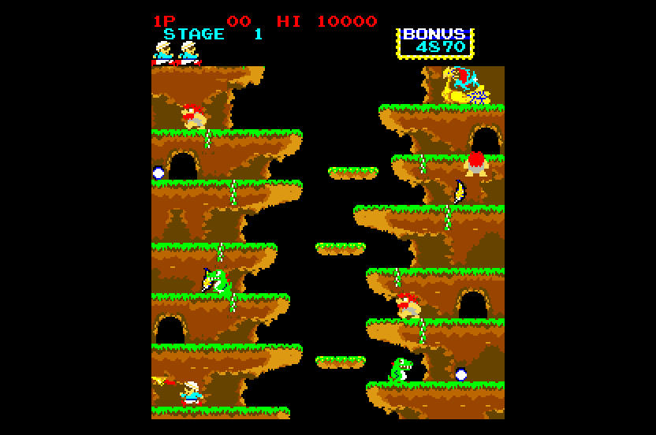

# Roc'n Rope (Konami, 1983) on the Atari STE



MAME set `rocnrope` (`konami/rocnrope.cpp`, MAME 0.286 source).  The main CPU (KONAMI-1, a 6809 with encrypted opcodes,
40 KB at $6000) is statically translated to 68000 code (`engine/m6809x.py`) and checked against a reference board in
lock-step.  The sound board (a Z80 with two AY-3-8910s, Time Pilot's) is translated too (Pooyan's method: the driver runs
on the STE, its two AYs are register files, their six channels go to the YM2149 each arcade frame).  The picture is MAME's ROT270 picture, 224 x 256, centred in the 320-pixel screen with the top and bottom
borders open, drawn by `src/render.s` (tile cache, sprite cache, generated Blitter code from `engine/sprite_programs.py`);
one flat 16-colour palette (the arcade's lookup PROMs use palette entries 0-15 only, so the fit is near exact: mean
error 0.9 a channel).  Status: **Incomplete** (sound checked only as register streams in the simulator, never heard; no
full-game verification: stages 2-4 and 8 are reached by a poked stage index only, no stage is completed).
Speed (Hatari, STE, 4 MB, TOS 2.06, DEBUG build with `AUTOPLAY=1` and the sound, 3000 VBLs, 2026-11-08): after the
boot test, 54 arcade frames (90% of the arcade's speed) and 28 pictures a second (108 frames and 56 pictures per 100
VBLs), no late border events; without the sound (`-D NOSOUND=1`, 2026-11-07) 60 frames and 48 pictures a second.
Per docs/speed.md's checklist (Musashi, sound off in the tests): no parallax, no colour cycling, one tile layer, so the
costs are the logic and the changing cells.  Stage 1: logic ~58k cycles a frame, a picture ~55k; stage 3: logic 68-74k
(of which `main_vlist`, the PSHU fills' cell lists, 6% and the sound's YM mix-down 4%), a picture 58-67k (tile_changed
17%, copy_cells 14%, sprites 13%, render_tiles 12%: the cells the pillar, the waterfall and the cross change each
frame).  Hoisting the constant addresses out of render_tiles' loop saved 0.4%; nothing larger was tried (the logic's
28% in one translated block `main_pb_05` is the next place to look: natives need a per-routine profile).  Hatari
stage 1 play: 55 arcade frames and 29 pictures a second; stages 2-4 were not run in Hatari (it cannot poke the stage).
Started 2026-11-07 from Track & Field's runtime and logic tests and Time Pilot's vertical renderer.

## Build and run

```sh
python port.py cover rocnrope               # coverage: ref/cover.py seeds 1-19 (60000 frames for 12-15), ref/cover_sound.py
python port.py build rocnrope               # -> run/rocnrope/ROCNROPE.PRG
python port.py test rocnrope                # lock-step (seeds 1, 4, 10, 12, 17-19), render (seeds 4, 17, 18), sprite edges, sound
python port.py mame rocnrope                # the reference against MAME (set MAME to a binary that knows rocnrope)
python games/rocnrope/tools/prepare.py      # verify assets/roms/rocnrope.zip, unpack to assets/roms/extracted/rocnrope/
python games/rocnrope/tools/build.py --sim  # -> run/rocnrope_sim (Musashi, for the tests); --debug, --frames N, -D AUTOPLAY=1
python games/rocnrope/tools/logic_test.py 3000 --seed 4        # the translation in lock-step with the reference
python games/rocnrope/tools/render_test.py 3000 --seed 4 --start 900   # the STE picture against the reference
python games/rocnrope/tools/sprite_test.py                      # edges, 16 shifts, holes, guards, 64 KB crossings
python games/rocnrope/tools/build.py --sim --tag rocnrope_snd && python games/rocnrope/tools/sound_test.py 3000 --seed 4 --tag rocnrope_snd
python games/rocnrope/ref/sound_cmp.py 1 4000                   # the STE's sound schedule against the reference board
powershell -ExecutionPolicy Bypass -File games/rocnrope/tools/hatari.ps1 -Frames 3000 -Every 250   # hidden Hatari + stills
```

Supply `assets/roms/rocnrope.zip` (MAME's parent set; `docs/rom_manifest.json` has the 16 files' sizes, CRCs and
SHA-1s).  Nothing ROM-derived is in git.  The MAME comparison needs a binary that knows `rocnrope`
(`F030Arcade/third_party/wolfmame-0248/mame.exe` does), started through `engine/mamewin.py`.

## Controls

**5/6** coin 1 / 2, **1/2** start, **arrow keys** move / climb, **Space / Z** button 1, **Control / X** button 2, **Esc**
quits.  Joystick port 1 player 1, port 0 player 2 (fire = button 1); Jaguar pads as in the other ports (A, C button 1,
B button 2).  DIP switches: MAME's defaults (3 lives, difficulty 5, bonus 20000 / 60000, demo sounds on); upright only
(the cocktail's flipped screen is not drawn).

## State

* **Reference board**: equals MAME 0.286's `rocnrope` (WolfMAME 0.248 binary): 0 differing pixels and 0 differing pens at
  frames 600-3600, and 0 differing bytes of $4000-$5FFF at the same frames (`ref/mame_cmp_rocnrope.py`).  At frames 60
  and 300 (the boot's RAM test) the pictures differ (not investigated: the test fills the RAM pseudo-randomly) and
  the RAM differs in two bytes at frame 60.
* **Logic**: exact against the reference's port schedule: `tools/logic_test.py`, seeds 1, 4, 7, 9, 10 for 3000 frames
  each (attract, coin, start, play, deaths; infinite lives; stages poked via $50C1; two players): RAM $4000-$5FFF,
  the RAM vectors, latch Q0 / Q7 and the sound commands, every frame.  About 40-55 K 68000 cycles a frame (Musashi).
* **Picture**: exact in the shown colours: `tools/render_test.py`, 0 differences in 2100 pictures each of seeds 1, 4, 7
  and 9 (frames 900-3000); `tools/sprite_test.py`: 154 made-up pictures exact (both side edges at every shift, flips,
  holes, guard lines, 64 KB crossings, sequences).  Sprites clip at the picture's group-aligned left and right edges
  ([AGENTS.md](../../AGENTS.md)).
* **Hatari** (F030Arcade build, STE, 4 MB, TOS 2.06): boot, attract (title, ranking, demo), play, the bird's scene; no
  crash.  Looked at 14 stills of one run only, with the AUTOPLAY input.
* **Sound** (2026-11-08): the driver's translation runs the driver's own commands in the simulator and equals its
  model (`tools/sound.py` STEBoard) every arcade frame: sound RAM, both AYs' registers, the YM's registers and channel
  choice (`tools/sound_test.py`, seeds 1, 4 and 10, 3000 frames each: 220 / 225 / 142 commands).  The STE's tick schedule
  against the reference board (the sound CPU at its clock, commands at the main CPU's instants):
  99.25% of the audible channel states equal over 4000 frames (`ref/sound_cmp.py`; the rest: an effect that starts up
  to a frame later, or in another free slot).  Heard only as a recording: Hatari with its sound on (`hatari.ps1 -Sound 1`) saved
  44.1 kHz audio of an AUTOPLAY run: silent before the coin, then the intro's tune (peaks change between 220 and 1170 Hz),
  then a steady low tone (peak 84-93 Hz, RMS about 1500) for the 18 s of play; nobody listened to it.  The AY mix-down
  onto three YM voices is lossy by design (loudest three of six).  The model is not compared with MAME's audio.
* **Later stages** (2026-11-08): the stage index is **$50C1** (0-based; the HUD prints it + 1 at the start of a game, a
  few hundred frames after the coin: poked later it is reset).  Poked before the HUD draws it, the game plays that stage:
  the scenery repeats every four stages (1: the cliffs, 2: the waterfall, 3: the rotating cross, 4: the cave), and
  stage 8 plays like 4.  Coverage seeds 7-9 (stages 2-4, lives kept) and 16-19 (MAME's cheats: lives $50C0,
  invincibility $51C0 = 2 / $51DE = 0, bonus $509B; stages 2, 3, 4 and 8) add 920 pcs to those of seeds 1-15; seeds
  12-15 alone play 60000 frames of stage 1 with the cheats (XNC at $B610 translated).  Lock-step (`logic_test.py`):
  seeds 17, 18 (3000 frames) and 19 (12000 frames) exact.  The render test found a real bug in stage 3: the game fills
  the pillar's tiles with `PSHU` (U pointing into the video RAM), whose stores the translation did not list as changed
  cells (stale tiles, 400-700 differing pixels from frame 3820); `Program.video_push` / `main_vlist` list them now
  (engine/m6809x.py, backwards compatible), and the render tests of seeds 16-19 (1667 pictures each) and 17 (1000)
  are exact.  Not reached: the stage *completing* (random play never gets the player to the top: the exit, the
  bonus count and the stage change happen only by the poke), so the code after a stage's end, and a stage poked above 8
  (the indexes' tables), are covered only as far as the pokes got.  MAME was not run with the poke: the reference's
  pictures of stages 2-4 are the reference machine's, whose rendering equals MAME's only where stage 1 shows it.
* **Not done / not verified**: the cocktail flip; the Mega STE; the full game (no stage is completed; stages above 8 and the code after a stage's end are not covered); a real controller
  run; `docs/sprite-preparation.md`'s reordered-source measurements (the sprite code is the shared generator's
  output, not measured against alternatives here); the speed in busy scenes; release packing (`tools/release.py` lists it).

## How it works

* **Board**: KONAMI-1 at 1.536 MHz, 256 x 256 total / 224 visible lines, 60 Hz, ROT270.  One 32 x 32 tilemap of 8 x 8 4 bpp
  tiles (colour RAM $4800, video RAM $4C00; code = byte + 256 x colour bit 7) and 24 sprites of 16 x 16 4 bpp (RAM
  $4000 / $4400: attribute, y / x, code), pens through two lookup PROMs into a 16-entry palette.  The IRQ vector is in
  RAM ($FFF2-$FFFD, written through $8182-$818D); MAME's driver init patches one ROM byte ($703D), as does `rom_image()`.
* **Reference** (`tools/machine.py`): `RocnRope` is the board in MAME's schedule; `RocnRopePort` the STE's.  The
  foreground is a task loop ($6065: queue at $5100-$513F, read pointer $501A); with the queue empty it calls $6094 (the
  coin text's blink) round and round; the IRQ ($70A0) plays the game.  The port's idle point is the BSR at $6070: the
  IRQ is delivered there (return address $6070).  Two CWAI #$EF sites ($6451, $69FC: the intro's screen clears) wait for
  the next interrupt: they are hooks (`rr_cwai_*`) that do the same wait.  One empty round runs per frame after the
  tasks (the arcade runs it thousands of times; it is idempotent).
* **Translation** (`tools/gen.py`): flat 64 KB (`rr_mem`), DP $50 (sites that ran with another DP, e.g. the sprite
  copy routine's $40, are `dp_sites` from the coverage), the I/O ($3000-$3100 inputs, $8000-$81FF writes) through
  `main_io_r` / `main_io_w`, byte stores to the tile RAM inline (they list the changed cell).  The task table at $6074
  has 16 handlers: $67FE was never reached by a coverage run and is a root.  One instruction, the undocumented XNC at
  $B610 (opcode $02, in code no seed reached), is not translated (it stops at `main_unsupported`); `engine/m6809x.py` got
  its flag liveness for it (the only engine change).
* **Picture** (`src/render.s`): after Time Pilot's renderer with Track & Field's 4 bpp tile and sprite baking: three
  display buffers and a clean screen holding the tiles; changed cells are drawn into it (`movep.l`) and copied to each
  buffer; sprites by the generated Blitter code (HOP 2 / OP 3, one end mask per row, no AND + OR pairs), damage rectangles
  restored from the clean screen.  The turn is in the assets (`tools/assets.py`: tiles and sprites as `np.rot90(raw, 1)`;
  raw flip x is the picture's flip of the rows, raw flip y of the columns).  No layer is drawn over the sprites.
* **Sound** (`tools/sound.py`, `tools/sndgen.py`, `src/sound.s`, all after Pooyan's: the same driver family): a Z80 at
  1.789772 MHz with ROM `rnr_7a.snd` + `rnr_8a.snd` at $0000-$1FFF, RAM $3000-$33FF, two AY-3-8910 at $4000-$7FFF.  The
  driver's loop head is $00C2 (`ei`), the timer waits end at $00D1; the command handler is $0038.  Each arcade frame the
  commands the main CPU wrote (latch Q1's rising edges, the byte at $8100: `snd_ring`) run the handler, then 5.83 ticks
  run the loop once each; `snd_ym` picks the three loudest of the six AY channels for the YM2149.  The RC filters
  ($8000-$FFFF stores) are not modelled.

## Speed

Logic about 40-55 K 68000 cycles an arcade frame in the lock-step runs (Musashi); a picture about 55-70 K CPU cycles
and 10-15 K Blitter bus cycles (`render_test.py`).  Hatari: see the summary.  Nothing was optimised or measured beyond
that (no natives; every pass is a short HOG pass from the shared generator).  `docs/speed.md`'s checklist has not been
gone through for this port.

## Tests and tools

`tools/prepare.py` (manifest), `tools/machine.py` (reference), `ref/mame_cmp_rocnrope.py` (against MAME), `ref/cover.py`
(coverage: seeds 1-3 play, 4-6 infinite lives ($50C0), 7-9 with $50C3 poked to 2 / 5 / 7, 10 two players, 11 DIPs),
`tools/gen.py`, `tools/assets.py`, `tools/build.py`, `tools/logic_test.py`, `tools/render_test.py`,
`tools/sprite_test.py`, `tools/hatari.ps1`.  `python port.py test rocnrope` runs them.

## Lessons

* 2026-11-07: **CWAI is a wait**: the intro's screen clears use CWAI #$EF; a port schedule that treats only the task
  loop as idle never leaves the first CWAI.  The reference core pushes the whole state at the CWAI; the lock-step test
  ignores those 12 stack bytes (the runtime pushes them at the IRQ).
* 2026-11-07: **Where the IRQ's RTI lands matters**: it lands on the BSR of the empty-queue round; with tasks queued that
  BSR runs before them (the real CPU does the same).  The runtime's idle hook therefore runs the translation on when the
  queue is not empty, and lets the round run once when it is, as the reference's order (IRQ, tasks, one round) says.
* 2026-11-07: **A routine that sets DP** ($70CC: `LDA #$40; TFR A,DP` for the sprite copy) breaks the translation's DP
  assumption silently: the coverage records the DP of every pc (`dps`) and gen.py turns it into `dp_sites`.
* 2026-11-08: **Odd word accesses** only fault in Hatari: a `ds.w` after an odd number of bytes (`wait_pc`, after the
  sound moved `snd_latch` out of this file) crashed the first Hatari run with the sound (CRASH.TXT: address error,
  PC in `rr_idle`).  The simulator never sees it; `even` before every word after byte variables.
* 2026-11-08: **Invincible random play finds code that plain play does not** (312 pcs in 60000 frames), among it an
  undocumented-opcode routine; the translator got XNC (`m6809x.py`, memory forms).
* The boot's RAM test takes about 360 arcade frames of CPU time (9.3 M cycles of the 6809 in the reference).

## Verification

Evidence is above (MAME comparison, lock-step seeds, render and sprite tests, one Hatari run with stills).  No
recorded or PPO play, no full-game run, no sound: see the [status policy](../../docs/port-status.md); the port is
**Incomplete**.
