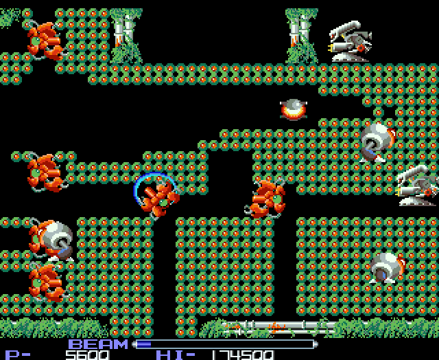

# R-Type (Irem, 1987) on the Atari STE



STE port of the MAME set `rtype` (Irem M72, `irem/m72.cpp`). The main CPU's NEC V30 program is statically translated
to 68000 code (`engine/v30x.py`, `tools/gen.py`) with natives for the hottest routines, exact against the reference
board (`engine/m72board.py`) through all eight stages and the ending; the Z80 sound CPU is not run (its commands are
kept in a ring), so there is no sound. The picture is the stage renderer (`src/stage.s`): the centred 320 pixels of
the 384-pixel picture, 16 colours per scene by the shared default fitter with checker pairs, the status bar with its
own palette; parallax, colour cycling and palette fades are dropped where they only cost work (the user's rule: keep
the gameplay). Status: Incomplete (sound not implemented); not released: development targets a 14 MB ST RAM machine
(the user, 2026-10-31; `tools/release.py` NOT_RELEASED). Latest speed (2026-11-07, Hatari 14 MB, `tools/bench.sh`
REPLAY FAST, recorded play, `-D INVULN -D DEBUG`): stage 2 34.5 arcade frames a second (63% of the arcade's 55.02 Hz),
18.4 pictures a second; stage 7 27.0 (49%) and 17.3; every stage in Speed.

## Build and run

```sh
python port.py build rtype            # verify ROMs, translate, build assets, the snapshot and RTYPE.PRG
python port.py build rtype --legacy-renderer   # the older shared M72 renderer instead of the stage renderer
python port.py test rtype             # palettes, the DMA scheduler, lock-step (attract, seeds 4 and 8), the legacy renderer's tests
python port.py mame rtype 1000        # the reference renderer against MAME's picture
python port.py cover rtype            # coverage (random play, attract and the Invulnerability switch)
python port.py ppo rtype test --steps 256 --frames 2100   # the shared PPO workflow (Verification)
games/rtype/tools/bench.sh shot@20 tap:06@25 tap:02@28 shot@60       # its own Hatari: rates, screenshots
REPLAY=8:3000:8000 FAST=true NOESC=1 EXTRA="-D STAGE -D INVULN -D PLAYBACK -D DEBUG" games/rtype/tools/bench.sh   # a recorded play from a replay point
games/rtype/tools/profile.py          # Musashi: 68000 cycles per V30 instruction, mnemonic, 256 bytes of code
venv/bin/python games/rtype/tools/stage_test.py build/rtype/stage_states_3.pkl --quiet --stop 0   # stage pictures against the model
```

Supply `assets/roms/rtype.zip`; preparation checks it against the manifest and fills `build/rtype/mame_roms/` (the
two PROMs and three PALs MAME wants but the driver never reads, as zero stand-ins). The executable is
`run/rtype/RTYPE.PRG`; the ROMs, the graphics and the start state are embedded. `tools/bench.sh` runs Hatari with
`--memsize 14` (`MEMSIZE=4` for a 4 MB run). Paths are relative to this folder; `engine/`, `tools/`, `port.py` and
`docs/` at the top are the repository's.

## Controls

**5/6** insert coins, **1/2** start, **arrow keys** move, **Space/Ctrl** fire (hold to charge the beam), **Alt** the
Force (detach / call back), **Escape** returns to the desktop. Joystick fire fires (port 1 player 1, the mouse port
player 2). Jaguar pad / PowerPad: pad A player 1, pad B player 2, the D-pad moves, **A** fire, **B** the Force,
**Option** coin, **Pause** start, keypad **1/2** start, **5/6** coin, **\*** + **#** quit. For scripted Hatari events
use scancodes: coin `06`, start `02`, Space `39`, Alt `38`, cursor keys `48 50 4b 4d`, Escape `01`. DIP switches:
MAME's defaults (3 lives, demo sounds on, coin mode 1).

## State

* The logic is exact: the translation runs in lock-step with the reference board's port schedule
  (`tools/logic_test.py`; attract and play, the work RAM, video RAMs, palettes, sprite RAM and registers equal every
  frame). Since 2026-11-01 through all eight stages and the ending: coverage seeds 10-12 to 86000 frames
  (`ref/cover.py`, Invulnerability), seed 10 in lock-step 45000-84000 with the stage build's natives; after the
  2026-11-03/04 natives independent reference reruns pass seed 4 to 9000, seed 1 to 14400 and 1800 warship frames.
  The reference board (`engine/m72board.py`) equals MAME 0.289 in all RAM.
* The pictures are exact against the model (`tools/stage_test.py` against `tools/stage_model.py`): every recording
  whole (every 2nd frame, 14,150 pictures) and stages 1, 2, 7 at every frame and every 3rd (2026-11-07).
* Missing: sound (the plan below, agreed 2026-11-01, not started).
* Not released (`tools/release.py` NOT_RELEASED; until 0.6 it was in `OVER_LOAD`, passed with a warning): RTYPE.PRG
  is 6.1 MB (TOS load with BSS 13.8 MB), far over the 3.7 MB release limit; how to fit the game back into 4 MB
  (per-stage loading, packing) is decided later.
* Speed: below the goal (a steady 25 pictures a second at the port's full 50 arcade frames a second): every stage's
  recorded play runs at 22-42 arcade frames a second (stage 3's warship and stage 7 the slowest).
* Agreed omissions (the user's rule: keep the gameplay, drop what only costs work): palette fades (FADE_SNAP), stage
  6's BG, the parallax of stages 5 and 7 (the BG as a strip locked to the FG), stage 8's colour cycling (frozen rows),
  the stars (BG star tiles and the star sprites $AF2-$AF7). The display cuts the left part of "1P-" and of the title's
  "R" (x 32-351 of the 384 pixels).

## How it works

### The board and the reference

`engine/m72board.py` is the Irem M72 board (equal to MAME 0.289 in all RAM); `tools/machine.py` RType adds the port's
schedule (`run_frame_port`). The port starts after the boot (the ROM and RAM tests are not translated):
`tools/snapshot.py` takes the reference's state at frame 400 (the title, the CPU idle), embedded in the program.

### Translation

`tools/gen.py`, `engine/v30x.py`; the design in the module's docstring and
[architecture.md, "The V30 translator"](../../docs/architecture.md#the-v30-translator-enginev30xpy-r-type-2026-10-13):
one snippet per V30 instruction; the V30's registers in d0-d6, the segment bases in a2-a4, SS:SP in a5; the V30's 1 MB
as one image with the bytes of each word swapped (words are native moves); flags in the CCR with backward liveness;
returns through a 64K-long table by IP. The code the coverage (`ref/cover.py`) never ran is taken from the program:
jump tables in ROM, the object handlers it stores (`mov word ptr [bp+0h], imm`), code after RETs that nothing refers
to. Inlining and leaf calls are on (`tools/gen.py` LEAF_CALLS); `ANY_PARITY` makes the ranking and name entry's word and
byte accesses test their parity at run time (Lessons, 2026-11-01). The translated stores mark 64-byte blocks of the
video RAMs and palettes (`tools/gen.py` MARKS / store_marks, `v30_vmarks`; logic_test checks that every changed block
is marked).

### Natives

`src/natives.s`, `tools/gen.py` NATIVES; each checked in lock-step (`logic_test.py`; for an instruction-level
comparison, `--steplock F`, build with `NO_NATIVES=1 NO_INLINE=1`: natives and inlined calls skip the labels the
interpreter stops at).

* **Palette fades left out** (2026-10-29, FADE_SNAP): the fade loop sets each colour to its target at once; the fade's
  counter still runs, so the game sees each fade end at the same frame. `logic_test.py --snap` checks such a build:
  everything but the palettes, the work RAM's palette copies and fade records and the stack page stays equal to the
  reference (seeds 1, 4, 8: 3000-4000 frames). `-D FADE_EXACT=1` builds the arcade's fades.
* **The sprite emitters** (2026-10-29: 0040:1BCC / 1C1B / 1CA6 and the fill 0040:0653): an object's sprites come from
  a definition in ROM (DS1:[BW]) plus its colour and position. Without SPRITE_LIST they write the sprite RAM as the
  arcade (lock-step identical); with SPRITE_LIST (the stage renderer) they write one record per object (definition,
  colour, x, y) at its first slot, and the DMA copies the records (`logic_test.py --list` expands them through the ROM
  and compares them with the reference's sprite list every frame).
* **The enemy collision test's broad phase** (`es_build`; offset boxes since 8a75fce): only L = R = 0 or T = B = 0 is a
  dead box (Lessons, 2026-11-01); a box with L > R no longer switches the broad phase off.
* **The movement script** (`nat_mscr`, 0040:F5C1), the fade rows at their target compared in longs.
* **2026-11-03** ([native-results.md](docs/native-results.md)): the corrected red-channel word cache, the E5CD
  object's movement / emission combined (`EMIT1_BODY`), tile-RAM clears filled and marked in bulk.
* **2026-11-04** ([native-structure-results.md](docs/native-structure-results.md)): one-entry sprite emission,
  collision-query endpoints reused on no-hit returns, PC-relative terrain-cache fields, ADDX for inline 24-bit
  movement, cached word-pair copies for changed fades, existing MOVE / logical result flags, an unrolled DMA copy.

### Schedule

`src/rtype.s`, `src/core.s`: an arcade frame is the VBL interrupt's handler (the game's logic, at the main loop's idle
point 0040:00D0) and then the raster interrupt's (the status bar's scroll), each to the idle point again
(`tools/machine.py` RType.run_frame_port is the same in Python). The VBL counts one arcade frame a field (50 Hz, the
game 9% slower than the arcade's 55.02 Hz; `-D TICK55`: 11 per 10 fields); the main loop runs one arcade frame per
count. Game speed first (the user, 2026-11-01; before `PIC_EVERY` 2 / `MAX_BEHIND` 3): a picture when the logic has
caught up or at the latest after `PIC_EVERY` (8) arcade frames, and in heavy scenes when one more frame would let the
picture end later than `PIC_VBLS` (3) fields after the last (`pic_due`, Timer D estimates); more than `MAX_BEHIND`
(12) frames behind are dropped, so the game slows down evenly. With `PIC_VBLS` every sprite DMA is captured at the
actual DMA point (Lessons, 2026-11-03; the old skip only with `PIC_VBLS=0`). The main CPU's commands to the sound CPU
(port $00) are kept in a ring (`src/core.s`) for a player.

### Picture

`src/stage.s` (its header): the stage renderer reads the program's state directly, no copies: the V30 image's palettes
and video RAMs, the marked 64-byte blocks, the native emitters' object records, the scroll registers before and after
the raster interrupt. Checked by `tools/stage_test.py` against `tools/stage_model.py` (no stars, BG locked to FG,
sprites over the tiles, fixed colours; bgscroll draws both layers at their own scroll). Per scene
`tools/stage_assets.py` sets flags:

* **The display**: the centred 320-pixel window of the 384-pixel picture (x 32-351). The status bar (lines 240-255, a
  raster split at line 239) gets its own palette.
* **Guard rows are never erased** (the user, 2026-10-31): sprites are drawn whole into the 64 guard lines above and
  below the picture, but only the visible lines 0-255 are erased; the display address always skips the guard rows.
  Not in the BG scroll mode, where the lines outside the window are BG lines that scroll into it: there sprites and FG
  rows are erased whole.
* **Sprites restored by contour** (the user, 2026-11-07; stefastbobs2's contour clear as a copy): in the FG mode a
  sprite's damage is its contour for its shift (`tools/stage_sprites.py` stk_*: per 16-pixel destination column its
  first opaque line and its lines; the record's 16 pointers at offset 88) instead of its rectangle: `st_crest` copies
  those columns from the clean buffer (4 words x 8 lines a pass), clipped to lines 0-255 when the sprite crosses the
  top or the bottom (bit 0 of the pointer). The BG scroll mode and the squeezed scenes keep rectangles; `-D ST_RECTS`
  builds the old restore. 7,779 contours (shared by content).
* **Stage 1's middle section: the BG drawn** (the user, 2026-10-31): from frame ~3000 of seed 8 the BG fills the
  picture locked to the FG (offset 128-129 pixels): composed into the buffer with the FG, cell by cell (the FG tile
  over the BG tile through its opaque pixels, `st_cell` as stage 2's strip), composed again when its cells change.
  The model's lock is in whole cells (`stage_model.py` Lock: the offset rounded to 8 pixels, taken again when off by
  more than 4, free while the BG map is empty). The BG's colour row (tile row 7) fades in, changes and fades out; its
  changing pens 1, 2, 3, 5 have dedicated STE indices in scene 6 (`stage_assets.py` DEDICATED: 12 colours for the
  rest) whose colours `st_palette` sets from the row's target: no cells composed again (before: ~6M cycles each).
* **Stages 2, 5, 7: the BG as a strip** locked to the FG (`tools/stage_bg.py`; BG_STRIP_SCENES, the strip's index in
  flag bits 6-7), stage 2's tunnel and, without their parallax (the user, 2026-11-01), stages 5 (BG at 1/2 of the FG's
  speed) and 7 (3/4); while the BG map holds walls (codes below 7D0h: stage 7's boss) the locked BG instead, so walls
  are never drawn where they are not. **Stage 6: no BG** (decorative; NO_BG_SCENES, flag bit 5; it ran at 2x).
* **Stage 8: frozen rows**: tile row 2 (82h / 8Ah) switches its target 254 times in 3000 frames; frozen rows keep
  their scene's reference target (FROZEN_ROWS, the scene's SC_FRZ word; `st_palette`).
* **Stage 3: the smaller layer as pieces** (the user, 2026-10-31; BG_HYBRID_SCENES, flag bit 4, with BG_PIECE_SCENES
  bit 3 and BG_SCROLL_SCENES bit 2). In the FG mode the walls are the buffer's layer and the warship (BG) is drawn over
  them each picture as pieces (`ST_LAYER` bg: a BG image, a non-empty BG cell opaque as a whole), then the walls'
  opaque pixels are copied again from the clean buffer where a warship row meets wall chunks (`st_wallfix`: the
  layers' order); a warship row over no wall chunks is erased by clearing (zeros, no source reads: `st_sync` clears
  those before it copies the log). The warship appears (the BG map's first non-empty tile) at frame 12618 of the
  attract demo. Once the warship has more 16-pixel chunks with pixels in the window than the walls
  (`st_meas` over `st_fgrc` / `st_bgrc`, every picture; frame 13326 of the demo; the switch picture ~1.2M + 0.27M
  cycles), the BG scroll mode for the rest of the scene: the buffers hold the BG map at its own x and y scroll (512
  lines, the first 256 again below: 896-line buffers), and the FG walls are drawn over it each picture like sprites
  (OP 3 copy passes from a FG image with the opaque pixels as end masks, a pass list per FG row made again when the
  row or the window's first chunk changes: `st_fgdraw`, `st_fgbuild`).
* **Short Blitter passes** (2026-11-03): `st_rect` cuts restore and clear rectangles into column strips of at most 32
  words, masked log passes take 4 lines (8 when the mask is `$FFFF`), `ST_RUN` is 6; `BLIT_STATS=256
  renderer_audit.py` over the stage recordings: longest pass 256 bus cycles, none over (Lessons, 2026-11-03).
* **The legacy renderer** (`--legacy-renderer`): `src/video.s` copies the marked blocks into
  `engine/rt/m72render.s`'s video state (Mr. HELI's renderer too; it still draws FG over BG with AND + OR passes);
  `tools/render_test.py`, `tools/sprite_test.py` test it. Since 2026-10-19 it uses cheaper contribution-bitmap
  rotations and reuses its access-count table in transfer fallback paths
  ([measurements](../../docs/virtual-scroll-performance.md#implementation-results)).

### Colours

The default since 2026-11-05 ([palette-results.md](docs/palette-results.md),
[colours.md](../../docs/colours.md#the-default-fitter-enginepalette_quantizepy-r-type-2026-11-05)): the retained
Alien/Zombies quantizer with bounded saturation weighting (`engine/palette_quantize.py` and `.js`). Sprite and tile
counts are compressed separately with exponent 0.75, then sprite priority is 8x and the chroma bonus stays below 2x.
Source RGB is preserved until the STE palette is fitted. Restrained checker pairs are baked in source coordinates,
including cropped and reordered sprite pieces; the pattern moves with each asset. The HUD stays flat and changing pens
keep their reserved indices (DEDICATED). The ordinary build regenerates palettes and sprite colours when their inputs
change; every stage's sprites are pre-coloured at build time (1112 definitions, 3437 colourings; `cols_*.json`, 1573
pre-coloured pairs recorded again for scene 6). `--legacy-renderer` keeps `engine/m72_palettes.py`'s scene colours.

### Sound: the plan (agreed 2026-11-01, not started)

R-Type's sound is the YM2151 alone (MAME 0.286 `irem/m72.cpp`: `rtype()` removes the DAC, the set has no samples
region, `rtype_sound_portmap` has only the YM2151 and the latch; the Z80's program is RAM, loaded by the main CPU).
The port keeps the main CPU's sound commands in a ring (`src/core.s`). The plan:

* **Effects as PCM through the DMA sound**: each effect command rendered once at build time from the exact FM sound
  (MAME, one latch command at a time, `-wavwrite`; or a Python port of ymfm), 8-bit mono ~12.5 kHz (~12 KB a second).
  Starting one is a few DMA register writes, no CPU while it plays. One DMA channel: a priority rule first (a more
  important effect replaces a lesser one); Kung-Fu Master's mixing ring (`games/kungfum`, `snd_mix`) if overlaps matter.
* **Music on the YM2149**: the driver's register writes with the effect commands left out, through `engine/opm.py`
  (carriers' pitch and loudness, Commando's way: 8 FM channels mixed down to 3).
* **Care**: the driver lends music channels to effects - record effects and music apart; identify which commands are
  effects and which are tunes; check against MAME by ear and by register logs. Memory: a few hundred KB of effects
  (fine on the 14 MB machine; the release size later).

## Speed

The goal (the user): a steady 25 pictures a second at the arcade's full speed (50 arcade frames a second in the port's
schedule). The rule: keep the gameplay, drop what only costs work (effects, parallax, colour cycling); the logic stays
exact.

Current figures, Hatari 14 MB (`tools/bench.sh` REPLAY=seed:start:end FAST=true, recorded play, seeds 8+ with `-D
INVULN`; the corrected timing after the sprite DMA fix,
[sprite-dma-results.md](docs/sprite-dma-results.md#uninstrumented-corrected-timing), and the runs since), and the
logic per stage window (Musashi, 600 frames of seed 10, 2026-11-04,
[native-structure-results.md](docs/native-structure-results.md#fixed-workload-logic-results)):

| stage (recording) | date | arcade frames/s | % of 55.02 Hz | pictures/s | logic, cycles an arcade frame |
|---|---|---|---|---|---|
| early play (4 600-3600) | 2026-11-03 | 41.77 | 76% | 33.70 | |
| 1 (8 3000-8000) | 2026-11-03 | 34.04 | 62% | 20.61 | 94.3k (10 / 3000) |
| 2 (10 11000-13000) | 2026-11-07 | 34.5 | 63% | 18.4 | 66.0k |
| 3 warship (1 12600-14400) | 2026-11-04 | 22.28 | 40% | 17.36 | 89.7k (warship, 1800 frames); stage 3 10 / 22000: 124.3k |
| 4 (10 33000-36000) | 2026-11-03 | 42.10 | 77% | 22.66 | 65.9k |
| 5 (10 46500-49500) | 2026-11-03 | 30.09 | 55% | 19.76 | 93.1k |
| 6 (10 56000-59000) | 2026-11-03 | 38.15 | 69% | 20.80 | 59.0k |
| 7 (10 64500-67500) | 2026-11-07 | 27.0 | 49% | 17.3 | 113.8k (10 / 65000) |
| 8 (10 74000-77000) | 2026-11-03 | 28.19 | 51% | 20.28 | 61.2k |

The 2026-11-03 rows predate the 2026-11-04 natives (+0.6-1.5% logic throughput in Hatari) and the 2026-11-07 contour
restores (+1-4%). The 2026-11-07 runs add `-D DEBUG`. Where the time went on 2026-11-01 (VBLs sampled, before the DMA
fix): the logic the largest share in every play stage (30-46%), then the sprites (16-30%), the log copy into the three
buffers (sync, 12-20%), the compositions (5-16%). Logic profiles of every stage (`profile.py`, 30 frames, 2026-11-01):
the cave crawler's handler 19% of stage 1 (four tile probes a crawler a frame), stage 4's fades whose targets change
every frame, the object loops' computed CALL / RET (0040:0600-06FF) 7-10% everywhere, the game's own dispatch. The
hottest stage-7 handler accounts for 37% of sampled logic, but only 10% is its translated code; 27% is already native
work ([logic-level-results.md](docs/logic-level-results.md)).

What made it fast, newest first:

* 2026-11-07: sprites restored by contour (96e834f): Musashi, frames 300-1500 every 2nd, mean CPU + Blitter a picture,
  rectangles -> contours: stage 1 -1.2%, 2 -5.0%, 3 -0.3%, 4 -1.9%, 5 -1.9%, 6 -2.0%, 7 -1.9%, 8 -1.5%. Hatari (-D
  INVULN -D DEBUG): stage 2 33.1 -> 34.5 arcade frames/s, 18.0 -> 18.4 pictures/s, erase words -24%; stage 7 26.7 ->
  27.0, 17.2 -> 17.3, -15%.
* 2026-11-04: the native structural changes ([native-structure-results.md](docs/native-structure-results.md)): logic
  cycles -1.06..2.97% across eight stage samples; warship -1.77%, stage 7 -2.16%; Hatari logic throughput +0.64% /
  +1.52% in the warship / stage-7 replays, zero late border / palette events. All 6,600 A/B frames, 2,176 focused
  cases and 72 non-SIM DMA cases pass.
* 2026-11-03: the native logic changes ([native-results.md](docs/native-results.md)): early play and restarts -16..23%
  logic cycles; eight later-game samples -0.3..3.0%. Hatari seed 4 600-3600: 39.54 -> 41.95 arcade frames/s, 29.71 ->
  33.94 pictures/s (before the DMA fix); zero late border / palette events. All 6,600 production / baseline frames
  match. The pairwise palette-copy experiment stays excluded.
* 2026-11-01: the BG strips, no BG and frozen rows (Musashi, a picture, CPU + Blitter, median / 90th percentile):
  stage 5 198k / 1.07M -> 174k / 404k; stage 6 198k / 6.0M -> 159k / 244k; stage 7 213k / 366k -> 212k / 335k (its
  recording is mostly the boss, the scroll stopped); stage 8 458k / 7.8M -> 144k / 529k. Before, the BG locked to the
  FG was composed again whenever the arcade's offset drifted more than 4 pixels (~1-6M cycles; stage 5: 165 whole
  recompositions in 3000 frames, compose 42% of its time; as a strip 36). A palette row that switches its target
  recomposed every cell drawn with it.
* 2026-11-01: stage 7's logic (seed 10 65000-65030, profile.py) 122k -> 98k cycles an arcade frame: the collision
  broad phase no longer switched off by a box with L > R (31k -> 13k), the movement script native (`nat_mscr`: 15k ->
  8k). Then (8a75fce) the broad phase for offset boxes: stage 3's logic 119.9k -> 110.0k; the fade rows at their
  target compared in longs: stage 6 80.4k -> 75.5k.
* 2026-11-01: game speed first (`PIC_EVERY` 8, `MAX_BEHIND` 12, `PIC_VBLS` 3 instead of 2 / 3): more arcade frames
  a second, fewer pictures (its Hatari figures were taken before the DMA fix and are not kept).
* 2026-10-31: stage 3's hybrid: Musashi, the stage-3 recording's median 206k -> 187k cycles a picture, 90th
  percentile 412k -> 338k. The two modes alone: warship coming in behind the full walls (12900-13100) 316k as pieces,
  452k scrolling; warship filling the screen (13400-13600) 394k as pieces, 284k scrolling: the smaller layer as
  pieces takes the better of each.
* 2026-10-31: stage 1's middle BG with dedicated pens: no recomposition of ~6M cycles at each colour change; seed 8
  exact to its end (3500 pictures; before: every picture from 3662 failed).
* 2026-10-31: guard rows never erased: Hatari (before the DMA fix) stage 2 34.1 -> 34.9 arcade frames/s, 17.1 -> 17.4
  pictures/s; stage 1 unchanged.
* 2026-10-29: FADE_SNAP: logic 119k -> 110k cycles an arcade frame (seed 4); Hatari play 15.0 -> 16.4 arcade frames/s,
  4.6 -> 5.3 pictures/s (the first renderer). The native sprite emitters with SPRITE_LIST: seed 4 play 119k -> 95k,
  seed 1 attract 93k -> 82k.
* The stage renderer itself: the first renderer (`engine/rt/m72render.s`, Hatari 4 MB) ran ~23 arcade frames a second
  in the attract mode, ~16 in play, 5.5-6.5 pictures a second.

Measured, not kept:

* 2026-11-07: stage 3's warship over black erased by being drawn over: the rows of the warship over no walls are
  erased by clearing their old rectangles (`st_sync`); the ship moves slowly against the walls (BG x 1/4 pixel a
  frame, y up to 1/4), so most of an old row lies under the new rows. Upper bound (no clearing at all, pictures
  wrong): Musashi seed 1 frames 12900-13320 (every 2nd) mean 349.5k -> 330.6k cycles a picture (-5.4%), 12600-12900
  242.8k -> 237.4k (-2.2%). Prototype (exact): each row's chunks opaque on all 8 lines recorded with its pieces, the
  clear only the runs of groups the new rows leave uncovered, per new-row line segment: 54% fewer words cleared, but
  349.5k -> 382.5k (+9%) and 242.8k -> 252.8k (+4%): 24 segments and 40 runs a picture, each a CPU scan and a Blitter
  start, cost more than 1300 cleared words (~4 cycles each) save. A black border baked into the graphics would need
  the same width as three pictures' movement (three buffers) and cost on every picture. Patch kept outside the tree.
* 2026-11-07, estimated, not tried: restoring only what the sprite's new position leaves uncovered (1.5-9% of the
  contour's words, the same slot's sprite 6 frames later).
* 2026-11-04: the higher-level logic audit ([logic-level-results.md](docs/logic-level-results.md)): exact shared
  collision queries, compiled two-command motion transitions and query construction hoisted out of collision scans:
  2.13% fewer logic cycles over the stage-3 warship replay, 3.22% / 3.47% in the seed-10 stage-3 / 7 samples; all
  6,600 comparison frames and 1,152 focused cases match. Prototypes isolated, no 2x route.
* 2026-11-03: later-stage natives ([later-native-results.md](docs/later-native-results.md)): movement-script leaf
  returns, tile runs / BG patches and the breakable-FG helper 0.49-2.54% fewer logic cycles in stage-3-8 samples;
  native box tests and fused object dispatch add little or regress. Hatari stages 7 / 8: +1.66% / +2.58% logic
  throughput, picture rates essentially unchanged. Isolated.
* 2026-11-03: avoiding redraws and copies ([route1-results.md](docs/route1-results.md)): refresh the visible window
  and fill incoming strips on buffer reuse: exact, stage 3 -2.50% renderer cycles, stage 4 -1.58%, stage 6 -0.81%;
  smaller gains on consecutive pictures. Hatari stage 3: 28.18 -> 28.66 arcade frames/s, 19.17 -> 19.68 pictures/s,
  with remaining late palette events. Production unchanged.
* 2026-11-03: mask groups or blocks per whole sprite
  ([sprite-preparation.md](../../docs/sprite-preparation.md#r-type-stage-renderer-mask-groups-or-blocks-per-whole-sprite-2026-11-03)).
* 2026-11-02: the prepared secondary layer ([prepared-layer-prototype.md](docs/prepared-layer-prototype.md)): native
  source packing, generated row routines and lazy masks for all 16 shifts, including preparation costs. Stage 3:
  266,396 -> 268,203 cycles a picture (+0.68%) drawing every second arcade frame; 230,692 -> 229,140 (-0.67%) drawing
  consecutive frames. Both exact; 113 focused cases pass; the 512 KB cache gives no consistent win.
* 2026-11-01: renderer experiments ([renderer-audit.md](docs/renderer-audit.md), sample windows in all eight stages):
  damage coalescing saved only 0.6% over the full stage-5 recording and did not improve Hatari's picture rate;
  unrolled secondary-layer loops were neutral and cached shifted masks slower.
* 2026-11-01: the collision summary's boxes by 64-pixel column: stage 7's logic 108.4k -> 110.4k (the filling costs
  more than the shorter scans save).
* 2026-10-31: a 16x8-cell column erase (one long per 16-pixel column) for the guard-row change: slower (Hatari 34.4 /
  17.2 against 34.9 / 17.4): its marking and scan cost more than the words it saves; 16x16 cells erase more words
  than rectangles.
* 2026-10-31: stage 3's warship in one mode for the whole scene: the BG scroll mode (Hatari, the demo's warship part
  REPLAY=1:12600:14400, before the DMA fix: 23.6 arcade frames/s, 13.4 pictures/s; 24.3 / 13.8 with its switch fix;
  32.6 / 18.9 without the warship), the warship as pieces only 24.0 / 13.7; the hybrid 25.5 / 14.5 (the whole stage-3
  demo 29.4 / 19.1).

Open, in order: the logic (68-150k 68000 cycles an arcade frame, stage 7 117-150k, near a whole STE frame: profile the
heavy stages with `tools/profile.py`, `logic_test.py --render-profile`, and make their hot routines natives or leaf
calls); stage 3's warship (the scene with two full layers); then the sprites and the log copy into the three buffers.

Techniques other ports use that may apply:
[speed.md](../../docs/speed.md#techniques-that-look-applicable-elsewhere-2026-11-07).

## Tests and tools

* `tools/logic_test.py [frames] --seed N [--start F --snap] [--list] [--record FILE] [--steplock F] [--mortal-at F]
  [--render-profile]`: lock-step against the reference's port schedule (`--snap`: a FADE_SNAP build; `--list`: the
  SPRITE_LIST records; `--mortal-at F`: the Invulnerability switch off from frame F; `--record`: stage states for
  `stage_test.py`, `logic_test.py END --seed S --start F --snap --list --record ...`; stage 3's
  `build/rtype/stage_states_3.pkl` is seed 1's attract demo, frames 11400-14400:
  `logic_test.py 14400 --seed 1 --start 11400 --snap --list --record ...`).
* `ref/cover.py SEED FRAMES [MORTAL_AT]`: coverage (`port.py cover rtype` runs the groups, including the late stages'
  deaths, game over, ranking and name entry).
* `tools/stage_test.py build/rtype/stage_states_*.pkl --quiet --stop 0`: the stage renderer's pictures against
  `tools/stage_model.py` (recordings of every stage).
* `tools/renderer_audit.py` (with `BLIT_STATS=256`: the longest Blitter pass), `tools/route1_audit.py`,
  `tools/logic_level_audit.py`, `tools/native_audit.py`, `tools/later_native_audit.py`,
  `tools/native_structure_audit.py`, `tools/prepared_layer.py`: the audits and prototypes of the docs below.
* `tools/palette_test.py` (the default stage colours, source phase, native cache fallback), `tools/dma_test.py` (the
  production DMA with deadline / cadence schedulers), `tools/render_test.py`, `tools/sprite_test.py` (the legacy
  renderer).
* `tools/profile.py`: Musashi cycles per V30 instruction, mnemonic, 256 bytes of code.
* `tools/bench.sh [hatari items ...]`: its own Hatari (14 MB); `EXTRA="-D ..."`, `FAST=true` (fast forward: the counters
  are emulated VBLs), `NOESC=1` (for PLAYBACK runs), `REPLAY=seed:start:end` (a replay point), `HATARI_ARGS` (e.g. a
  video), `MEMSIZE`. Benches of seeds 8+ need `-D INVULN`: their recordings play with the Invulnerability switch;
  without it the player dies in Hatari and the replay ends in a game over.

Dated reports (`docs/`):

* [palette-results.md](docs/palette-results.md): the default colours, 2026-11-05 - current.
* [sprite-dma-results.md](docs/sprite-dma-results.md): the sprite DMA fix and the corrected timing, 2026-11-03 -
  current.
* [native-results.md](docs/native-results.md): native logic optimisations, 2026-11-03 - integrated.
* [native-structure-results.md](docs/native-structure-results.md): native structural changes, 2026-11-04 -
  integrated.
* [later-native-results.md](docs/later-native-results.md), [logic-level-results.md](docs/logic-level-results.md),
  [route1-results.md](docs/route1-results.md), [prepared-layer-prototype.md](docs/prepared-layer-prototype.md),
  [renderer-audit.md](docs/renderer-audit.md): measured dead ends, not integrated.

## Lessons

### 2026-11-03: stale object lists made the pictures look cheap

With `PIC_VBLS` enabled the DMA-copy skip predicted that no picture could follow, but the deadline scheduler could then
draw current scrolling with an old object list ([sprite-dma-results.md](docs/sprite-dma-results.md)). Instrumented
Hatari stage-3 / 7 replays: pictures with an uncaptured latest DMA 1,047 / 1,568 -> 0. Drawing the current poses costs
more than drawing the old list again: the Hatari figures before 2026-11-03 (stage 3 28.55 -> 22.22, stage 7 36.57 ->
26.57 arcade frames/s) are not correct-picture throughput. A non-SIM regression test (`tools/dma_test.py`) is part of
`port.py test rtype`.

### 2026-11-03: long Blitter passes made late palette events

Stage 3 had 22 late palette-on events: a restore or cleared rectangle wider than 32 words went out as one HOG pass a
line (92 words: 736 bus cycles), the log's masked copies as 8 lines of 4 words (they read the destination: 384), full
FG/BG runs of 7 chunks as 8 words (272). With the short passes (Picture): the border report `(1,0,22,0,0)` ->
`(1,0,0,0,0)`, at a cost: stage-3 simulator cost 242.9k -> 246.8k cycles a picture (+1.6%: more passes), Hatari stage
3 (seed 1, 12600-14400) 22.22 -> 21.80 arcade frames/s, 17.31 -> 17.23 pictures/s; stage 7 (seed 10, 64500-67500)
26.57 -> 26.28, 17.17 pictures/s both, no late events either way. `render_test.py` and `sprite_test.py` pass.

### 2026-11-03: a cache that leaked the ROM offset

The native red-channel word cache held wrong words: the ROM offset's high byte leaked into 4,010 entries
([native-results.md](docs/native-results.md)).

### 2026-11-01: the late stages' bugs

* The broad phase of the enemy collision test (`src/natives.s` es_build) dropped a box with only its right (or bottom)
  edge 0 as dead; the arcade still hits it from the left (stages 7 and 8): only L = R = 0 or T = B = 0 is dead now.
* The ranking's records (11 bytes from 2F51h) put a rank's words at an odd address, and the coverage had never run the
  ranking: the translation took the word stores as even, the STE raised an address error (Musashi has none, so the
  lock-step never saw it). `ANY_PARITY` fixes it; `--mortal-at` / MORTAL_AT covers the late stages' deaths, game
  over, ranking and name entry, which the invulnerable coverage never reached (badpc 0592E).

### 2026-10-13: the first renderer's PIC_EVERY trade

The first renderer (`engine/rt/m72render.s`, before the stage renderer and the natives; logic 92-125k cycles an arcade
frame in play, attract with the demo ~105k, heavy invulnerable play 150-176k; the picture 0.7-1.7M): Hatari play

| PIC_EVERY | arcade frames / s (play) | pictures / s |
|---|---|---|
| 1 | 13.4 | 6.7 |
| 2 (then the default) | 15.7-16.9 | 5.6-6.1 |
| 4 | 22.7 | 4.3 |

With a picture far dearer than an arcade frame, `PIC_EVERY` only trades pictures for arcade frames.

## Verification

Lock-step through all eight stages and the ending (seeds 10-12 coverage to 86000 frames, seed 10 45000-84000), the
stage pictures of every stage's recording against the model, Hatari replays of recorded play in every stage
(`REPLAY`, seeds 8+ invulnerable). No full natural playthrough in Hatari; no sound.

PPO exploration: `venv/bin/python port.py ppo rtype test --steps 256 --frames 2100` ([the PPO guide](../../docs/ppo.md)).
Full-game verification follows the [status policy](../../docs/port-status.md); nothing here claims a complete playthrough.
