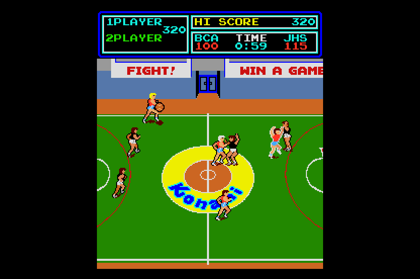

# Super Basketball (Konami, 1984) on the Atari STE



MAME set `sbasketb` (Konami GX405, version I, encrypted; `konami/sbasketb.cpp`).  The main CPU, a KONAMI-1 (an MC6809
with encrypted opcodes, 40 KB of ROM), is statically translated to 68000 code (`engine/m6809x.py`) and checked
against a reference board in lock-step; its foreground loop's head is a native that delivers the IRQ.  The sound board
(a Z80 with an SN76489A, a VLM5030 and a DAC: the Track & Field / Hyper Sports board with its own driver ROM) is **not
ported yet**: the build has no sound (`NOSOUND=1`), the sound commands are logged by the reference only.  The picture
is MAME's ROT90 picture, 224 x 256 (portrait, not the 256 x 224 of the other Konami sports games), centred in the
320-pixel screen with the top and bottom borders open, sprites by generated code (`engine/sprite_programs.py`), exact
against the reference in the shown colours; one 16-colour palette by the shared default fitter, flat.  Status:
**Incomplete** (no sound; ~69% of the arcade's speed and ~14 pictures a second in Hatari; no full-game verification).
Speed: 41.2 arcade frames a second (69%), 13.9 pictures a second over 4,000 VBLs of the AUTOPLAY script (Hatari,
`tools/hatari.ps1 -Frames 4000`, DEBUG build, 4 MB, 2026-11-07).

## Build and run

```sh
python port.py cover sbasketb               # coverage: ref/cover.py seeds 1-12 (~6 min in parallel)
python port.py build sbasketb               # -> run/sbasketb/SBASKETB.PRG
python port.py test sbasketb                # lock-step (seeds 1, 4, 6), render (seed 1), sprite edges
python port.py mame sbasketb                # the reference against MAME (ref/mame_cmp_sbasketb.py)
python games/sbasketb/tools/prepare.py      # verify assets/roms/sbasketb.zip, unpack to assets/roms/extracted/sbasketb/
python games/sbasketb/tools/build.py        # -> run/sbasketb/SBASKETB.PRG (--sim: run/sbasketb_sim; --assets: colours again)
python games/sbasketb/tools/logic_test.py 20000 --seed 1   # the translation in lock-step with the reference
python games/sbasketb/tools/render_test.py 3000 --seed 1 --start 300 --every 3   # the STE picture against the reference
python games/sbasketb/tools/sprite_test.py                 # edges, 16 shifts, holes, banks, guards, 64 KB crossings
powershell -File games/sbasketb/tools/hatari.ps1 -Frames 4000 -Every 250   # Hatari hidden, AVI stills, counters
python games/sbasketb/ref/mame_cmp_sbasketb.py [frame ...]  # the reference against MAME
```

Supply `assets/roms/sbasketb.zip` (MAME's parent set; `docs/rom_manifest.json` has the 14 files' sizes, CRCs and
SHA-1s).  Nothing ROM-derived is in git: the graphics, colours and ROM image are made into `build/sbasketb/` and
assembled into the program.  Paths are relative to this folder; `engine/`, `tools/`, `port.py` and `docs/` at the top
are the repository's.

## Controls

**5/6** coin 1 / 2, **1/2** start, **arrow keys** move, **Space / Control / Z** button 1 (shoot, jump), **X** button 2
(pass), **C** button 3, **Esc** quits.  Joystick port 1 player 1, port 0 player 2 (fire = button 1).  Jaguar pad / PowerPad:
pad A player 1, pad B player 2, the D-pad moves, **A** button 1, **B** button 2, **C** button 3, **Option** coin,
**Pause** start.  DIP switches: the 0.286 source's defaults (60 s game, upright, starting score 100-115, ranking data
kept, easy, demo sounds on).

## State

* **Logic**: exact against the reference's port schedule.  `tools/logic_test.py`: RAM $2000-$3BFF (video, colour and
  sprite RAM too), the sprite palette bank $3C20, the scroll $3F80, the latch (Q0, Q1, Q5), the sound commands (each
  write of $3D80).  Seed 1 20,000 frames, seeds 2-12 8,000 frames each (attract; coin, start, random play with the stick
  and three buttons; two players; 30 / 40 / 50 s games, other DIP switches; the service mode with its test screens).
  The reference's self-test is skipped (below), so those are the game's own paths from `$6000` on.
* **Picture**: exact in the shown colours.  `tools/render_test.py`: 0 differences in 700 sampled pictures of seed 1's play
  (frames 1000-2400, every 2nd), 740 each of seeds 1, 4 and 6 (frames 300-4000, every 5th) and 675 of seed 5 (two players,
  frames 300-3000, every 4th), and in 400 consecutive pictures (frames 1000-1400) with the generated sprite code and
  again with the row path only (`-D REN_GEN=0`); `tools/sprite_test.py`: 154 made-up pictures exact (both
  side edges at every shift, holes, flips, overlaps, both sprite banks, palette banks 0-255, the guard lines, 64 KB
  crossings, 60 pictures in a row with moving sprites, scrolls and tiles).  `BLIT_STATS=256`: every pass HOG, the longest
  116 bus cycles.  The reference equals MAME (How it works).
* **Hatari** (F030Arcade build, STE, 4 MB, TOS 2.06): boot, attract, coin, start, the AUTOPLAY player's game; no
  crash, 3 border fallbacks and no late border event in 4,000 VBLs.
* Not done, most important first: the sound (Sound); a full-game playthrough and any playtest beyond the AUTOPLAY script;
  speed (Speed); the cocktail flip (`flip_screen` raises `NotImplementedError` in the reference renderer, the runtime
  ignores latch Q0); the arcade's self-test is not run.

## How it works

### The board and the reference

`tools/machine.py` follows MAME's `konami/sbasketb.cpp`: the KONAMI-1 at 18.432 MHz / 12 = 1.536 MHz, 60 Hz, 256 lines,
the IRQ (HOLD_LINE) at the VBLANK (line 240) while the LS259 latch's Q1 is 1; RAM $2000-$2FFF, colour RAM $3000-$33FF
and video RAM $3400-$37FF (a 32 x 32 tilemap of 8 x 8 4 bpp tiles, 512 of them; the columns 6-31 scrolled in y by $3F80,
columns 0-5 fixed: the scoreboard), sprite RAM $3800-$39FF (two banks of 64 sprites by latch Q5, 16 x 16, 384 in ROM, the
last on top, none where x and y are both 0), the sprite palette bank $3C20, ROM $6000-$FFFF.  Colours: three 256 x 4
palette PROMs (a 2k / 1k / 470 / 220 ohm network each) as indirect colours; tiles by one lookup PROM, sprites by the other
with the palette bank in the high nibble.
`ref/mame_cmp_sbasketb.py` (2026-11-07, WolfMAME 0.248 of the F030Arcade checkout, run through `engine/mamewin.py`):
**0 of 4,352 pens and 0 pixels differ** at frames 60-12,000 (attract mode, scrolling, the ROT90 picture); the reference
machine's RAM equals MAME's but for 1-3 stack bytes.  The binary differs from the authoritative 0.286 source in two
places, which the comparison accounts for and the port does not use: it runs the CPU at **1.4 MHz** (the source:
18.432 MHz / 12 = 1.536 MHz; found because the boot's delay loops took 9.7% more frames) and its DSW2 default has
"Starting Score" 70-78 (`$68`; the source: 100-115, `$60`).  `SBasket(dsw2=0x68, hz=1400000)` is the machine MAME 0.248
runs; the default is the source's.

### Translation

`tools/gen.py`: the 6809's 64 KB are one block (`sb_mem`: RAM, video RAM and the ROM at their addresses), so every slot's
base is the same and an indexed access needs no slot.  The sites the coverage saw touch the I/O ($3C00-$3FFF, the
write-only registers) or store to the video and colour RAM go through `main_io_r` / `main_io_w`, except the byte stores
whose address is in $3000-$37FF (`video_inline`: they write the byte and list the cell for the renderer themselves).
Since every slot holds one page for good, no jump, call or return checks a page (`fixed_slots`); the 68030 forms run
(`fast_forms`).  **DP moves**: `TFR A,DP` takes $24 in the player routines ($8EB6, $9A77-$9C25) and the code otherwise
uses $20; the translator wants one DP per instruction, so the coverage records DP at every instruction (`ref/cover.py`
`dp`, `gen.py` `dp_sites`).  A routine called with either ($99FA-$9A0F) addresses nothing through DP and is accepted
as it is.  A first version without `dp_sites` was exact for 238 frames and then wrote the player's state to the wrong
page.

### Schedule

The port (`machine.SBasketPort`, `src/sbasketb.s`): the foreground is a task loop ($60F9 `TST <$22` ... $611E
`LDX <$1A; LDD ,X; ASLA; LBCS $60F9`: the queue at $2100, its read pointer at $201A, an empty entry has bit 7); the IRQ
handler ($62D9) plays the game and queues tasks.  The loop head $60F9 is a native (`sb_idle`, gen.py NATIVES): the
picture is drawn when due, the next arcade frame awaited and the IRQ delivered (Q1 1) with $60F9 as its return address,
when the queue is empty **or the loop has come back 8 times since the last IRQ**: in the two-player menu the loop
queues a blinking text every pass while the frame counter $2014 has not moved (one entry a pass, one always waiting), so
an "empty queue" rule never delivers the IRQ there (the arcade's IRQ comes by time).  Six arcade frames to five VBLs;
MAX_SKIP 3.  **The boot skips the self-test**: the reset vector's code ($D582: delay loops of ~60 frames each, a RAM
test, then $D640 reads SYSTEM and sets $2FF0 to 3 when start 1 and 2 are held: the service mode) is not run: the
reference and the runtime start at `$6000` with $2FF0 set that way.

### Picture

* **Turned** as MAME's ROT90 turns it (`tools/assets.py`): picture pixel (X, Y) is the raw pixel (x = Y, y = 239 - X);
  the tile and sprite graphics are turned once at build time (the sprite 16 x 16, 4 bpp, 384 of them; the tiles 512).
  Raw flip x reverses the turned rows, flip y the columns.
* **The playfield**: 256 lines of 240 bytes: the 6 fixed tile columns (picture lines 0-47) at X = 232 - 8 ty, the 26
  scrolled ones (lines 48-255) in a 256-pixel ring at P = 248 - 8 ty, the first 224 pixels again at 256-479 so a window at
  any scroll never wraps; picture X shows P = (X + 16 - scroll) mod 256.  A changed cell (`main_io_w` lists it) is
  converted on first use per (code, colour, flips) into a tile cache (a long a row, `movep.l`).
* **Rows**: a display buffer's tile row (8 lines) is copied from the playfield (one HOG pass per plane and line: 14 words,
  FXSR and the skew for the scrolled rows) when the buffer's scroll differs from the picture's (all rows), a cell of it
  changed, or the buffer's last sprites covered it; the rest stay.
* **Sprites**: baked on first use per (code, colour, flips) into a cache slot (flushed when the palette bank changes);
  generated code for the coverage's 348 shapes (5,192 routines, 534 KB of end mask streams: `engine/sprite_programs.py`,
  [sprite-preparation.md](../../docs/sprite-preparation.md)), the row path for the others and 64 KB crossings.  Clipped
  at the picture's group-aligned left and right edges (screen x 48 and 272), whole into 16 guard lines below (cleared
  before the buffer's next picture).  Drawn from the first to the last entry (MAME's order: the last on top; Track &
  Field's loop runs the other way).
* **Colours**: 199 of the 4,352 pens are shown in the coverage; black and 15 by the shared default fitter, flat
  (`engine/palette_native.py`; mean channel error 5.7 over the shown pixels).

### Sound

Not done.  The board is the Hyper Sports one (`hyperspt_sh_timer_r`, `hyperspt_sound_w`, SN76489A through the $E001 latch
and the $E002 strobe, the DAC at $E000, the VLM5030 with 8 KB of speech ROM) with its own driver (405e13.7a, 8 KB at
$0000, RAM $4000-$43FF); the main CPU's write of $3D00 is the command and a write of $3D80 raises the Z80's IRQ (HOLD_LINE,
vector $FF).  `tools/sound.py` / `sndgen.py` / `src/sound.s` of Track & Field are shared with Hyper Sports through a
table of the driver's loop, tick, tune and wait addresses; this ROM's have to be found first (`ref/cover_sound.py`'s
command ranges too), then the schedule model and player checked as in those ports.

## Speed

| Date | Setup | Logic | Pictures | Musashi cycles |
|---|---|---|---|---|
| 2026-11-07 | Hatari, `tools/hatari.ps1 -Frames 4000` (the AUTOPLAY script: coin, start, moving and shooting), DEBUG build, 4 MB, no sound | 69%, 41.2 arcade frames a second | 13.9 a second | |
| 2026-11-07 | Musashi, seed 1's play (`render_test.py 1400 --seed 1 --start 1000`, 400 pictures) | | | logic 99.5k an arcade frame; a picture CPU 98.9k + Blitter 103.8k bus cycles |

Where a picture's time goes (`render_test.py 1500 --seed 1 --start 1000 --prof`): `compose` 24%, `draw_cell` 24% (the
generated code and its Blitter waits), `bake_sprite` 15% (the cache filling), `draw_sprites` 13% (its 64-entry loop), the
tiles 10%.  The logic (~99k cycles an arcade frame, 60 a second) is more than half of a 8 MHz STE before the picture: this
port is **logic-bound** and has none of `docs/speed.md`'s natives or tricks yet (the translation is the generic one;
the first candidates are the frame's biggest routines by `engine/xprof.py`'s profile).

What made it faster (2026-11-07): rows composed only when the buffer's scroll differs, a cell changed or its last sprites
covered them (a picture's Blitter 128k -> 93k bus cycles; the scroll is the same as three pictures earlier in 71% of
the play frames of seed 1); the generated sprite code (a picture 115.0k CPU + 106.8k Blitter -> 98.9k + 103.8k, seed 1
frames 1000-1400, `-D REN_GEN=0` against the default, both exact).

Measured, not kept: nothing yet.  Techniques other ports use that may apply:
[speed.md](../../docs/speed.md#techniques-that-look-applicable-elsewhere-2026-11-07).

## Tests and tools

* `tools/logic_test.py N --seed S`: lock-step against the reference (the compared state: State); the logic's Musashi
  cycles an arcade frame.
* `tools/render_test.py N --seed S --start F [--every K] [--prof]`: the STE picture against the reference, with cycle
  figures; `-D REN_GEN=0` builds put every sprite on the row path.
* `tools/sprite_test.py`: made-up pictures (edges, 16 shifts, holes, flips, overlaps, both banks, palette banks, guards,
  64 KB).
* `tools/hatari.ps1`: the F030Arcade Hatari hidden, the AVI's stills and the counters (`-Frames`, `-Every`).
* `ref/cover.py N`: the coverage (seeds in its header); `ref/mame_cmp_sbasketb.py`: the reference against MAME.

## Lessons

* **A MAME binary's clock and DIP defaults can differ from the source** (2026-11-07): WolfMAME 0.248 runs this board's
  CPU at 1.4 MHz and defaults "Starting Score" to 70-78.  The RAM comparison diverged at the end of the boot's delay
  loops (a pure `MUL` loop of 65,536 turns: 61.4 frames at 1.536 MHz, 67.5 at 1.4 MHz); reading the X register in MAME at
  two frames gave the clock.  The 0.286 source wins for the port (`AGENTS.md`).
* **Write-only registers are not in a MAME memory dump** ($3C20, $3F80, the LS259): tap them (`mame_frames.lua` TAPS and
  `tapstate`) and apply the frame's writes to the last state.
* **DP is a register the translator treats as a constant** (above): a game that moves it needs the coverage's per-
  instruction DP.
* **The idle point of a task loop must also fire when the loop never empties** (above, the two-player menu).
* **Sprite order is the driver's**: Track & Field's loop draws the last entry first; this one draws the first first (the
  render test found it in 67 pixels around the ball).
* **A sprite's colour set wraps modulo 256** (`color = attr & 15 + 16 * palette bank`): the reference masks it.

## Verification

No playtest beyond the AUTOPLAY script (coin, start, moving and shooting) in Hatari; the lock-step seeds play at random
with the stick and the buttons, two players and the service mode included, never a whole game with its ending and the
high-score entry on purpose.  Nothing here claims a complete playthrough.  No PPO profile.

Full-game verification follows the [status policy](../../docs/port-status.md); nothing here claims a complete playthrough.
