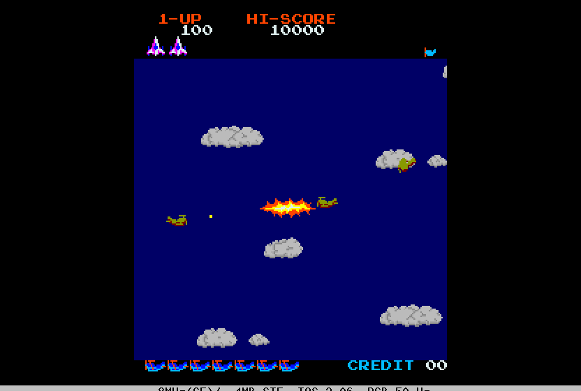

# Time Pilot (Konami, 1982) for Atari STE



MAME set `timeplt`.  The main Z80 program (24 KB) is statically translated to 68000 code and checked against a
reference board in lock-step; the picture is MAME's ROT90 picture, 224 x 256, centred in the 320-pixel screen with
the top and bottom borders open.  Work in progress: no sound yet, one fitted 16-colour palette.  Started 2026-10-25
from F030Arcade's Falcon port (`F030Arcade/games/timeplt`: its executed-pc roots, the cloud-reuse capture, the
scanline-255 schedule).

```sh
python games/timeplt/tools/prepare.py      # verify assets/roms/timeplt.zip, unpack to assets/roms/extracted/timeplt/
python port.py cover timeplt               # coverage: ref/cover.py seeds 1-12 (~10 min in parallel)
python games/timeplt/tools/build.py        # -> run/timeplt/TIMEPLT.PRG (--sim: run/timeplt_sim; --assets: colours again)
python games/timeplt/tools/logic_test.py 8000 --seed 4   # the translation in lock-step with the reference
python games/timeplt/tools/render_test.py 3000 --start 1000   # the STE picture against the reference, every frame
python games/timeplt/tools/perf_test.py 1600 --start 1000     # the logic's cycles by Z80 instruction (Musashi)
games/timeplt/tools/bench.sh 6000          # Hatari speed (its own Hatari, killed by PID): logic and pictures a second
python games/timeplt/ref/mame_cmp_timeplt.py [frame ...]  # the reference against MAME 0.289
```

Supply `assets/roms/timeplt.zip` (MAME's parent set; `docs/rom_manifest.json` has the 11 files' sizes, CRCs and
SHA-1s).  Nothing ROM-derived is in git: the graphics, colours and ROM image are made into `build/timeplt/` and
assembled into the program.  `docs/f030-roots.json` holds only instruction addresses (F030Arcade's reference and
Go-Explore runs); the coverage pickles add this repository's.

Controls: **5/6** coin 1 / 2, **1/2** start, **arrow keys** turn the plane, **Space / Control / Z** fire, **Esc**
quits.  Joystick port 1 player 1, port 0 player 2; Jaguar pads as in the other ports.  DIP switches: MAME's defaults
(3 lives, bonus 10000 / 50000, difficulty 4, demo sounds on).

## The board and the port's schedule

`tools/machine.py` follows MAME's `konami/timeplt.cpp`: a 3.072 MHz Z80, 60 Hz, 256 lines (VBLANK and the NMI at
line 240); video RAM $A000-$A7FF (32 x 32 tiles, 2 bpp, colour bit 4 = category 1: drawn over the sprites), 24
sprites of 16 x 16 ($B010-$B03F, $B410-$B43F), inputs at $C200-$C360 (with mirrors), the LS259 latch at $C300-$C30F.
`ref/mame_cmp_timeplt.py` (2026-10-25): 0 of 384 pens and 0 pixels differ at frames 60-3600, the reference rendered
line by line from MAME's logged writes (MAME draws by scanline); the MAME-timed reference's RAM equals MAME's but for
2-4 stack bytes.

The port (`machine.TimepltPort`, `src/timeplt.s`): the foreground is a task loop; its idle point $0B93 with an
empty queue ($AC00 + [$A9B3], bit 7) is the hook where the picture is drawn, the next arcade frame awaited and the
NMI delivered with the token $6001 as its return address.  Six arcade frames to five VBLs; MAX_SKIP 3.

The clouds are multiplexed: the NMI handler waits for the beam ($C000) to pass a cloud sprite in the upper half and
moves it 128 lines down and 128 pixels across.  The beam reads 255 in the port (the waits end at once); the 16 clears
of y bit 7 ($0FAC-$118D) first call `cloud_save_<slot>`, which keeps the slot's old content (the first per frame);
before a picture `cloud_check` keeps those whose slot moved as a reuse moves it, and the renderer draws both
contents (F030Arcade's `beam.s`).  The reference does the same (`TimepltPort.extra`); `logic_test.py` compares the
lists.

## State

* **Logic**: exact against the reference's port schedule.  `tools/logic_test.py`: RAM $A000-$AFFF, the sprite RAMs,
  latch Q0, the sound commands (latch Q2's rising edge), the reused clouds, every changed video RAM cell listed.
  Seed 1 3,000 frames, seeds 4 and 9 8,000 (infinite lives from stage 1-5 / invincible: every era, stage changes,
  the later loops), seed 10 6,000 (two players); with the natives (below) seeds 1, 4, 9, 10 3,000 frames each.
* **Picture**: exact in the shown colours: `tools/render_test.py`, 0 differences in 600 consecutive pictures of
  seed 1's play and in 3,000 of seed 8 (era 5); `tools/sprite_test.py`: 150 made-up pictures exact (both side edges at
  every shift, the generated and the row path, holes, flips, reused clouds, the score bands, 64 KB crossings, 60
  pictures in a row).  Sprites clip at the picture's group-aligned left and right edges (AGENTS.md), whole into the
  guard lines below.  `BLIT_STATS=256`: every pass HOG, the longest 256 bus cycles.
* **Hatari** (F030Arcade build, STE, 4 MB, TOS 2.06): attract, coin, start, play, deaths; no crash, no late border
  event.
* **Colours**: the arcade shows 18-22 colours in an era (25 in all); one palette of black and 15 fitted in Oklab
  (`tools/assets.py`): mean error 1.3 a channel, but pure green maps to yellow and red to orange.  Per-era palettes
  are the next step.
* Not done: sound (the board's Z80 and two AY-3-8910s), the cocktail flip, Space Pilot (`spaceplt`, the bootleg: its
  own code ROMs, coverage and checks).

## Speed (2026-10-25)

`PLAY=1 tools/bench.sh 9000` (the recorded play, `tools/play_search.py`: 9,000 ticks, infinite lives from tick 840;
DEBUG build, Hatari): **100% of the arcade's speed (59.9 frames a second); in play 32.5 pictures a second (median of
2-s windows), 26.5 (10th percentile), 24.5 at the least**; 50 in the attract mode.  At the port's start the same
measures were 15.5-18.

The logic: the arcade's Z80 is busy ~31k of its 51k cycles a frame (3,179 instructions); the translation costs ~16
68000 cycles per Z80 instruction, so the logic takes ~52k Musashi cycles a frame in play (`tools/perf_test.py`), ~55%
of the STE in Hatari.  That alone rules out 50 pictures a second in play.  What cut it from ~60k: `bit_s` off (the
lock-step tests show the flags tasks save stay exact), natives (`gen.py NATIVES`, `src/timeplt.s`) for the cloud
routine $0F97 (called ~4 times a frame; the beam at 255: a fast exit when no slot is to be reused) and for three ROM
checksums folded into the random byte every frame (constant sums: `CK_*`), the tile marks without saving a0.  The
translated code is near its floor elsewhere (the collision loop's inner loop is ~80 cycles an iteration already).

A picture in play (`tools/render_test.py --prof`, Musashi): ~73k CPU + ~30k Blitter bus cycles, from ~211k + 55k:
* **Sprites** (docs/sprite-preparation.md): per shape (code x flips, the 358 the coverage saw) and shift, rows grouped
  by mask, a pass type per row as stefastbobs2 chooses it (a 16-pixel row whose pixels stay in one destination word
  after the shift is a one-word pass: the left word plain, the right word with FXSR; two words with NFSR otherwise),
  and for the clipped side cases one word only.  Code per shape and pattern of types (4,085 routines shared by
  content), end masks from a stream (217 KB, shared by content); the Blitter state written only where it changes, the
  destination's low word stepped.  ~42 CPU cycles a row.  The per-sprite setup (`draw_one`, ~900 cycles) keeps the
  Blitter pointers in registers; damage is the drawn lines and words only.
* **Tiles**: the writers list changed cells (no row scans); per-colour row converters for the clean screen.
* **Front tiles**: the score bands (picture lines 0-31, 248-255: front in every column) are restored as rectangles
  after the sprites; sprites wholly inside them are not drawn.
