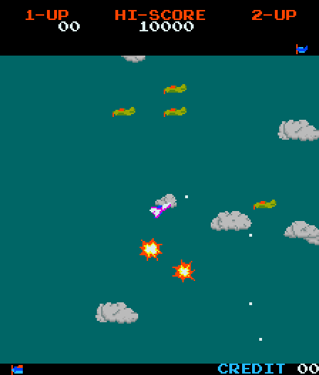

# Time Pilot (Konami, 1982) on the Atari STE



MAME set `timeplt` (`konami/timeplt.cpp`).  The main Z80 program (24 KB) is statically translated to 68000 code
(`engine/z80x.py`, with natives for the cloud routine and three ROM checksums) and checked against a reference board in
lock-step; the sound board (a Z80 and two AY-3-8910s) is not run yet.  The picture is MAME's ROT90 picture, 224 x 256,
centred in the 320-pixel screen with the top and bottom borders open, sprites by generated code
(`engine/sprite_programs.py`), exact against the reference in the shown colours; one 16-colour palette by the shared
default fitter, flat.  Status: **Incomplete** (sound not implemented; full speed, 24-33 pictures a second in play).
Speed: 100% of the arcade's rate (59.9 arcade frames a second); in play 32.5 pictures a second (median of 2-s windows),
26.5 (10th percentile), 24.5 at the least, 50 in the attract mode (Hatari, `PLAY=1 tools/bench.sh 9000`, the recorded
play, DEBUG build, 4 MB, 2026-10-25).  Started 2026-10-25 from F030Arcade's Falcon port (`F030Arcade/games/timeplt`:
its executed-pc roots, the cloud-reuse capture, the scanline-255 schedule).

## Build and run

```sh
python port.py cover timeplt               # coverage: ref/cover.py seeds 1-13 (~10 min in parallel)
python port.py build timeplt               # -> run/timeplt/TIMEPLT.PRG
python port.py test timeplt                # lock-step (seeds 1, 4, 9), render (seeds 1, 8), sprite edges
python port.py run timeplt shot@30         # Hatari (F030Arcade build), screenshot at 30 s
python port.py mame timeplt                # the reference against MAME 0.289 (ref/mame_cmp_timeplt.py)
python games/timeplt/tools/prepare.py      # verify assets/roms/timeplt.zip, unpack to assets/roms/extracted/timeplt/
python games/timeplt/tools/build.py        # -> run/timeplt/TIMEPLT.PRG (--sim: run/timeplt_sim; --assets: colours again)
python games/timeplt/tools/logic_test.py 8000 --seed 4   # the translation in lock-step with the reference
python games/timeplt/tools/render_test.py 3000 --start 1000   # the STE picture against the reference, every frame
python games/timeplt/tools/perf_test.py 1600 --start 1000     # the logic's cycles by Z80 instruction (Musashi)
games/timeplt/tools/bench.sh 6000          # Hatari speed (its own Hatari, killed by PID): logic and pictures a second
python games/timeplt/ref/mame_cmp_timeplt.py [frame ...]  # the reference against MAME 0.289
```

Supply `assets/roms/timeplt.zip` (MAME's parent set; `docs/rom_manifest.json` has the 11 files' sizes, CRCs and
SHA-1s).  Nothing ROM-derived is in git: the graphics, colours and ROM image are made into `build/timeplt/` and
assembled into the program.  `docs/f030-roots.json` holds only instruction addresses (F030Arcade's reference and
Go-Explore runs); the coverage pickles add this repository's.  Paths are relative to this folder; `engine/`, `tools/`,
`port.py` and `docs/` at the top are the repository's.

## Controls

**5/6** coin 1 / 2, **1/2** start, **arrow keys** turn the plane, **Space / Control / Z** fire, **Esc** quits.  Joystick
port 1 player 1, port 0 player 2; Jaguar pads as in the other ports.  DIP switches: MAME's defaults (3 lives, bonus
10000 / 50000, difficulty 4, demo sounds on).

## State

* **Logic**: exact against the reference's port schedule.  `tools/logic_test.py`: RAM $A000-$AFFF, the sprite RAMs,
  latch Q0, the sound commands (latch Q2's rising edge), the reused clouds, every changed video RAM cell listed.
  Seed 1 3,000 frames, seeds 4 and 9 8,000 (infinite lives from stage 1-5 / invincible: every era, stage changes,
  the later loops), seed 10 6,000 (two players), seed 13 8,000 (games from stages 10-60: the stage counter's
  icons); with the natives seeds 1, 4, 9, 10 3,000 frames each.  The reference follows a recorded expert game (MARP)
  to its end (Verification).
* **Picture**: exact in the shown colours: `tools/render_test.py`, 0 differences in 600 consecutive pictures of
  seed 1's play and in 3,000 of seed 8 (era 5); `tools/sprite_test.py`: 150 made-up pictures exact (both side edges at
  every shift, the generated and the row path, holes, flips, reused clouds, the score bands, 64 KB crossings, 60
  pictures in a row).  Sprites clip at the picture's group-aligned left and right edges
  ([AGENTS.md](../../AGENTS.md)), whole into the guard lines below.  `BLIT_STATS=256`: every pass HOG, the longest
  256 bus cycles.  The reference equals MAME (How it works).
* **Hatari** (F030Arcade build, STE, 4 MB, TOS 2.06): attract, coin, start, play, deaths; no crash, no late border
  event.
* Not done, most important first: sound (the board's Z80 and two AY-3-8910s); the cocktail flip; Space Pilot
  (`spaceplt`, the bootleg: its own code ROMs, coverage and checks).  Translated but not lock-step tested (never seen
  by the coverage or the MARP game): `$2BD5`-`$2C70`, `$2DD2`, `$3C7F`, `$4597`, `$4824`-`$484C`; the beam waits
  `$109F`-`$1195` run in MAME's schedule only.

## How it works

### The board and the reference

`tools/machine.py` follows MAME's `konami/timeplt.cpp`: a 3.072 MHz Z80, 60 Hz, 256 lines (VBLANK and the NMI at
line 240); video RAM $A000-$A7FF (32 x 32 tiles, 2 bpp, colour bit 4 = category 1: drawn over the sprites), 24
sprites of 16 x 16 ($B010-$B03F, $B410-$B43F), inputs at $C200-$C360 (with mirrors), the LS259 latch at $C300-$C30F.
`ref/mame_cmp_timeplt.py` (2026-10-25): 0 of 384 pens and 0 pixels differ at frames 60-3600, the reference rendered
line by line from MAME's logged writes (MAME draws by scanline); the MAME-timed reference's RAM equals MAME's but for
2-4 stack bytes.

### Translation

`tools/gen.py` translates from the coverage (`ref/cover.py` seeds 1-13 and `docs/f030-roots.json`) with `bit_s` off
(the lock-step tests show the flags tasks save stay exact) and leaf functions of up to 16 instructions emitted in place
(`TP_INLINE`).  Natives (`gen.py NATIVES`, `src/timeplt.s`): the cloud routine $0F97 (called ~4 times a frame; with
the beam at 255 a fast exit when no slot is to be reused) and three ROM checksums folded into the random byte every
frame (constant sums: `CK_*`).  The video RAM writers list their cells for the renderer (the tile marks without
saving a0).

### Schedule

The port (`machine.TimepltPort`, `src/timeplt.s`): the foreground is a task loop; its idle point $0B93 with an empty
queue ($AC00 + [$A9B3], bit 7) is the hook where the picture is drawn, the next arcade frame awaited and the NMI
delivered with the token $6001 as its return address.  Six arcade frames to five VBLs; MAX_SKIP 3.

The clouds are multiplexed: the NMI handler waits for the beam ($C000) to pass a cloud sprite in the upper half and
moves it 128 lines down and 128 pixels across.  The beam reads 255 in the port (the waits end at once); the 16 clears
of y bit 7 ($0FAC-$118D) first call `cloud_save_<slot>`, which keeps the slot's old content (the first per frame);
before a picture `cloud_check` keeps those whose slot moved as a reuse moves it, and the renderer draws both
contents (F030Arcade's `beam.s`).  The reference does the same (`TimepltPort.extra`); `logic_test.py` compares the
lists.  The port's own schedule (tasks in zero time, `ld a,r` its shift register) cannot follow a recording.

### Picture

* **Sprites** ([sprite preparation](../../docs/sprite-preparation.md)): per shape (code x flips, the 358 the coverage
  saw) and shift, rows grouped by mask, a pass type per row as stefastbobs2 chooses it (a 16-pixel row whose pixels
  stay in one destination word after the shift is a one-word pass; two words with NFSR otherwise), and for the
  clipped side cases one word only.  Each row is baked aligned at the left of its source word with its own skew
  (73ff9b3, 2026-10-25), so a one-word pass in the right word needs no FXSR; only the left clip of a straddling row
  keeps one.  Code per shape and pattern of types (4,085 routines shared by content), end masks from a stream
  (217 KB, shared by content); the Blitter state written only where it changes, the destination's low word stepped.
  ~42 CPU cycles a row.  The per-sprite setup (`draw_one`, ~900 cycles) keeps the Blitter pointers in registers;
  damage is the drawn lines and words only.  18 sprite shapes without generated code (codes 62-63, 141-143, 184-191
  flipped in y, 200-203, 252; found by the MARP game's coverage) take the row path.
* **Tiles**: the writers list changed cells (no row scans); per-colour row converters for the clean screen.
* **Front tiles**: the score bands (picture lines 0-31, 248-255: front in every column) are restored as rectangles
  after the sprites; sprites wholly inside them are not drawn.
* **Colours**: the arcade shows 18-22 colours in an era (25 in all); one palette of black and 15 (`tools/assets.py`
  `palette()`): since 2026-11-05 the shared bounded flat fit (`engine/palette_native.py` over the default fitter, one
  STE index per PROM pen, coverage seeds including 13); text and HUD glyphs stay flat, black stays slot zero
  ([colours](../../docs/colours.md)).  It replaced an Oklab fit (mean error 1.3 a channel) that showed pure green as
  yellow and red as orange.  Per-era palettes would be exact.

### Sound

Not implemented: the board's Z80 and two AY-3-8910s.  Pooyan runs the same sound board translated
([its README](../pooyan/README.md)).

## Speed

| Date | Setup | Logic | Pictures | Musashi cycles |
|---|---|---|---|---|
| 2026-10-25 | Hatari, `PLAY=1 tools/bench.sh 9000` (the recorded play, `tools/play_search.py`: 9,000 ticks, infinite lives from tick 840), DEBUG build, 4 MB | 100%, 59.9 arcade frames a second | play: 32.5 median of 2-s windows, 26.5 10th percentile, 24.5 at the least; attract 50 | logic ~52k an arcade frame in play (`tools/perf_test.py`); a picture in play ~73k CPU + ~30k Blitter bus (`tools/render_test.py --prof`) |

The logic: the arcade's Z80 is busy ~31k of its 51k cycles a frame (3,179 instructions); the translation costs ~16
68000 cycles per Z80 instruction, ~55% of the STE in Hatari.  That alone rules out 50 pictures a second in play.  At
the port's start the pictures a second in play were 15.5-18.

What made it fast, newest first (2026-10-25):
* **Sprites**: the generated code per shape and pass-type pattern with mask streams (Picture): a picture ~211k CPU +
  55k Blitter -> ~73k + 30k together with the tile and score-band changes; the steps are measured in
  [sprite preparation](../../docs/sprite-preparation.md#what-the-ports-found).
* **Tiles**: cell lists from the writers instead of row scans; per-colour row converters.
* **Logic** ~60k -> ~52k Musashi cycles an arcade frame: `bit_s` off, the cloud and checksum natives, the tile marks
  without saving a0.  The translated code is near its floor elsewhere (the collision loop's inner loop is ~80 cycles
  an iteration already).

Techniques other ports use that may apply:
[speed.md](../../docs/speed.md#techniques-that-look-applicable-elsewhere-2026-11-07).

## Tests and tools

* `tools/logic_test.py N --seed S`: lock-step against the reference (the compared state: State).
* `tools/render_test.py N --start F [--seed S] [--every K] [--prof]`: the STE picture against the reference; `--prof`
  the CPU and Blitter cycles of a picture by routine.
* `tools/sprite_test.py`: made-up pictures (edges, 16 shifts, holes, flips, reused clouds, the score bands, 64 KB).
* `tools/perf_test.py N --start F`: the logic's cycles by Z80 instruction (Musashi).
* `tools/bench.sh N` (`PLAY=1`: the recorded play of `tools/play_search.py`): Hatari, logic and pictures a second.
* `ref/mame_cmp_timeplt.py [frame ...]`: the reference against MAME.

## Lessons

### 2026-11-04: a recorded game found unmarked writers

The MARP game's coverage against seeds 1-12: the stage counter's icons for 30, 10 and 5 stages (`$0DE0`-`$0E8C`, 8
video and colour RAM stores) had never run, so the translation did not mark those cells and the STE would not have
redrawn them from stage 10 on.  Seed 13 (games from stages 10-60) now covers them (`logic_test.py --seed 13` stopped
at frame 999 without it).

## Verification

A recorded expert game (MARP, 2026-11-04): `dyo_timeplt_2903800_wolf106.zip` (replay.marpirc.net; WolfMAME 0.106,
87.6 minutes, 315,449 frames) was replayed through the reference in MAME's schedule (`machine.Timeplt.run_frame`;
DSW0 $FF, DSW1 $7B from the recording).  The .inp of 0.106: a 28-byte header, then 124 bytes a frame (a u32, then up
to 30 ports as big-endian u32: IN0, IN1, IN2, DSW0, DSW1); recording frame n + 1 drives reference frame n.  It stays
with the recorded game to the end: stage 54, the game over and the initials entry ("DY.."), 903,700 points on the
six-digit counter against MARP's 2,903,800 (100 apart: not resolved without a WolfMAME 0.106 dump).  This checks the
reference, not the STE program: the port's own schedule cannot follow a recording.

Full-game verification follows the [status policy](../../docs/port-status.md); nothing here claims a complete playthrough.
