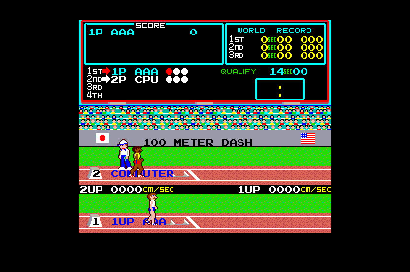

# Track & Field (Konami, 1983) for Atari STE



MAME set `trackfld` (Konami GX361).  The main CPU, a KONAMI-1 (an MC6809 with encrypted opcodes, 40 KB of ROM), is
statically translated to 68000 code (`engine/m6809x.py`) and checked against a reference board in lock-step; the
picture is MAME's, 256 x 224, centred in the 320-pixel screen with the top and bottom borders open.  Sound
(2026-10-29): the sound board's Z80 driver translated too, its SN76489A's tones and noise on the STE's YM2149, the
VLM5030's speech and the DAC tunes rendered offline and played on the DMA sound (see Sound; Hyper Sports uses the same
player).  Work in progress: one fitted 16-colour palette.  Started 2026-10-29.

```sh
python games/trackfld/tools/prepare.py      # verify assets/roms/trackfld.zip, unpack to assets/roms/extracted/trackfld/
python port.py cover trackfld               # coverage: ref/cover.py seeds 1-12 (~1 min in parallel)
python games/trackfld/tools/build.py        # -> run/trackfld/TRACKFLD.PRG (--sim: run/trackfld_sim; --assets: colours again)
python games/trackfld/tools/logic_test.py 20000 --seed 6  # the translation in lock-step with the reference
python games/trackfld/tools/render_test.py 3000 --seed 6 --start 1000   # the STE picture against the reference
python games/trackfld/tools/sprite_test.py                # edges, all 16 shifts, holes, guards, 64 KB crossings
games/trackfld/tools/bench.sh 6000          # Hatari speed (its own Hatari, killed by PID): logic and pictures a second
python games/trackfld/ref/mame_cmp_trackfld.py [frame ...]  # the reference against MAME 0.289
python games/trackfld/ref/cover_sound.py trackfld <seed> 20000  # sound coverage: seeds 1-12 the game's, 101-103 random
python games/trackfld/tools/sound_test.py 6000 --seed 1   # the STE's sound player against tools/sound.py every frame
python games/trackfld/ref/sound_cmp.py trackfld 1 4000    # the STE's sound schedule against the MAME-timed board
SOUND=1 AVI=1 games/trackfld/tools/bench.sh 6000          # Hatari with sound: run/trackfld_bench/trackfld.avi, .wav
```

Supply `assets/roms/trackfld.zip` (MAME's parent set; `docs/rom_manifest.json` has the files' sizes, CRCs and
SHA-1s).  Nothing ROM-derived is in git: the graphics, colours and ROM image are made into `build/trackfld/` and
assembled into the program.

Controls: **5/6** coin 1 / 2, **1/2** start, run with **Left / Right** (or **Z / C**) in turn, the action (jump,
throw, the angle: hold) with **Up / Space / Control / X**, **Esc** quits.  Joystick port 1 player 1, port 0 player 2:
left and right run, up and fire act.  Jaguar pad / PowerPad: pad A player 1, pad B player 2, the D-pad's left / right
and **A / C** run, **B** and up act, **Option** coin, **Pause** start.  DIP switches: MAME's defaults (1 life, the
game continues after the last event, no bonus, the records kept, normal difficulty, demo sounds on).

## The board and the port's schedule

`tools/machine.py` follows MAME's `konami/trackfld.cpp`: the KONAMI-1 at 1.536 MHz, 60.6 Hz, the IRQ at the VBLANK
while the LS259 latch's Q7 is 1; RAM $1800-$1FFF (the sprite RAMs and the row scrolls in it), NVRAM $2800-$2FFF, video
and colour RAM $3000-$3FFF (64 x 32 tiles of 8 x 8, 4 bpp, x scrolled per tile row), 32 sprites of 16 x 16 (4 bpp,
transparent where the lookup PROM's entry is 0), ROM $6000-$FFFF.  `ref/mame_cmp_trackfld.py` (2026-10-29): 0 of 512
pens and 0 pixels differ at frames 60-3600; the MAME-timed reference's RAM equals MAME's but for 1-3 stack bytes.

The port (`machine.TrackFieldPort`, `src/trackfld.s`): the foreground is a task loop ($6160: LDX <$1A; LDD ,X; ASLA;
BCS: the queue at $2900, an empty entry has bit 7); the IRQ handler ($6600) plays the game and queues tasks.  The idle
point $6160 with an empty queue is a native (`tf_idle`, gen.py NATIVES): the picture is drawn when due, the next
arcade frame awaited and the IRQ delivered (Q7 1) with $6160 as its return address; its RTI comes back there.  Six
arcade frames to five VBLs; MAX_SKIP 3.

The translation (`tools/gen.py`): the 6809's 64 KB are one block (`tf_mem`: RAM, NVRAM, video RAM and the ROM at
their addresses), so every slot's base is the same and an indexed access needs no slot.  The sites the coverage saw
touch the I/O ($1000-$12FF) or store to the video RAM go through `main_io_r` / `main_io_w`; a video RAM store lists its
cell for the renderer (267 sites, ~37 stores a frame).  Since every slot holds one page for good, no jump, call or
return checks a page (`fixed_slots`); the 68030 forms run (`fast_forms`), the return compares ordered by the
coverage's counts of each return; a call's live flags come from its callee's summary (`call_summaries`: what it reads
first, what it passes through) instead of every caller's needs, which halved the flag-keeping wrappers.

## State

* **Logic**: exact against the reference's port schedule.  `tools/logic_test.py`: RAM $1800-$1FFF, NVRAM and video
  RAM $2800-$3FFF, the latch (Q0, Q7), the sound commands (Q1's rising edges).  Seeds 1-12 20,000 frames each
  (attract, the name entry, play to the game over and again; every event from its start by MAME's cheats with
  always-qualify and infinite lives; two players; the other DIP switches).  The logic costs ~20-38k Musashi cycles an
  arcade frame (seed 1 19.7k, seed 6 37.5k over 20,000 frames, the video RAM marks included; the sound adds 10-15k:
  Sound); the translator's flag work (below) took 10-17% off.
* **Picture**: exact in the shown colours.  `tools/render_test.py`: 0 differences in 715 sampled pictures of seed 6's
  play (frames 1000-6000) and 150 of seed 1's attract; `tools/sprite_test.py`: 154 made-up pictures exact (both side
  edges at every shift, holes, flips, overlaps, MAME's x - 256 wrap, the guard lines, 64 KB crossings, 60 pictures in
  a row with moving sprites, scrolls and tiles).  `BLIT_STATS=256`: every pass HOG, the longest 132 bus cycles.
* **Hatari** (F030Arcade build, STE, 4 MB, TOS 2.06): boot, attract, coin, the name entry, the 100 m dash, deaths;
  no crash, no late border event in 6,000 VBLs.
* **Colours**: the arcade shows 24 colours in the coverage; black and 15 fitted in Oklab (`tools/assets.py`): mean
  error 0.8 a channel, weighted by pixels; the worst-matched pens are rare (magenta, a dark grey).
* Not done: the DAC's pulses outside the tunes (Sound), the cocktail flip, the service mode, players 3 and 4 (IN1);
  the sprites' reordered-source / generated-code path (`engine/sprite_programs.py`, as Time Pilot's: AGENTS.md asks
  for it to be prototyped and measured; the row path is used so far, and docs/sprite-preparation.md has no Track &
  Field result yet).

## Speed (2026-10-29)

`tools/bench.sh 6000` (DEBUG build, the AUTOPLAY script: coin, start, the name, running): **95% of the arcade's speed
(median 60 arcade frames a second), pictures 40.8 a second on average, median 47.5, 10th percentile 22** with the
sound (without: `EXTRA="-D NOSOUND=1"`, 95%, 44.0, 49, 30); the dips are the screen changes (a whole new tile map:
~1,800 cells converted and drawn into the playfield).

A picture (`tools/render_test.py`, Musashi, seed 6's play): ~49k CPU + ~33-40k Blitter bus cycles.
* **The playfield**: the 64 x 32 tilemap in STE planes, 768 pixels wide (the first 256 again at the end: a window at
  any scroll never wraps); a changed cell converted on first use per (code, colour, flips) into a tile cache (a long a
  row) and written with movep.l.
* **Rows**: a tile row is copied from the playfield into a buffer only when its scroll differs from what that buffer
  holds there, a cell of it changed, or the buffer's last sprites covered it: one HOG pass per plane and line (16
  words, FXSR and the skew for the scroll: 132 bus cycles, the addresses running on to the next plane).
* **Sprites**: baked on first use per (code, colour, flips) into a cache slot (the opaque rows, their masks, the plane
  words in pass order); a row is one HOG pass, OP 3 with the opaque pixels as end masks (docs/sprite-preparation.md);
  clipped at the group-aligned edges (screen x 32 and 288: the inner word only), whole into 16 guard lines above and
  below (cleared before the buffer's next picture).

## Sound

The board (MAME 0.286 `konami/trackfld.cpp` sound_map, `trackfld_a.cpp`, the authoritative source tree of `AGENTS.md`;
`tools/sound.py`, shared with Hyper Sports): a Z80 at 14.318181 MHz / 4 = 3.579545 MHz; ROM $0000-$3FFF (c2_d13.bin at
$0000-$1FFF), RAM $4000-$43FF (mirrored to $5FFF), the command latch $6000, the timer $8000 (total cycles / 1024, &
$0F), the SN76489A (14.318181 MHz / 8) written through a latch ($A000) and a strobe ($C000), the 8-bit DAC $E000, the
VLM5030 (3.579545 MHz, its 8 KB ROM c9_d15.bin): BSY $E002 bit 4, its pins $E003 + A7-A9 (A8 ST, A9 RST), its data $E004
(mirror $1FF8).  The main CPU's latch Q1 rising edge raises the IRQ (HOLD_LINE, IM 1).

The driver: the loop's head $01A8 (`ei`) waits for a rising edge of the timer's bit 1 (every 4096 cycles: 873.9 ticks a
second, 14.4 an arcade frame), then runs the three SN channels' effects (each followed by an `ei; nop; nop; di` window),
the speech queue ($032A: the next phrase, its data byte and an ST pulse, when BSY has been low for 16 ticks), the DAC
envelope ($400B) and returns to the head through the tune check ($01A1).  The IRQ handler $0038 reads the latch: 0 all
off, $01-$34 an effect (from $1F on all three channels), $40 / $41 a tune, $80-$C4 phrases into the queue, $FF speaks
the queue.  A tune ($0251: `rst $10` through $13C6 with $400A) is a cycle-timed routine, interrupts off: a 16-step
waveform on the DAC with busy-wait delays, the SN's tones beside it; tune 0 (5.1 s, at a game's start) and tune 1 (4.0
s, the DAC alone).

* **Reference** (`MameBoard`): the sound CPU at its clock, the timer from its cycles, the VLM5030 emulated up to each
  access (`engine/vlm5030.py`: MAME's vlm5030.cpp in Python, its integer arithmetic; BSY as MAME's stream gives it),
  commands at given cycles, the IRQ taken at the first instruction with interrupts on.
* **The STE's schedule** (`TickBoard`, time in half Z80 cycles): each arcade frame the commands of the frame before
  each run the IRQ handler (a subroutine, TOKEN as the return address), then the frame's time (118,125: 59,062.5
  cycles) runs ticks from $01B7 (after the wait) to the loop's head (8,192 each).  The VLM: BSY high from ST's rising
  edge; ST's falling edge starts the phrase of the latched byte, busy for its measured length (`phrase_busy`: the
  samples until BSY falls, 440 cycles each); a tick counts it down; RST rising while busy stops it.  A tune is a hook
  at $0251 with its measured effect (`tunes()`: the RAM bytes and SN registers it leaves, run once on the cycle-timed
  board): the effect at once, its time taken from the schedule (the time goes below 0: no ticks until it has passed;
  the commands meanwhile wait, only the last delivered, as the held IRQ line gives the last latch value).
  `ref/sound_cmp.py trackfld 1 4000` feeds both with the game's commands: each SN voice's audible states in order (the
  time left out) **98.0%** equal (3,182 of 3,247), the phrases and tunes started 6 of 6 in the same order; the STE starts
  an effect up to a frame (16.5 ms) later.
* **Coverage** (`ref/cover_sound.py`, shared): seeds 1-12 the game's commands of `ref/cover.py`'s seeds, 101-103 random
  commands (20,000 frames each): 1,734 instructions translated, no unexpected access (the timer is read only in the
  waits, the RAM's mirrors never).
* **Translation** (`tools/sndgen.py`, shared; `engine/z80x.py` FAST, the 64 KB block): the static `ld (nn),a` /
  `ld a,(nn)` of the I/O become the SN latch and strobe (`snd_sn_w`: the byte into the register file as MAME's
  sn76496_base_device::write keeps it), the VLM's data byte, the command latch, BSY (`snd_bsy`); the 8 sites that set
  the VLM's pins with `ld (hl),a` call `snd_vlm_pins` with HL; the `rst $10` jump table is emitted at its calls (Pooyan's
  helper).  Natives (`src/sound.s`): the tune routine (`snd_tune`: its measured effect, its samples on the DMA) and the
  tick's start (`snd_idle`: a tick with every channel idle, no speech queued and no DAC envelope does at once what the
  driver's code does, and the frame's further idle ticks, which change nothing, pass at once).
* **Player** (`src/sound.s`, shared): `snd_frame` before each IRQ: the commands of `snd_ring`, the frame's ticks in one
  run (the hook at the loop's head starts the next tick while the time allows), then `snd_ym`: the SN's four voices on
  the YM's three channels, the three loudest (ties: the lower voice), a voice keeping its YM channel while chosen (Mr.
  Do!'s method); a tone's period N -> N x 4,000,000 / 1,789,772 (the YM at 2 MHz / 16 P, the SN at 1.789772 MHz / 32 N),
  the noise on its channel with the tone off and the YM's noise period (the SN's shift period x 2,000,000 / 1,789,772,
  at most 31: the SN's slower noises play at the YM's slowest), the attenuation (2 dB steps) to the YM's level
  15 - round(2 a / 3) (~3 dB), 15 -> 0; only changed registers written.
* **DMA** (`sndgen.pcm`, `snd_dma`): the 62 phrases of the VLM ROM's table (27.0 s), rendered by `engine/vlm5030.py`
  (8,135 Hz, resampled), and the two tunes (9.1 s: the cycle-timed board's SN and DAC writes synthesized as MAME mixes
  them, the SN 1.0 and the DAC 0.4, box-filtered) at 12,517 Hz, 8 bits, mono, the phrases and the tunes each scaled to a
  peak of 100: 451 KB.  A phrase or a tune starts at the end of the frame that started it, playing once; a stop ends it.
* **Test** (`tools/sound_test.py`, 2026-10-29): the STE player against `STEBoard` every frame (the sound RAM, the SN's
  registers, the YM's registers and channel choice, the schedule's time, the VLM's busy time, the DMA's last
  request): seeds 1, 6 and 8, 6,000 frames each, equal (13, 12 and 35 phrases, tune 0).  The logic, render and sprite
  tests pass with the sound build (`port.py test`'s list).  Hatari (`SOUND=1 AVI=1 tools/bench.sh 6000`): the AVI's
  sound track is silent until the AUTOPLAY's coin (19 s: the attract sends no commands), then has the effects, the
  speech (phrases found in it by correlation) and tune 0 (its notes' frequencies in order); the dominant frequencies
  of the played parts 94-1,700 Hz.
* **Cost**: Musashi, the logic with the sound / without (`logic_test.py`, 3,000 frames): seed 1 35.0k / 19.7k cycles an
  arcade frame, seed 6 42.2k / 31.9k (20,000 frames of seed 6: 50.4k / 37.5k).  Hatari (`tools/bench.sh 6000`, above):
  the logic keeps its 95%, the pictures 44.0 -> **40.8** a second (median 49 -> 47.5, 10th percentile 30 -> 22).
  The program grows from 331,595 to 1,198,772 bytes (the samples 451 KB, the driver's dispatch table 256 KB, its
  64 KB block): 2,058,348 bytes to load (MAX_LOAD 3,700,000); packed with LZ4 366 KB: it still fits a floppy.
* Not done: the DAC's pulses outside the tunes (effect $0D's envelope, $400B: a pulse of a decaying level every 7
  ticks, ~125 Hz; 1,000-1,400 pulses in a 20,000-frame game seed): the single DMA stream plays phrases and tunes,
  pulses would need a mixing ring as Kung-Fu Master's voices; the relative levels of the YM and the DMA are a guess;
  the SN's periodic noise plays as white noise.

## Full-game verification status

Automated players such as Dreamer can attempt a full playthrough once this port's
adapter and native Hatari replay transport are verified. An attempt or assisted
stage visit does not establish completion; a successful natural Hatari playthrough
and graphics, sound and control checks are required for green **Complete** status.
See the shared [status and verification policy](../../docs/port-status.md) and
[current port status](../../README.md). Existing test results above retain their
stated scope; this note does not claim a new successful run or Dreamer integration.
