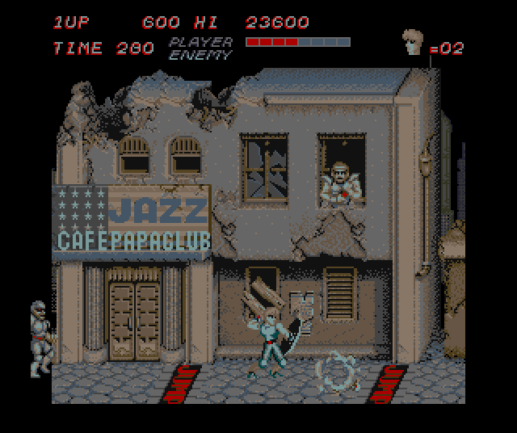

# Trojan (Capcom, 1986) for the Atari STE



STE port of MAME set `trojanr` (Trojan, Romstar, set 1; driver `capcom/lwings.cpp`, machine `trojan`): the main Z80
translated whole (bank-aware), the three tile layers, the 96 sprites and the text on the STE's 16 colours, the sound
effects and the music of the YM2203 pair on the YM2149.  4 MB STE, the borders open: all 240 lines.

```sh
python games/trojan/tools/prepare.py        # verify assets/roms/trojanr.zip, unpack it, MAME's ROM folder
python games/trojan/tools/build.py          # run/trojan/TROJAN.PRG (--sim: run/trojan_sim/ for the tests; --sound: record the driver again)
python games/trojan/tools/logic_test.py 10000 --seed 4        # lock-step against the reference (seeds: ref/cover.py)
python games/trojan/tools/render_test.py 4000 --seed 6 --first 1000 --every 5   # the pictures against the reference
python games/trojan/tools/sprite_test.py    # sprites at every edge, 16 shifts, holes, a 64 KB crossing
games/trojan/tools/bench.sh                 # Hatari (pinned F030Arcade build, its own instance): AUTOPLAY, logic and picture rates
PLAY=1 games/trojan/tools/bench.sh          # the same with the recorded play (tools/play_search.py)
python games/trojan/tools/profile.py 2000 2100 --seed 4      # where the cycles go (Musashi), cells / sprites / text a picture
python games/trojan/tools/native_test.py    # the in-place rst helpers and the natives against the Z80
python games/trojan/ref/mame_cmp_trojan.py  # the reference board against MAME 0.289 (see "Reference")
```

Supply `assets/roms/trojanr.zip` (the old file names `tb01.bin`-`tb25.bin`, `mb7114e.1e`, `tbp24s10.7j`; checked
against `docs/rom_manifest.json`).  Nothing ROM-derived is in git: the graphics, the program image, the sound data
and the coverage pickles are made in `build/trojan/`.  `python port.py test trojan` runs the main tests;
`tools/native_test.py` checks the natives (below).

Controls: **5/6** coin, **1/2** start, **arrows** move, **Space/Ctrl** attack (button 1), **Alt** jump (button 2),
**Esc** quits.  Joystick port 1 player 1 (fire attacks), port 0 player 2.  Jaguar pad / PowerPad: pad A player 1, pad
B player 2, **A** attack, **B** jump, **Option** coin, **Pause** start, keypad **1/2/5/6**, **\*** + **#** quit.

## The board

| | |
|---|---|
| main CPU | Z80, 3 MHz; 32 KB fixed ROM + 4 x 16 KB banks at $8000 ($F80E bits 1-2) |
| sound | Z80 + 2 x YM2203 (latch $F80C); ADPCM Z80 + MSM5205 (latch $F80D, not played) |
| screen | 256 x 240 of 384 x 282 at 6 MHz: 55.4 Hz; NMI at line 248 (the frame's work), IRQ at line 128 (`di / ret`) |
| bg2 | 32 x 16 tiles 16x16, 512 tiles, opaque, x scroll; its map a 32 KB ROM, `$F805` a 256-pixel step of it |
| bg1 | 32 x 32 tiles 16x16 (512 x 512), 2048 tiles, x / y scroll, group-1 entries' pens 7-11 in front of the sprites |
| sprites | 96 of 16x16, 2048, always flipped in y; buffered: the DMA ($F808) in the vertical blank |
| fg | 32 x 32 characters 8x8, 2 bpp, pen 3 transparent |
| palette | 1024 pens (448 used) in write-only RAM, RGBx_444 |

## Reference (`tools/machine.py`, `ref/mame_cmp_trojan.py`)

`Trojan` is the board as MAME runs it: the main CPU on `engine/z80mame.py` with BUSREQ added (the sprite DMA) and a
copy of MAME's scheduler for it (attoseconds, MAME's truncated periods, every timer of the board and every
synchronised write ends a slice).  Against MAME 0.289 (one run, `engine/mame_frames.lua`): the picture 0 pixels and the
pens 0 differ at 14 frames from 60 to 3600 and at 5000-13800; RAM, sprite buffer, registers, pens and the sound
latch identical at every 10th frame through 3600 and every 250th through 13800; every stack write with MAME's value
and beam position (cycle-exact; checked write for write over 3600 frames).  (`engine/z80.py` gives `ld r,(ix+d)` and
the like 4 cycles more than MAME: its boot fell 40 lines behind by frame 7.)

`TrojanPort` is the schedule the STE runs (on `engine/z80.py`, flags as the translation keeps them): the foreground
until it idles (`$0491` with the task queue `$CD82` empty), then a frame = the NMI handler to its return, then the
foreground until it idles again.  The line-128 IRQ is not delivered (its handler only disables interrupts, which the
idle loop's `ei` enables again).  The DMA copies the sprites in the NMI handler.

## The translation (`tools/gen.py`, `ref/cover.py`)

Coverage on the port schedule (`ref/cover.py SEED [FRAMES]`, build/trojan/cover*.pkl, kept as `docs/coverage.json`
so a build needs no pickles): seed 0 the AUTOPLAY schedule, 1-3 and 16-21 coins, starts and random play that dies,
4-15 and 22-51 each level 1-6 from the starting-level DIP switch with MAME's cheats (lives `$CDA0`, energy `$C078`,
time `$C079`) and input changes every 8-40 frames, -1 the recorded play: 15,059 bank/pc pairs (the last 50,000-frame
seeds added 53).  The translation (Black Tiger's bank-aware scheme): 16,543 instructions, the banked code at virtual
addresses (banks 0, 1, 3 hold code), a jump into the window through the selected bank's dispatch table, a ret to a
window return point direct when its bank is selected, the window's data through `g_winbase` (static reads always,
indirect reads at the 135 sites the coverage saw), `ld (nn),a` to $F808 / $F80C / $F80D / $F80E calls the runtime (a
bank switch from banked code continues through the dispatch), the 114 writers of the character / tile RAM and the
palette set the renderer's flags (`fg_written`, `bg_written`, `pal_written`; the renderer also compares a slice of
each a frame in case a writer is missing).  The inputs live in `tr_inputs` and go into the image at each frame
(stores to $F808 / $F80C overwrite two input bytes there).

Natives (2026-10-16): the table helpers `rst $18 / $20 / $28 / $30` are emitted in place where the flags they leave
are dead (gen.py `TrEmitter.x_rst`; 207 of the 314 sites, `TR_NO_NATIVE_RST=1` turns them off), and the copy loop at
$1E95 (B bytes, 4 apart: `ex de,hl` / `ldi` / `add hl,3`) is a native (`src/natives.s`, gen.py `NATIVES`; the
translated loop when the source would cross into or out of the bank window, the destination's index would wrap or
either touches the word the loop pushes; `TR_NO_NATIVES=1` turns it off).  `tools/native_test.py`: every in-place
site and the native against `engine/z80.py` from random states (A, BC, DE, HL, the RAM, the bank): all equal.
Logic 68000 cycles an arcade frame, seed 7 frames 101-10000: 99,977 -> 89,149 (the rst helpers) -> 64,127 (the
copy loop); seed 6 96,752 -> 91,457.

Lock-step (`tools/logic_test.py`, the translation on Musashi frame by frame against `TrojanPort`; RAM, palette,
registers, sprite buffer, SP; every change of the video RAM and the palette with its flag): identical through 10,000
frames for seeds 0, 1, 4-9 (and 8000 for 2, 10-15, 23, 27, 40 earlier), and 8990 frames of the recorded play
(`--play`, a PLAYBACK build).  68000 cycles an arcade frame (Musashi, logic only, frames 101-10000): seed 0 70k,
seed 1 73k, seeds 4-9 51k, 88k, 91k, 64k, 94k, 87k (the recorded play 65k).

## The picture (`src/render.s`, `tools/assets.py`)

* **Rings**: two virtual screens of 52 word columns x 304 lines that follow bg1 (the Shifter's address and
  `$ffff8265`); bg1's column c at word columns c + 2 and c + 34, so the window never wraps.  The picture's 240 lines
  start at line 32 (guard lines above and below take whole sprites); `PIC_TOP = 18` centres them in the open borders
  (Hatari: the picture's first line is the 18th shown, all 240 visible).  The side bands: the window's words w0,
  w0 + 1, w0 + 19, w0 + 20 black, w0 + 2 and w0 + 18 cleared in part (the column's mask), the picture between.
* **Cells**: each ring keeps per cell a key of what it shows (the bg1 entry, its colour's epoch, the backdrop: none
  for an opaque tile, one colour when the bg2 pixels behind it are one colour, else bg2 itself at a "generation"
  that changes only when X2 - sx, the vertical phase or bg2's columns change).  A frame checks every visible cell
  when the map, bg2 against bg1 or the vertical scroll changed; when only the window moved (or a column mask), the
  columns new in the window and the invalidated ones; else only the ring's damage list (the text's cells).  Opaque
  tiles and tiles over one colour are baked images (the composite cached like a tile) copied by the CPU; cells over
  bg2 copy it from the bg2 buffer with the Blitter (skewed, a plane a pass) and lay the tile over it in runs of rows
  with equal masks.
* **bg2**: a third buffer of 33 word columns x 288 lines, its world columns drawn as they come into reach; the
  one-colour backdrop per column and slot row (`u_cells`) made when a column is drawn or the vertical phase changes.
* **Sprites**: the Blitter with the reordered rows (below), clipped at the black words' boundary.  The words under
  each (its drawn lines: `sprite_rows.bin`) are saved first (`sv_save`, a Blitter copy in passes of 32 words) and
  put back, the last first, before the ring's next picture (`sv_restore`): the cells under sprites keep their keys.
  A text cell under one is drawn again (its saved words lack the text); the front pens of group-1 cells under them
  after the sprites.
* **Text**: per row the characters in pairs (columns 2 j and 2 j + 1: one word of 16 pixels, `row_compose`; a pair's
  image made again only when its characters change), drawn shifted with the Blitter, a pass a row of a pair; a ring
  keeps its text while nothing under it changed and the window stayed; its cells come from the row's runs of pairs.
* **Colours**: one fixed 16-colour palette (`ref/palette_fit.py`: Oklab k-means over the attract mode and levels
  1-6, black for colour 0; mean error 4-5 of 255 a channel, level 5 12.2); every pen maps to its nearest colour; a
  16-pen set whose mapping changes gets a new epoch, the baked images keyed by it (fades re-bake).
* **Sprite preparation** (stefastbobs2, `docs/sprite-preparation.md`): rows sorted by opaque mask, baked in that
  order, END1 / END3 written only on a change, the source address running on.  Against the rows' own order
  (`TR_SPRITE_PLAIN=1`): the sprite drawing 35.7k -> 34.3k CPU cycles a picture, the Blitter the same.  Kept.
* **HOG passes**: every pass is HOG and short (`blit_go` / `blit_go_lines` pieces of 4 lines when the destination is
  read, the bg2 plane passes 48 bus accesses).  Border events late in Hatari: 0 of 8000 VBLs.

Tests: `render_test.py` (the picture after every arcade frame drawn, compared through the palette: the attract mode
frames 30-3000 every 3rd, each level 1-6 (seeds 4-9) frames 1000-4000 every 5th: all equal; the bands black but where
a sprite is drawn whole into a masked word), `sprite_test.py` (2 rings x 16 fine scrolls, 17 sprites: both edges at
every alignment, guards, flips, holes, a 64 KB crossing: all equal).

## Sound (`tools/sound.py`, `src/sound.s`)

The sound driver is Gun.Smoke's at other addresses, with 7-bit commands (`engine/capsnd.py` got a `mask` parameter,
default $3F, and `engine/rt/capsnd.s` a `CS_CMDMASK`, default $3F): 46 effects (01-2E), 24 tunes (30-47), stops.
Recorded per command on a model of the board (IRQs at lines 32, 96, 160, 224 of 282), checked: the tunes 0 of 262,115
channel ticks differ, the effects 5 of 32,000 chip-IRQs audibly (random commands), 0 in the game's own sequence.
Played by `cs_tick` once an arcade frame.  The ADPCM voices (shouts, the MSM5205) are not played.

## Speed (Hatari, pinned F030Arcade build, 8 MHz STE, 8000 VBLs)

| | logic (arcade frames/s) | pictures/s |
|---|---|---|
| AUTOPLAY (`bench.sh`: attract, then level 1) | 50.0 (90% of 55.4) | 18.0 |
| recorded play (`PLAY=1`) | 50.0 (90%) | 10.4 |
| before (6889023) AUTOPLAY / play | 35.9 (65%) / 33.6 (61%) | 13.1 / 8.7 |

The steps (2026-10-16, the recorded play, logic / pictures a second): the rst helpers in place 34.3 / 8.9; the
renderer (below) 40.4 / 11.2 (AUTOPLAY 41.0 / 17.1); the schedule `MAX_SKIPS` 8, `MAX_PENDING` 5 (4 / 3 before: up to
8 arcade frames not drawn in a row while the game is behind) 49.9 / 10.4 (6 / 4: 46.1 / 10.6; 8 / 8: 50.7 / 10.2);
the copy loop native 50.0 / 10.4.

Musashi (`tools/profile.py 2000 2100`, CPU + Blitter cycles an arcade frame, logic included), seed 4 (level 1,
scrolling): 740k with the rst helpers in place -> 700k sprites' words saved and put back instead of their cells
drawn again (cells 100 -> 60 a picture) -> 678k the slots' addresses a table, `cell_key` once -> 672k the touched
cells in one pass -> 642k the text in pairs (37.8 -> 23.3 draws) -> 617k `u_cells` per bg2 column (`b2_update` 26k
-> 0.4k) -> 608k the text's cells by runs -> 597k `draw_runs` without `blit_go_lines` -> 588k the sprites' mask and
line addresses from tables -> 578k (467.7k CPU + 110.5k Blitter).  Seed 6 (level 3, 45 sprites): 579k -> 543k
(the sprites' tables, `mapkey_update` with `cmpm`, the pair images kept, the copy loop native).  AUTOPLAY frames
2000-2100: 765k -> 695k (a wrap of bg2_gen no longer flushes the caches: `bake` 27k -> 0).  Tried and dropped: clean images of the text's cells put
back instead of drawn again (+5k: those cells are cheap).  Every Blitter pass HOG and at most 256 bus cycles
(`BLIT_STATS=256`: 0 over); border events late in Hatari: 0 of 8000 VBLs.  Load size 2,779,608 bytes (text + data +
BSS + 256; the limit 3,700,000).

## What is missing

* Speed: the game runs at 90% of the arcade's speed with 10-18 pictures a second (fewer while the game catches up).
  A picture still costs 430-570k cycles: sprites ~5k each (the bookkeeping, the save and restore, the stream),
  cells over bg2 drawn again whenever bg2 moves against bg1 (35-53 a picture while scrolling), the full key check of
  336 cells, the text drawn again whenever the window moves.  Not done: the cells over bg2 in two phases (the bg2
  copies, then the tiles), the sprites' saves in one pass before the draws, more natives (the banked code, $26AE,
  $3E9E), `rst $30` sites whose targets read the flags.
* The ADPCM voices; flip screen (cocktail) is not drawn; one palette for the whole game (per-level palettes would fit
  level 5 better).
* Coverage is random play: code no seed reached stops at `z80_badpc` (CRASH.TXT names the bank and pc).

## Standard PPO exploration

Use `venv/bin/python port.py ppo trojan test --steps 256 --frames 2100` to check the shared training/recording/replay workflow. See [the common PPO guide](../../docs/ppo.md). PPO supplements the existing scripted coverage; canonical replay fixtures are preserved.
