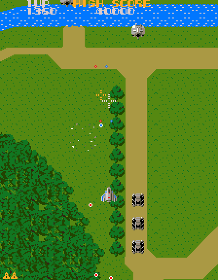

# Super Xevious (Namco, 1984) on the Atari STE



The MAME set **`sxevious`** (Super Xevious, a clone of `xevious`; driver `namco/galaga.cpp` (`xevious_state`), video
`namco/xevious.cpp`, machine `namco/xevious_m.cpp`).  `assets/roms/` has `sxevious.zip` and the device sets
`namco50.zip` ... `namco54.zip` but no `xevious.zip`, so the base game was not ported; the 26 files of
`docs/rom_manifest.json` equal the CRCs and SHA-1s of MAME's `ROM_START( sxevious )`.  Board: three Z80s at 3.072 MHz
(main, sub, sound) on Galaga's board family, the Namco 06XX bus with the **50XX** (a score keeper that Xevious only uses
for a start-up check), the **51XX** (inputs, coins, credits) and the **54XX** (explosion noise), two scrolling tile layers
(background with a pattern ROM logic, foreground characters) and 3-bit sprites.  All three Z80 programs are translated to
68000 code (`tools/gen.py`, `engine/z80x.py`); the 51XX runs its own translated program (`engine/mb88x.py`, as in Galaga);
the 50XX is **simulated** at the register interface for the three commands the game sends; the sound is the Namco WSG's
three voices as the YM2149's square waves and the player's explosion as noise (as in Galaga).  Status: **Experimental** (root README): the logic is exact in lock-step and the picture is exact against the
reference renderer, which equals MAME's picture, but only one explosion sound exists, the picture is drawn by the CPU, and the speed is
low.  Latest speed (Hatari, 4 MB STE, `tools/bench.ps1 3000`, attract mode, 2026-11-07): about 21.5 arcade frames a second
(35% of the arcade's 60.6) and 5.4 pictures a second.

## Build and run

```sh
python port.py prepare xevious                  # checks assets/roms/sxevious.zip, unpacks it (build does it too)
python port.py build xevious                    # run/xevious/XEVIOUS.PRG (ROMs embedded; needs namco51.zip, namco50.zip, namco54.zip)
python port.py build xevious --sim              # run/xevious_sim/XEVIOUS.PRG, the simulator build the tests use
python port.py test xevious                     # prepare, build, lock-step logic test (2 seeds), renderer tests (2 seeds)
python port.py cover xevious [seed]             # coverage: seeds 1-9 (20000 frames), 11-14 and 31-34 (60000 frames)
python port.py mame xevious [frames ...]        # the reference picture against MAME's (needs MAME=...wolfmame-0248/mame.exe)
games/xevious/tools/bench.ps1 3000              # Hatari fast-forward: pictures and arcade frames a second per 250 VBLs
```

Build switches (`tools/build.py -D NAME=VALUE`): `FRAMES=N` (quits after N VBLs), `RATE=N` (counters to `RATE.BIN`),
`DSWA=` / `DSWB=` (the DIP switch bytes: MAME's defaults `$FF` / `$7F`), `MAX_SKIP=` (pictures skipped in a row while the
game is behind, 3), `--invincible` (MAME's cheat as a ROM patch, for the tests of seeds 31+), `--full-selftest` (keeps the
main CPU's boot self-test).  Layout: `src/` the runtime and renderer (`xevious.s`, `render.s`), `tools/` the reference
machine, translation, assets, build and tests, `ref/` coverage, colour samples and the MAME comparison; coverage pickles and
generated files in `build/xevious/`.  Commands run from the repository root.

ROMs: `assets/roms/sxevious.zip`; the MCU programs in `namco50.zip` (`50xx.bin`, crc a0acbaf7), `namco51.zip` (`51xx.bin`,
crc c2f57ef8) and `namco54.zip` (`54xx.bin`, crc ee7357e0).

## Controls

**5** coin, **1/2** start, **cursor keys** move (8 directions), **Space/Ctrl** zapper (fire), **Alt** blaster (bomb),
**Esc** quits.  Jaguar pad / PowerPad (STE enhanced ports, [architecture](../../docs/architecture.md#input-all-ports)): the
D-pad moves, **A / C** fire, **B** bomb, **Option** coin, **Pause** start, keypad **1/2** start, **5** coin, **\*** + **#**
quit.  The second button reaches the program through the DIP switch bank ($6800 bit 0), as on the board.

## State

* The reference (`tools/machine.py`): `ref/mame_cmp_xevious.py` against WolfMAME 0.248 (the pens and the tile code follow
  the 0.286 source; the pictures come from the binary): **0 of 1152 pens and 0 pixels differ** at frames 700, 1000,
  1500, 2200, 3000, 4800, 5600, 6500, 8000, 9500, 11000 and 13000 of the attract mode (scrolling terrain, all sprite sizes
  the demo shows).  The reference's own game follows MAME's RAM for hundreds of frames, then drifts (three Z80s interleaved
  differently): the check is of the renderer and the board's memory map.
* The translation (`tools/logic_test.py`, Musashi against `Xevious.run_frame_port`): **exact** for 8,000 frames of seed 1
  (one player: coin, start, random play, deaths, game over) and of seed 4 (two players), 12,000 frames of seed 32 (MAME's
  invincibility cheat as a ROM patch of both sides: the later areas) and 20,000 frames of seed 31 (the same, before the sound
  check was added).  Compared every frame: the work RAM `$7800-$CFFF` (main CPU's view, the sub CPU's half), the latches, the
  scroll registers, the 51XX's RAM, the sound registers and the YM image; every changed tile RAM block must have been
  marked.  Not lock-stepped: DIP variants (seeds 7-9), seeds 11-14, the build's own timing (the schedule is the reference's).
* The picture (`tools/render_test.py`): 0 of 64,512 pixels differ against `machine.render_raw()` through the colour map at
  every sampled picture (frames 150-3600 of seeds 1, 3 and 31, six consecutive pictures at 400-405), the pixels outside
  the picture area stay black.
* Hatari (F030Arcade's build, 4 MB STE, cycle-exact; `tools/hatari.ps1`: hidden, AUTOPLAY coin / start / pattern, AVI, stills):
  2,500 VBLs, no `CRASH.TXT`; stills show the title, the ready screen, scrolling forest and the area edge, the sprites and
  the foreground text in the right colours.  The autoplay's crude pattern keeps losing Solvalou (the game then reads PLAYER
  ONE / TWO READY), so a long Hatari play with the ship alive and shooting was not looked at.
* Coverage (`ref/cover.py`): CPU1 7,187 translated instructions, CPU2 762, CPU3 555; no unsupported, no missing target.
* Sound (`tools/logic_test.py`): every frame the sound CPU's WSG registers equal the reference's and the YM2149's registers
  equal `tools/sound.py`'s image of them (the model of Galaga's port with Xevious's waveform PROM); not listened to in Hatari
  (`--sound off`), the pitch not compared with MAME's audio.
* Missing, most important first: the 54XX's other noises (only the player's explosion, commands $1x / $2x, is a noise burst, as in Galaga's port; MAME's
  discrete circuit and the ground-target explosions are not modelled); a full natural playthrough; **speed** (below); the Blitter's masked sprite passes of
  `AGENTS.md` (sprites and the foreground are merged by the CPU: `render.s`, `blit_row`); the cocktail flip, a foreground
  scroll and a vertical background scroll other than 0 (the game uses none: `ref/pens.py` saw one value of registers 1-3);
  per-area palettes (one 16-colour fit for all areas); the 54XX's program; the 50XX's own program (translating it needs
  `mb88x` for the MB8842's 128 nibbles of RAM).
* Open: the sound CPU's block is copied in and out around its turns (`g_sound_in` / `g_sound_out`: `$A000-$A0FF`,
  `$A2F0-$A2FF`, `$8028`, `$8571`); the sub CPU's accesses to `$7900-$7FFF` are assumed to stay in that window (coverage:
  `$7900-$7C7F`, `$7F00`).

## How it works

### The board and the reference

`tools/machine.py` follows MAME: ROM `$0000-$3FFF` (own per CPU: 16 KB, 8 KB, 4 KB), DIP switches `$6800-$6807` (one bit
of each bank per address), the sound registers `$6800-$681F` (writes), the LS259 latch `$6820-$6827` (IRQ1, IRQ2, NMI3
off, the reset line of CPU2 / CPU3 and the custom chips), the 06XX at `$7000` / `$7100`, work RAM `$7800-$7FFF`, three
2 KB RAMs with the sprite registers at `+$780` (`$8000`, `$9000`, `$A000`), the tile RAMs `$B000` (foreground attributes),
`$B800` (background attributes), `$C000` (foreground codes), `$C800` (background codes), the scroll / flip latch
`$D000-$D07F` (written by the sub CPU; each register is set by one write: data + A0 << 8), and `$F000-$FFFF`: the
background pattern ROM logic (BS latches written, BB0 / BB1 read: `xevious_bb_r`, three ROMs).  The 50XX, 51XX and 54XX run
their real programs on `engine/mb88.py` behind an exact model of the 06XX's clock edges, as in Galaga.  The picture: 288 x
224, the background map 512 x 256 (scroll x, y; dx -20, dy -16), the foreground map (dx -32, dy -18), 64 sprites with
the pens' transparency in the colour look-up PROM (`$80`), double width / height by flags, the flips of `draw_sprites`.
Colours: three 4-bit PROMs through `0x0E / 0x1F / 0x43 / 0x8F` weights, 128 colours + black; 512 + 512 look-up entries.

### Translation and schedule

`tools/gen.py`: CPU1 `z80x.FAST` (signed), CPU2 and CPU3 `FAST_LONG`; hooks at the frame's stops; static and `(hl)` writes
to the scroll latch and the misc latch call the runtime (`g_vhlatch`, `g_latchw`); the tile RAM writers mark 32-byte blocks
(`vblocks`); the 06XX handler's `ldi` ($0067) records the byte it wrote (`n06_last`).  The boot self-test (630 frames) is
skipped (`ste_rom`: `$015A` jumps to the pass result; block 0's checksum byte compensates), and the boot's clear of the
sound registers is a no-op because the STE keeps the DIP switch cells and the sound registers apart.

The schedule is cooperative (`machine.run_frame_port`, `src/xevious.s`): the main CPU's idle loop (`$044C` waits for the
flag `$8000` its IRQ handler sets) and two boot spin loops (`$02AD`, `$0310`) are the frame's stops; there the sub CPU's
foreground runs to its own idle loop (`$0356`, flag `$8002`) and the sound CPU's boot to `$0098` (their register sets
in `ctx2` / `ctx3`), the 51XX gets its frame (TC high, low), the main CPU's IRQ handler runs if the program enabled it, the
sound CPU's NMI handler twice, the picture is drawn and the next frame awaited.  The 06XX's NMIs run right at the control
write, as often as the program keeps the transfer going (event-driven 51XX, as Galaga; a read started from inside the
handler, the next queued transfer, suppresses its first pulse again: MAME's read stretch).  The shared work RAM
`$7900-$7FFF` lies in both the main and the sub CPU's half of the memory block and is copied at every change of CPU.

### The 50XX

Xevious sends the 50XX only `$10` (reset the scores), `$80` (+5) and `$E5` (+90) and reads four bytes after each, at start-up
(coverage: the six runs that logged it, seeds 21, 22 and 31-34, up to 60,000 frames; 8 reads).  The runtime simulates that (`n50_write`,
`n50_pulse`): the score in BCD, the flags `$F0` when it is not 0, the bytes one a pulse, `$FF` after the fourth.  It is not
the chip: the real program's flags depend on time (MAME's cycle-exact reference reads `$E0` where the reference's schedule
reads `$F0`) and on state the game never reaches.

### The picture

`tools/assets.py`: the arcade raster is shown rotated 90 degrees (display x = 223 - raw y, display line = raw x), 224
pixels wide (chunk 3 of the 320 pixel line), 288 lines; one 16-colour palette fitted to the colours seen
(`ref/pens.py`, `engine/palette_quantize.py`, flat); tiles and sprites in display orientation (`bgt.bin`, `fgt.bin`,
`spt.bin`).  `src/render.s`: the background is a ring of 512 lines (plus 288 behind it) updated from the tile RAM writes
(shadow copies tell the changed cells), the picture is one Blitter copy of 288 lines from `(20 + scroll) & 511`, the
sprites and the foreground are drawn by the CPU row by row (pens' masks from the three bit planes, shifted, merged,
clipped at the picture's edges), the foreground from a list of cells with pixels.

## Speed

Hatari (4 MB, cycle-exact, fast-forward, `tools/bench.ps1`, 2026-11-07; attract mode `MAX_SKIP` 3: 21.5 arcade frames a
second, 5.4 pictures a second).  In the autoplay (play, 2,000 VBLs): `MAX_SKIP` 1: 14 arcade frames, 7 pictures a second; 3:
about 22 and 5.4; 7: 27 and 3.5 (a picture is skipped while a VBL waits, up to `MAX_SKIP` in a row).  The arcade runs 60.6.
Musashi (`render_test.py --entry`): the logic about 175,000 cycles a frame; a picture 0.85-1.1 million: the sprites 480,000
in a busy scene (about 54 tiles, 16 rows each, `blit_row` about 560 cycles a row: the colour conversion is not the cost,
the shifting and merging of five words into two groups of four planes is), the background ring's changed cells 100,000-340,000
(a scroll step rewrites a row of tiles, a new area all of them; 12 million for the first picture), the picture copy 37,000 CPU
cycles plus about 130,000 Blitter bus cycles, the foreground about 50,000.  A cache of converted sprite tiles (tag, mask and
four planes a row) was tried and not kept: no change.
Proposals (nothing was dropped silently): (1) the Blitter's masked sprite passes with shared rows (`AGENTS.md`,
`docs/sprite-preparation.md`) would replace `blit_row` and are the main gain, maybe 2x on the sprites; (2) hardware scrolling
of the ring (no copy, the background shown from the ring itself, sprites drawn into it and restored from a clean ring) saves
the 130,000 bus cycles and most of the ring work but is a redesign; (3) a lower picture rate (`MAX_SKIP` 7: 27 arcade frames a
second, 3.5 pictures) is the cheapest trade and is the user's call; (4) drawing the ground-target sprites and the foreground
every second picture would save about a third of the CPU drawing at some flicker.  The logic (175,000: the translated code,
the copies of the shared RAM windows, the 51XX) leaves 45 arcade frames a second without any picture.

Speed audit (2026-11-08, against `docs/speed.md`; logic 175-182k cycles a frame, a picture 0.85-1.1M; Hatari autoplay 22 arcade
frames and 5.4 pictures a second, `MAX_SKIP` 3):

| Technique | State | Before -> after |
|---|---|---|
| Register maps (`z80x.FAST` / `FAST_LONG`) | applied | - |
| Writer marks for tile RAM (`vwriters`, scroll latch writers) | applied | no RAM comparisons |
| Window guards only at coverage sites | applied (shared RAM windows copied at the stops) | - |
| Leaves in place (`inline_leaves=16`, rst, jumps) | tried, not kept: the lock-step test is no longer exact (the Z80 stack residue at `$CFFC` differs, frame 0); needs the test to ignore dead stack words first | logic unchanged (reverted) |
| Natives at hot routines, `flags_at` at the idle hook | not tried (no routine profile yet) | - |
| Sprite cache of converted tiles | tried, rejected | no change |
| `sprite_programs` / Blitter masked passes (`AGENTS.md`) | **not done: the main gain** | `blit_row` ~560 cycles a row, 480k a busy picture |
| Hardware scroll with twin lines | not done (redesign; saves ~130k bus cycles + most ring work) | - |
| Damage only drawn rows, per-slot cache, contour restores | n.a. today (sprites are drawn from the ring and the picture is copied whole) | - |
| Palette stamps / colour cycling | n.a. (one fixed 16-colour set, no cycling) | - |
| Pictures-per-second schedule (`MAX_SKIP`) | applied; trade is the user's call | 1: 14 / 7, 3: 22 / 5.4, 7: 27 / 3.5 |
| Dropping effects (ground sprites / foreground every second picture) | proposed, not done | ~1/3 of the CPU drawing |

## Tests and tools

`tools/machine.py` (the reference), `tools/gen.py`, `tools/assets.py`, `tools/build.py`, `tools/logic_test.py` (lock-step),
`tools/render_test.py` (renderer, `--shots` writes the build's pictures), `tools/bench.ps1`, `ref/cover.py`, `ref/pens.py`
(the colours seen), `ref/mame_cmp_xevious.py`.  `port.py test xevious` runs them.

## Lessons

* 2026-11-07: **a pure test of the renderer needs the simulator's trace mode on**: the Blitter starts from a write hook, and
  `set_trace_mode(False)` (the lock-step test's speed-up) leaves every Blitter pass undone: the whole background was black.
* 2026-11-07: **the chip reset must run the event-driven 51XX to its main loop** (`latch_w`): the reference lacked that run
  and the first transfer reached a chip at pc 0, so the STE (which ran it) differed by one pulse for good.
* 2026-11-07: **the 06XX handler pops the next queued transfer**: de' is no longer the port's pointer at the end, so the byte
  of a write is taken at the `ldi` itself (`n06_last`), not from de' - 1 as in Galaga.
* 2026-11-07: a hook that clobbers a register of the translated code (the latch hook's `ctx_reset` left `d0` = A = `$FF`)
  shows up as a RAM byte one frame later: the hook saves everything it uses.
* 2026-11-07: the sub CPU writes the scroll registers: a MAME tap on the main CPU alone saw none (`mame_cmp_xevious.py`).
* 2026-11-07: the invincibility cheat patches code: it needs the same patch and a compensating checksum byte in the reference
  (`Xevious(invincible=True)`) and in the build (`--invincible`) or the boot self-check at `$0240` fails (a spin at `$027E`).
* 2026-11-07: random play reaches 2,650 pcs of the main CPU; invincibility (seeds 31-34, 60,000 frames) 6,100.  Infinite
  lives alone (seeds 11-14) did not get past the first areas.

## Verification

Assisted coverage and tests only (random scripted play, MAME's cheats); no natural full-game playthrough, no Hatari
playtest of the picture, no listening test: see the [status policy](../../docs/port-status.md).  No PPO profile.
