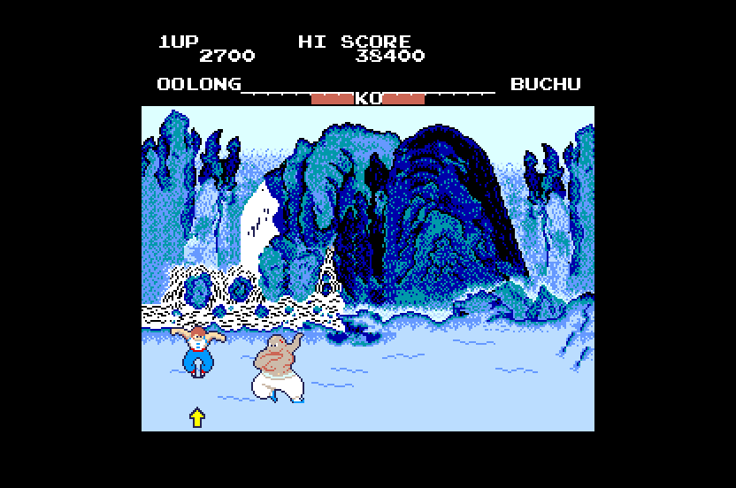

# Yie Ar Kung-Fu (Konami, 1985) on the Atari STE



MAME set `yiear` (version I; Konami GX407, `konami/yiear.cpp`).  The only CPU, a plain MC6809E (32 KB of ROM at $8000,
no encrypted opcodes), is statically translated to 68000 code (`engine/m6809x.py`) and checked against a reference board
in lock-step; its idle point is a native that delivers the eight NMIs and the IRQ of an arcade frame.  The board has no
sound CPU: the main CPU's NMI handler drives an SN76489A and a VLM5030 speech chip, so the SN's tones and noise play on
the STE's YM2149 and the VLM's phrases (rendered offline) on the DMA sound.  The picture is MAME's, 256 x 224, centred in
the 320-pixel screen with the top and bottom borders open, sprites by generated code (`engine/sprite_programs.py`),
exact against the reference in the shown colours; one 16-colour palette by the bounded flat fit, black and 15.
Status: **Incomplete** (logic and picture exact in lock-step with the reference; short Hatari checks only; no
full-game verification, cocktail flip not done).
Speed: 96% of the arcade's rate (58.2 arcade frames a second), 34.2 pictures a second, with the sound (Hatari,
`tools/hatari.ps1 -Sound 1`, 3,000 VBLs of the AUTOPLAY script, DEBUG build, 4 MB, 2026-11-07).

## Build and run

```sh
python port.py cover yiear                  # coverage: ref/cover.py seeds 1-11 (~4 min in parallel)
python port.py build yiear                  # -> run/yiear/YIEAR.PRG
python port.py test yiear                   # lock-step (seeds 1, 3, 9), render (seeds 1, 2), sprite edges
python port.py run yiear shot@30            # Hatari (F030Arcade build), screenshot at 30 s
python games/yiear/tools/prepare.py         # verify assets/roms/yiear.zip, unpack to assets/roms/extracted/yiear/
python games/yiear/tools/build.py           # -> run/yiear/YIEAR.PRG (--sim: run/yiear_sim; --assets: colours and sound again)
python games/yiear/tools/logic_test.py 20000 --seed 3     # the translation in lock-step with the reference
python games/yiear/tools/render_test.py 3000 --seed 1 --start 100 --every 3   # the STE picture against the reference
python games/yiear/tools/sprite_test.py                   # edges, 16 shifts, holes, guards, 64 KB crossings
python games/yiear/ref/mame_cmp_yiear.py [frame ...]      # the reference against MAME (wolfmame-0248, minimized)
powershell -File games/yiear/tools/hatari.ps1 -Frames 2500 -Every 250   # hidden Hatari, AVI stills in run/yiear_hatari
```

Supply `assets/roms/yiear.zip` (MAME's set; `docs/rom_manifest.json` has the ten files' sizes, CRCs and SHA-1s; the
archive's `yiear2` and `yieartf` members are not used).  Nothing ROM-derived is in git: the graphics, colours, the
VLM5030's phrases and the ROM image are made into `build/yiear/` and assembled into the program.  Paths are relative
to this folder; `engine/`, `tools/`, `port.py` and `docs/` at the top are the repository's.

## Controls

**5/6** coin 1 / 2, **1/2** start; move with the **arrows** (up jumps, down ducks), kick with **Z / Space / Control**,
punch with **X / Alternate**, **C** is the board's unused third button, **Esc** quits.  Joystick port 1 player 1, port 0
player 2 (IN2, which the arcade reads only with dual controls or in a cocktail cabinet): the stick moves, fire kicks (a
joystick has no punch button).  Jaguar pad / PowerPad: pad A player 1, pad B player 2, **A** kick, **B** punch, **C**
the third button, **Option** coin, **Pause** start.  DIP switches: MAME's defaults (1 life, upright, bonus 30000 /
80000, normal difficulty, demo sounds on, 1 coin 1 credit); `build.py --dsw2 N --dsw3 N` builds with others.

## State

* **Logic**: exact against the reference's port schedule.  `tools/logic_test.py`: RAM $5000-$5FFF (sprite RAM and
  video RAM in it; the 64 bytes below the stack pointer are dead and left out), the control latch's NMI and IRQ
  enables, every sound write (SN76489A data, VLM5030 control and data) of the frame, the SN's register file and the
  YM's registers against `tools/sound.py`.  Seeds 1 (3,000 and 8,000 frames), 3 (8,000 and 20,000) and 9 (two players, 6,000) pass, and seed 5 (five lives, easy: its
  own build) 12,000: attract, coin, start, random play to game overs and again.  The coverage's DIP seeds 10 and 11
  (dual controls, service mode) were run in the reference only.
* **Picture**: exact in the shown colours.  `tools/render_test.py`: 0 differences in 967 sampled pictures of seed 1's play and of seed 2's (frames 100-3000
  every third) and in 1,425 of seed 2 (frames 300-6000 every fourth); `BLIT_STATS=256`: every pass HOG, the longest 128
  bus cycles, none over 256.  `tools/sprite_test.py`: 148 made-up
  pictures exact (the right edge at every shift, the left edge, holes, flips, overlaps, the guard lines, 64 KB
  crossings, 60 pictures in a row with moving sprites and changing tiles).  The reference equals MAME (How it works).
* **Sound**: the SN's registers and the YM's follow the model every frame; the VLM phrases start on the DMA sound at
  ST's fall and stop at RST's rise (Hatari with sound, `hatari.ps1 -Sound 1`: the AVI's audio track is silent for the 11 s of attract mode before the coin
  and then has tones, noise and speech, the dominant frequencies of its half-second windows 100-1,700 Hz; no listening
  comparison with the arcade was made).
* **Hatari** (F030Arcade build, STE, 4 MB, TOS 2.06, 2,500 and 3,000 VBLs of the AUTOPLAY script: coin, start, moves and
  kicks): attract, the "next opponent" screen, the fight with Buchu, game over; no crash, late border events 0,
  border fallbacks 2.
* Not done, most important first: a full-game playthrough (the coverage's random play reaches the first opponents
  only: the later ones, the high-score entry and the bonus stages are translated from the program but not exercised);
  the cocktail flip (control bit 0: the reference stops at it); the VLM's real time (below); the service mode's screens
  are covered by one seed only.

## How it works

### The board and the reference

`tools/machine.py` follows MAME's `konami/yiear.cpp`: the MC6809E at 1.536 MHz, 60.6 Hz; the IRQ at the VBLANK (line
240) while control bit 2 is 1, an NMI every 32 lines from line 16 (eight a frame, the music tempo) while bit 1 is 1
(the game toggles the bit to take the next one: the 6809's NMI is an edge); RAM $5000-$5FFF (the two sprite RAMs, the
video RAM $5800-$5FFF: 32 x 32 cells of attribute and code), ROM $8000-$FFFF, the inputs $4C00-$4E03, the SN76489A
through a latch ($4800 / $4900), the VLM5030 ($4A00 control: ST, RST; $4B00 data; $0000 BSY).  24 sprites of 16 x 16
(the 18 documented plus six), drawn from the last to the first; sprite pen 0 transparent; a 32-entry palette PROM
(pens 0-15 the sprites', 16-31 the tiles').

`ref/mame_cmp_yiear.py` (2026-11-07, wolfmame-0248; one run of `engine/mame_frames.lua` dumps $5000-$5FFF, the screen
and the pens at frames 60-3600): **0 of 32 pens and 0 pixels differ** at all eight frames.  Two differences from the
authoritative 0.286 source are noted: its palette code weighs the blue bits 0x52 / 0xAD (the port uses them), the 0.248
binary 0x47 / 0x97 (red and green agree), so the compare uses the binary's blue; and the reference's *logic* from
power-on is not MAME's to the cycle: the boot RAM test runs as MAME's does up to a constant offset of about 2,900 CPU
cycles that was fitted (`machine.SKEW`), and from frame 900 the attract mode's sprite RAM differs from MAME's (a
stack's few bytes differ earlier).  The port does not depend on this: its schedule is its own (below), and the check
that matters for the picture, MAME's memory through the reference renderer, is exact.

### Translation

`tools/gen.py`: the 6809's 64 KB are one block (`ya_mem`: RAM, video RAM and the ROM at their addresses), so every
slot's base is the same and an indexed access needs no slot; direct page $51 (the program sets it with `TFR A,DP`).  The
sites the coverage saw touch the I/O ($0000, $4000-$4FFF) go through `main_io_r` / `main_io_w`; the video RAM is plain
memory (the renderer compares it with what it drew).  Every slot holds one page for good, so no jump, call or return
checks a page (`fixed_slots`); the 68030 forms run (`fast_forms`), a call's live flags come from its callee's summary
(`call_summaries`).  7,751 instructions, none unsupported.  The boot self-test (a 65,536-iteration loop, the RAM test,
a ROM checksum: ~160 frames) is run once in Python up to the `JMP $8000` and the 68000 program starts there with the
registers and the RAM it leaves (`yiear.img`, `start_info.s`: the RAM depends on the DIP switches, so `build.py
--dsw2` makes its own image).

### Schedule

The port (`machine.YieArPort`, `src/yiear.s`): the foreground is a task loop ($807C: LDX <$DA; LDD ,X; ASLA; BCS: the
queue at $52C0, an empty entry has bit 7); the IRQ handler ($897D) plays the game and queues tasks; the NMI handler
($C78E) is the sound driver's tick.  The idle point $807C with an empty queue is a native (`ya_idle`, gen.py NATIVES):
it first delivers the eight NMIs of the frame just played, one visit each (each NMI's queued tasks run before the next),
then draws the picture when due, waits for the next arcade frame, counts the VLM's BSY down and delivers the IRQ with
$807C as its return address; an RTI comes back there.  Six arcade frames to five VBLs; MAX_SKIP 3.  The arcade's NMIs
and IRQ can come at any point of the foreground; here they come at the idle point (the reference has the same
schedule), as in Track & Field.

The VLM5030's BSY has no time between frames to count in: it rises with ST, falls RST-reset at once, else a phrase's
length in arcade frames after ST falls (`tools/vlm_frames.py`: the samples `engine/vlm5030.py` makes of it).  The
reference's BSY and the runtime's are the same function of the frame count.

### Picture

(After Mario Bros.' `render.s`, which is Track & Field's.)

* **The playfield**: the 32 x 32 tilemap (256 x 256 pixels) in STE planes, 128 bytes a line; it never scrolls.  A cell
  whose attribute or code changed against `tile_vram` (a compare of the 2 KB a picture, 512 longs) is converted on
  first use per (code, flips) into a tile cache (a long a row; all 2,048 keys fit) and written with movep.l.
* **Rows**: a tile row is copied from the playfield into a buffer only when a cell of it changed, the buffer never held
  it, or the buffer's last sprites covered it (only their 16-pixel groups then): one HOG pass per plane and line.
* **Sprites**: baked on first use per (code, flips) into a cache slot; generated code (`tools/assets.py`) for the
  coverage's 402 shapes (5,357 routines, 507 KB of end mask streams), the row path for the others and 64 KB crossings
  ([sprite-preparation.md](../../docs/sprite-preparation.md)).  The first 19 entries are drawn a line lower (MAME's
  `sy++`).  Clipped at the group-aligned edges (screen x 32 and 288; x is a byte, so only the right edge is crossed),
  whole into 16 guard lines above and below.
* **Colours**: black and 15 by `engine/palette_quantize.py`'s bounded flat fit to the coverage's pens (sprites and tiles
  counted apart), one STE index per PROM pen; mean error 0.7 levels a channel (the worst pen, a green used for a few
  pixels, 150).

### Sound

The SN76489A (1.536 MHz): `src/sound.s` keeps its register file from the writes (`snd_sn_w`, as MAME's
`sn76496_base_device::write`) and once an arcade frame `snd_ym` puts its four voices on the YM2149's three channels: the
three loudest, a voice keeping its YM channel while chosen (Mr. Do!'s method as in Track & Field); a tone's period N
becomes N x 4,000,000 / 1,536,000, the noise the YM noise period for the SN's shift rate, the attenuation (2 dB steps)
the YM level.  The VLM5030's phrases the coverage started (`ref/cover.py` `phrases`) are rendered by `engine/vlm5030.py`
(8,135 Hz), resampled to 12,517 Hz, 8 bits, mono, and start on the DMA sound when ST falls; RST rising while busy
stops it (the NMI handler's speech start, $C8BE, sets RST first, which resets the chip: the old phrase is cut as on the
board).  Not done: the YM / DMA balance is a guess, the SN's periodic noise plays as white noise, a phrase's BSY is its
length in arcade frames, not the chip's cycle-exact time.

## Speed

| Date | Setup | Logic | Pictures | Musashi cycles |
|---|---|---|---|---|
| 2026-11-07 | Hatari, `tools/hatari.ps1 -Frames 3000 -Sound 1` (AUTOPLAY: coin, start, moves and kicks), DEBUG build, 4 MB | 96%, 58.2 arcade frames a second | 34.2 a second (2,052 of 3,001 VBLs) | |
| 2026-11-07 | the same without sound (2,500 VBLs, an earlier build) | 96%, 57.8 | 32.6 | |
| 2026-11-07 | Musashi, `render_test.py 3000 --seed 1 --start 100 --every 3` (and seed 2) | | | logic with the sound 48.6k an arcade frame (seed 2: 48.2k; `logic_test.py`: 52-60k over 3,000-8,000 frames); a picture 78.9k CPU + 24.5k Blitter bus cycles (seed 2: 76.5k + 21.2k) |

The logic is cheap (the whole IRQ handler plus eight NMIs is ~4,100 + 8 x 240 6809 cycles of 25,344); a picture is the
cost.  What went into it: the playfield compare scans the 2 KB of video RAM every picture (512 longs); a screen change
converts and draws its changed tiles once (first use per tile and flips).  Nothing was optimized beyond what Mario Bros.' and
Track & Field's renderer already do; the pictures a second are the 50 Hz VBLs' share left after the logic.

Measured, not kept: nothing.

Techniques other ports use that may apply:
[speed.md](../../docs/speed.md#techniques-that-look-applicable-elsewhere-2026-11-07).

## Tests and tools

* `tools/logic_test.py N --seed S`: lock-step against the reference (the compared state: State); the logic's Musashi
  cycles an arcade frame.  Seeds 5-8, 10 and 11 need their own build (`build.py --sim --tag yiear_sim5 --dsw2 0x78`, run
  with `--tag yiear_sim5`).
* `tools/render_test.py N --seed S --start F [--every K]`: the STE picture against the reference, with cycles.
* `tools/sprite_test.py`: made-up pictures (edges, 16 shifts, holes, flips, overlaps, guards, 64 KB).
* `tools/hatari.ps1`: hidden Hatari with the AUTOPLAY script (coin, start, moves and kicks; period 4,000 frames), the
  AVI and stills.
* `ref/cover.py SEED N`: the coverage; `ref/mame_cmp_yiear.py`: the reference against MAME.
* `tools/vlm_frames.py`, `tools/sound.py`, `tools/sndgen.py`: the VLM's busy table, the SN / YM model, the sound
  assets.

## Lessons

* **Coverage must include the init**: the first coverage object was created after the boot reached the idle point, so
  the init code ($8000-$807C) was not covered, its `STB $4000` became a plain store and the control latch never
  changed; the lock-step test found it at frame -1.  Start the coverage right after the self-test.
* **A spin on the VLM's BSY**: the NMI handler waits at $C8C5 until BSY is low before it starts a phrase; with a
  frame-counted BSY that loop never ends.  The cause was a missing rule: RST rising while BSY resets the chip, so BSY is
  already low there.
* **The self-test is the DIP switches' too**: the RAM it leaves depends on the DIP switches, so a build with others
  needs its own image.
* **Windows**: a scratch script named `dis.py` shadows the standard library's (it broke `import inspect` inside numpy).

## Verification

No playtest beyond the AUTOPLAY script in Hatari (coin, start, moves and kicks: the first opponent, a game over) and the
lock-step seeds' random play; the later opponents are not reached by either.

Full-game verification follows the [status policy](../../docs/port-status.md); nothing here claims a complete playthrough.
